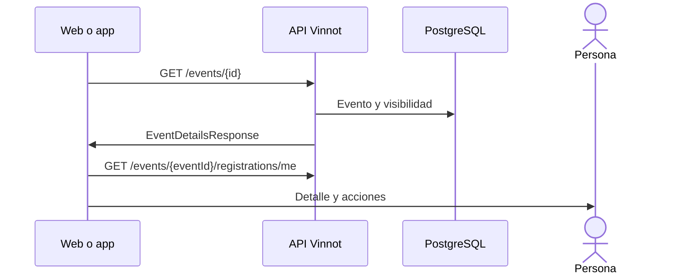

# UC-EVT-02 · Ver el detalle de un evento

| Campo | Valor |
|---|---|
| ID | `UC-EVT-02` |
| Módulo | [Eventos y entradas](../README.md) |
| Plataformas | Web, APK |
| Actores | Usuario autenticado |
| IDs en Lucidchart | [WEB UC-EVT-02](https://lucid.app/lucidchart/9f11a16b-bb5a-42fc-a9e8-0852b17bd241/edit), [APK UC-EVT-02](https://lucid.app/lucidchart/e095dd25-e8ac-41ba-bf5b-396e1055f217/edit) |
| Requisitos | [`RF-WEB-EVT-05`](../requirements.md), [`RF-WEB-EVT-06`](../requirements.md), [`RF-WEB-EVT-07`](../requirements.md), [`RF-APK-EVT-05`](../requirements.md), [`RF-APK-EVT-06`](../requirements.md), [`RF-APK-EVT-07`](../requirements.md) |
| Casos de prueba | [`CP-EVT-07`](../testing.md), [`CP-EVT-08`](../testing.md), [`CP-EVT-09`](../testing.md), [`CP-EVT-10`](../testing.md), [`CP-EVT-46`](../testing.md) |

## Precondiciones

- La persona tiene sesión iniciada y abre un evento desde un listado, un enlace o un aviso.

## Postcondiciones

- La persona ve el evento y las acciones disponibles.

## Flujo principal

1. El cliente pide `GET /events/{id}`.
2. La API devuelve el evento si ya se publicó alguna vez y no es un borrador.
3. El cliente muestra imagen, descripción, fecha, lugar, precio, cupos y el organizador con su nombre, email y teléfono si los cargó.
4. Ofrece abrir la ubicación en mapas, compartir el evento si tiene página pública y denunciarlo.
5. Si la persona ya tiene una inscripción, el cliente la consulta con `GET /events/{eventId}/registrations/me` y muestra su estado en «Tu inscripción». Al inscribirse en un evento con teléfono o email de contacto, «Tu inscripción» ofrece «Contactar al organizador» por WhatsApp o email.

## Flujos alternativos

- 2a. El evento es un borrador o nunca se publicó y quien consulta no es el organizador, un moderador ni un administrador: la API responde 404.
- 2b. El evento fue cancelado o terminó: se sigue mostrando con su estado, sin inscripción.
- 4a. Faltan datos del organizador o de ubicación: no se muestran o no se ofrece esa acción.
- 4b. El evento no tiene página pública, porque es un borrador o se canceló sin haberse publicado: no se ofrece compartir.

## Reglas de negocio

- Los enlaces a eventos ya publicados siguen funcionando después de cancelarse o terminar.
- La denuncia sigue las reglas de [Comunidad](../../community/README.md); el organizador no ve la acción en su propio evento.
- Compartir genera el enlace público del evento ([Compartir](../../sharing/README.md)); solo se ofrece cuando el evento ya se publicó y no es un borrador.

## Diagrama

[Ver diagrama de «UC-EVT-02 · Ver el detalle de un evento» completo](https://images.vinnot.com/docs/diagrams/v1/es/modules-events-use-cases-uc-evt-02-view-event-f861916c6662.svg)

Diagrama de componentes en Lucidchart: [WEB UC-EVT-02](https://lucid.app/lucidchart/9f11a16b-bb5a-42fc-a9e8-0852b17bd241/edit), [APK UC-EVT-02](https://lucid.app/lucidchart/e095dd25-e8ac-41ba-bf5b-396e1055f217/edit).

## Código

| Capa | Ubicación |
|---|---|
| Endpoints | `GET /events/{id}` |
| Backend | [`EventController.java`](../../../../../backend/src/main/java/com/vinnot/event/infrastructure/web/controller/EventController.java), [`GetEventByIdQueryHandler.java`](../../../../../backend/src/main/java/com/vinnot/event/application/query/handler/GetEventByIdQueryHandler.java) |
| Web | [`EventDetailsPage.tsx`](../../../../../frontend-react/src/presentation/pages/events/EventDetailsPage.tsx), [`EventDetailsSidebar.tsx`](../../../../../frontend-react/src/presentation/pages/events/EventDetailsSidebar.tsx), [`useEventDetailsViewModel.ts`](../../../../../frontend-react/src/presentation/pages/events/useEventDetailsViewModel.ts), [`EventDetailsHero.tsx`](../../../../../frontend-react/src/presentation/pages/events/EventDetailsHero.tsx), [`useEvent.ts`](../../../../../frontend-react/src/presentation/hooks/queries/event/useEvent.ts), [`events.service.ts`](../../../../../frontend-react/src/application/services/events.service.ts), [`events.client.ts`](../../../../../frontend-react/src/infrastructure/api/clients/events.client.ts) |
| App | [`EventDetailScreen.tsx`](../../../../../frontend-mobile/src/presentation/features/event/EventDetailScreen.tsx), [`ReserveCTA.tsx`](../../../../../frontend-mobile/src/presentation/features/event/ReserveCTA.tsx), [`useEventDetailViewModel.ts`](../../../../../frontend-mobile/src/presentation/features/event/useEventDetailViewModel.ts), [`EventDetailHero.tsx`](../../../../../frontend-mobile/src/presentation/features/event/EventDetailHero.tsx), [`events.service.ts`](../../../../../frontend-mobile/src/application/services/events.service.ts), [`events.client.ts`](../../../../../frontend-mobile/src/infrastructure/api/clients/events.client.ts) |

## Tests automáticos

- Backend: [`GetEventByIdQueryHandlerTest.java`](../../../../../backend/src/test/java/com/vinnot/event/application/query/handler/GetEventByIdQueryHandlerTest.java)
- Web: [`EventDetailsPage.test.tsx`](../../../../../frontend-react/src/presentation/pages/events/EventDetailsPage.test.tsx), [`EventDetailsHero.test.tsx`](../../../../../frontend-react/src/presentation/pages/events/EventDetailsHero.test.tsx), [`EventDetailsSidebar.test.tsx`](../../../../../frontend-react/src/presentation/pages/events/EventDetailsSidebar.test.tsx), [`useEventDetailsViewModel.test.tsx`](../../../../../frontend-react/src/presentation/pages/events/useEventDetailsViewModel.test.tsx), [`publicContent.test.ts`](../../../../../frontend-react/src/domain/sharing/publicContent.test.ts), [`event.mappers.test.ts`](../../../../../frontend-react/src/domain/event/event.mappers.test.ts)
- App: [`eventDetailRoute.test.tsx`](../../../../../frontend-mobile/src/presentation/features/event/__tests__/eventDetailRoute.test.tsx), [`shareability.test.ts`](../../../../../frontend-mobile/src/domain/sharing/shareability.test.ts), [`event.mappers.test.ts`](../../../../../frontend-mobile/src/domain/event/event.mappers.test.ts)
