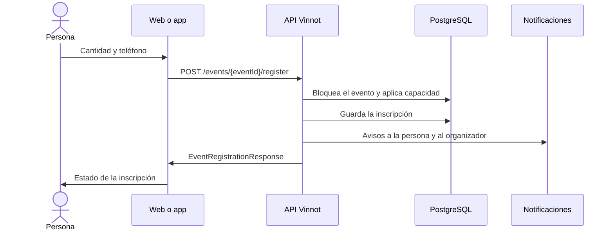

# UC-EVT-03 · Inscribirse en un evento

| Campo | Valor |
|---|---|
| ID | `UC-EVT-03` |
| Módulo | [Eventos y entradas](../README.md) |
| Plataformas | Web, APK |
| Actores | Usuario autenticado, Organizador |
| IDs en Lucidchart | [WEB UC-EVT-03](https://lucid.app/lucidchart/9f11a16b-bb5a-42fc-a9e8-0852b17bd241/edit), [APK UC-EVT-03](https://lucid.app/lucidchart/e095dd25-e8ac-41ba-bf5b-396e1055f217/edit) |
| Requisitos | [`RF-WEB-EVT-08`](../requirements.md), [`RF-WEB-EVT-09`](../requirements.md), [`RF-WEB-EVT-10`](../requirements.md), [`RF-WEB-EVT-11`](../requirements.md), [`RF-WEB-EVT-12`](../requirements.md), [`RF-APK-EVT-08`](../requirements.md), [`RF-APK-EVT-09`](../requirements.md), [`RF-APK-EVT-10`](../requirements.md), [`RF-APK-EVT-11`](../requirements.md), [`RF-APK-EVT-12`](../requirements.md) |
| Casos de prueba | [`CP-EVT-11`](../testing.md), [`CP-EVT-12`](../testing.md), [`CP-EVT-13`](../testing.md), [`CP-EVT-14`](../testing.md), [`CP-EVT-15`](../testing.md), [`CP-EVT-16`](../testing.md), [`CP-EVT-17`](../testing.md), [`CP-EVT-18`](../testing.md), [`CP-EVT-19`](../testing.md), [`CP-EVT-20`](../testing.md) |

## Precondiciones

- La persona tiene sesión iniciada y el evento está `PUBLISHED` o `SOLD_OUT`.

## Postcondiciones

- La persona tiene una inscripción con su estado real.

## Flujo principal

1. La persona elige «Inscribirme» en el detalle del evento.
2. El cliente pide la cantidad de entradas, hasta el máximo por solicitud del evento, y un teléfono de contacto; nombre y email salen de la cuenta.
3. La persona puede guardar el teléfono en su perfil y ve el total a pagar si el evento es pago.
4. La persona confirma con «Continuar al pago» si el evento es pago, «Enviar solicitud» si la aprobación es manual o «Confirmar inscripción» en los demás casos, y el cliente envía `POST /events/{eventId}/register` con la cantidad, el contacto y el idioma de los avisos.
5. La API bloquea el evento, comprueba que la inscripción esté abierta y que la persona no tenga otra activa, y aplica la capacidad.
6. La API guarda la inscripción con el estado que corresponde y avisa a la persona y al organizador ([UC-EVT-09](uc-evt-09-attendee-notices.md)).
7. El cliente muestra el estado: solicitada, en espera, esperando pago, esperando confirmación o confirmada.

## Flujos alternativos

- 5a. La inscripción cerró o el evento no está disponible: la API responde 400 `REGISTRATION_CLOSED` o `EVENT_NOT_AVAILABLE`.
- 5b. La persona ya tiene una inscripción activa: la API responde 422 `EVENT_ALREADY_REGISTERED`.
- 5c. La cantidad supera el máximo por solicitud: la API responde `REGISTRATION_LIMIT_EXCEEDED`.
- 5d. No hay cupo: la inscripción queda `WAITLISTED`.
- 6a. El evento es pago: la inscripción queda `AWAITING_PAYMENT` con una reserva de cupo y la persona paga ([Pagos](../../payments/README.md)).
- 6b. Evento gratuito con confirmación de asistencia: queda `AWAITING_ATTENDEE_CONFIRMATION` con reserva ([UC-EVT-04](uc-evt-04-confirm-attendance.md)).
- 6c. Evento gratuito con aprobación automática y sin confirmación: queda `CONFIRMED`.
- 6d. Evento con aprobación manual: queda `REQUESTED` hasta que el organizador la revise ([Partners](../../partner/README.md)).
- 1a. La persona no tiene sesión: la app la lleva a iniciar sesión y vuelve al evento.

## Reglas de negocio

- Una sola inscripción activa por persona y evento; quien se inscribe sale de la sesión, no de un dato editable.
- Cada solicitud admite de 1 a 20 entradas, dentro del máximo del evento (6 por defecto).
- La inscripción cierra en la fecha límite del evento, y nunca después de su inicio.
- Confirmadas y reservas nunca superan la capacidad; al llegar al límite el evento pasa a `SOLD_OUT`.
- Una inscripción en espera no asciende sola cuando se libera un cupo.
- El estado de la inscripción y el del pago son independientes.

## Diagrama

[Ver diagrama de «UC-EVT-03 · Inscribirse en un evento» completo](https://images.vinnot.com/docs/diagrams/v1/es/modules-events-use-cases-uc-evt-03-register-for-event-5ff0fdd1071f.svg)

Diagrama de componentes en Lucidchart: [WEB UC-EVT-03](https://lucid.app/lucidchart/9f11a16b-bb5a-42fc-a9e8-0852b17bd241/edit), [APK UC-EVT-03](https://lucid.app/lucidchart/e095dd25-e8ac-41ba-bf5b-396e1055f217/edit).

## Código

| Capa | Ubicación |
|---|---|
| Endpoints | `POST /events/{eventId}/register`, `GET /events/{eventId}/registrations/me` |
| Backend | [`EventController.java`](../../../../../backend/src/main/java/com/vinnot/event/infrastructure/web/controller/EventController.java), [`RegisterForEventCommandHandler.java`](../../../../../backend/src/main/java/com/vinnot/event/application/command/handler/RegisterForEventCommandHandler.java), [`EventRegistration.java`](../../../../../backend/src/main/java/com/vinnot/event/domain/model/EventRegistration.java), [`EventCapacity.java`](../../../../../backend/src/main/java/com/vinnot/event/domain/valueobject/EventCapacity.java), [`EventRegistrationSettings.java`](../../../../../backend/src/main/java/com/vinnot/event/domain/valueobject/EventRegistrationSettings.java) |
| Web | [`EventDetailsPage.tsx`](../../../../../frontend-react/src/presentation/pages/events/EventDetailsPage.tsx), [`EventDetailsSidebar.tsx`](../../../../../frontend-react/src/presentation/pages/events/EventDetailsSidebar.tsx), [`useEventDetailsViewModel.ts`](../../../../../frontend-react/src/presentation/pages/events/useEventDetailsViewModel.ts), [`EventRegistrationModal.tsx`](../../../../../frontend-react/src/presentation/pages/events/EventRegistrationModal.tsx), [`useEventRegistrationForm.ts`](../../../../../frontend-react/src/presentation/pages/events/useEventRegistrationForm.ts), [`useRegisterForEvent.ts`](../../../../../frontend-react/src/presentation/hooks/queries/event/useRegisterForEvent.ts), [`events.service.ts`](../../../../../frontend-react/src/application/services/events.service.ts), [`events.client.ts`](../../../../../frontend-react/src/infrastructure/api/clients/events.client.ts) |
| App | [`EventDetailScreen.tsx`](../../../../../frontend-mobile/src/presentation/features/event/EventDetailScreen.tsx), [`ReserveCTA.tsx`](../../../../../frontend-mobile/src/presentation/features/event/ReserveCTA.tsx), [`useEventDetailViewModel.ts`](../../../../../frontend-mobile/src/presentation/features/event/useEventDetailViewModel.ts), [`EventRegistrationSheet.tsx`](../../../../../frontend-mobile/src/presentation/features/event/EventRegistrationSheet.tsx), [`useEventRegistrationForm.ts`](../../../../../frontend-mobile/src/presentation/features/event/useEventRegistrationForm.ts), [`events.service.ts`](../../../../../frontend-mobile/src/application/services/events.service.ts), [`events.client.ts`](../../../../../frontend-mobile/src/infrastructure/api/clients/events.client.ts) |

## Tests automáticos

- Backend: [`RegisterForEventCommandHandlerTest.java`](../../../../../backend/src/test/java/com/vinnot/event/application/command/handler/RegisterForEventCommandHandlerTest.java), [`EventRegistrationTest.java`](../../../../../backend/src/test/java/com/vinnot/event/domain/model/EventRegistrationTest.java), [`EventCapacityTest.java`](../../../../../backend/src/test/java/com/vinnot/event/domain/valueobject/EventCapacityTest.java), [`EventRegistrationSettingsTest.java`](../../../../../backend/src/test/java/com/vinnot/event/domain/valueobject/EventRegistrationSettingsTest.java), [`FreeEventRegistrationPostgresIntegrationTest.java`](../../../../../backend/src/test/java/com/vinnot/event/infrastructure/FreeEventRegistrationPostgresIntegrationTest.java)
- Web: [`EventRegistrationModal.test.tsx`](../../../../../frontend-react/src/presentation/pages/events/EventRegistrationModal.test.tsx), [`useEventRegistrationForm.test.ts`](../../../../../frontend-react/src/presentation/pages/events/useEventRegistrationForm.test.ts), [`useEventRegistration.test.tsx`](../../../../../frontend-react/src/presentation/hooks/queries/event/useEventRegistration.test.tsx)
- App: [`EventRegistrationSheet.test.tsx`](../../../../../frontend-mobile/src/presentation/features/event/EventRegistrationSheet.test.tsx), [`useEventRegistrationForm.test.ts`](../../../../../frontend-mobile/src/presentation/features/event/useEventRegistrationForm.test.ts), [`ReserveCTA.test.tsx`](../../../../../frontend-mobile/src/presentation/features/event/ReserveCTA.test.tsx)
