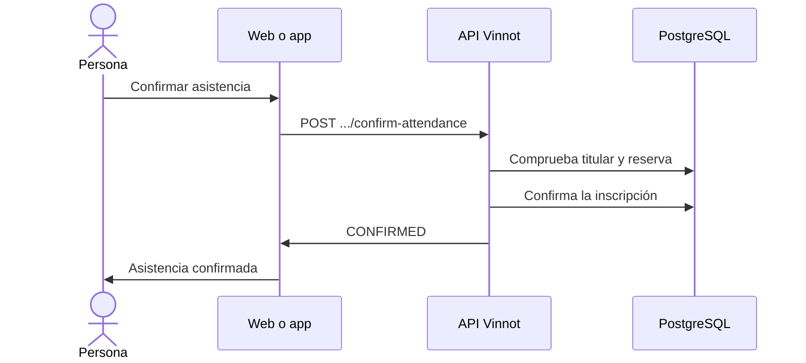

# UC-EVT-04 · Confirmar la asistencia

| Campo | Valor |
|---|---|
| ID | `UC-EVT-04` |
| Módulo | [Eventos y entradas](../README.md) |
| Plataformas | Web, APK |
| Actores | Usuario autenticado |
| IDs en Lucidchart | [WEB UC-EVT-04](https://lucid.app/lucidchart/9f11a16b-bb5a-42fc-a9e8-0852b17bd241/edit), [APK UC-EVT-04](https://lucid.app/lucidchart/e095dd25-e8ac-41ba-bf5b-396e1055f217/edit) |
| Requisitos | [`RF-WEB-EVT-13`](../requirements.md), [`RF-APK-EVT-13`](../requirements.md) |
| Casos de prueba | [`CP-EVT-21`](../testing.md), [`CP-EVT-22`](../testing.md), [`CP-EVT-23`](../testing.md), [`CP-EVT-24`](../testing.md) |

## Precondiciones

- La persona tiene una inscripción `AWAITING_ATTENDEE_CONFIRMATION` con la reserva vigente.

## Postcondiciones

- La inscripción queda `CONFIRMED` y la reserva pasa a cupo confirmado.

## Flujo principal

1. La persona abre el evento y ve que debe confirmar su asistencia antes de la fecha indicada.
2. Elige «Confirmar asistencia».
3. El cliente envía `POST /events/registrations/{registrationId}/confirm-attendance`.
4. La API comprueba que la inscripción sea de la persona, que esté esperando confirmación y que la reserva no haya vencido.
5. La API confirma la inscripción y devuelve el nuevo estado.

## Flujos alternativos

- 4a. La reserva venció: la API responde 400 `REGISTRATION_HOLD_EXPIRED`.
- 4b. La inscripción está en otro estado: la API responde 400 `INVALID_REGISTRATION_TRANSITION`.
- 4c. La inscripción es de otra persona: la API la rechaza.

## Reglas de negocio

- La reserva dura lo que define el evento (1440 minutos por defecto, entre 5 y 10080).
- Una reserva sin confirmar vence sola ([UC-EVT-08](uc-evt-08-event-lifecycle.md)).

## Diagrama

[Ver diagrama de «UC-EVT-04 · Confirmar la asistencia» completo](https://images.vinnot.com/docs/diagrams/v1/es/modules-events-use-cases-uc-evt-04-confirm-attendance-536c7bdecba8.svg)

Diagrama de componentes en Lucidchart: [WEB UC-EVT-04](https://lucid.app/lucidchart/9f11a16b-bb5a-42fc-a9e8-0852b17bd241/edit), [APK UC-EVT-04](https://lucid.app/lucidchart/e095dd25-e8ac-41ba-bf5b-396e1055f217/edit).

## Código

| Capa | Ubicación |
|---|---|
| Endpoints | `POST /events/registrations/{registrationId}/confirm-attendance` |
| Backend | [`EventController.java`](../../../../../backend/src/main/java/com/vinnot/event/infrastructure/web/controller/EventController.java), [`ConfirmEventAttendanceCommandHandler.java`](../../../../../backend/src/main/java/com/vinnot/event/application/command/handler/ConfirmEventAttendanceCommandHandler.java), [`EventRegistration.java`](../../../../../backend/src/main/java/com/vinnot/event/domain/model/EventRegistration.java) |
| Web | [`EventDetailsPage.tsx`](../../../../../frontend-react/src/presentation/pages/events/EventDetailsPage.tsx), [`EventDetailsSidebar.tsx`](../../../../../frontend-react/src/presentation/pages/events/EventDetailsSidebar.tsx), [`useEventDetailsViewModel.ts`](../../../../../frontend-react/src/presentation/pages/events/useEventDetailsViewModel.ts), [`events.service.ts`](../../../../../frontend-react/src/application/services/events.service.ts), [`events.client.ts`](../../../../../frontend-react/src/infrastructure/api/clients/events.client.ts) |
| App | [`EventDetailScreen.tsx`](../../../../../frontend-mobile/src/presentation/features/event/EventDetailScreen.tsx), [`ReserveCTA.tsx`](../../../../../frontend-mobile/src/presentation/features/event/ReserveCTA.tsx), [`useEventDetailViewModel.ts`](../../../../../frontend-mobile/src/presentation/features/event/useEventDetailViewModel.ts), [`events.service.ts`](../../../../../frontend-mobile/src/application/services/events.service.ts), [`events.client.ts`](../../../../../frontend-mobile/src/infrastructure/api/clients/events.client.ts) |

## Tests automáticos

- Backend: [`EventRegistrationLifecycleHandlersTest.java`](../../../../../backend/src/test/java/com/vinnot/event/application/command/handler/EventRegistrationLifecycleHandlersTest.java), [`EventRegistrationTest.java`](../../../../../backend/src/test/java/com/vinnot/event/domain/model/EventRegistrationTest.java)
- Web: [`EventDetailsSidebar.test.tsx`](../../../../../frontend-react/src/presentation/pages/events/EventDetailsSidebar.test.tsx)
- App: [`ReserveCTA.test.tsx`](../../../../../frontend-mobile/src/presentation/features/event/ReserveCTA.test.tsx)
