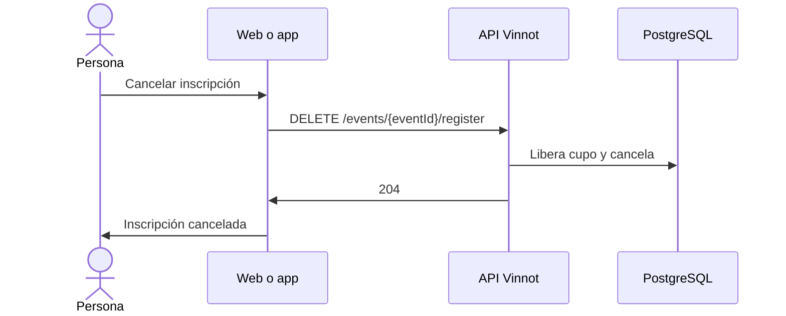

# UC-EVT-05 · Cancelar la inscripción propia

| Campo | Valor |
|---|---|
| ID | `UC-EVT-05` |
| Módulo | [Eventos y entradas](../README.md) |
| Plataformas | Web, APK |
| Actores | Usuario autenticado |
| IDs en Lucidchart | [APK UC-EVT-05](https://lucid.app/lucidchart/e095dd25-e8ac-41ba-bf5b-396e1055f217/edit), [WEB UC-EVT-08](https://lucid.app/lucidchart/9f11a16b-bb5a-42fc-a9e8-0852b17bd241/edit) |
| Requisitos | [`RF-WEB-EVT-14`](../requirements.md), [`RF-APK-EVT-14`](../requirements.md) |
| Casos de prueba | [`CP-EVT-25`](../testing.md), [`CP-EVT-26`](../testing.md), [`CP-EVT-27`](../testing.md), [`CP-EVT-28`](../testing.md) |

## Precondiciones

- La persona tiene una inscripción que no está cancelada, rechazada ni vencida.

## Postcondiciones

- La inscripción queda `CANCELLED` y su cupo o reserva se libera.

## Flujo principal

1. La persona abre el evento y, en «Tu inscripción», elige «Cancelar inscripción».
2. El cliente pide confirmación.
3. El cliente envía `DELETE /events/{eventId}/register`.
4. La API libera la reserva o el cupo confirmado y marca la inscripción como `CANCELLED`.
5. El cliente muestra el nuevo estado; la web avisa «Inscripción cancelada».

## Flujos alternativos

- 2a. La persona vuelve atrás: no se cancela nada.
- 4a. La inscripción está confirmada y se pagó en línea: la API responde 422 `PAID_REGISTRATION_REQUIRES_ORGANIZER`; la cancelación y la devolución las gestiona el organizador. La app explica que hay que contactar al organizador; la web muestra «No pudimos cancelar la inscripción».
- 4b. La inscripción ya terminó: la API responde 400 `INVALID_REGISTRATION_TRANSITION`.

## Reglas de negocio

- Cancelar una inscripción no borra el evento.
- Cancelar por cuenta propia no inicia una devolución.
- La acción solo aparece mientras la inscripción no está cancelada, rechazada ni vencida.

## Diagrama

[Ver diagrama de «UC-EVT-05 · Cancelar la inscripción propia» completo](https://images.vinnot.com/docs/diagrams/v1/es/modules-events-use-cases-uc-evt-05-cancel-registration-ee674d891a57.svg)

Diagrama de componentes en Lucidchart: [APK UC-EVT-05](https://lucid.app/lucidchart/e095dd25-e8ac-41ba-bf5b-396e1055f217/edit), [WEB UC-EVT-08](https://lucid.app/lucidchart/9f11a16b-bb5a-42fc-a9e8-0852b17bd241/edit).

## Código

| Capa | Ubicación |
|---|---|
| Endpoints | `DELETE /events/{eventId}/register` |
| Backend | [`EventController.java`](../../../../../backend/src/main/java/com/vinnot/event/infrastructure/web/controller/EventController.java), [`CancelEventRegistrationCommandHandler.java`](../../../../../backend/src/main/java/com/vinnot/event/application/command/handler/CancelEventRegistrationCommandHandler.java), [`EventRegistration.java`](../../../../../backend/src/main/java/com/vinnot/event/domain/model/EventRegistration.java) |
| Web | [`EventDetailsPage.tsx`](../../../../../frontend-react/src/presentation/pages/events/EventDetailsPage.tsx), [`EventDetailsSidebar.tsx`](../../../../../frontend-react/src/presentation/pages/events/EventDetailsSidebar.tsx), [`useEventDetailsViewModel.ts`](../../../../../frontend-react/src/presentation/pages/events/useEventDetailsViewModel.ts), [`useCancelRegistration.ts`](../../../../../frontend-react/src/presentation/hooks/queries/event/useCancelRegistration.ts), [`eventRegistrationActions.ts`](../../../../../frontend-react/src/domain/event/eventRegistrationActions.ts) |
| App | [`EventDetailScreen.tsx`](../../../../../frontend-mobile/src/presentation/features/event/EventDetailScreen.tsx), [`ReserveCTA.tsx`](../../../../../frontend-mobile/src/presentation/features/event/ReserveCTA.tsx), [`useEventDetailViewModel.ts`](../../../../../frontend-mobile/src/presentation/features/event/useEventDetailViewModel.ts), [`events.service.ts`](../../../../../frontend-mobile/src/application/services/events.service.ts), [`events.client.ts`](../../../../../frontend-mobile/src/infrastructure/api/clients/events.client.ts) |

## Tests automáticos

- Backend: [`EventRegistrationLifecycleHandlersTest.java`](../../../../../backend/src/test/java/com/vinnot/event/application/command/handler/EventRegistrationLifecycleHandlersTest.java), [`EventRegistrationTest.java`](../../../../../backend/src/test/java/com/vinnot/event/domain/model/EventRegistrationTest.java)
- Web: [`useEventDetailsViewModel.test.tsx`](../../../../../frontend-react/src/presentation/pages/events/useEventDetailsViewModel.test.tsx), [`EventDetailsSidebar.test.tsx`](../../../../../frontend-react/src/presentation/pages/events/EventDetailsSidebar.test.tsx)
- App: [`ReserveCTA.test.tsx`](../../../../../frontend-mobile/src/presentation/features/event/ReserveCTA.test.tsx)
