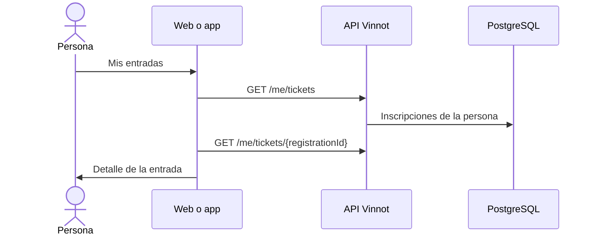

# UC-EVT-06 · Ver mis entradas

| Campo | Valor |
|---|---|
| ID | `UC-EVT-06` |
| Módulo | [Eventos y entradas](../README.md) |
| Plataformas | Web, APK |
| Actores | Usuario autenticado |
| IDs en Lucidchart | [WEB UC-EVT-07](https://lucid.app/lucidchart/9f11a16b-bb5a-42fc-a9e8-0852b17bd241/edit), [APK UC-EVT-07](https://lucid.app/lucidchart/e095dd25-e8ac-41ba-bf5b-396e1055f217/edit) |
| Requisitos | [`RF-WEB-EVT-15`](../requirements.md) |
| Casos de prueba | [`CP-EVT-29`](../testing.md), [`CP-EVT-30`](../testing.md), [`CP-EVT-31`](../testing.md), [`CP-EVT-32`](../testing.md) |

## Precondiciones

- La persona tiene sesión iniciada.

## Postcondiciones

- La persona ve sus inscripciones y el detalle de cada entrada.

## Flujo principal

1. La persona abre «Mis entradas» desde el menú de la web o el perfil de la app.
2. El cliente pide `GET /me/tickets`, paginado y de la más reciente a la más antigua.
3. Muestra cada entrada con el evento, la fecha, el lugar y el estado.
4. La persona abre una entrada y el cliente pide `GET /me/tickets/{registrationId}`.
5. El cliente muestra fecha, cantidad de personas, lugar, pago, reserva vigente, contacto del organizador y la referencia de 12 caracteres.

## Flujos alternativos

- 3a. No tiene entradas: se muestra el estado vacío con un acceso a Eventos.
- 4a. La entrada no existe o es de otra persona: la API responde 404 y el cliente muestra que no está disponible.
- 5a. El evento fue cancelado: la entrada lo indica.

## Reglas de negocio

- Cada persona ve solo sus inscripciones, en cualquier estado.
- Páginas de hasta 50; las respuestas no se guardan en caché.
- No hay código QR ni control de ingreso: la referencia identifica la entrada.

## Diagrama

[Ver diagrama de «UC-EVT-06 · Ver mis entradas» completo](https://images.vinnot.com/docs/diagrams/v1/es/modules-events-use-cases-uc-evt-06-my-tickets-8356e2e0d2cd.svg)

Diagrama de componentes en Lucidchart: [WEB UC-EVT-07](https://lucid.app/lucidchart/9f11a16b-bb5a-42fc-a9e8-0852b17bd241/edit), [APK UC-EVT-07](https://lucid.app/lucidchart/e095dd25-e8ac-41ba-bf5b-396e1055f217/edit).

## Código

| Capa | Ubicación |
|---|---|
| Endpoints | `GET /me/tickets`, `GET /me/tickets/{registrationId}` |
| Backend | [`MyTicketsController.java`](../../../../../backend/src/main/java/com/vinnot/event/infrastructure/web/controller/MyTicketsController.java), [`GetMyTicketsQueryHandler.java`](../../../../../backend/src/main/java/com/vinnot/event/application/query/handler/GetMyTicketsQueryHandler.java), [`PostgresEventTicketReader.java`](../../../../../backend/src/main/java/com/vinnot/event/infrastructure/persistence/adapter/PostgresEventTicketReader.java) |
| Web | [`MyTicketsPage.tsx`](../../../../../frontend-react/src/presentation/pages/events/MyTicketsPage.tsx), [`useMyTicketDetailsViewModel.ts`](../../../../../frontend-react/src/presentation/pages/events/useMyTicketDetailsViewModel.ts), [`eventTickets.service.ts`](../../../../../frontend-react/src/application/services/eventTickets.service.ts), [`eventTickets.client.ts`](../../../../../frontend-react/src/infrastructure/api/clients/eventTickets.client.ts) |
| App | [`MyTicketsScreen.tsx`](../../../../../frontend-mobile/src/presentation/features/event/MyTicketsScreen.tsx), [`useMyTickets.ts`](../../../../../frontend-mobile/src/presentation/hooks/queries/event/useMyTickets.ts), [`eventTickets.service.ts`](../../../../../frontend-mobile/src/application/services/eventTickets.service.ts), [`eventTickets.client.ts`](../../../../../frontend-mobile/src/infrastructure/api/clients/eventTickets.client.ts) |

## Tests automáticos

- Backend: [`GetMyTicketsQueryHandlerTest.java`](../../../../../backend/src/test/java/com/vinnot/event/application/query/handler/GetMyTicketsQueryHandlerTest.java)
- Web: [`MyTicketsPage.test.tsx`](../../../../../frontend-react/src/presentation/pages/events/MyTicketsPage.test.tsx), [`eventTickets.service.test.ts`](../../../../../frontend-react/src/application/services/eventTickets.service.test.ts)
- App: [`MyTicketsScreen.test.tsx`](../../../../../frontend-mobile/src/presentation/features/event/MyTicketsScreen.test.tsx), [`MyTicketsNavigation.test.tsx`](../../../../../frontend-mobile/src/presentation/features/event/MyTicketsNavigation.test.tsx)
