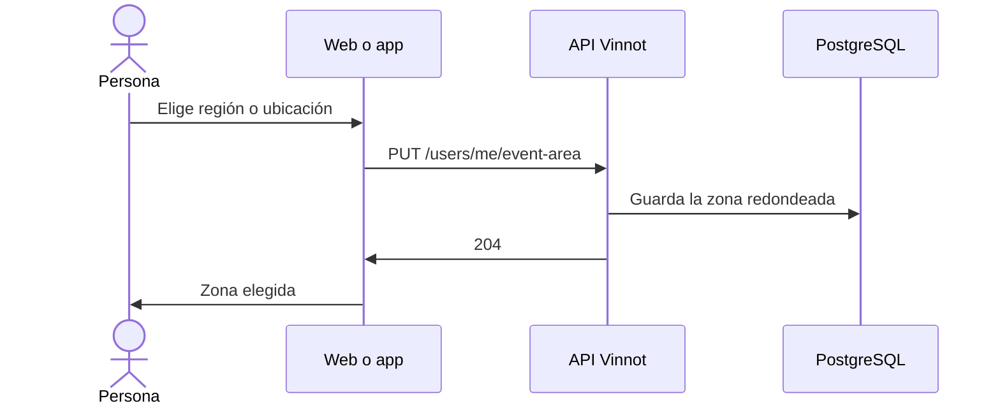

# UC-EVT-07 · Elegir la zona de avisos de eventos

| Campo | Valor |
|---|---|
| ID | `UC-EVT-07` |
| Módulo | [Eventos y entradas](../README.md) |
| Plataformas | Web, APK |
| Actores | Usuario autenticado |
| IDs en Lucidchart | [WEB UC-NOTIF-02](https://lucid.app/lucidchart/9f11a16b-bb5a-42fc-a9e8-0852b17bd241/edit), [APK UC-NOTIF-06](https://lucid.app/lucidchart/e095dd25-e8ac-41ba-bf5b-396e1055f217/edit) |
| Requisitos | [`RF-WEB-EVT-16`](../requirements.md), [`RF-APK-EVT-15`](../requirements.md) |
| Casos de prueba | [`CP-EVT-33`](../testing.md), [`CP-EVT-34`](../testing.md), [`CP-EVT-35`](../testing.md), [`CP-EVT-36`](../testing.md), [`CP-EVT-37`](../testing.md) |

## Precondiciones

- La persona tiene sesión iniciada y abre sus preferencias de notificaciones.

## Postcondiciones

- Los avisos de eventos nuevos cercanos usan la zona elegida.

## Flujo principal

1. En la categoría de eventos cercanos, la persona elige una región o usa su ubicación actual.
2. El cliente envía `PUT /users/me/event-area` con la región o con las coordenadas.
3. La API guarda la zona; las coordenadas se redondean a 0,1°.
4. El cliente muestra la zona elegida, que se lee con `GET /users/me/event-area`.

## Flujos alternativos

- 1a. La persona quita la zona: el cliente envía `DELETE /users/me/event-area`.
- 2a. Faltan la latitud o la longitud: la API responde 400.
- 3a. La región no existe: la API responde 404.
- 4a. No hay zona guardada: la API responde 204 y el cliente ofrece elegir una.

## Reglas de negocio

- Con coordenadas, los avisos cubren 50 km alrededor del punto guardado.
- No se guarda la ubicación exacta.
- Las preferencias de cada categoría están en [Notificaciones](../../notifications/README.md).

## Diagrama

[Ver diagrama de «UC-EVT-07 · Elegir la zona de avisos de eventos» completo](https://images.vinnot.com/docs/diagrams/v1/es/modules-events-use-cases-uc-evt-07-event-area-9d9e3db31c36.svg)

Diagrama de componentes en Lucidchart: [WEB UC-NOTIF-02](https://lucid.app/lucidchart/9f11a16b-bb5a-42fc-a9e8-0852b17bd241/edit), [APK UC-NOTIF-06](https://lucid.app/lucidchart/e095dd25-e8ac-41ba-bf5b-396e1055f217/edit).

## Código

| Capa | Ubicación |
|---|---|
| Endpoints | `GET /users/me/event-area`, `PUT /users/me/event-area`, `DELETE /users/me/event-area` |
| Backend | [`EventAreaController.java`](../../../../../backend/src/main/java/com/vinnot/event/infrastructure/web/controller/EventAreaController.java), [`EventAreaService.java`](../../../../../backend/src/main/java/com/vinnot/event/application/service/EventAreaService.java), [`EventArea.java`](../../../../../backend/src/main/java/com/vinnot/event/domain/valueobject/EventArea.java), [`JdbcEventAreaRepository.java`](../../../../../backend/src/main/java/com/vinnot/event/infrastructure/persistence/adapter/JdbcEventAreaRepository.java) |
| Web | [`EventAreaPicker.tsx`](../../../../../frontend-react/src/presentation/pages/user/EventAreaPicker.tsx), [`useEventAreaViewModel.ts`](../../../../../frontend-react/src/presentation/pages/user/useEventAreaViewModel.ts), [`useEventArea.ts`](../../../../../frontend-react/src/presentation/hooks/queries/notification/useEventArea.ts), [`eventArea.ts`](../../../../../frontend-react/src/domain/notification/eventArea.ts) |
| App | [`EventAreaSection.tsx`](../../../../../frontend-mobile/src/presentation/features/user/EventAreaSection.tsx), [`useEventArea.ts`](../../../../../frontend-mobile/src/presentation/features/user/useEventArea.ts), [`eventArea.ts`](../../../../../frontend-mobile/src/domain/notification/eventArea.ts) |

## Tests automáticos

- Backend: [`EventAreaControllerTest.java`](../../../../../backend/src/test/java/com/vinnot/event/infrastructure/web/controller/EventAreaControllerTest.java), [`EventAreaServiceTest.java`](../../../../../backend/src/test/java/com/vinnot/event/application/service/EventAreaServiceTest.java), [`EventAreaTest.java`](../../../../../backend/src/test/java/com/vinnot/event/domain/valueobject/EventAreaTest.java), [`EventAreaPostgresIntegrationTest.java`](../../../../../backend/src/test/java/com/vinnot/event/infrastructure/EventAreaPostgresIntegrationTest.java)
- Web: [`EventAreaPicker.test.tsx`](../../../../../frontend-react/src/presentation/pages/user/EventAreaPicker.test.tsx), [`useEventAreaViewModel.test.tsx`](../../../../../frontend-react/src/presentation/pages/user/useEventAreaViewModel.test.tsx), [`useEventArea.test.tsx`](../../../../../frontend-react/src/presentation/hooks/queries/notification/useEventArea.test.tsx), [`eventArea.test.ts`](../../../../../frontend-react/src/domain/notification/eventArea.test.ts)
- App: [`EventAreaSection.test.tsx`](../../../../../frontend-mobile/src/presentation/features/user/EventAreaSection.test.tsx), [`useEventArea.test.ts`](../../../../../frontend-mobile/src/presentation/features/user/useEventArea.test.ts), [`eventArea.test.ts`](../../../../../frontend-mobile/src/domain/notification/eventArea.test.ts)
