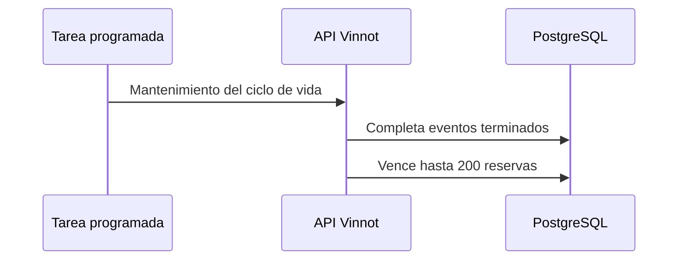

# UC-EVT-08 · Cerrar eventos terminados y vencer reservas

| Campo | Valor |
|---|---|
| ID | `UC-EVT-08` |
| Módulo | [Eventos y entradas](../README.md) |
| Plataformas | Solo backend |
| Actores | Sistema (tarea programada) |
| IDs en Lucidchart | Ninguno |
| Requisitos | Ninguno |
| Casos de prueba | [`CP-EVT-38`](../testing.md), [`CP-EVT-39`](../testing.md), [`CP-EVT-40`](../testing.md) |

## Precondiciones

- La tarea programada corre un minuto después del arranque y luego cada cinco minutos.

## Postcondiciones

- Los eventos terminados quedan `COMPLETED` y las reservas vencidas liberan su cupo.

## Flujo principal

1. La tarea marca como `COMPLETED` los eventos publicados o agotados cuyo fin ya pasó.
2. Busca hasta 200 inscripciones con reserva vencida.
3. Para cada una, libera la reserva en el evento y marca la inscripción como `EXPIRED`.

## Flujos alternativos

- 2a. Hay más de 200 vencidas: el resto se procesa en las ejecuciones siguientes.
- 3a. Un evento agotado recupera cupo: vuelve a `PUBLISHED`.

## Reglas de negocio

- Una inscripción en espera no asciende sola al liberarse un cupo.
- Un evento cancelado no pasa a `COMPLETED`.

## Diagrama

[Ver diagrama de «UC-EVT-08 · Cerrar eventos terminados y vencer reservas» completo](https://images.vinnot.com/docs/diagrams/v1/es/modules-events-use-cases-uc-evt-08-event-lifecycle-d3e2f263c8c2.svg)

## Código

| Capa | Ubicación |
|---|---|
| Backend | [`EventLifecycleScheduler.java`](../../../../../backend/src/main/java/com/vinnot/event/infrastructure/scheduling/EventLifecycleScheduler.java), [`MaintainEventLifecycleCommandHandler.java`](../../../../../backend/src/main/java/com/vinnot/event/application/command/handler/MaintainEventLifecycleCommandHandler.java), [`EventHoldExpirationService.java`](../../../../../backend/src/main/java/com/vinnot/event/application/service/EventHoldExpirationService.java) |

## Tests automáticos

- Backend: [`MaintainEventLifecycleCommandHandlerTest.java`](../../../../../backend/src/test/java/com/vinnot/event/application/command/handler/MaintainEventLifecycleCommandHandlerTest.java), [`EventHoldExpirationServiceTest.java`](../../../../../backend/src/test/java/com/vinnot/event/application/service/EventHoldExpirationServiceTest.java), [`EventStatusTransitionTest.java`](../../../../../backend/src/test/java/com/vinnot/event/domain/model/EventStatusTransitionTest.java)
- Web: Ninguno
- App: Ninguno
