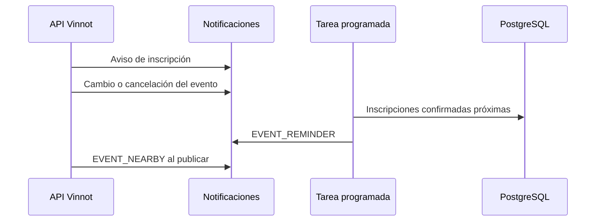

# UC-EVT-09 · Avisar a quienes asisten

| Campo | Valor |
|---|---|
| ID | `UC-EVT-09` |
| Módulo | [Eventos y entradas](../README.md) |
| Plataformas | Solo backend |
| Actores | Sistema (tarea programada), Organizador, Servicio de email y push |
| IDs en Lucidchart | Ninguno |
| Requisitos | Ninguno |
| Casos de prueba | [`CP-EVT-41`](../testing.md), [`CP-EVT-42`](../testing.md), [`CP-EVT-43`](../testing.md), [`CP-EVT-44`](../testing.md), [`CP-EVT-45`](../testing.md) |

## Precondiciones

- Hay inscripciones nuevas, eventos que cambian o se cancelan, eventos próximos o eventos recién publicados.

## Postcondiciones

- Quienes asisten y quienes viven cerca reciben los avisos que les corresponden.

## Flujo principal

1. Al inscribirse, la persona recibe `EVENT_REGISTRATION_ATTENDEE` y el organizador `EVENT_REGISTRATION_ORGANIZER`, por email y push.
2. Si el organizador cambia la fecha o el lugar de un evento publicado, quienes asisten reciben `EVENT_CHANGED_ATTENDEE` y los recordatorios se reprograman.
3. Si el evento se cancela, cada inscripción activa se cancela y quien asiste recibe `EVENT_CANCELLED_ATTENDEE` con el motivo y qué pasa con su dinero.
4. Cada cinco minutos, la tarea de recordatorios envía `EVENT_REMINDER` por email y push a quienes tienen la inscripción confirmada, entre 24 y 1 hora antes del inicio, y otro push entre 2 horas y 15 minutos antes.
5. La primera vez que se publica un evento con inscripción abierta, las personas con una zona de avisos que coincide reciben un push `EVENT_NEARBY`.

## Flujos alternativos

- 3a. Quien canceló no es el organizador: el organizador recibe un resumen `EVENT_CANCELLED_ORGANIZER_SUMMARY`.
- 3b. La inscripción se pagó en línea: el aviso indica que se solicitó la devolución automática al mismo medio de pago a través de Mercado Pago ([Pagos](../../payments/README.md)); si se pagó al organizador, que él la coordina.
- 4a. El evento empieza en menos de 2 horas: no se envía el push del día anterior; lo cubre el segundo.
- 5a. La persona bloqueó al organizador, es el organizador o desactivó la categoría: no recibe el aviso.

## Reglas de negocio

- Los avisos de eventos cercanos son solo push y llegan como mucho uno por día.
- Con zona por región o ciudad coinciden por nombre; con coordenadas, dentro de 50 km.
- Cada aviso tiene una clave propia, así que reintentar no lo duplica.
- Los canales, horarios de silencio y límites de push están en [Notificaciones](../../notifications/README.md).

## Diagrama

[Ver diagrama de «UC-EVT-09 · Avisar a quienes asisten» completo](https://images.vinnot.com/docs/diagrams/v1/es/modules-events-use-cases-uc-evt-09-attendee-notices-cb3bc363d9b2.svg)

## Código

| Capa | Ubicación |
|---|---|
| Backend | [`NotifyEventRegistrationService.java`](../../../../../backend/src/main/java/com/vinnot/event/application/service/NotifyEventRegistrationService.java), [`EventScheduleChangeService.java`](../../../../../backend/src/main/java/com/vinnot/event/application/service/EventScheduleChangeService.java), [`EventCancellationService.java`](../../../../../backend/src/main/java/com/vinnot/event/application/service/EventCancellationService.java), [`EventReminderScheduler.java`](../../../../../backend/src/main/java/com/vinnot/event/infrastructure/scheduling/EventReminderScheduler.java), [`SendEventRemindersService.java`](../../../../../backend/src/main/java/com/vinnot/event/application/service/SendEventRemindersService.java), [`AnnounceNewEventNearbyService.java`](../../../../../backend/src/main/java/com/vinnot/event/application/service/AnnounceNewEventNearbyService.java) |

## Tests automáticos

- Backend: [`NotifyEventRegistrationServiceTest.java`](../../../../../backend/src/test/java/com/vinnot/event/application/service/NotifyEventRegistrationServiceTest.java), [`EventScheduleChangeServiceTest.java`](../../../../../backend/src/test/java/com/vinnot/event/application/service/EventScheduleChangeServiceTest.java), [`EventCancellationServiceTest.java`](../../../../../backend/src/test/java/com/vinnot/event/application/service/EventCancellationServiceTest.java), [`SendEventRemindersServiceTest.java`](../../../../../backend/src/test/java/com/vinnot/event/application/service/SendEventRemindersServiceTest.java), [`EventReminderPostgresIntegrationTest.java`](../../../../../backend/src/test/java/com/vinnot/event/infrastructure/EventReminderPostgresIntegrationTest.java), [`AnnounceNewEventNearbyServiceTest.java`](../../../../../backend/src/test/java/com/vinnot/event/application/service/AnnounceNewEventNearbyServiceTest.java), [`EventReminderSchedulerTest.java`](../../../../../backend/src/test/java/com/vinnot/event/infrastructure/scheduling/EventReminderSchedulerTest.java), [`EventReminderTemplateTest.java`](../../../../../backend/src/test/java/com/vinnot/notification/infrastructure/template/EventReminderTemplateTest.java)
- Web: Ninguno
- App: Ninguno
