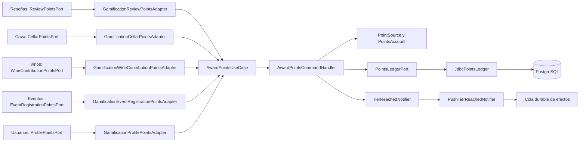

# Arquitectura

Cómo está construido el módulo en cada capa. El backend sigue el flujo hexagonal
`controller → puerto de entrada → handler → dominio → puerto de salida → adaptador`;
la web y la app siguen `pantalla → hook → servicio → cliente API → transporte HTTP`.
Las reglas de puntos, niveles y casos borde están en el [README del módulo](README.md).

## Flujo de un premio

Los módulos donde ocurre la actividad no conocen las reglas de puntos: cada uno declara
su propio puerto de salida y un adaptador de infraestructura lo traduce al puerto de
entrada de gamificación.



[Ver diagrama de «Flujo de un premio» completo](https://images.vinnot.com/docs/diagrams/v1/es/modules-gamification-architecture-c10f67b985c8.svg)

## Backend

### Capas

| Responsabilidad | Implementación |
|---|---|
| HTTP | [`PointsController`](../../../../backend/src/main/java/com/vinnot/gamification/infrastructure/web/controller/PointsController.java) bajo `/users/me/points`; [`CelebratePointsRequest`](../../../../backend/src/main/java/com/vinnot/gamification/infrastructure/web/request/CelebratePointsRequest.java) exige `tier` o `welcome: true` |
| Escrituras | [`AwardPointsCommandHandler`](../../../../backend/src/main/java/com/vinnot/gamification/application/command/handler/AwardPointsCommandHandler.java) (premiar y revocar) y [`CelebratePointsCommandHandler`](../../../../backend/src/main/java/com/vinnot/gamification/application/command/handler/CelebratePointsCommandHandler.java) |
| Lecturas | [`GetMyPointsQueryHandler`](../../../../backend/src/main/java/com/vinnot/gamification/application/query/handler/GetMyPointsQueryHandler.java) y [`GetPointStandingsQueryHandler`](../../../../backend/src/main/java/com/vinnot/gamification/application/query/handler/GetPointStandingsQueryHandler.java) (niveles de varios autores en una consulta) |
| Dominio | [`PointSource`](../../../../backend/src/main/java/com/vinnot/gamification/domain/model/PointSource.java) (puntos y límites), [`PointRules`](../../../../backend/src/main/java/com/vinnot/gamification/domain/model/PointRules.java) (tope de 40, nota de 80 caracteres, claves), [`PointsAccount`](../../../../backend/src/main/java/com/vinnot/gamification/domain/model/PointsAccount.java) (nivel, celebración, bienvenida y día en la zona de la persona) y [`Tier`](../../../../backend/src/main/java/com/vinnot/gamification/domain/model/Tier.java) |
| Puertos de salida | [`PointsLedgerPort`](../../../../backend/src/main/java/com/vinnot/gamification/application/port/out/PointsLedgerPort.java) y [`TierReachedNotifier`](../../../../backend/src/main/java/com/vinnot/gamification/application/port/out/TierReachedNotifier.java) |
| Adaptadores | [`JdbcPointsLedger`](../../../../backend/src/main/java/com/vinnot/gamification/infrastructure/persistence/JdbcPointsLedger.java) y [`PushTierReachedNotifier`](../../../../backend/src/main/java/com/vinnot/gamification/infrastructure/notification/PushTierReachedNotifier.java) |
| Lectores de otros módulos | [`GamificationReviewerBadgeAdapter`](../../../../backend/src/main/java/com/vinnot/review/infrastructure/gamification/GamificationReviewerBadgeAdapter.java) (sello de autores de reseñas y comentarios) y [`GamificationUserPointsAdapter`](../../../../backend/src/main/java/com/vinnot/admin/infrastructure/gamification/GamificationUserPointsAdapter.java) (puntos y sello en el listado de usuarios de administración) |

### Concurrencia e idempotencia

- `JdbcPointsLedger.lockAccount` crea la fila de `user_points` si falta y la bloquea con
  `SELECT … FOR UPDATE`, así dos premios simultáneos de la misma persona se ordenan y no
  superan los topes.
- Cada premio es único por (`user_id`, `source`, `source_key`). Un premio revocado queda
  inactivo y puede volver a otorgarse sin contar dos veces.
- Las revocaciones por prefijo quitan todos los likes de una reseña de una vez.
- El push `TIER_REACHED` se encola en la misma transacción, con la clave
  `tier-reached:<persona>:<nivel>`; la preferencia de Comunidad se comprueba al entregarlo.

### Datos

[`V70__points_and_wax_seal_emblems.sql`](../../../../backend/src/main/resources/db/migration/V70__points_and_wax_seal_emblems.sql)
crea `user_points`, `user_point_awards`, `user_point_movements` y `wine_label_scans`, y
calcula los puntos históricos sin enviar push. El detalle está en la sección «Datos y
cálculo histórico (V70)» del [README](README.md).

### Errores esperables

`POST /users/me/points/celebrations` sin `tier` ni `welcome: true`, o con una clave de
nivel desconocida, responde `400`. Una cuenta inexistente al celebrar responde `404`
(`EntityNotFoundException`). Premiar o revocar a una cuenta que ya no existe no hace nada.

## Web

```text
PointsPage / ProfilePointsHeader / PointsCelebrationHost → useMyPoints / usePointsAcknowledgement → pointsService → usersClient → http
```

| Pieza | Qué hace |
|---|---|
| [`PointsPage.tsx`](../../../../frontend-react/src/presentation/pages/user/PointsPage.tsx) | «Tus puntos» en `/profile/points`: sello, progreso, cómo sumar, movimientos y escalera |
| [`ProfilePointsHeader.tsx`](../../../../frontend-react/src/presentation/components/features/points/ProfilePointsHeader.tsx) | Sello, puntos y progreso en el perfil; el sello abre «Tus puntos» |
| [`PointsCelebrationHost.tsx`](../../../../frontend-react/src/presentation/components/features/points/PointsCelebrationHost.tsx) | Montado en `AppShell`: revelación del nivel y tarjeta de bienvenida |
| [`UserBadge.tsx`](../../../../frontend-react/src/presentation/components/features/points/UserBadge.tsx) | Sello animado con CSS; respeta el movimiento reducido |
| [`useMyPoints.ts`](../../../../frontend-react/src/presentation/hooks/queries/user/useMyPoints.ts) y [`usePointsAcknowledgement.ts`](../../../../frontend-react/src/presentation/hooks/queries/user/usePointsAcknowledgement.ts) | Consulta y confirmación de celebraciones con TanStack Query |
| [`points.service.ts`](../../../../frontend-react/src/application/services/points.service.ts) y [`domain/points`](../../../../frontend-react/src/domain/points/) | Mapeo del DTO a modelos y escalera de niveles |
| [`users.client.ts`](../../../../frontend-react/src/infrastructure/api/clients/users.client.ts) | `GET /users/me/points` y `POST /users/me/points/celebrations` |

## App

| Pieza | Qué hace |
|---|---|
| [`PointsScreen.tsx`](../../../../frontend-mobile/src/presentation/features/points/PointsScreen.tsx) | «Tus puntos» en `/points`, con deslizar para actualizar |
| [`ProfilePoints.tsx`](../../../../frontend-mobile/src/presentation/features/points/ProfilePoints.tsx) | Sello, puntos y progreso en el perfil |
| [`PointsHost.tsx`](../../../../frontend-mobile/src/presentation/features/points/PointsHost.tsx) y [`usePointsCelebration.ts`](../../../../frontend-mobile/src/presentation/features/points/usePointsCelebration.ts) | Montado en el layout de `(app)`: revelación con vibración y tarjeta de bienvenida |
| [`UserBadge.tsx`](../../../../frontend-mobile/src/presentation/features/points/UserBadge.tsx) y [`SealCanvas.tsx`](../../../../frontend-mobile/src/presentation/features/points/SealCanvas.tsx) | Sello animado con Skia y relojes de Reanimated |
| [`hooks/queries/user`](../../../../frontend-mobile/src/presentation/hooks/queries/user/index.ts) | `usePointsSummary` y sus actualizaciones |
| [`points.service.ts`](../../../../frontend-mobile/src/application/services/points.service.ts) y [`domain/points`](../../../../frontend-mobile/src/domain/points/) | Mapeo del DTO a modelos y escalera de niveles |
| [`points.client.ts`](../../../../frontend-mobile/src/infrastructure/api/clients/points.client.ts) | `GET /users/me/points` y `POST /users/me/points/celebrations` |

## Referencias

- [README del módulo](README.md) y [manual de Puntos y sellos](../../manuals/points-and-seals.mdx).
- [Notificaciones](../notifications/README.md), para el push `TIER_REACHED`.
- [Reseñas](../reviews/README.md) y [Cava](../cellar/README.md), que informan la actividad.
