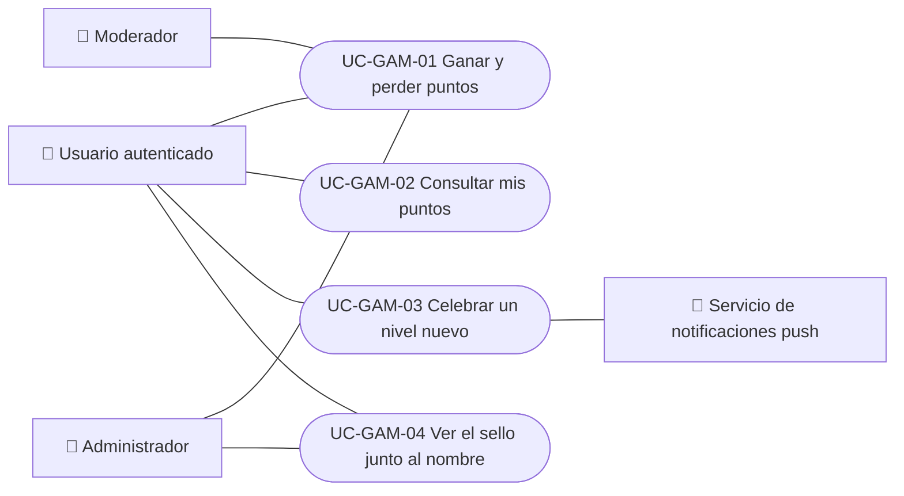

# Casos de uso

Casos de uso del módulo de puntos y sellos: ganar y perder puntos, consultarlos, celebrar un nivel nuevo y ver el sello junto al nombre. La guía para personas usuarias es [Puntos y sellos](../../../manuals/points-and-seals.mdx). Cada caso vale para las plataformas indicadas.

| ID | Caso de uso | Plataformas | Actores |
|---|---|---|---|
| `UC-GAM-01` | [Ganar y perder puntos](uc-gam-01-earn-and-lose-points.md) | Web, APK | Usuario autenticado, Moderador, Administrador |
| `UC-GAM-02` | [Consultar mis puntos](uc-gam-02-view-my-points.md) | Web, APK | Usuario autenticado |
| `UC-GAM-03` | [Celebrar un nivel nuevo](uc-gam-03-celebrate-tier.md) | Web, APK | Usuario autenticado, Servicio de notificaciones push |
| `UC-GAM-04` | [Ver el sello junto al nombre](uc-gam-04-seal-next-to-name.md) | Web, APK | Usuario autenticado, Administrador |

## Actores y casos de uso

[Ver diagrama de «Actores y casos de uso» completo](https://images.vinnot.com/docs/diagrams/v1/es/modules-gamification-use-cases-readme-ed72ecad6709.svg)

## Equivalencia con Lucidchart

| ID | IDs en Lucidchart |
|---|---|
| `UC-GAM-01` | Ninguno |
| `UC-GAM-02` | Ninguno |
| `UC-GAM-03` | Ninguno |
| `UC-GAM-04` | Ninguno |
