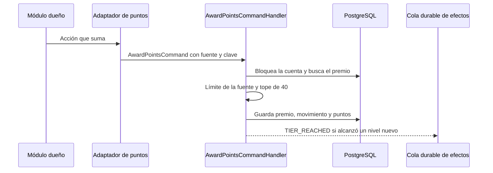

# UC-GAM-01 · Ganar y perder puntos

| Campo | Valor |
|---|---|
| ID | `UC-GAM-01` |
| Módulo | [Puntos y sellos](../README.md) |
| Plataformas | Web, APK |
| Actores | Usuario autenticado, Moderador, Administrador |
| IDs en Lucidchart | Ninguno |
| Requisitos | [`RF-WEB-GAM-01`](../requirements.md), [`RF-WEB-GAM-02`](../requirements.md), [`RF-WEB-GAM-03`](../requirements.md), [`RF-APK-GAM-01`](../requirements.md), [`RF-APK-GAM-02`](../requirements.md), [`RF-APK-GAM-03`](../requirements.md) |
| Casos de prueba | [`CP-GAM-01`](../testing.md), [`CP-GAM-02`](../testing.md), [`CP-GAM-03`](../testing.md), [`CP-GAM-04`](../testing.md), [`CP-GAM-05`](../testing.md), [`CP-GAM-06`](../testing.md), [`CP-GAM-07`](../testing.md), [`CP-GAM-08`](../testing.md) |

## Precondiciones

- La persona tiene una cuenta activa.

## Postcondiciones

- El movimiento queda en el historial y los puntos y el nivel de la persona, actualizados.

## Flujo principal

1. La persona hace una acción que suma, por ejemplo publicar una reseña aprobada.
2. El caso de uso del módulo dueño (reseñas, cava, vinos, eventos o usuarios) llama a su puerto de puntos; su adaptador `Gamification*PointsAdapter` lo traduce en un `AwardPointsCommand` con la fuente y la clave de origen.
3. `AwardPointsCommandHandler` bloquea la cuenta de puntos de la persona.
4. Si ya existe un premio activo con la misma persona, fuente y clave, termina sin cambios.
5. `PointSource.grant` calcula lo que corresponde: primero el límite diario de la fuente y después el tope global de 40, con el día en la zona horaria de la persona.
6. Guarda el premio y el movimiento y actualiza los puntos y el nivel.
7. Si la persona alcanzó por primera vez un nivel más alto, encola el aviso `TIER_REACHED` ([`UC-GAM-03`](uc-gam-03-celebrate-tier.md)).

## Flujos alternativos

- 4a. La misma acción vuelve a llegar con la misma clave: no se suma nada.
- 5a. Se alcanzó el límite diario de la fuente (5 likes, 3 comentarios, 3 escaneos o 3 altas en la cava): suma 0 y no deja rastro, así la acción puede ganar otro día.
- 5b. Se alcanzó el tope global de 40: el último premio se recorta a lo que falta; un vino aprobado suma igual porque queda fuera del tope.
- 1a. El contenido se borra o se retira por moderación: `revoke` quita exactamente lo otorgado; borrar una reseña revoca también sus likes recibidos; volver a crearla premia otra vez.
- 1b. Una reseña vuelve a `PENDING`: se revocan la reseña, la nota y sus likes; la aprobación vuelve a premiarlos con las mismas claves, dentro de los topes de ese día.
- 3a. La cuenta ya no existe: no suma ni resta nada.
- 3b. Llegan dos premios al mismo tiempo: el bloqueo por persona evita superar el tope o contar dos veces una clave.

## Reglas de negocio

- Dar likes no suma; los likes propios cuentan como recibidos.
- Un comentario solo suma en la reseña de otra persona.
- Una entrada de la cava creada por una reseña da 0 puntos.
- La tabla completa de fuentes, límites y casos borde está en las secciones «Puntos por acción» y «Revocaciones y casos borde» del [README del módulo](../README.md).

## Secuencia de un premio

[Ver diagrama de «Secuencia de un premio» completo](https://images.vinnot.com/docs/diagrams/v1/es/modules-gamification-use-cases-uc-gam-01-earn-and-lose-points-e975cc0e1bb8.svg)

## Código

| Capa | Ubicación |
|---|---|
| Backend | [`AwardPointsCommandHandler.java`](../../../../../backend/src/main/java/com/vinnot/gamification/application/command/handler/AwardPointsCommandHandler.java), [`PointSource.java`](../../../../../backend/src/main/java/com/vinnot/gamification/domain/model/PointSource.java), [`PointsAccount.java`](../../../../../backend/src/main/java/com/vinnot/gamification/domain/model/PointsAccount.java), [`JdbcPointsLedger.java`](../../../../../backend/src/main/java/com/vinnot/gamification/infrastructure/persistence/JdbcPointsLedger.java) |
| Adaptadores de otros módulos | [`GamificationReviewPointsAdapter.java`](../../../../../backend/src/main/java/com/vinnot/review/infrastructure/gamification/GamificationReviewPointsAdapter.java), [`GamificationCellarPointsAdapter.java`](../../../../../backend/src/main/java/com/vinnot/cellar/infrastructure/gamification/GamificationCellarPointsAdapter.java), [`GamificationWineContributionPointsAdapter.java`](../../../../../backend/src/main/java/com/vinnot/wine/infrastructure/gamification/GamificationWineContributionPointsAdapter.java), [`GamificationEventRegistrationPointsAdapter.java`](../../../../../backend/src/main/java/com/vinnot/event/infrastructure/gamification/GamificationEventRegistrationPointsAdapter.java), [`GamificationProfilePointsAdapter.java`](../../../../../backend/src/main/java/com/vinnot/user/infrastructure/gamification/GamificationProfilePointsAdapter.java) |
| Datos | [`V70__points_and_wax_seal_emblems.sql`](../../../../../backend/src/main/resources/db/migration/V70__points_and_wax_seal_emblems.sql) |

## Tests automáticos

- Backend:
  - [`AwardPointsCommandHandlerTest.java`](../../../../../backend/src/test/java/com/vinnot/gamification/application/command/handler/AwardPointsCommandHandlerTest.java): `anAwardIsIdempotentPerMemberSourceAndKey`, `aRevocationTakesBackExactlyWhatWasAwardedOnceAndAllowsAwardingAgain`, `aPrefixRevocationTakesBackEveryLikeOfAReview`, `likesStopAtFivePerDayAndTheLimitResetsAtTheMembersMidnight`, `commentsScansAndCellarAddsStopAtThreePerDay`, `theGlobalCapIsFortyPerDayAndApprovedWinesAreOutsideIt`, `aMemberThatNoLongerExistsEarnsAndLosesNothing`, `aCappedAwardLeavesNoTraceSoItCanBeEarnedAnotherDay`
  - [`PointSourceTest.java`](../../../../../backend/src/test/java/com/vinnot/gamification/domain/model/PointSourceTest.java): `everySourceGrantsItsApprovedPoints`, `perSourceDailyLimitsStopAtFiveLikesAndThreeCommentsScansAndCellarAdds`, `theGlobalCapClampsTheLastAwardAndExcludesApprovedWines`
  - [`PointRulesTest.java`](../../../../../backend/src/test/java/com/vinnot/gamification/domain/model/PointRulesTest.java): `aNoteEarnsFromEightyCharactersWithoutSurroundingSpaces`, `aCompleteProfileHasAPhotoBothNamesAndAPhone`, `likeKeysShareTheReviewPrefix`, `awardsAndMovementsKeepTheirMemberSourceAndKey`
  - [`PointsAccountTest.java`](../../../../../backend/src/test/java/com/vinnot/gamification/domain/model/PointsAccountTest.java): `theWelcomeCardIsDismissedOnceAndPointsNeverGoNegative`, `theDayStartsAtMidnightInTheMembersOwnZone`
  - [`PointsHttpPostgresIntegrationTest.java`](../../../../../backend/src/test/java/com/vinnot/gamification/infrastructure/PointsHttpPostgresIntegrationTest.java): `reviewsLikesAndCommentsEarnAndDeletingTheReviewTakesItsPointsBack`, `aReviewOutOfModerationHoldsNoLikePointsAndApprovalAwardsEverythingAgainOnce`, `aCellarEntryAddedByHandEarnsOnceAndOneAReviewCreatedEarnsNothing`, `concurrentAwardsNeverPassTheDailyCapOrCountOneKeyTwice`, `scansAreRecordedAndAnExactMatchEarnsOncePerWine`, `aCompleteProfileNeedsThePhoneAndEarnsOnce`
  - [`PointsBackfillMigrationPostgresIntegrationTest.java`](../../../../../backend/src/test/java/com/vinnot/gamification/infrastructure/PointsBackfillMigrationPostgresIntegrationTest.java): `existingContentEarnsWithTheLiveRulesAndCapsWithoutAnyPush`
  - [`GamificationReviewPointsAdapterTest.java`](../../../../../backend/src/test/java/com/vinnot/review/infrastructure/gamification/GamificationReviewPointsAdapterTest.java): `aReviewEarnsPerWineAndItsNoteOnlyFromEightyCharacters`, `unpublishingRevokesTheReviewAndNoteAndDeletingAlsoItsLikes`, `unpublishingAlsoRevokesTheLikesTheReviewReceived`, `approvalAwardsTheReviewItsNoteAndOnePointPerCurrentLikeWithTheSameKeys`, `likesAreKeyedByReviewAndLiker`, `onlyACommentOnSomeoneElsesReviewEarns`
  - [`GamificationProfilePointsAdapterTest.java`](../../../../../backend/src/test/java/com/vinnot/user/infrastructure/gamification/GamificationProfilePointsAdapterTest.java): `aPhotoAndBothNamesWithoutAPhoneEarnNothing`, `addingThePhoneCompletesTheProfileUnderItsSingleKey`
- Web:
  - [`pointsInvalidation.test.tsx`](../../../../../frontend-react/src/presentation/hooks/queries/user/pointsInvalidation.test.tsx): `refreshes the points after a profile update and an avatar upload, still syncing the session user`
