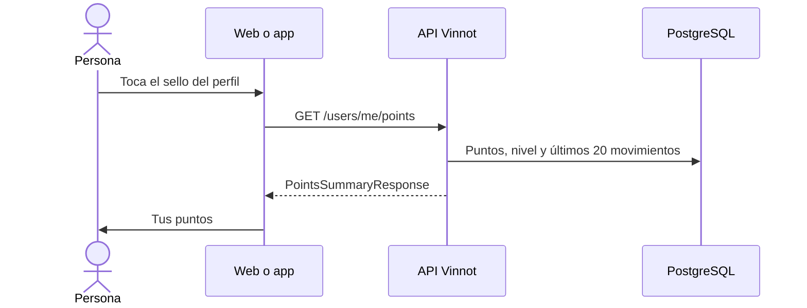

# UC-GAM-02 · Consultar mis puntos

| Campo | Valor |
|---|---|
| ID | `UC-GAM-02` |
| Módulo | [Puntos y sellos](../README.md) |
| Plataformas | Web, APK |
| Actores | Usuario autenticado |
| IDs en Lucidchart | Ninguno |
| Requisitos | [`RF-WEB-GAM-04`](../requirements.md), [`RF-APK-GAM-04`](../requirements.md) |
| Casos de prueba | [`CP-GAM-09`](../testing.md), [`CP-GAM-10`](../testing.md), [`CP-GAM-11`](../testing.md), [`CP-GAM-12`](../testing.md), [`CP-GAM-13`](../testing.md) |

## Precondiciones

- La persona tiene sesión iniciada.

## Postcondiciones

- La persona ve sus puntos, su sello, su progreso y sus últimos movimientos.

## Flujo principal

1. La persona abre su perfil: el encabezado muestra el sello, los puntos, el nombre del nivel y la barra de progreso al siguiente.
2. Toca el sello y se abre «Tus puntos» (`/profile/points` en la web, `/points` en la app).
3. El cliente pide `GET /users/me/points`.
4. `GetMyPointsQueryHandler` proyecta los puntos, el nivel, el siguiente nivel y su umbral, lo sumado hoy y el tope, las celebraciones pendientes y los últimos 20 movimientos con su etiqueta.
5. La pantalla muestra cómo sumar con cada límite y el tope diario, los últimos movimientos con su signo y la escalera completa con el nivel actual marcado.

## Flujos alternativos

- 4a. La persona nunca tuvo puntos: se muestra Brote con 0 puntos.
- 5a. No hay movimientos: se indica que todavía no hay actividad.
- 3a. La carga falla: se ofrece reintentar.
- 5b. En la app, la persona desliza para actualizar o vuelve a la pantalla: se piden puntos frescos, sin indicador de carga para las actualizaciones en segundo plano.

## Reglas de negocio

- El nivel sale de los puntos actuales: baja si se revocan puntos.
- Las revocaciones aparecen como movimientos negativos.
- Un movimiento muestra el nombre del vino o evento relacionado cuando existe.

## Secuencia de la consulta

[Ver diagrama de «Secuencia de la consulta» completo](https://images.vinnot.com/docs/diagrams/v1/es/modules-gamification-use-cases-uc-gam-02-view-my-points-89cca16fb9da.svg)

## Código

| Capa | Ubicación |
|---|---|
| Endpoints | `GET /users/me/points` |
| Backend | [`PointsController.java`](../../../../../backend/src/main/java/com/vinnot/gamification/infrastructure/web/controller/PointsController.java), [`GetMyPointsQueryHandler.java`](../../../../../backend/src/main/java/com/vinnot/gamification/application/query/handler/GetMyPointsQueryHandler.java), [`PointsSummaryResponse.java`](../../../../../backend/src/main/java/com/vinnot/gamification/application/query/response/PointsSummaryResponse.java), [`Tier.java`](../../../../../backend/src/main/java/com/vinnot/gamification/domain/model/Tier.java) |
| Web | [`PointsPage.tsx`](../../../../../frontend-react/src/presentation/pages/user/PointsPage.tsx), [`ProfilePointsHeader.tsx`](../../../../../frontend-react/src/presentation/components/features/points/ProfilePointsHeader.tsx), [`useMyPoints.ts`](../../../../../frontend-react/src/presentation/hooks/queries/user/useMyPoints.ts), [`points.service.ts`](../../../../../frontend-react/src/application/services/points.service.ts), [`users.client.ts`](../../../../../frontend-react/src/infrastructure/api/clients/users.client.ts) |
| App | [`PointsScreen.tsx`](../../../../../frontend-mobile/src/presentation/features/points/PointsScreen.tsx), [`ProfilePoints.tsx`](../../../../../frontend-mobile/src/presentation/features/points/ProfilePoints.tsx), [`index.ts`](../../../../../frontend-mobile/src/presentation/hooks/queries/user/index.ts), [`points.service.ts`](../../../../../frontend-mobile/src/application/services/points.service.ts), [`points.client.ts`](../../../../../frontend-mobile/src/infrastructure/api/clients/points.client.ts) |

## Tests automáticos

- Backend:
  - [`PointsQueryHandlersTest.java`](../../../../../backend/src/test/java/com/vinnot/gamification/application/query/handler/PointsQueryHandlersTest.java): `aMemberWithoutPointsIsAFreshBrote`, `theSummaryShowsProgressTodayAndTheLastMovementsLabelled`
  - [`TierTest.java`](../../../../../backend/src/test/java/com/vinnot/gamification/domain/model/TierTest.java): `theLadderHasTheApprovedKeysAndThresholds`, `pointsChooseTheHighestReachedTier`, `nextIsNullAtTheTopAndLowerPicksTheSmallerTier`
  - [`PointsHttpPostgresIntegrationTest.java`](../../../../../backend/src/test/java/com/vinnot/gamification/infrastructure/PointsHttpPostgresIntegrationTest.java): `reviewsLikesAndCommentsEarnAndDeletingTheReviewTakesItsPointsBack`, `aCompleteProfileNeedsThePhoneAndEarnsOnce`
- Web:
  - [`PointsPage.test.tsx`](../../../../../frontend-react/src/presentation/pages/user/PointsPage.test.tsx): `shows the seal and progress, how to earn points, recent movements and the full ladder`, `reads in Spanish and says when there are no movements yet`, `offers a retry when the points cannot be loaded`, `shows points and the seal in the profile header; the seal opens the points page`, `shows a placeholder while loading and nothing when the points are unavailable`
  - [`points.service.test.ts`](../../../../../frontend-react/src/application/services/points.service.test.ts): `maps the points summary into the domain model`
  - [`users.client.points.test.ts`](../../../../../frontend-react/src/infrastructure/api/clients/users.client.points.test.ts): `reads the current user points from the wrapped /users/me/points response`, `also accepts an unwrapped points body`
  - [`points.mappers.test.ts`](../../../../../frontend-react/src/domain/points/points.mappers.test.ts): `maps the points summary with known tiers, sources and dates`, `falls back safely on the top tier, unknown keys and missing fields`, `treats an absent list and flags as empty`
  - [`points.tiers.test.ts`](../../../../../frontend-react/src/domain/points/points.tiers.test.ts): `lists the eleven tiers in ladder order with their thresholds`, `finds the tier that current points reach`, `measures the way from the tier floor to the next tier`, `is full with nothing left at the top tier`
  - [`badgeTierCopy.test.ts`](../../../../../frontend-react/src/shared/i18n/badgeTierCopy.test.ts): `names every tier in Spanish and in English`
- App:
  - [`PointsScreen.test.tsx`](../../../../../frontend-mobile/src/presentation/features/points/PointsScreen.test.tsx): `lists how to earn points with each limit and the daily cap`, `shows recent movements with their sign, including revocations and unknown sources`, `shows the whole ladder: reached seals animated, the current one marked, the rest locked`, `says when there is no activity yet`, `pulls fresh points on pull-to-refresh, without a spinner for background refreshes`, `offers a retry when loading fails`
  - [`usePointsSummary.test.tsx`](../../../../../frontend-mobile/src/presentation/hooks/queries/user/usePointsSummary.test.tsx): `asks for fresh points when a screen opens, even if the seal host already holds them`, `refreshes the points when the person comes back to the screen`, `does not fetch for a signed-out profile`
  - [`points.service.test.ts`](../../../../../frontend-mobile/src/application/services/points.service.test.ts): `maps the current user`
  - [`points.client.test.ts`](../../../../../frontend-mobile/src/infrastructure/api/clients/points.client.test.ts): `reads the current user`, `also accepts an unwrapped body`
  - [`points.mappers.test.ts`](../../../../../frontend-mobile/src/domain/points/points.mappers.test.ts): `maps the summary, its tiers and the recent movements`, `falls back safely on missing or unknown fields`, `derives an unknown tier from the points instead of showing the first seal`
  - [`badgeTiers.test.ts`](../../../../../frontend-mobile/src/domain/points/badgeTiers.test.ts): `lists the eleven tiers in ascending order with their thresholds`, `measures the way from the tier floor to the next tier`, `is complete at the top tier`
