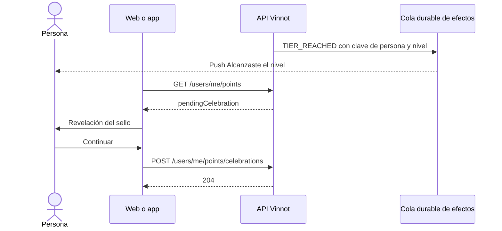

# UC-GAM-03 · Celebrar un nivel nuevo

| Campo | Valor |
|---|---|
| ID | `UC-GAM-03` |
| Módulo | [Puntos y sellos](../README.md) |
| Plataformas | Web, APK |
| Actores | Usuario autenticado, Servicio de notificaciones push |
| IDs en Lucidchart | Ninguno |
| Requisitos | [`RF-WEB-GAM-05`](../requirements.md), [`RF-WEB-GAM-06`](../requirements.md), [`RF-APK-GAM-05`](../requirements.md), [`RF-APK-GAM-06`](../requirements.md), [`RF-APK-GAM-09`](../requirements.md) |
| Casos de prueba | [`CP-GAM-14`](../testing.md), [`CP-GAM-15`](../testing.md), [`CP-GAM-16`](../testing.md), [`CP-GAM-17`](../testing.md), [`CP-GAM-18`](../testing.md), [`CP-GAM-19`](../testing.md) |

## Precondiciones

- La persona alcanzó por primera vez un nivel más alto ([`UC-GAM-01`](uc-gam-01-earn-and-lose-points.md)).

## Postcondiciones

- Ese nivel y los inferiores quedan celebrados y no se vuelven a mostrar.

## Flujo principal

1. En la misma transacción del premio, `PushTierReachedNotifier` encola un push `TIER_REACHED` en la cola durable de efectos, con la clave de la persona y el nivel.
2. Al entregarlo, el push dice «Alcanzaste <nivel>» con el nombre del nivel en el idioma de la persona.
3. Al abrir la web o la app, `PointsCelebrationHost` (web) o `PointsHost` (app) lee `pendingCelebration` de `GET /users/me/points`.
4. Muestra la revelación del sello a pantalla completa; en la app, con una vibración de éxito.
5. Al continuar, el cliente envía `POST /users/me/points/celebrations` con `{ tier }`.
6. `CelebratePointsCommandHandler` marca ese nivel y los inferiores como celebrados y la API responde 204.

## Flujos alternativos

- 1a. La persona bajó de nivel por una revocación y vuelve a subir: no se encola otro push ni se repite la celebración.
- 2a. La preferencia de Comunidad está apagada: el push no se envía; la celebración en pantalla se muestra igual.
- 3a. La respuesta trae `showWelcome` después del cálculo histórico: se muestra una vez la tarjeta de bienvenida y se descarta con `{ welcome: true }` para todos los dispositivos.
- 5a. Se celebra un nivel inferior al pendiente: el nivel más alto sigue pendiente.
- 5b. El pedido no trae `tier` ni `welcome: true`, o trae una clave desconocida: la API responde 400.

## Reglas de negocio

- Un push por persona y nivel: la clave del efecto es `tier-reached:<persona>:<nivel>`.
- El cálculo histórico de V70 nunca envía push; deja la bienvenida pendiente en lugar de una celebración.
- Celebrar un nivel por encima del alcanzado cuenta como el alcanzado.

## Secuencia de la celebración

[Ver diagrama de «Secuencia de la celebración» completo](https://images.vinnot.com/docs/diagrams/v1/es/modules-gamification-use-cases-uc-gam-03-celebrate-tier-bc3273b9aa4e.svg)

## Código

| Capa | Ubicación |
|---|---|
| Endpoints | `POST /users/me/points/celebrations` |
| Backend | [`PointsController.java`](../../../../../backend/src/main/java/com/vinnot/gamification/infrastructure/web/controller/PointsController.java), [`CelebratePointsRequest.java`](../../../../../backend/src/main/java/com/vinnot/gamification/infrastructure/web/request/CelebratePointsRequest.java), [`CelebratePointsCommandHandler.java`](../../../../../backend/src/main/java/com/vinnot/gamification/application/command/handler/CelebratePointsCommandHandler.java), [`PushTierReachedNotifier.java`](../../../../../backend/src/main/java/com/vinnot/gamification/infrastructure/notification/PushTierReachedNotifier.java), [`TierReachedPushTemplate.java`](../../../../../backend/src/main/java/com/vinnot/notification/infrastructure/push/TierReachedPushTemplate.java) |
| Web | [`PointsCelebrationHost.tsx`](../../../../../frontend-react/src/presentation/components/features/points/PointsCelebrationHost.tsx), [`usePointsAcknowledgement.ts`](../../../../../frontend-react/src/presentation/hooks/queries/user/usePointsAcknowledgement.ts), [`points.service.ts`](../../../../../frontend-react/src/application/services/points.service.ts) |
| App | [`PointsHost.tsx`](../../../../../frontend-mobile/src/presentation/features/points/PointsHost.tsx), [`usePointsCelebration.ts`](../../../../../frontend-mobile/src/presentation/features/points/usePointsCelebration.ts), [`TierCelebration.tsx`](../../../../../frontend-mobile/src/presentation/features/points/TierCelebration.tsx), [`PointsWelcomeCard.tsx`](../../../../../frontend-mobile/src/presentation/features/points/PointsWelcomeCard.tsx) |

## Tests automáticos

- Backend:
  - [`CelebratePointsCommandHandlerTest.java`](../../../../../backend/src/test/java/com/vinnot/gamification/application/command/handler/CelebratePointsCommandHandlerTest.java): `celebratingTheReachedTierClearsThePendingCelebration`, `celebratingALowerTierLeavesTheHigherOnePending`, `aTierAboveTheReachedOneCountsAsTheReachedOne`, `dismissingTheWelcomeCardKeepsTheCelebrationPending`, `anUnknownMemberIsRejected`
  - [`PointsAccountTest.java`](../../../../../backend/src/test/java/com/vinnot/gamification/domain/model/PointsAccountTest.java): `reachingATierForTheFirstTimeIsReportedOnce`, `aJumpOverSeveralTiersReportsTheHighestOne`, `celebratingMarksThatTierAndLowerOnesButNeverAboveTheHighestReached`
  - [`PushTierReachedNotifierTest.java`](../../../../../backend/src/test/java/com/vinnot/gamification/infrastructure/PushTierReachedNotifierTest.java): `queuesOnePushKeyedByMemberAndTier`
  - [`AwardPointsCommandHandlerTest.java`](../../../../../backend/src/test/java/com/vinnot/gamification/application/command/handler/AwardPointsCommandHandlerTest.java): `reachingATierQueuesOnePushAndADropAndReturnDoNotQueueAnother`
  - [`PointsHttpPostgresIntegrationTest.java`](../../../../../backend/src/test/java/com/vinnot/gamification/infrastructure/PointsHttpPostgresIntegrationTest.java): `reachingATierQueuesOnePushAndTheCelebrationIsRecorded`
  - [`PointsQueryHandlersTest.java`](../../../../../backend/src/test/java/com/vinnot/gamification/application/query/handler/PointsQueryHandlersTest.java): `celebratingAndDismissingTheWelcomeAreStored`
- Web:
  - [`PointsCelebrationHost.test.tsx`](../../../../../frontend-react/src/presentation/components/features/points/PointsCelebrationHost.test.tsx): `reveals a newly reached tier once and records it as celebrated`, `shows the one-time welcome card and opens the points page from it`, `stays silent with nothing to celebrate and for visitors`
  - [`pointsInvalidation.test.tsx`](../../../../../frontend-react/src/presentation/hooks/queries/user/pointsInvalidation.test.tsx): `clears the pending celebration or the welcome card at once and records them`, `leaves an empty cache alone when acknowledging`
  - [`points.service.test.ts`](../../../../../frontend-react/src/application/services/points.service.test.ts): `marks a tier as celebrated and dismisses the welcome card`
  - [`users.client.points.test.ts`](../../../../../frontend-react/src/infrastructure/api/clients/users.client.points.test.ts): `marks a tier celebrated and dismisses the welcome card`
- App:
  - [`PointsHost.test.tsx`](../../../../../frontend-mobile/src/presentation/features/points/PointsHost.test.tsx): `renders nothing when there is nothing to celebrate`, `celebrates a new tier with a success haptic and closes it with continue`, `closes the celebration before opening the points screen`, `shows the one-time welcome card and dismisses it`
  - [`usePointsCelebration.test.ts`](../../../../../frontend-mobile/src/presentation/features/points/usePointsCelebration.test.ts): `celebrates a pending tier once and then marks it as celebrated`, `celebrates a later tier reached in the same session`, `shows the welcome card once and dismisses it on every device`, `shows nothing without a pending tier or a welcome`
  - [`points.service.test.ts`](../../../../../frontend-mobile/src/application/services/points.service.test.ts): `marks a tier as celebrated and dismisses the welcome card`
  - [`points.client.test.ts`](../../../../../frontend-mobile/src/infrastructure/api/clients/points.client.test.ts): `marks a tier as celebrated and dismisses the welcome card`
  - [`badgeTierCopy.test.ts`](../../../../../frontend-mobile/src/shared/i18n/badgeTierCopy.test.ts): `names every tier in Spanish and in English`, `reads naturally around the top tier in the celebration and the welcome card`
