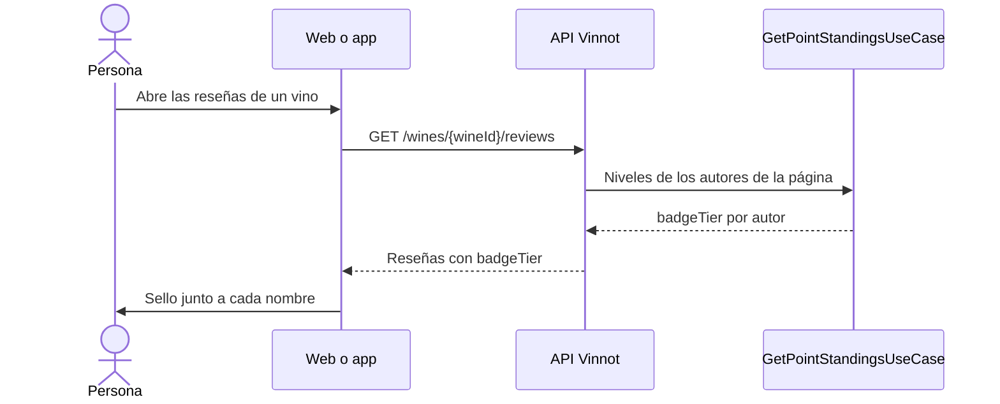

# UC-GAM-04 · Ver el sello junto al nombre

| Campo | Valor |
|---|---|
| ID | `UC-GAM-04` |
| Módulo | [Puntos y sellos](../README.md) |
| Plataformas | Web, APK |
| Actores | Usuario autenticado, Administrador |
| IDs en Lucidchart | Ninguno |
| Requisitos | [`RF-WEB-GAM-07`](../requirements.md), [`RF-WEB-GAM-08`](../requirements.md), [`RF-APK-GAM-07`](../requirements.md), [`RF-APK-GAM-08`](../requirements.md) |
| Casos de prueba | [`CP-GAM-20`](../testing.md), [`CP-GAM-21`](../testing.md), [`CP-GAM-22`](../testing.md), [`CP-GAM-23`](../testing.md), [`CP-GAM-24`](../testing.md) |

## Precondiciones

- La persona tiene sesión iniciada.

## Postcondiciones

- Cada autor visible muestra el sello de su nivel, salvo las cuentas bloqueadas o inactivas.

## Flujo principal

1. La persona abre las reseñas de un vino, sus reseñas, los comentarios de una reseña o, si administra, el listado de usuarios.
2. La API agrega `badgeTier` a cada autor; las reseñas lo obtienen con una sola consulta por página mediante `GetPointStandingsUseCase`, y el listado de administración suma también los `points`.
3. `UserBadge` dibuja el arte del nivel junto al nombre.
4. En listas el sello se anima una vez al aparecer y otra cada 8 a 16 segundos; en el perfil, de forma continua.

## Flujos alternativos

- 2a. La cuenta del autor está bloqueada o inactiva: `badgeTier` es `null` y no se muestra sello.
- 3a. La clave del nivel es desconocida: no se muestra sello y el nombre queda igual.
- 4a. El sistema pide menos movimiento: el sello queda quieto con un reflejo fijo.
- 4b. El sello mide menos de 40 px: se dibuja sin destellos.

## Reglas de negocio

- El sello no aparece en organizadores, bloqueos, denuncias ni push.
- La animación crece con el nivel; el detalle por nivel está en el [README del módulo](../README.md#interfaz).
- En la web, en sellos grandes, la lámina sigue el puntero; en la app, el sello en reposo queda plano.

## Secuencia de una lista con sellos

[Ver diagrama de «Secuencia de una lista con sellos» completo](https://images.vinnot.com/docs/diagrams/v1/es/modules-gamification-use-cases-uc-gam-04-seal-next-to-name-d5156505235e.svg)

## Código

| Capa | Ubicación |
|---|---|
| Backend | [`GetPointStandingsQueryHandler.java`](../../../../../backend/src/main/java/com/vinnot/gamification/application/query/handler/GetPointStandingsQueryHandler.java), [`GamificationReviewerBadgeAdapter.java`](../../../../../backend/src/main/java/com/vinnot/review/infrastructure/gamification/GamificationReviewerBadgeAdapter.java), [`GamificationUserPointsAdapter.java`](../../../../../backend/src/main/java/com/vinnot/admin/infrastructure/gamification/GamificationUserPointsAdapter.java) |
| Web | [`UserBadge.tsx`](../../../../../frontend-react/src/presentation/components/features/points/UserBadge.tsx), [`sealMotion.ts`](../../../../../frontend-react/src/presentation/components/features/points/sealMotion.ts), [`ReviewCard.tsx`](../../../../../frontend-react/src/presentation/components/features/wine/ReviewCard.tsx) |
| App | [`UserBadge.tsx`](../../../../../frontend-mobile/src/presentation/features/points/UserBadge.tsx), [`NameBadge.tsx`](../../../../../frontend-mobile/src/presentation/features/points/NameBadge.tsx), [`SealCanvas.tsx`](../../../../../frontend-mobile/src/presentation/features/points/SealCanvas.tsx), [`sealMotion.ts`](../../../../../frontend-mobile/src/presentation/features/points/sealMotion.ts) |

## Tests automáticos

- Backend:
  - [`PointsQueryHandlersTest.java`](../../../../../backend/src/test/java/com/vinnot/gamification/application/query/handler/PointsQueryHandlersTest.java): `standingsHideTheSealOfLockedOrInactiveMembers`
  - [`PointsHttpPostgresIntegrationTest.java`](../../../../../backend/src/test/java/com/vinnot/gamification/infrastructure/PointsHttpPostgresIntegrationTest.java): `reviewerBadgesShowTheTierAndHideItForLockedMembers`
  - [`GamificationReviewPointsAdapterTest.java`](../../../../../backend/src/test/java/com/vinnot/review/infrastructure/gamification/GamificationReviewPointsAdapterTest.java): `badgesComeFromThePointsModule`
  - [`ReviewerInfoResolverTest.java`](../../../../../backend/src/test/java/com/vinnot/review/application/query/handler/ReviewerInfoResolverTest.java): `buildsFullNameAndFallsBackToUsernameForMissingNames`
  - [`GetReviewCommentsQueryHandlerTest.java`](../../../../../backend/src/test/java/com/vinnot/review/application/query/handler/GetReviewCommentsQueryHandlerTest.java): `batchResolvesReviewersAndKeepsUnknownUsersNullable`
  - [`GetReviewsByWineQueryHandlerTest.java`](../../../../../backend/src/test/java/com/vinnot/review/application/query/handler/GetReviewsByWineQueryHandlerTest.java): `resolvesSortEnrichmentCountsAndCurrentUsersLike`
  - [`AdminCatalogQueryHandlersTest.java`](../../../../../backend/src/test/java/com/vinnot/admin/application/query/handler/AdminCatalogQueryHandlersTest.java): `getsAnAdministrativeUserProjectionOrReportsItsAbsence`, `switchesAdministrativeUserSearchBetweenKeywordAndFullListing`
- Web:
  - [`UserBadge.test.tsx`](../../../../../frontend-react/src/presentation/components/features/points/UserBadge.test.tsx): `shows nothing when the tier is hidden or unknown`, `draws the tier art as one named image in both languages`, `plays once when it appears in a list, then replays every 8–16 s while visible`, `loops forever in the profile without waiting to appear`, `skips sparkles below 40 px and shows them on bigger seals`, `stays still with a fixed highlight when the system asks for less motion`, `follows the pointer with tilt and foil on big seals and resets on leave`
  - [`ReviewCard.test.tsx`](../../../../../frontend-react/src/presentation/components/features/wine/ReviewCard.test.tsx): `shows the reviewer seal right after the name`, `hides the seal when the reviewer has none, as before`
  - [`ReviewComments.test.tsx`](../../../../../frontend-react/src/presentation/components/features/wine/ReviewComments.test.tsx): `shows the commenter seal after the name and nothing when there is none`
  - [`AdminUsersPage.test.tsx`](../../../../../frontend-react/src/presentation/pages/admin/AdminUsersPage.test.tsx): `shows each user seal after the username and their points, without a seal when hidden`
- App:
  - [`UserBadge.test.tsx`](../../../../../frontend-mobile/src/presentation/features/points/UserBadge.test.tsx): `renders nothing when the user has no visible badge`, `draws the tier art and names the tier for screen readers`, `skips sparkles below 40 points and keeps them at profile size`, `keeps a resting seal flat, without the 3D tilt that leaves a box edge on iOS`, `still shows the seal with reduced motion`
  - [`useListReplay.test.ts`](../../../../../frontend-mobile/src/presentation/features/points/useListReplay.test.ts): `plays once on appear and again after 8 to 16 seconds while on screen`, `skips replays while the seal is off screen`
  - [`sealMotion.test.ts`](../../../../../frontend-mobile/src/presentation/features/points/sealMotion.test.ts): `loops forever in the profile and plays once per burst in lists`, `replays list seals every 8 to 16 seconds`
  - [`ReviewItem.test.tsx`](../../../../../frontend-mobile/src/presentation/features/wine/ReviewItem.test.tsx): `shows the reviewer's seal after the name and keeps the name when there is none`
  - [`ReviewComments.test.tsx`](../../../../../frontend-mobile/src/presentation/features/wine/ReviewComments.test.tsx): `shows the commenter's seal after the name only when they have one`
  - [`AdminUserRow.test.tsx`](../../../../../frontend-mobile/src/presentation/features/admin/AdminUserRow.test.tsx): `shows the user's seal after the name and their points`, `hides the seal of a user without a visible tier`
