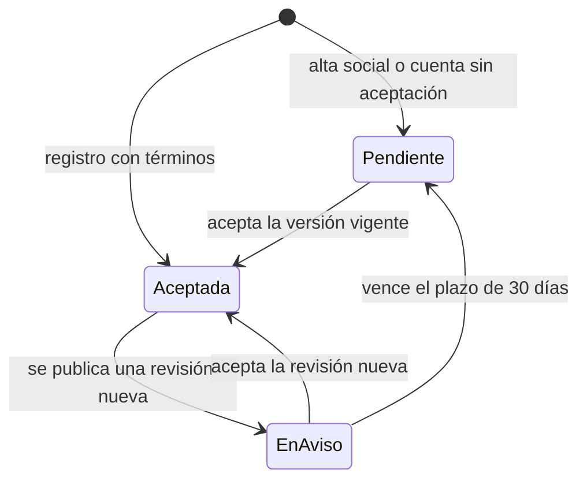
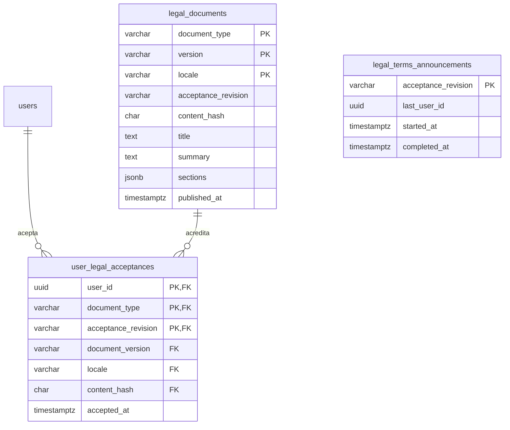

# Legal

Los términos de uso de Vinnot y la prueba de que cada cuenta los aceptó. El
módulo publica los términos por versión, los pide al registrarse y al entrar
cuando hay una revisión nueva, guarda cada aceptación como evidencia que no se
puede modificar y avisa por email cuando cambian. El centro legal también ofrece
privacidad, políticas y cookies, pero esos documentos son contenido fijo del
cliente: solo los términos están versionados y se aceptan.

- Código del módulo: `LEG`.
- Backend: paquete [`legal`](../../../../backend/src/main/java/com/vinnot/legal/).
- [Casos de uso](use-cases/README.md) · [Requisitos](requirements.md) ·
  [Arquitectura](architecture.md) · [Pruebas](testing.md)

## Actores

| Actor | Qué hace en este módulo |
|---|---|
| Visitante | Lee el centro legal y acepta los términos al registrarse |
| Usuario autenticado | Acepta la versión vigente o cierra sesión sin aceptar |
| Tarea programada | Avisa a las cuentas cuando se publica una revisión nueva |
| Servicio de email | Entrega el aviso `TERMS_UPDATED` |
| Equipo técnico | Publica versiones nuevas con una migración y una variable de entorno |

## Reglas de negocio

| Regla | Detalle | Dónde |
|---|---|---|
| Aceptación explícita | Hace falta marcar la casilla; iniciar sesión, leer o desplazarse no cuenta | [`LegalAgreementService.java`](../../../../backend/src/main/java/com/vinnot/legal/application/service/LegalAgreementService.java) |
| Selección exacta | Versión, idioma (`es` o `en`) y hash SHA-256 deben coincidir con la versión vigente; si no, 422 `TERMS_VERSION_CHANGED` | [`LegalAgreementService.java`](../../../../backend/src/main/java/com/vinnot/legal/application/service/LegalAgreementService.java) |
| Versión y revisión | `version` identifica una publicación; `acceptanceRevision` la revisión que exige aceptar. Las traducciones comparten revisión | `V21__versioned_terms_acceptance.sql` |
| Plazo de aviso | Quien aceptó una revisión anterior tiene 30 días desde que se publica la nueva; la primera revisión y quien nunca aceptó deben aceptar en el momento | [`LegalAgreementService.java`](../../../../backend/src/main/java/com/vinnot/legal/application/service/LegalAgreementService.java) |
| Evidencia inmutable | Los documentos no se modifican ni se borran y las aceptaciones no se modifican (triggers); eliminar la cuenta borra sus aceptaciones | `V21__versioned_terms_acceptance.sql` |
| Sin duplicados | Una aceptación por cuenta y revisión; la primera conserva fecha e idioma | [`JdbcLegalRepository.java`](../../../../backend/src/main/java/com/vinnot/legal/infrastructure/JdbcLegalRepository.java) |
| Exigencia en la API | Con `LEGAL_ENFORCE_ACCEPTANCE` encendido, la API rechaza a quien debe aceptar (422 `TERMS_ACCEPTANCE_REQUIRED`); por defecto está apagado | [`LegalAccessConfiguration.java`](../../../../backend/src/main/java/com/vinnot/legal/infrastructure/web/LegalAccessConfiguration.java) |
| Alcance | Aceptar los términos no activa cookies opcionales, comunicaciones ni permisos del sistema | [`TermsReview.tsx`](../../../../frontend-react/src/presentation/components/auth/TermsReview.tsx) |

## Estado de aceptación de una cuenta

[Ver diagrama de «Estado de aceptación de una cuenta» completo](https://images.vinnot.com/docs/diagrams/v1/es/modules-legal-readme-0d01d32776c2.svg)

`Pendiente` es `required = true`: la web y la app muestran el pedido de
aceptación antes de la aplicación. `EnAviso` es `required = false` con
`requiredFrom`: la persona sigue usando la aplicación y recibe el email de
aviso.

## Dónde vive

| Parte | Ubicación |
|---|---|
| API | [`LegalController`](../../../../backend/src/main/java/com/vinnot/legal/infrastructure/web/LegalController.java), el interceptor [`LegalAccessConfiguration`](../../../../backend/src/main/java/com/vinnot/legal/infrastructure/web/LegalAccessConfiguration.java) y la tarea [`TermsAnnouncementScheduler`](../../../../backend/src/main/java/com/vinnot/legal/infrastructure/scheduling/TermsAnnouncementScheduler.java); el registro llama al módulo desde [`RegisterUserCommandHandler`](../../../../backend/src/main/java/com/vinnot/user/application/command/handler/RegisterUserCommandHandler.java) |
| Web | [`TermsGate`](../../../../frontend-react/src/presentation/components/auth/TermsGate.tsx), [`TermsReview`](../../../../frontend-react/src/presentation/components/auth/TermsReview.tsx) y el centro legal [`LegalCentrePage`](../../../../frontend-react/src/presentation/pages/public/LegalCentrePage.tsx) |
| App | [`TermsGate`](../../../../frontend-mobile/src/presentation/features/public/TermsGate.tsx), [`TermsReview`](../../../../frontend-mobile/src/presentation/features/public/TermsReview.tsx) y el centro legal [`LegalCentreScreen`](../../../../frontend-mobile/src/presentation/features/public/LegalCentreScreen.tsx) |
| Contenido fijo | `content/public-pages.json`, copiado a cada cliente por `scripts/sync-public-content.mjs` |

No hay pantalla de administración para los documentos legales: una versión
nueva se publica con una migración y la variable `LEGAL_TERMS_VERSION`
([UC-LEG-08](use-cases/uc-leg-08-publish-terms-version.md)).

## Versiones publicadas

| Versión | Revisión | Migración | Motivo |
|---|---|---|---|
| `2026-09-27.1` | `terms-1` | `V21__versioned_terms_acceptance.sql` | Primera versión de los términos |
| `2026-10-29.1` | `terms-2` | `V75__terms_2026_10_29.sql` | La sección `transactions` («Eventos, entradas y pagos») describe la venta de entradas con Mercado Pago y la comisión de Vinnot. La versión anterior decía que Vinnot no procesaba pagos de eventos, y eso ya no era cierto. Es un cambio sustantivo, así que usa una revisión nueva |

Las otras siete secciones de `2026-10-29.1` son idénticas a las de
`2026-09-27.1`. La copia incluida en los clientes (página `terms` de
`content/public-pages.json`) repite el mismo texto. Los pasos de publicación
están en [UC-LEG-08](use-cases/uc-leg-08-publish-terms-version.md#publicar-la-revisión-terms-2).

El resto del centro legal no tiene versión propia: `content/public-pages.json`
lleva una sola fecha `version` (`2026-10-29` desde este cambio). Ese día la
página de privacidad sumó Mercado Pago, los registros de pago y el registro de
seguridad, y la de pagos dejó de decir que no había cobros ni comisión.

## Configuración

| Variable | Valor por defecto | Para qué |
|---|---|---|
| `LEGAL_TERMS_VERSION` | `2026-10-29.1` | Elige la versión vigente entre las publicadas |
| `LEGAL_ENFORCE_ACCEPTANCE` | `false` | Enciende el bloqueo de la API para quien debe aceptar |
| `app.legal.notice-period` | `P30D` | Plazo de aviso para una revisión nueva |
| `app.legal.announcements.enabled` | `true` | Enciende el aviso por email de una revisión nueva |

## Datos

Tablas creadas en `V21__versioned_terms_acceptance.sql` y
`V56__legal_terms_announcements.sql`.

[Ver diagrama de «Legal · Datos» completo](https://images.vinnot.com/docs/diagrams/v1/es/modules-legal-readme-f7c84ae6409a.svg)

`legal_terms_announcements` guarda hasta qué cuenta llegó el aviso de cada
revisión, para retomarlo en la próxima corrida.
