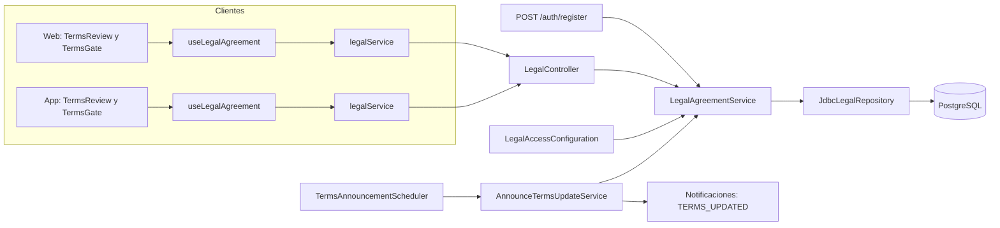
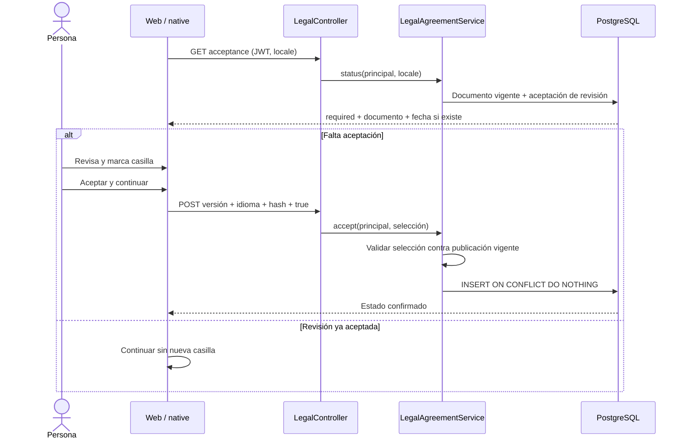
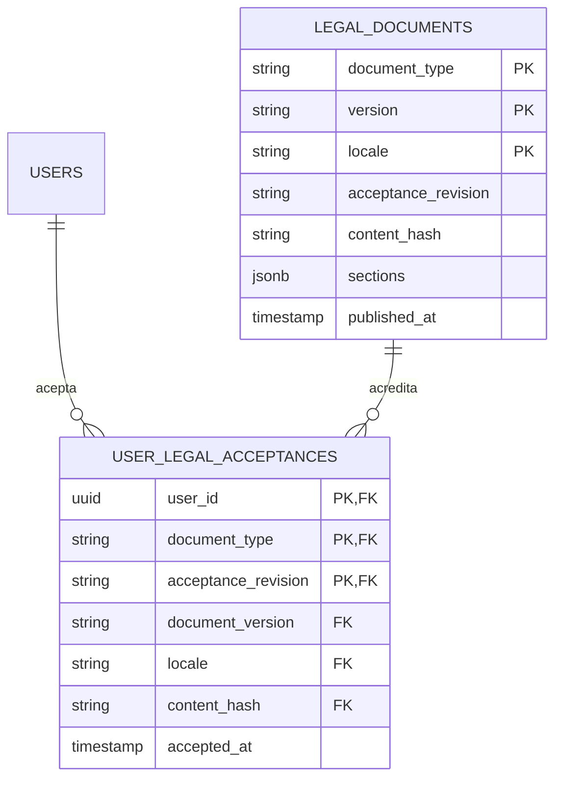

# Arquitectura

Cómo está construido el módulo en cada capa. El backend sigue el flujo hexagonal
`controller → puerto de entrada → servicio → dominio → puerto de salida → adaptador`;
la web y la app siguen `pantalla → hook → servicio → cliente API → transporte HTTP`.



[Ver diagrama de «Arquitectura» completo](https://images.vinnot.com/docs/diagrams/v1/es/modules-legal-architecture-132eee682787.svg)

## Backend

### Alcance y separación de decisiones

El módulo `legal` registra la aceptación explícita de los términos de uso de
Vinnot. Iniciar sesión con contraseña o un proveedor social acredita identidad,
no aceptación. Abrir una política, desplazarse hasta el final o cambiar una
preferencia no crea evidencia contractual.

La Política de Privacidad informa sobre el tratamiento de datos. Las opciones
de mapas/cookies, comunicaciones y permisos del sistema operativo mantienen
sus controles independientes. La casilla de términos nunca activa esas opciones.

### Capas y responsabilidades

`LegalController → LegalAgreementUseCase → LegalAgreementService →
LegalDocumentPort / LegalAcceptancePort → JdbcLegalRepository → PostgreSQL`.

El dominio contiene `TermsDocument`, sus secciones, `TermsSelection` y
`TermsStatus`, sin Spring ni SQL. El servicio valida idioma, aceptación
afirmativa, versión y huella. El adaptador JDBC archiva y consulta documentos,
inserta evidencia e implementa idempotencia. El controller toma la identidad del
principal autenticado; ningún `userId` enviado por el cliente define el titular.

El registro de usuario depende del puerto de entrada legal: valida antes de
crear la cuenta y registra la selección dentro de la misma transacción que
guarda el usuario y solicita la verificación. Un fallo revierte la operación.
No se inventan aceptaciones para cuentas preexistentes o creadas mediante OAuth.

### Contratos HTTP

Rutas relativas a `/api`:

| Método y recurso | Acceso | Resultado |
|---|---|---|
| GET /legal/terms/current?locale=es | Público | Texto, versión, revisión contractual, idioma y SHA-256 vigentes |
| GET /legal/terms/versions/{version}?locale=es | Público | Copia archivada exacta |
| GET /legal/acceptance?locale=es | Autenticado | required, acceptedAt, requiredFrom y documento vigente |
| POST /legal/acceptance | Autenticado | Estado confirmado de la cuenta |

Locales válidos: `es` y `en`. La UI convierte su idioma al locale del contrato.
El POST y el campo opcional `termsAcceptance` de `POST /auth/register` reciben:

```json
{
  "version": "2026-10-29.1",
  "locale": "es",
  "contentHash": "<SHA-256 hexadecimal del documento obtenido>",
  "accepted": true
}
```

Los campos ausentes, mal formados o la casilla falsa producen `400` en el
adaptador HTTP. `TERMS_VERSION_CHANGED` y `TERMS_ACCEPTANCE_REQUIRED` son
reglas de negocio `422`, no errores de autenticación: no invalidan el JWT.
El cliente vuelve a cargar el documento y exige una nueva acción, sin
reintentar una aceptación automáticamente. Un documento inexistente devuelve
`404`. La ausencia de sesión devuelve `401`.

### Versiones, evidencia e integridad

La migración `V21__versioned_terms_acceptance.sql` crea:

- `legal_documents`: clave tipo/versión/idioma; título, resumen, secciones JSON,
  huella, revisión contractual y fecha de publicación.
- `user_legal_acceptances`: cuenta, tipo, revisión, versión exacta, idioma,
  huella y fecha asignada por PostgreSQL.

La clave primaria cuenta/tipo/revisión evita duplicados concurrentes; el primer
registro conserva fecha e idioma. Una FK compuesta comprueba que la evidencia
corresponde a un documento real. El índice de documento soporta esa FK; la
clave primaria permite resolver el estado por cuenta sin escanear la tabla.
Triggers impiden UPDATE/DELETE de documentos y UPDATE de aceptaciones.
Eliminar definitivamente una cuenta elimina sus registros por cascada; no se
almacenan IP, agente de usuario ni otros identificadores de dispositivo.

La huella inicial se calcula sobre JSON UTF-8 compacto con propiedades en orden:
`title`, `summary`, `sections`; cada sección contiene `id`, `title`, `body`.
No se recalcula sobre JSONB serializado por PostgreSQL, que puede cambiar el orden
de claves. El texto archivado no se reescribe para una corrección editorial.

`version` identifica una publicación; `acceptanceRevision` identifica la
revisión contractual que requiere consentimiento. Traducciones equivalentes
comparten revisión. Un cambio sustantivo publica nuevas filas ES/EN con nueva
revisión y exige reaceptación; correcciones editoriales equivalentes pueden
conservarla. Cambiar una FAQ o el diseño no cambia la revisión contractual.

El plazo de aviso se cuenta desde `published_at`, que PostgreSQL asigna cuando
la migración inserta la fila, no desde el cambio de `LEGAL_TERMS_VERSION`.
Por eso la migración y la variable se publican en el mismo despliegue.
`LegalPostgresIntegrationTest` recalcula la huella de `2026-09-27.1` y
`2026-10-29.1` con este algoritmo y comprueba que solo cambió la sección
`transactions`.

### Flujo de aceptación



[Ver diagrama de «Flujo de aceptación» completo](https://images.vinnot.com/docs/diagrams/v1/es/modules-legal-architecture-ab95a98f0907.svg)

### Modelo relacional



[Ver diagrama de «Modelo relacional» completo](https://images.vinnot.com/docs/diagrams/v1/es/modules-legal-architecture-a10894b1309c.svg)

### Publicación gradual y operación

`LEGAL_TERMS_VERSION` selecciona una publicación existente (inicial:
`2026-09-27.1`; vigente: `2026-10-29.1`, publicada por
`V75__terms_2026_10_29.sql` con la revisión `terms-2`; ver
[versiones publicadas](README.md#versiones-publicadas)). `LEGAL_ENFORCE_ACCEPTANCE` es `false` por defecto.
Durante esta fase el backend admite registros legacy sin selección, pero
nunca los marca como aceptados; las nuevas UI sí solicitan la selección.

Con la exigencia activada, `LegalAccessConfiguration` verifica la revisión
antes de las operaciones autenticadas. Quedan disponibles autenticación,
refresh/logout, documentos/aceptación, soporte, borrado propio de cuenta,
infraestructura/documentación HTTP, la versión mínima de la app
(`/app-versions/**`) y recursos públicos estáticos. La navegación
anónima conserva su acceso público; esta política no otorga roles ni permisos.

Una revisión de aceptación nueva da a las cuentas que aceptaron una anterior un
plazo de aviso (`app.legal.notice-period`, 30 días por defecto) contado desde la
primera publicación de esa revisión: `required` sigue en false hasta entonces, la
app funciona como antes (`acceptedAt` informa su aceptación anterior y
`requiredFrom` la fecha, así los clientes publicados antes del plazo igual la dejan
entrar) y `TermsAnnouncementScheduler` le envía a cada cuenta activa y no
suspendida la fecha (`TERMS_UPDATED`, cursor V56 `legal_terms_announcements`). La primera
revisión y las cuentas que nunca aceptaron una revisión son obligatorias en el
momento, así que el plazo nunca relaja la protección existente.

Orden: desplegar backend y V21, publicar clientes compatibles, comprobar
recuperación y recién entonces habilitar la exigencia. Revertir temporalmente
la exigencia no borra evidencia ni reescribe documentos. Un rollback binario
debe conservar V21 y usar una versión compatible con esa historia Flyway;
no se elimina una migración aplicada.

El despliegue web de desarrollo verifica ambos documentos públicos con
`scripts/wait-github-public-terms.mjs` antes de subir archivos a S3. Comprueba
estructura, idioma y coincidencia de versión/revisión ES/EN; reintenta de forma
acotada mientras arranca el backend. Si no están disponibles, la publicación web
se detiene sin reemplazar sus archivos. Esta comprobación no activa la exigencia
global ni registra aceptaciones.

### Pruebas y referencias

Las regresiones cubren validación, idioma, revisión sustantiva, rollout,
documentos alterados, principal autenticado, rechazo, concurrencia,
rollback transaccional, inmutabilidad, FK/índices y eliminación de cuenta.
PostgreSQL se prueba con Testcontainers; no se sustituye por H2.

Ver [autenticación](../../backend/architecture/authentication-and-identity.md),
[API](../../backend/architecture/api.md) y [soporte público](../support/architecture.md).

El texto del acuerdo se presenta plegado inicialmente en registro y primer ingreso, con control para desplegarlo. La casilla sigue desmarcada y aceptar requiere selección explícita y confirmación del servidor. La atribución pública de privacidad identifica a Vinnot y conserva el canal de contacto.

## Web

```text
TermsReview / TermsGate → useLegalAgreement → legalService → legalClient → http
```

| Capa | Pieza | Qué hace |
|---|---|---|
| Dominio | [`agreement.ts`](../../../../frontend-react/src/domain/legal/agreement.ts) | Tipos del documento, la selección y el estado; `selectTerms()` arma la selección a enviar |
| Infraestructura | [`legal.client.ts`](../../../../frontend-react/src/infrastructure/api/clients/legal.client.ts) y [`legal.dto.ts`](../../../../frontend-react/src/infrastructure/api/dto/legal.dto.ts) | Llama a `GET /legal/terms/current`, `GET /legal/acceptance` y `POST /legal/acceptance`; no usa `/legal/terms/versions` |
| Aplicación | [`legal.service.ts`](../../../../frontend-react/src/application/services/legal.service.ts) | Valida cada respuesta: un documento incompleto falla con `INVALID_TERMS_DOCUMENT` y un estado incoherente con `INVALID_TERMS_STATUS` |
| Presentación | [`useLegalAgreement.ts`](../../../../frontend-react/src/presentation/hooks/useLegalAgreement.ts) | Modo `registration` (pide el documento vigente) o `account` (pide el estado). La casilla vale para la persona, el idioma y el hash; si aceptar falla, se desmarca y no se reintenta |
| Presentación | [`TermsReview.tsx`](../../../../frontend-react/src/presentation/components/auth/TermsReview.tsx) | Texto plegado, casilla desmarcada, error con «Volver a cargar términos» y enlace a privacidad |
| Presentación | [`TermsGate.tsx`](../../../../frontend-react/src/presentation/components/auth/TermsGate.tsx) | Pantalla completa «Antes de continuar» con aceptar y «Ahora no · cerrar sesión» |
| Presentación | [`usePublicDocument.ts`](../../../../frontend-react/src/presentation/hooks/usePublicDocument.ts) | Lee los términos desde la API y el resto de los documentos desde el contenido incluido; sin API muestra la copia incluida |

### Dónde se controla

[`App.tsx`](../../../../frontend-react/src/app/App.tsx) envuelve con `TermsGate` el
contenedor de la aplicación y la ruta de completar el perfil. `/legal`,
`/legal/:slug`, `/contact` y las páginas públicas quedan excluidas, así que se
pueden leer sin aceptar.

### Registro

[`useRegisterViewModel.ts`](../../../../frontend-react/src/presentation/pages/public/useRegisterViewModel.ts)
no envía el formulario sin selección y, ante `TERMS_VERSION_CHANGED`, recarga
los términos. [`authErrorMessage.ts`](../../../../frontend-react/src/presentation/feedback/authErrorMessage.ts)
traduce ese código a un mensaje propio. Los botones de Google y Apple del registro
no envían términos: los pide `TermsGate` después del ingreso.

## App

La app repite las mismas capas que la web, con archivos equivalentes en
`frontend-mobile/src`: [`agreement.ts`](../../../../frontend-mobile/src/domain/legal/agreement.ts),
[`legal.client.ts`](../../../../frontend-mobile/src/infrastructure/api/clients/legal.client.ts),
[`legal.service.ts`](../../../../frontend-mobile/src/application/services/legal.service.ts),
[`useLegalAgreement.ts`](../../../../frontend-mobile/src/presentation/hooks/useLegalAgreement.ts),
[`TermsReview.tsx`](../../../../frontend-mobile/src/presentation/features/public/TermsReview.tsx)
y [`TermsGate.tsx`](../../../../frontend-mobile/src/presentation/features/public/TermsGate.tsx).
El servicio es idéntico al de la web.

### Dónde se controla

`frontend-mobile/app/(app)/_layout.tsx` pone `TermsGate` dentro de `AuthGuard`,
alrededor de todas las pantallas privadas y de la redirección a completar el
perfil. Las rutas públicas (`app/legal`, `app/terms.tsx`, `app/privacy.tsx` y
`app/contact.tsx`) están fuera del grupo `(app)`, así que no pasan por el
control.

### Registro

`frontend-mobile/app/(auth)/register.tsx` no envía el formulario sin selección
y, ante `TERMS_VERSION_CHANGED`, recarga los términos. [`auth.service.ts`](../../../../frontend-mobile/src/application/services/auth.service.ts)
traduce ese código al mensaje propio «Los términos se actualizaron. Revisá la nueva
versión antes de continuar.» en lugar del texto del servidor.
