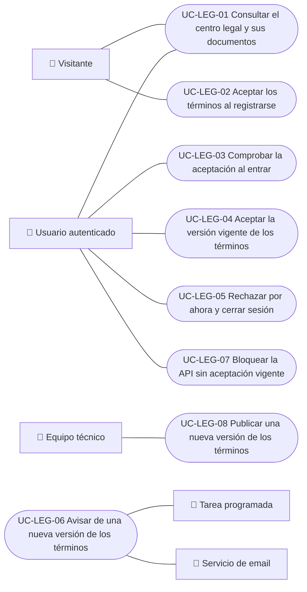

# Casos de uso

Casos de uso del módulo legal: consultar los documentos, aceptar los términos vigentes y operar sus versiones. Cada caso vale para las plataformas indicadas; «Solo backend» indica procesos sin pantalla.

| ID | Caso de uso | Plataformas | Actores |
|---|---|---|---|
| `UC-LEG-01` | [Consultar el centro legal y sus documentos](uc-leg-01-legal-centre.md) | Web, APK | Visitante, Usuario autenticado |
| `UC-LEG-02` | [Aceptar los términos al registrarse](uc-leg-02-accept-at-sign-up.md) | Web, APK | Visitante |
| `UC-LEG-03` | [Comprobar la aceptación al entrar](uc-leg-03-check-acceptance.md) | Web, APK | Usuario autenticado |
| `UC-LEG-04` | [Aceptar la versión vigente de los términos](uc-leg-04-accept-current-version.md) | Web, APK | Usuario autenticado |
| `UC-LEG-05` | [Rechazar por ahora y cerrar sesión](uc-leg-05-decline-and-sign-out.md) | Web, APK | Usuario autenticado |
| `UC-LEG-06` | [Avisar de una nueva versión de los términos](uc-leg-06-announce-terms-update.md) | Solo backend | Tarea programada, Servicio de email |
| `UC-LEG-07` | [Bloquear la API sin aceptación vigente](uc-leg-07-enforce-acceptance.md) | Solo backend | Usuario autenticado |
| `UC-LEG-08` | [Publicar una nueva versión de los términos](uc-leg-08-publish-terms-version.md) | Solo backend | Equipo técnico |

## Diagrama de casos de uso

[Ver diagrama de «Casos de uso · Diagrama de casos de uso» completo](https://images.vinnot.com/docs/diagrams/v1/es/modules-legal-use-cases-readme-b3906158aeb6.svg)

## Equivalencia con Lucidchart

| ID | IDs en Lucidchart |
|---|---|
| `UC-LEG-01` | [WEB UC-PUB-03](https://lucid.app/lucidchart/9f11a16b-bb5a-42fc-a9e8-0852b17bd241/edit), [APK UC-PUB-02](https://lucid.app/lucidchart/e095dd25-e8ac-41ba-bf5b-396e1055f217/edit) |
| `UC-LEG-02` | [WEB UC-LEGAL-01](https://lucid.app/lucidchart/9f11a16b-bb5a-42fc-a9e8-0852b17bd241/edit), [APK UC-AUTH-02](https://lucid.app/lucidchart/e095dd25-e8ac-41ba-bf5b-396e1055f217/edit) |
| `UC-LEG-03` | [WEB UC-LEGAL-02](https://lucid.app/lucidchart/9f11a16b-bb5a-42fc-a9e8-0852b17bd241/edit), [APK UC-LEGAL-01](https://lucid.app/lucidchart/e095dd25-e8ac-41ba-bf5b-396e1055f217/edit) |
| `UC-LEG-04` | [WEB UC-LEGAL-02](https://lucid.app/lucidchart/9f11a16b-bb5a-42fc-a9e8-0852b17bd241/edit), [APK UC-LEGAL-01](https://lucid.app/lucidchart/e095dd25-e8ac-41ba-bf5b-396e1055f217/edit) |
| `UC-LEG-05` | [WEB UC-LEGAL-02](https://lucid.app/lucidchart/9f11a16b-bb5a-42fc-a9e8-0852b17bd241/edit), [APK UC-LEGAL-01](https://lucid.app/lucidchart/e095dd25-e8ac-41ba-bf5b-396e1055f217/edit) |
| `UC-LEG-06` | Ninguno |
| `UC-LEG-07` | Ninguno |
| `UC-LEG-08` | Ninguno |
