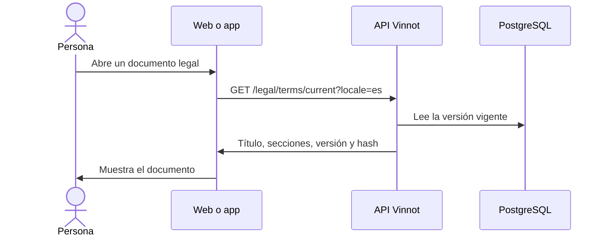

# UC-LEG-01 · Consultar el centro legal y sus documentos

| Campo | Valor |
|---|---|
| ID | `UC-LEG-01` |
| Módulo | [Legal](../README.md) |
| Plataformas | Web, APK |
| Actores | Visitante, Usuario autenticado |
| IDs en Lucidchart | [WEB UC-PUB-03](https://lucid.app/lucidchart/9f11a16b-bb5a-42fc-a9e8-0852b17bd241/edit), [APK UC-PUB-02](https://lucid.app/lucidchart/e095dd25-e8ac-41ba-bf5b-396e1055f217/edit) |
| Requisitos | [`RF-WEB-LEG-01`](../requirements.md), [`RF-APK-LEG-01`](../requirements.md) |
| Casos de prueba | [`CP-LEG-01`](../testing.md), [`CP-LEG-02`](../testing.md) |

## Precondiciones

- Ninguna: el centro legal no requiere sesión.

## Postcondiciones

- La persona leyó el documento; leer no registra ninguna aceptación.

## Flujo principal

1. La persona abre el centro legal (`/legal`, en la web y en la app).
2. El cliente lista los documentos: términos, privacidad, política de contenidos, moderación, confianza y seguridad, ranking, pagos y cancelaciones, y cookies.
3. La persona elige uno.
4. Para los términos, el cliente pide la versión vigente a la API en el idioma de la interfaz; el resto de los documentos viene incluido en el cliente.
5. El cliente muestra el documento con su versión.

## Flujos alternativos

- 4a. La API no responde al pedir los términos: se muestra la copia incluida en el cliente, marcada como no confirmada, con opción de volver a cargar.

## Reglas de negocio

- Solo los términos están versionados en la API (`document_type = 'terms'`); los demás documentos salen de `content/public-pages.json`, que `scripts/sync-public-content.mjs` copia a cada cliente.
- `GET /legal/terms/current` y `GET /legal/terms/versions/{version}` son públicos; el idioma es `es` o `en`, otro valor responde 422 `LEGAL_LOCALE_INVALID`.
- Una versión que no existe responde 404.

## Diagrama

[Ver diagrama de «UC-LEG-01 · Consultar el centro legal y sus documentos» completo](https://images.vinnot.com/docs/diagrams/v1/es/modules-legal-use-cases-uc-leg-01-legal-centre-070693c30448.svg)

Diagrama de componentes en Lucidchart: [WEB UC-PUB-03](https://lucid.app/lucidchart/9f11a16b-bb5a-42fc-a9e8-0852b17bd241/edit), [APK UC-PUB-02](https://lucid.app/lucidchart/e095dd25-e8ac-41ba-bf5b-396e1055f217/edit).

## Código

| Capa | Ubicación |
|---|---|
| Endpoints | `GET /legal/terms/current`, `GET /legal/terms/versions/{version}` |
| Backend | [`LegalController.java`](../../../../../backend/src/main/java/com/vinnot/legal/infrastructure/web/LegalController.java), [`LegalAgreementService.java`](../../../../../backend/src/main/java/com/vinnot/legal/application/service/LegalAgreementService.java) |
| Web | [`LegalCentrePage.tsx`](../../../../../frontend-react/src/presentation/pages/public/LegalCentrePage.tsx), [`PublicDocumentPage.tsx`](../../../../../frontend-react/src/presentation/pages/public/PublicDocumentPage.tsx), [`usePublicDocument.ts`](../../../../../frontend-react/src/presentation/hooks/usePublicDocument.ts), [`useLegalAgreement.ts`](../../../../../frontend-react/src/presentation/hooks/useLegalAgreement.ts) |
| App | [`index.tsx`](../../../../../frontend-mobile/app/legal/index.tsx), [`terms.tsx`](../../../../../frontend-mobile/app/terms.tsx), [`LegalCentreScreen.tsx`](../../../../../frontend-mobile/src/presentation/features/public/LegalCentreScreen.tsx), [`usePublicDocument.ts`](../../../../../frontend-mobile/src/presentation/hooks/usePublicDocument.ts) |

## Tests automáticos

- Backend: [`LegalControllerTest.java`](../../../../../backend/src/test/java/com/vinnot/legal/infrastructure/web/LegalControllerTest.java), [`SecurityConfigAccessTest.java`](../../../../../backend/src/test/java/com/vinnot/shared/infrastructure/config/SecurityConfigAccessTest.java)
- Web: [`usePublicDocument.test.ts`](../../../../../frontend-react/src/presentation/hooks/usePublicDocument.test.ts)
- App: [`usePublicDocument.test.ts`](../../../../../frontend-mobile/src/presentation/hooks/usePublicDocument.test.ts)
