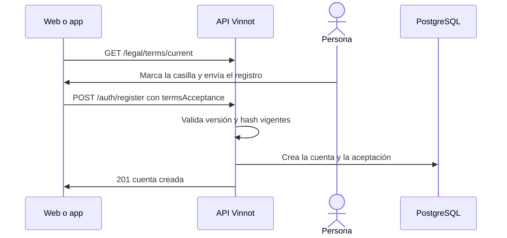

# UC-LEG-02 · Aceptar los términos al registrarse

| Campo | Valor |
|---|---|
| ID | `UC-LEG-02` |
| Módulo | [Legal](../README.md) |
| Plataformas | Web, APK |
| Actores | Visitante |
| IDs en Lucidchart | [WEB UC-LEGAL-01](https://lucid.app/lucidchart/9f11a16b-bb5a-42fc-a9e8-0852b17bd241/edit), [APK UC-AUTH-02](https://lucid.app/lucidchart/e095dd25-e8ac-41ba-bf5b-396e1055f217/edit) |
| Requisitos | [`RF-WEB-LEG-02`](../requirements.md), [`RF-APK-LEG-02`](../requirements.md) |
| Casos de prueba | [`CP-LEG-03`](../testing.md), [`CP-LEG-04`](../testing.md), [`CP-LEG-05`](../testing.md), [`CP-LEG-06`](../testing.md), [`CP-LEG-07`](../testing.md) |

## Precondiciones

- La persona está en el registro con email y contraseña.
- Hay una versión vigente de los términos publicada en `es` y `en`.

## Postcondiciones

- La aceptación queda guardada con versión, idioma y hash, en la misma transacción que crea la cuenta.
- Aceptar los términos no activa cookies opcionales ni comunicaciones promocionales.

## Flujo principal

1. La persona abre el registro y el cliente carga los términos vigentes.
2. El cliente muestra los términos plegados, la casilla desmarcada y el enlace a la política de privacidad.
3. La persona puede desplegar el texto y marca la casilla.
4. Al enviar el registro, el cliente agrega `termsAcceptance` con versión, idioma, hash y `accepted: true`.
5. La API compara la selección con la versión vigente antes de crear la cuenta.
6. La API crea la cuenta y guarda la aceptación en la misma transacción ([UC-USR-01](../../users/use-cases/uc-usr-01-sign-up.md)).

## Flujos alternativos

- 1a. Los términos no cargan: se avisa con «Volver a cargar términos» y el registro no se puede enviar.
- 3a. La casilla no está marcada: el formulario no se envía.
- 5a. La versión o el hash ya no son los vigentes: la API responde 422 `TERMS_VERSION_CHANGED`, no crea la cuenta, y el cliente muestra un mensaje traducido, recarga los términos y desmarca la casilla.
- 1b. La persona se registra con Google o Apple desde esa pantalla: no se envían términos y se piden después del ingreso ([UC-LEG-04](uc-leg-04-accept-current-version.md)).

## Reglas de negocio

- La casilla empieza desmarcada y la marca vale para esa persona, ese idioma y ese hash: cambiar el idioma o recibir otra versión la desmarca.
- Con `LEGAL_ENFORCE_ACCEPTANCE` apagado (valor por defecto) la API acepta registros sin `termsAcceptance` para clientes viejos, pero no registra aceptación; encendido, responde 422 `TERMS_ACCEPTANCE_REQUIRED`.
- Un cuerpo mal formado o `accepted: false` responde 400.

## Diagrama

[Ver diagrama de «UC-LEG-02 · Aceptar los términos al registrarse» completo](https://images.vinnot.com/docs/diagrams/v1/es/modules-legal-use-cases-uc-leg-02-accept-at-sign-up-a9e79f504536.svg)

Diagrama de componentes en Lucidchart: [WEB UC-LEGAL-01](https://lucid.app/lucidchart/9f11a16b-bb5a-42fc-a9e8-0852b17bd241/edit), [APK UC-AUTH-02](https://lucid.app/lucidchart/e095dd25-e8ac-41ba-bf5b-396e1055f217/edit).

## Código

| Capa | Ubicación |
|---|---|
| Endpoints | `GET /legal/terms/current`, `POST /auth/register` |
| Backend | [`AuthController.java`](../../../../../backend/src/main/java/com/vinnot/user/infrastructure/web/controller/AuthController.java), [`RegisterUserCommandHandler.java`](../../../../../backend/src/main/java/com/vinnot/user/application/command/handler/RegisterUserCommandHandler.java), [`LegalAgreementService.java`](../../../../../backend/src/main/java/com/vinnot/legal/application/service/LegalAgreementService.java) |
| Web | [`RegisterPage.tsx`](../../../../../frontend-react/src/presentation/pages/public/RegisterPage.tsx), [`useRegisterViewModel.ts`](../../../../../frontend-react/src/presentation/pages/public/useRegisterViewModel.ts), [`TermsReview.tsx`](../../../../../frontend-react/src/presentation/components/auth/TermsReview.tsx), [`useLegalAgreement.ts`](../../../../../frontend-react/src/presentation/hooks/useLegalAgreement.ts), [`legal.service.ts`](../../../../../frontend-react/src/application/services/legal.service.ts) |
| App | `frontend-mobile/app/(auth)/register.tsx`, [`TermsReview.tsx`](../../../../../frontend-mobile/src/presentation/features/public/TermsReview.tsx), [`useLegalAgreement.ts`](../../../../../frontend-mobile/src/presentation/hooks/useLegalAgreement.ts), [`legal.service.ts`](../../../../../frontend-mobile/src/application/services/legal.service.ts) |

## Tests automáticos

- Backend: [`LegalAgreementServiceTest.java`](../../../../../backend/src/test/java/com/vinnot/legal/application/service/LegalAgreementServiceTest.java), [`AccountActionCommandHandlersTest.java`](../../../../../backend/src/test/java/com/vinnot/user/application/command/handler/AccountActionCommandHandlersTest.java), [`LegalPostgresIntegrationTest.java`](../../../../../backend/src/test/java/com/vinnot/legal/infrastructure/LegalPostgresIntegrationTest.java)
- Web: [`useLegalAgreement.test.ts`](../../../../../frontend-react/src/presentation/hooks/useLegalAgreement.test.ts), [`authErrorMessage.test.ts`](../../../../../frontend-react/src/presentation/feedback/authErrorMessage.test.ts), [`authErrorViewModels.test.tsx`](../../../../../frontend-react/src/presentation/pages/public/authErrorViewModels.test.tsx)
- App: [`registerRoute.test.tsx`](../../../../../frontend-mobile/src/presentation/features/auth/__tests__/registerRoute.test.tsx), [`useLegalAgreement.test.ts`](../../../../../frontend-mobile/src/presentation/hooks/useLegalAgreement.test.ts), [`auth.service.test.ts`](../../../../../frontend-mobile/src/application/services/auth.service.test.ts)
