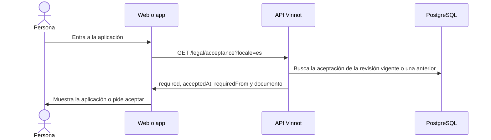

# UC-LEG-03 · Comprobar la aceptación al entrar

| Campo | Valor |
|---|---|
| ID | `UC-LEG-03` |
| Módulo | [Legal](../README.md) |
| Plataformas | Web, APK |
| Actores | Usuario autenticado |
| IDs en Lucidchart | [WEB UC-LEGAL-02](https://lucid.app/lucidchart/9f11a16b-bb5a-42fc-a9e8-0852b17bd241/edit), [APK UC-LEGAL-01](https://lucid.app/lucidchart/e095dd25-e8ac-41ba-bf5b-396e1055f217/edit) |
| Requisitos | [`RF-WEB-LEG-03`](../requirements.md), [`RF-APK-LEG-03`](../requirements.md) |
| Casos de prueba | [`CP-LEG-08`](../testing.md), [`CP-LEG-09`](../testing.md), [`CP-LEG-10`](../testing.md), [`CP-LEG-11`](../testing.md) |

## Precondiciones

- La persona tiene sesión iniciada.

## Postcondiciones

- El cliente sabe si hace falta aceptar los términos; la aplicación solo se muestra si no hace falta.

## Flujo principal

1. La persona entra a una parte privada de la aplicación o a completar el perfil.
2. El control de términos pide el estado de aceptación a la API.
3. Mientras espera muestra «Verificando tu cuenta…».
4. La API calcula el estado: si la cuenta aceptó la revisión vigente, no hace falta aceptar; si aceptó una revisión anterior y el plazo de aviso no venció, tampoco, e informa la fecha límite (`requiredFrom`); en otro caso hace falta.
5. Si no hace falta aceptar, el cliente muestra la aplicación.

## Flujos alternativos

- 4a. Hace falta aceptar: se sigue con [UC-LEG-04](uc-leg-04-accept-current-version.md).
- 2a. La consulta falla sin conexión o por tiempo de espera: la app muestra el estado ilustrado «Sin conexión» con «Reintentar»; tampoco libera el acceso.
- 2b. La consulta falla por otro motivo: se muestra «No pudimos verificar tu acuerdo» con opción de volver a cargar; no se muestra la aplicación ni se da por hecho que faltan términos.
- 1a. La persona abre el centro legal o contacto: no se controla la aceptación (en la web se excluyen esas rutas; en la app están fuera del grupo privado `(app)`).

## Reglas de negocio

- El plazo de aviso es de 30 días (`app.legal.notice-period`) desde la primera publicación de la revisión nueva.
- La primera revisión, las cuentas que nunca aceptaron y las altas con Google o Apple deben aceptar en el momento.
- El estado lo decide la API; el cliente no guarda la aceptación como prueba propia.
- Durante el plazo de aviso la persona sigue usando la aplicación y recibe el email de [UC-LEG-06](uc-leg-06-announce-terms-update.md).

## Diagrama

[Ver diagrama de «UC-LEG-03 · Comprobar la aceptación al entrar» completo](https://images.vinnot.com/docs/diagrams/v1/es/modules-legal-use-cases-uc-leg-03-check-acceptance-efd2f0772054.svg)

Diagrama de componentes en Lucidchart: [WEB UC-LEGAL-02](https://lucid.app/lucidchart/9f11a16b-bb5a-42fc-a9e8-0852b17bd241/edit), [APK UC-LEGAL-01](https://lucid.app/lucidchart/e095dd25-e8ac-41ba-bf5b-396e1055f217/edit).

## Código

| Capa | Ubicación |
|---|---|
| Endpoints | `GET /legal/acceptance` |
| Backend | [`LegalController.java`](../../../../../backend/src/main/java/com/vinnot/legal/infrastructure/web/LegalController.java), [`LegalAgreementService.java`](../../../../../backend/src/main/java/com/vinnot/legal/application/service/LegalAgreementService.java), [`JdbcLegalRepository.java`](../../../../../backend/src/main/java/com/vinnot/legal/infrastructure/JdbcLegalRepository.java) |
| Web | [`App.tsx`](../../../../../frontend-react/src/app/App.tsx), [`TermsGate.tsx`](../../../../../frontend-react/src/presentation/components/auth/TermsGate.tsx), [`useLegalAgreement.ts`](../../../../../frontend-react/src/presentation/hooks/useLegalAgreement.ts), [`legal.service.ts`](../../../../../frontend-react/src/application/services/legal.service.ts), [`legal.client.ts`](../../../../../frontend-react/src/infrastructure/api/clients/legal.client.ts) |
| App | `frontend-mobile/app/(app)/_layout.tsx`, [`TermsGate.tsx`](../../../../../frontend-mobile/src/presentation/features/public/TermsGate.tsx), [`useLegalAgreement.ts`](../../../../../frontend-mobile/src/presentation/hooks/useLegalAgreement.ts), [`legal.service.ts`](../../../../../frontend-mobile/src/application/services/legal.service.ts), [`legal.client.ts`](../../../../../frontend-mobile/src/infrastructure/api/clients/legal.client.ts) |

## Tests automáticos

- Backend: [`LegalAgreementServiceTest.java`](../../../../../backend/src/test/java/com/vinnot/legal/application/service/LegalAgreementServiceTest.java), [`LegalAcceptanceHttpPostgresIntegrationTest.java`](../../../../../backend/src/test/java/com/vinnot/legal/infrastructure/web/LegalAcceptanceHttpPostgresIntegrationTest.java)
- Web: [`TermsGate.test.tsx`](../../../../../frontend-react/src/presentation/components/auth/TermsGate.test.tsx), [`useLegalAgreement.test.ts`](../../../../../frontend-react/src/presentation/hooks/useLegalAgreement.test.ts), [`legal.service.test.ts`](../../../../../frontend-react/src/application/services/legal.service.test.ts)
- App: [`TermsGate.test.tsx`](../../../../../frontend-mobile/src/presentation/features/public/TermsGate.test.tsx), [`useLegalAgreement.test.ts`](../../../../../frontend-mobile/src/presentation/hooks/useLegalAgreement.test.ts), [`legal.service.test.ts`](../../../../../frontend-mobile/src/application/services/legal.service.test.ts)
