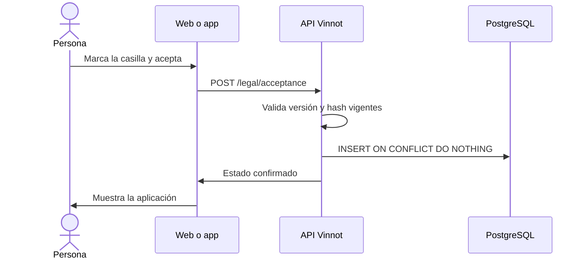

# UC-LEG-04 · Aceptar la versión vigente de los términos

| Campo | Valor |
|---|---|
| ID | `UC-LEG-04` |
| Módulo | [Legal](../README.md) |
| Plataformas | Web, APK |
| Actores | Usuario autenticado |
| IDs en Lucidchart | [WEB UC-LEGAL-02](https://lucid.app/lucidchart/9f11a16b-bb5a-42fc-a9e8-0852b17bd241/edit), [APK UC-LEGAL-01](https://lucid.app/lucidchart/e095dd25-e8ac-41ba-bf5b-396e1055f217/edit) |
| Requisitos | [`RF-WEB-LEG-04`](../requirements.md), [`RF-WEB-LEG-05`](../requirements.md), [`RF-WEB-LEG-06`](../requirements.md), [`RF-APK-LEG-04`](../requirements.md), [`RF-APK-LEG-05`](../requirements.md), [`RF-APK-LEG-06`](../requirements.md) |
| Casos de prueba | [`CP-LEG-12`](../testing.md), [`CP-LEG-13`](../testing.md), [`CP-LEG-14`](../testing.md), [`CP-LEG-15`](../testing.md) |

## Precondiciones

- La consulta de [UC-LEG-03](uc-leg-03-check-acceptance.md) indicó que hace falta aceptar.

## Postcondiciones

- La aceptación queda guardada con cuenta, revisión, versión, idioma, hash y fecha asignada por PostgreSQL.
- El acceso se libera solo después de la confirmación de la API, y vale en todas las plataformas.

## Flujo principal

1. El cliente muestra «Antes de continuar» con los términos plegados y la casilla desmarcada.
2. La persona marca la casilla.
3. Pulsa «Aceptar y continuar».
4. El cliente envía versión, idioma, hash y `accepted: true`.
5. La API compara la selección con la versión vigente y guarda la aceptación.
6. La API devuelve el estado confirmado y el cliente muestra la aplicación.

## Flujos alternativos

- 5a. La versión cambió mientras tanto: la API responde 422 `TERMS_VERSION_CHANGED`, el cliente desmarca la casilla y pide volver a cargar; nunca reintenta la aceptación solo.
- 4a. Falla la red: se muestra el error con «Volver a cargar términos» y no se libera el acceso.
- 5b. La revisión ya estaba aceptada (otro dispositivo o doble envío): la API no duplica nada, conserva la primera fecha e idioma y devuelve el estado.

## Reglas de negocio

- El titular sale de la sesión; la API no acepta un `userId` enviado por el cliente.
- Un cuerpo mal formado o `accepted: false` responde 400; un idioma distinto de `es` o `en`, 422 `LEGAL_LOCALE_INVALID`.
- La evidencia no se puede modificar (triggers de V21); eliminar la cuenta la borra en cascada. No se guarda IP ni datos del dispositivo.
- Las traducciones equivalentes comparten revisión: aceptar en `es` cubre la revisión también en `en`.

## Diagrama

[Ver diagrama de «UC-LEG-04 · Aceptar la versión vigente de los términos» completo](https://images.vinnot.com/docs/diagrams/v1/es/modules-legal-use-cases-uc-leg-04-accept-current-version-b98c0a1e7efd.svg)

Diagrama de componentes en Lucidchart: [WEB UC-LEGAL-02](https://lucid.app/lucidchart/9f11a16b-bb5a-42fc-a9e8-0852b17bd241/edit), [APK UC-LEGAL-01](https://lucid.app/lucidchart/e095dd25-e8ac-41ba-bf5b-396e1055f217/edit).

## Código

| Capa | Ubicación |
|---|---|
| Endpoints | `POST /legal/acceptance` |
| Backend | [`LegalController.java`](../../../../../backend/src/main/java/com/vinnot/legal/infrastructure/web/LegalController.java), [`AcceptanceRequest.java`](../../../../../backend/src/main/java/com/vinnot/legal/infrastructure/web/AcceptanceRequest.java), [`LegalAgreementService.java`](../../../../../backend/src/main/java/com/vinnot/legal/application/service/LegalAgreementService.java), [`JdbcLegalRepository.java`](../../../../../backend/src/main/java/com/vinnot/legal/infrastructure/JdbcLegalRepository.java) |
| Web | [`TermsGate.tsx`](../../../../../frontend-react/src/presentation/components/auth/TermsGate.tsx), [`TermsReview.tsx`](../../../../../frontend-react/src/presentation/components/auth/TermsReview.tsx), [`useLegalAgreement.ts`](../../../../../frontend-react/src/presentation/hooks/useLegalAgreement.ts), [`legal.service.ts`](../../../../../frontend-react/src/application/services/legal.service.ts), [`legal.client.ts`](../../../../../frontend-react/src/infrastructure/api/clients/legal.client.ts) |
| App | [`TermsGate.tsx`](../../../../../frontend-mobile/src/presentation/features/public/TermsGate.tsx), [`TermsReview.tsx`](../../../../../frontend-mobile/src/presentation/features/public/TermsReview.tsx), [`useLegalAgreement.ts`](../../../../../frontend-mobile/src/presentation/hooks/useLegalAgreement.ts), [`legal.service.ts`](../../../../../frontend-mobile/src/application/services/legal.service.ts), [`legal.client.ts`](../../../../../frontend-mobile/src/infrastructure/api/clients/legal.client.ts) |

## Tests automáticos

- Backend: [`LegalAgreementServiceTest.java`](../../../../../backend/src/test/java/com/vinnot/legal/application/service/LegalAgreementServiceTest.java), [`LegalControllerTest.java`](../../../../../backend/src/test/java/com/vinnot/legal/infrastructure/web/LegalControllerTest.java), [`LegalAcceptanceHttpPostgresIntegrationTest.java`](../../../../../backend/src/test/java/com/vinnot/legal/infrastructure/web/LegalAcceptanceHttpPostgresIntegrationTest.java), [`LegalPostgresIntegrationTest.java`](../../../../../backend/src/test/java/com/vinnot/legal/infrastructure/LegalPostgresIntegrationTest.java)
- Web: [`TermsGate.test.tsx`](../../../../../frontend-react/src/presentation/components/auth/TermsGate.test.tsx), [`useLegalAgreement.test.ts`](../../../../../frontend-react/src/presentation/hooks/useLegalAgreement.test.ts), [`legal.service.test.ts`](../../../../../frontend-react/src/application/services/legal.service.test.ts)
- App: [`TermsGate.test.tsx`](../../../../../frontend-mobile/src/presentation/features/public/TermsGate.test.tsx), [`useLegalAgreement.test.ts`](../../../../../frontend-mobile/src/presentation/hooks/useLegalAgreement.test.ts), [`legal.service.test.ts`](../../../../../frontend-mobile/src/application/services/legal.service.test.ts)
