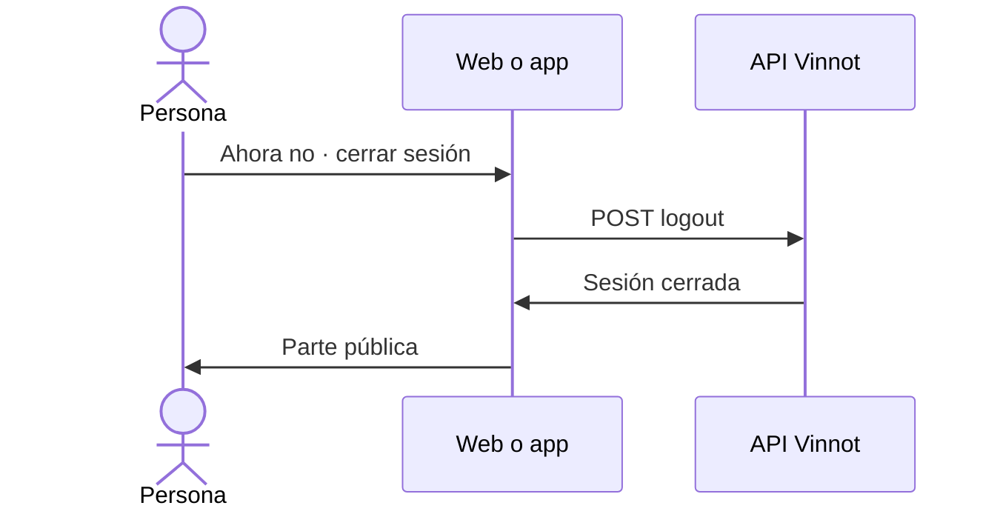

# UC-LEG-05 · Rechazar por ahora y cerrar sesión

| Campo | Valor |
|---|---|
| ID | `UC-LEG-05` |
| Módulo | [Legal](../README.md) |
| Plataformas | Web, APK |
| Actores | Usuario autenticado |
| IDs en Lucidchart | [WEB UC-LEGAL-02](https://lucid.app/lucidchart/9f11a16b-bb5a-42fc-a9e8-0852b17bd241/edit), [APK UC-LEGAL-01](https://lucid.app/lucidchart/e095dd25-e8ac-41ba-bf5b-396e1055f217/edit) |
| Requisitos | [`RF-WEB-LEG-07`](../requirements.md), [`RF-APK-LEG-07`](../requirements.md) |
| Casos de prueba | [`CP-LEG-16`](../testing.md), [`CP-LEG-17`](../testing.md) |

## Precondiciones

- El cliente muestra el pedido de aceptación de [UC-LEG-04](uc-leg-04-accept-current-version.md).

## Postcondiciones

- La sesión se cierra y no se registra ninguna aceptación.
- El centro legal y contacto siguen disponibles.

## Flujo principal

1. La persona pulsa «Ahora no · cerrar sesión».
2. El cliente cierra la sesión ([UC-USR-08](../../users/use-cases/uc-usr-08-sign-out.md)).
3. La persona vuelve a la parte pública.

## Flujos alternativos

- 2a. El cierre de sesión falla: se muestra «Volvé a intentar cerrar sesión.».

## Reglas de negocio

- Rechazar no cuenta como consentimiento ni como rechazo guardado: la próxima vez se vuelve a preguntar.
- Sin aceptar los términos la persona igual puede desactivar o eliminar su cuenta (`DELETE /users/me` y `DELETE /users/me/permanent` quedan permitidos aun con la exigencia encendida).

## Diagrama

[Ver diagrama de «UC-LEG-05 · Rechazar por ahora y cerrar sesión» completo](https://images.vinnot.com/docs/diagrams/v1/es/modules-legal-use-cases-uc-leg-05-decline-and-sign-out-d18c74301964.svg)

Diagrama de componentes en Lucidchart: [WEB UC-LEGAL-02](https://lucid.app/lucidchart/9f11a16b-bb5a-42fc-a9e8-0852b17bd241/edit), [APK UC-LEGAL-01](https://lucid.app/lucidchart/e095dd25-e8ac-41ba-bf5b-396e1055f217/edit).

## Código

| Capa | Ubicación |
|---|---|
| Endpoints | `POST /auth/web/logout (web)`, `POST /auth/logout (app)` |
| Web | [`TermsGate.tsx`](../../../../../frontend-react/src/presentation/components/auth/TermsGate.tsx) |
| App | [`TermsGate.tsx`](../../../../../frontend-mobile/src/presentation/features/public/TermsGate.tsx) |

## Tests automáticos

- Backend: Ninguno
- Web: [`TermsGate.test.tsx`](../../../../../frontend-react/src/presentation/components/auth/TermsGate.test.tsx)
- App: [`TermsGate.test.tsx`](../../../../../frontend-mobile/src/presentation/features/public/TermsGate.test.tsx)
