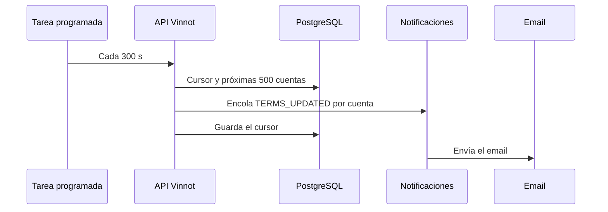

# UC-LEG-06 · Avisar de una nueva versión de los términos

| Campo | Valor |
|---|---|
| ID | `UC-LEG-06` |
| Módulo | [Legal](../README.md) |
| Plataformas | Solo backend |
| Actores | Tarea programada, Servicio de email |
| IDs en Lucidchart | Ninguno |
| Requisitos | Ninguno |
| Casos de prueba | [`CP-LEG-18`](../testing.md), [`CP-LEG-19`](../testing.md), [`CP-LEG-20`](../testing.md) |

## Precondiciones

- La revisión vigente reemplaza a una anterior y su plazo de aviso (`requiredFrom`) todavía no venció.
- `app.legal.announcements.enabled` está encendido (valor por defecto).

## Postcondiciones

- Cada cuenta activa y no bloqueada que aceptó una revisión anterior, y no la vigente, recibe un único aviso `TERMS_UPDATED` con la versión y la fecha límite.
- El avance queda guardado en `legal_terms_announcements`.

## Flujo principal

1. La tarea programada corre 60 segundos después del arranque y luego cada 300 segundos.
2. Lee la versión vigente y calcula su fecha límite.
3. Toma con bloqueo el cursor de la revisión y busca las próximas 500 cuentas a avisar, ordenadas por id.
4. Encola un aviso `TERMS_UPDATED` por cuenta con clave de idempotencia `terms-updated:<revisión>:<cuenta>`.
5. Guarda la última cuenta avisada como nuevo cursor.
6. El módulo de [notificaciones](../../notifications/README.md) envía el email con la plantilla `terms_updated`.

## Flujos alternativos

- 2a. No hay fecha límite o ya venció: la tarea no hace nada.
- 3a. Quedan menos de 500 cuentas: se marca la revisión como completa y las corridas siguientes no buscan más.

## Reglas de negocio

- La fecha se informa en la zona `America/Argentina/Buenos_Aires`.
- La clave de idempotencia evita avisar dos veces a la misma cuenta por la misma revisión.
- Las cuentas que nunca aceptaron no reciben aviso: deben aceptar al entrar.

## Diagrama

[Ver diagrama de «UC-LEG-06 · Avisar de una nueva versión de los términos» completo](https://images.vinnot.com/docs/diagrams/v1/es/modules-legal-use-cases-uc-leg-06-announce-terms-update-9d6a17cab85d.svg)

## Código

| Capa | Ubicación |
|---|---|
| Backend | [`TermsAnnouncementScheduler.java`](../../../../../backend/src/main/java/com/vinnot/legal/infrastructure/scheduling/TermsAnnouncementScheduler.java), [`AnnounceTermsUpdateService.java`](../../../../../backend/src/main/java/com/vinnot/legal/application/service/AnnounceTermsUpdateService.java), [`JdbcTermsAnnouncementAdapter.java`](../../../../../backend/src/main/java/com/vinnot/legal/infrastructure/JdbcTermsAnnouncementAdapter.java), [`TermsUpdatedTemplate.java`](../../../../../backend/src/main/java/com/vinnot/notification/infrastructure/template/TermsUpdatedTemplate.java) |

## Tests automáticos

- Backend: [`AnnounceTermsUpdateServiceTest.java`](../../../../../backend/src/test/java/com/vinnot/legal/application/service/AnnounceTermsUpdateServiceTest.java), [`TermsAnnouncementSchedulerTest.java`](../../../../../backend/src/test/java/com/vinnot/legal/infrastructure/scheduling/TermsAnnouncementSchedulerTest.java), [`TermsUpdatedTemplateTest.java`](../../../../../backend/src/test/java/com/vinnot/notification/infrastructure/template/TermsUpdatedTemplateTest.java)
- Web: Ninguno
- App: Ninguno
