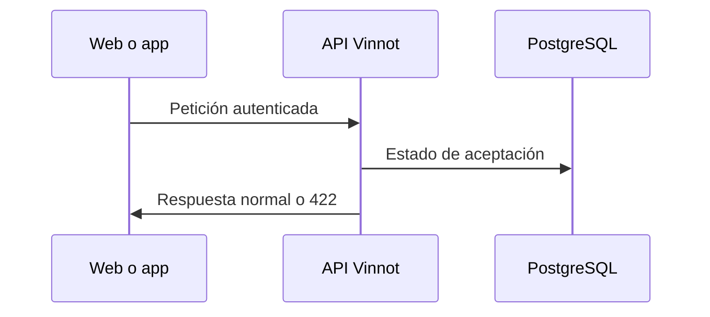

# UC-LEG-07 · Bloquear la API sin aceptación vigente

| Campo | Valor |
|---|---|
| ID | `UC-LEG-07` |
| Módulo | [Legal](../README.md) |
| Plataformas | Solo backend |
| Actores | Usuario autenticado |
| IDs en Lucidchart | Ninguno |
| Requisitos | Ninguno |
| Casos de prueba | [`CP-LEG-21`](../testing.md), [`CP-LEG-22`](../testing.md), [`CP-LEG-23`](../testing.md), [`CP-LEG-24`](../testing.md) |

## Precondiciones

- `LEGAL_ENFORCE_ACCEPTANCE` está encendido (por defecto está apagado).
- La persona tiene sesión iniciada.

## Postcondiciones

- Las cuentas que deben aceptar no pueden usar la API autenticada hasta hacerlo.

## Flujo principal

1. El cliente llama a un endpoint autenticado.
2. El interceptor consulta el estado de aceptación de la cuenta.
3. Si no hace falta aceptar, la petición sigue normalmente.

## Flujos alternativos

- 3a. Hace falta aceptar: la API responde 422 `TERMS_ACCEPTANCE_REQUIRED` («Review and accept the current terms to continue»).
- 1a. La ruta está excluida (`/auth/**`, `/legal/**`, `/support/**`, `/notifications/unsubscribe`, salud, documentación de la API y `/uploads/**`), la petición es anónima o es `OPTIONS`: pasa sin consultar.
- 1b. Es `DELETE /users/me` o `DELETE /users/me/permanent`: pasa sin consultar.

## Reglas de negocio

- Se enciende recién después de desplegar el backend y clientes compatibles; apagarlo no borra evidencia.
- La web y la app piden el mismo estado al entrar ([UC-LEG-03](uc-leg-03-check-acceptance.md)) y muestran el pedido de aceptación antes de la aplicación.
- Esta regla no da roles ni permisos.

## Diagrama

[Ver diagrama de «UC-LEG-07 · Bloquear la API sin aceptación vigente» completo](https://images.vinnot.com/docs/diagrams/v1/es/modules-legal-use-cases-uc-leg-07-enforce-acceptance-4195fa8b286b.svg)

## Código

| Capa | Ubicación |
|---|---|
| Backend | [`LegalAccessConfiguration.java`](../../../../../backend/src/main/java/com/vinnot/legal/infrastructure/web/LegalAccessConfiguration.java), [`LegalAgreementService.java`](../../../../../backend/src/main/java/com/vinnot/legal/application/service/LegalAgreementService.java) |

## Tests automáticos

- Backend: [`LegalAccessConfigurationTest.java`](../../../../../backend/src/test/java/com/vinnot/legal/infrastructure/web/LegalAccessConfigurationTest.java), [`LegalAcceptanceHttpPostgresIntegrationTest.java`](../../../../../backend/src/test/java/com/vinnot/legal/infrastructure/web/LegalAcceptanceHttpPostgresIntegrationTest.java)
- Web: Ninguno
- App: Ninguno
