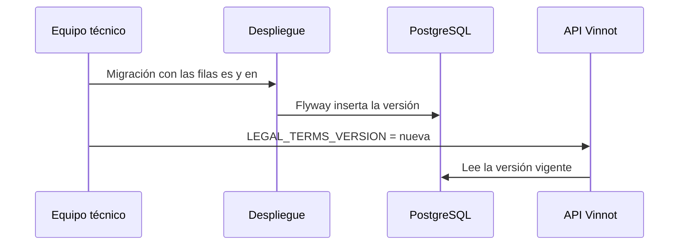

# UC-LEG-08 · Publicar una nueva versión de los términos

| Campo | Valor |
|---|---|
| ID | `UC-LEG-08` |
| Módulo | [Legal](../README.md) |
| Plataformas | Solo backend |
| Actores | Equipo técnico |
| IDs en Lucidchart | Ninguno |
| Requisitos | Ninguno |
| Casos de prueba | [`CP-LEG-25`](../testing.md), [`CP-LEG-26`](../testing.md), [`CP-LEG-27`](../testing.md) |

## Precondiciones

- El texto nuevo está aprobado en `es` y `en`.

## Postcondiciones

- La versión nueva queda archivada y es la vigente.
- Si cambió la revisión contractual, las cuentas deben volver a aceptar según [UC-LEG-03](uc-leg-03-check-acceptance.md).

## Flujo principal

1. El equipo escribe una migración Flyway que inserta en `legal_documents` las filas `es` y `en` con la misma versión y revisión, y el SHA-256 de cada texto.
2. Despliega el backend y la migración se aplica.
3. Cambia `LEGAL_TERMS_VERSION` a la versión nueva.
4. Los clientes reciben la versión nueva al pedir los términos.

## Flujos alternativos

- 1a. Es una corrección editorial equivalente: se publica una versión nueva con la misma revisión y nadie tiene que volver a aceptar.
- 1b. Es un cambio sustantivo: se usa una revisión nueva; las cuentas que aceptaron la anterior tienen el plazo de aviso y reciben [UC-LEG-06](uc-leg-06-announce-terms-update.md).

## Reglas de negocio

- No hay pantalla de administración: un documento publicado no se puede modificar ni borrar (triggers de V21), así que cada cambio es una versión nueva.
- El hash se calcula sobre JSON UTF-8 compacto con `title`, `summary` y `sections` en ese orden; cada sección lleva `id`, `title` y `body`.
- El despliegue web de desarrollo comprueba con `scripts/wait-github-public-terms.mjs` que ambos idiomas estén publicados antes de subir archivos.
- El plazo de aviso corre desde que la migración inserta las filas (`published_at`), no desde el cambio de `LEGAL_TERMS_VERSION`: publica las dos cosas en el mismo despliegue.
- La página `terms` de `content/public-pages.json` repite el texto vigente, porque es la copia que muestran los clientes sin API. Después de editarla, ejecuta `node scripts/sync-public-content.mjs --write`.

## Publicar la revisión terms-2

`2026-10-29.1` / `terms-2` (`V75__terms_2026_10_29.sql`) reemplaza a `2026-09-27.1` / `terms-1`; el motivo está en [versiones publicadas](../README.md#versiones-publicadas).

1. Entrega en el mismo cambio `V75__terms_2026_10_29.sql`, `content/public-pages.json` y los dos `generated-content.json`, y el valor por defecto `2026-10-29.1` de `app.legal.terms-version`.
2. En cada host, si el secreto de runtime define `LEGAL_TERMS_VERSION`, cámbialo a `2026-10-29.1` antes del despliegue. Si no lo define, rige el valor por defecto de `application.yml`.
3. Despliega el backend. Flyway inserta las filas `es` y `en`, y desde ese momento corre el plazo de aviso de 30 días (`app.legal.notice-period`).
4. Comprueba que `GET /api/legal/terms/current?locale=es` y `?locale=en` devuelven `2026-10-29.1` y `terms-2`. El despliegue web lo espera con `scripts/wait-github-public-terms.mjs`.
5. Aviso por email: mientras dura el plazo, `TermsAnnouncementScheduler` envía `TERMS_UPDATED` con la versión y la fecha límite a cada cuenta activa y no suspendida que aceptó `terms-1`, en lotes de 500 ([UC-LEG-06](uc-leg-06-announce-terms-update.md)). Requiere `app.legal.announcements.enabled=true`, que es el valor por defecto.
6. Durante los 30 días, quien aceptó `terms-1` sigue entrando: `GET /api/legal/acceptance` devuelve `required=false` y la fecha límite en `requiredFrom`. Al vencer el plazo, la web y la app le piden aceptar `terms-2` ([UC-LEG-03](uc-leg-03-check-acceptance.md)). Las cuentas nuevas aceptan `terms-2` al registrarse.

## Diagrama

[Ver diagrama de «UC-LEG-08 · Publicar una nueva versión de los términos» completo](https://images.vinnot.com/docs/diagrams/v1/es/modules-legal-use-cases-uc-leg-08-publish-terms-version-e180c83fcd52.svg)

## Código

| Capa | Ubicación |
|---|---|
| Backend | [`JdbcLegalRepository.java`](../../../../../backend/src/main/java/com/vinnot/legal/infrastructure/JdbcLegalRepository.java), [`LegalAgreementService.java`](../../../../../backend/src/main/java/com/vinnot/legal/application/service/LegalAgreementService.java) |

## Tests automáticos

- Backend: [`LegalPostgresIntegrationTest.java`](../../../../../backend/src/test/java/com/vinnot/legal/infrastructure/LegalPostgresIntegrationTest.java), [`LegalAgreementServiceTest.java`](../../../../../backend/src/test/java/com/vinnot/legal/application/service/LegalAgreementServiceTest.java)
- Web: Ninguno
- App: Ninguno
