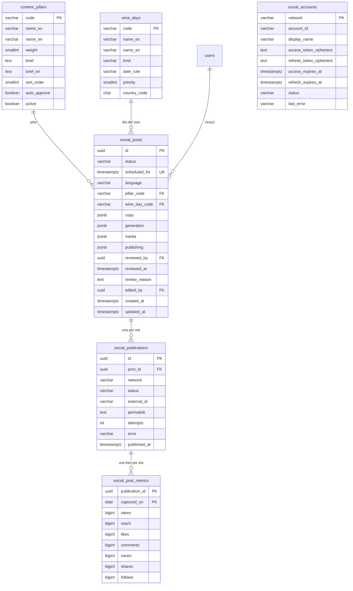

# Marketing en redes

Agente de redes sociales. Fase 1 (#489): un calendario de días del vino con reglas de fecha,
pilares de contenido, un planificador semanal que arma dos o tres publicaciones por semana,
la redacción del texto con el puerto de IA existente y una cola de aprobación para la persona
dueña del producto. Fase 2 (#492): cada publicación recibe una ilustración en acuarela (IA o
viñeta del pilar) y sus placas dibujadas como imágenes para Instagram y TikTok, que se revisan
y descargan en la misma página. Fases 3 y 4 (#510): las publicaciones aprobadas se publican solas a su hora en
Instagram, Facebook y Threads (TikTok queda como borrador hasta su auditoría), vuelven las métricas, el planificador
aprende qué pilares rinden y cada pilar puede aprobarse solo. Calendario estratégico (#513): publicaciones rotativas al
mediodía de martes, miércoles y jueves, días del vino a la mañana de su propio día, una publicación por fecha, TikTok a la
noche, y el administrador puede mover una publicación a otra fecha y hora o publicarla ahora. Todo está apagado por
configuración hasta encenderlo ([guía de configuración de las redes](../../infra/guides/social-networks-setup.md)).

- Código del módulo: `MKT`.
- Backend: paquete [`marketing`](../../../../backend/src/main/java/com/vinnot/marketing/).
- [Casos de uso](use-cases/README.md) · [Requisitos](requirements.md) ·
  [Arquitectura](architecture.md) · [Pruebas](testing.md)

## Actores

| Actor | Qué hace en este módulo |
|---|---|
| Administrador | Aprueba, rechaza, edita o regenera cada publicación, pide una nueva ilustración, descarga las placas, puede planificar ahora, cambia la fecha y hora de una publicación, publica ahora una aprobada, reintenta una red fallida, enciende o apaga los pilares y su aprobación automática y conecta Threads y TikTok |
| Sistema | Planifica los lunes a las 09:00, redacta el texto, reintenta los borradores sin texto, dibuja las placas en segundo plano, publica a la hora de la publicación (cada red a su hora), lee las métricas cada día, aprueba por pilar y renueva los tokens |
| OpenAI | Escribe el texto, verifica sus datos y pinta la ilustración |
| Instagram, Facebook, Threads y TikTok | Reciben el carrusel, devuelven el id, el enlace y las métricas; Threads y TikTok autorizan la cuenta con OAuth |

## Reglas de negocio

| Regla | Detalle | Dónde |
|---|---|---|
| Días del vino por regla | Cada día es `fixed`, `nth-weekday`, `last-weekday` u `offset-from`; se resuelve por año | [`DateRule.java`](../../../../backend/src/main/java/com/vinnot/marketing/domain/model/DateRule.java) |
| Turnos rotativos | Martes, miércoles y jueves a las 12:30 hora Argentina, los días y la hora de mayor interacción | [`WeeklyPlanner.java`](../../../../backend/src/main/java/com/vinnot/marketing/domain/service/WeeklyPlanner.java) |
| Días del vino a la mañana | Se publica el día mismo a las 09:30; un día del vino en un día de turno toma el turno de ese día (ese día no sale una rotativa) | [`WeeklyPlanner.java`](../../../../backend/src/main/java/com/vinnot/marketing/domain/service/WeeklyPlanner.java) |
| Una publicación por fecha | Como mucho una publicación por fecha de Argentina: de dos días del vino en una fecha gana el número de prioridad más bajo y el otro se descarta; las publicaciones existentes cuentan por fecha, sea cual sea su hora | [`WeeklyPlanner.java`](../../../../backend/src/main/java/com/vinnot/marketing/domain/service/WeeklyPlanner.java) |
| Máximo semanal | Un día del vino fuera de los días de turno es una publicación extra: la prioridad 1 sale siempre, la 2 y la 3 solo mientras la semana (lunes a domingo, existentes y planificadas) tenga menos de 4 publicaciones | [`WeeklyPlanner.java`](../../../../backend/src/main/java/com/vinnot/marketing/domain/service/WeeklyPlanner.java) |
| Publicaciones movidas | Una rotativa movida fuera de los días de turno ocupa un turno libre de su semana y un día del vino ya publicado no se vuelve a planificar, así que mover publicaciones nunca agrega publicaciones | [`WeeklyPlanner.java`](../../../../backend/src/main/java/com/vinnot/marketing/domain/service/WeeklyPlanner.java) |
| Rotación de pilares | Cada turno toma el pilar activo con menos usos dividido por (peso × factor de rendimiento), sin repetir el pilar anterior; `APP_FEATURE` una de cada cuatro | [`WeeklyPlanner.java`](../../../../backend/src/main/java/com/vinnot/marketing/domain/service/WeeklyPlanner.java) |
| Idempotencia | Planificar dos veces la misma ventana no crea nada | [`WeeklyPlanner.java`](../../../../backend/src/main/java/com/vinnot/marketing/domain/service/WeeklyPlanner.java) |
| Hora por red | Una red puede tener una hora local mínima (TikTok 19:30 por defecto): el día de la publicación no publica antes de esa hora; la publicación queda `SCHEDULED` hasta que termina cada red | [`PublishingSettings.java`](../../../../backend/src/main/java/com/vinnot/marketing/application/model/PublishingSettings.java) |
| Cambiar fecha y hora | Una publicación que no empezó a publicarse (`DRAFT`, `PENDING_APPROVAL`, `APPROVED`, `REJECTED`) pasa a una hora futura y conserva su estado; ninguna otra publicación puede salir esa fecha; se escribe solo sobre el estado y la hora leídos | [`SocialPostScheduleService.java`](../../../../backend/src/main/java/com/vinnot/marketing/application/service/SocialPostScheduleService.java) |
| Publicar ahora | Una publicación `APPROVED` con placas en español listas pasa a ahora y arranca en cada red habilitada enseguida, sin esperar la hora mínima de cada red | [`SocialPostScheduleService.java`](../../../../backend/src/main/java/com/vinnot/marketing/application/service/SocialPostScheduleService.java) |
| Límites del texto | Hook ≤ 60, 3 a 7 slides (título ≤ 40, cuerpo ≤ 160), caption ≤ 600, 5 a 10 hashtags con `#vinnot`, alt ≤ 200 | [`PostCopy.java`](../../../../backend/src/main/java/com/vinnot/marketing/domain/model/PostCopy.java) |
| Dos idiomas | Cada publicación se escribe en español neutro («tú», sin voseo ni regionalismos) y en inglés, en una sola llamada a la IA; queda pendiente de aprobación solo con los dos textos válidos; el administrador edita un idioma por vez | [`PostCopies.java`](../../../../backend/src/main/java/com/vinnot/marketing/domain/model/PostCopies.java) |
| Voz y maridajes | Voz de sommelier refinada y técnica para un público global, con datos concretos; maridajes solo por categorías de alimentos explicados por la estructura, nunca comida callejera ni rápida | [`SocialCopyPromptBuilder.java`](../../../../backend/src/main/java/com/vinnot/marketing/application/service/SocialCopyPromptBuilder.java) |
| Leyenda legal | El dominio agrega siempre la leyenda de cada idioma, nunca el modelo: «Beber con moderación. Prohibida su venta a menores de 18 años.» y «Drink responsibly. Not for sale to anyone under 18.» | [`PostCopy.java`](../../../../backend/src/main/java/com/vinnot/marketing/domain/model/PostCopy.java) |
| Verificación de datos | Una segunda llamada revisa los hechos; si falla, se regenera una vez y queda `FLAGGED` | [`SocialCopyService.java`](../../../../backend/src/main/java/com/vinnot/marketing/application/service/SocialCopyService.java) |
| Transiciones | Aprobar solo desde pendiente; rechazar desde pendiente o aprobada; editar devuelve a pendiente; regenerar desde pendiente, rechazada o aprobada (una aprobada pierde la aprobación y vuelve a pendiente); lo demás responde 409 | [`SocialPost.java`](../../../../backend/src/main/java/com/vinnot/marketing/domain/model/SocialPost.java) |
| Aviso por lote | Cada administrador recibe un email y un push `SOCIAL_BATCH_READY` cuando una corrida deja publicaciones pendientes | [`SocialBatchNoticeService.java`](../../../../backend/src/main/java/com/vinnot/marketing/application/service/SocialBatchNoticeService.java) |
| Costo | Las llamadas pasan por la admisión y el presupuesto de IA del proveedor compartido | [`OpenAiClient.java`](../../../../backend/src/main/java/com/vinnot/shared/infrastructure/ai/OpenAiClient.java) |
| Ilustración en acuarela | Una por publicación, de OpenAI (`/v1/images/edits`) con cuatro ilustraciones de la app como referencia y la receta «detailed hand-painted watercolor, fine sepia ink linework, warm sepia, cream, aged oak, olive and soft wine red palette, paper grain, warm light, elegant premium editorial feel»; fondo transparente verificado, sin texto, logos, caras ni personas | [`IllustrationPromptBuilder.java`](../../../../backend/src/main/java/com/vinnot/marketing/application/service/IllustrationPromptBuilder.java) |
| Viñeta de respaldo | Si la IA está apagada, simulada, sin presupuesto, falla o devuelve una imagen opaca, la portada usa la viñeta del pilar; nunca faltan placas por la ilustración | [`RenderSocialMediaService.java`](../../../../backend/src/main/java/com/vinnot/marketing/application/service/RenderSocialMediaService.java) |
| Placas | Un juego por idioma, JPEG de 1080x1350 (Instagram) y 1080x1920 (TikTok): portada, una por placa del texto y cierre con CTA y la leyenda legal del idioma; la ilustración es compartida; el texto se achica hasta entrar y nunca se corta | [`Java2dSlideRenderer.java`](../../../../backend/src/main/java/com/vinnot/marketing/infrastructure/render/Java2dSlideRenderer.java) |
| Placas vigentes | Las placas de cada idioma se versionan por un hash de su hook, placas, CTA y tema; editar un idioma redibuja solo ese; las de un texto anterior nunca se muestran | [`SocialPostMedia.java`](../../../../backend/src/main/java/com/vinnot/marketing/domain/model/SocialPostMedia.java) |
| Publicación sola | Una publicación `APPROVED` con placas en español listas se publica a su hora en cada red habilitada, como carrusel de las placas en español con el texto en español; queda `PUBLISHED` cuando todas las redes terminaron bien o `FAILED` con el primer error; nunca se publica más de 2 × `media-grace` tarde | [`PublishSocialPostService.java`](../../../../backend/src/main/java/com/vinnot/marketing/application/service/PublishSocialPostService.java) |
| Publicación congelada | Desde `SCHEDULED` no se edita, regenera, rechaza ni pide nueva ilustración; una `FAILED` puede volver a dibujar y reintentarse | [`SocialPost.java`](../../../../backend/src/main/java/com/vinnot/marketing/domain/model/SocialPost.java) |
| Texto por red | Instagram y Facebook ≤ 2.200 caracteres y 30 hashtags; Threads ≤ 500 con un tema; TikTok título ≤ 90 y descripción ≤ 4.000; la leyenda legal nunca se corta | [`NetworkCaptionFormatter.java`](../../../../backend/src/main/java/com/vinnot/marketing/domain/service/NetworkCaptionFormatter.java) |
| TikTok como borrador | `MEDIA_UPLOAD` deja el carrusel en la bandeja de TikTok (`DRAFT_SENT`, cuenta como éxito); cuando el creador lo publica desde la app de TikTok, el barrido de borradores (cada 15 minutos, borradores de los últimos 14 días) lo marca `PUBLISHED`, con el enlace cuando TikTok da el id del post público (#516); `DIRECT_POST` después de la auditoría | [`TikTokPublisher.java`](../../../../backend/src/main/java/com/vinnot/marketing/infrastructure/social/TikTokPublisher.java), [`SyncSocialDraftsService.java`](../../../../backend/src/main/java/com/vinnot/marketing/application/service/SyncSocialDraftsService.java) |
| Reintentos | Hasta 5 intentos por red ante `RATE_LIMITED`, `UNAVAILABLE` o `PROCESSING_TIMEOUT`; el administrador reintenta una red `FAILED` y los intentos vuelven a cero | [`SocialPublication.java`](../../../../backend/src/main/java/com/vinnot/marketing/domain/model/SocialPublication.java) |
| Ponderación | Factor del pilar = interacciones por vista de los últimos 90 días contra el total, entre 0,5 y 2,0, neutro hasta 3 publicaciones medidas | [`PillarWeighting.java`](../../../../backend/src/main/java/com/vinnot/marketing/domain/service/PillarWeighting.java) |
| Aprobación automática | Un pilar con el interruptor encendido aprueba sus pendientes con placas listas y verificación `PASSED` 24 h antes del turno, sin revisor y con motivo `AUTO_APPROVED` | [`AutoApproveSocialPostsService.java`](../../../../backend/src/main/java/com/vinnot/marketing/application/service/AutoApproveSocialPostsService.java) |
| Cuentas | Meta (Instagram y la página de Facebook) usa un token de usuario del sistema que no vence, guardado como secreto; Threads y TikTok se conectan con OAuth, sus tokens se guardan cifrados (AES-256-GCM) y se renuevan solos | [`SocialAccountAdminService.java`](../../../../backend/src/main/java/com/vinnot/marketing/application/service/SocialAccountAdminService.java) |
| Costo de las imágenes | Cada imagen reserva un costo fijo (`ai.images.max-cost-usd`) contra el mismo tope mensual de IA | [`OpenAiImageClient.java`](../../../../backend/src/main/java/com/vinnot/shared/infrastructure/ai/OpenAiImageClient.java) |

## Dónde vive

| Parte | Ubicación |
|---|---|
| API | [`SocialPostAdminController`](../../../../backend/src/main/java/com/vinnot/marketing/infrastructure/web/controller/SocialPostAdminController.java) bajo `/admin/social-posts`, [`SocialPillarAdminController`](../../../../backend/src/main/java/com/vinnot/marketing/infrastructure/web/controller/SocialPillarAdminController.java) bajo `/admin/social-posts/pillars` y [`SocialAccountAdminController`](../../../../backend/src/main/java/com/vinnot/marketing/infrastructure/web/controller/SocialAccountAdminController.java) bajo `/admin/social-accounts` |
| API pública | [`SocialMediaController`](../../../../backend/src/main/java/com/vinnot/shared/infrastructure/web/controller/SocialMediaController.java) sirve `GET /api/uploads/social/{key}` con almacenamiento local o S3; con R2 sirve el Worker de `images.vinnot.com`; [`SocialAccountCallbackController`](../../../../backend/src/main/java/com/vinnot/marketing/infrastructure/web/controller/SocialAccountCallbackController.java) recibe la vuelta de OAuth en `GET /api/public/social-accounts/{network}/callback` |
| Jobs | [`SocialPlannerScheduler`](../../../../backend/src/main/java/com/vinnot/marketing/infrastructure/scheduling/SocialPlannerScheduler.java) (lunes 09:00) y [`SocialCopyGenerationScheduler`](../../../../backend/src/main/java/com/vinnot/marketing/infrastructure/scheduling/SocialCopyGenerationScheduler.java) (cada 30 minutos); [`SocialMediaRenderScheduler`](../../../../backend/src/main/java/com/vinnot/marketing/infrastructure/scheduling/SocialMediaRenderScheduler.java) (barrido cada 30 minutos) y el efecto durable `social-media-render` ([`SocialMediaRenderEffectHandler`](../../../../backend/src/main/java/com/vinnot/marketing/infrastructure/effects/SocialMediaRenderEffectHandler.java)); [`SocialPublishingScheduler`](../../../../backend/src/main/java/com/vinnot/marketing/infrastructure/scheduling/SocialPublishingScheduler.java) (cada 5 minutos) y el efecto durable `social-publish` ([`SocialPublishEffectHandler`](../../../../backend/src/main/java/com/vinnot/marketing/infrastructure/effects/SocialPublishEffectHandler.java)); [`SocialMetricsScheduler`](../../../../backend/src/main/java/com/vinnot/marketing/infrastructure/scheduling/SocialMetricsScheduler.java) (06:00), [`SocialAutoApproveScheduler`](../../../../backend/src/main/java/com/vinnot/marketing/infrastructure/scheduling/SocialAutoApproveScheduler.java) (cada 15 minutos) y [`SocialAccountRefreshScheduler`](../../../../backend/src/main/java/com/vinnot/marketing/infrastructure/accounts/SocialAccountRefreshScheduler.java) (cada hora) |
| Arte | `backend/src/main/resources/marketing/`: `references/` (estilo para la IA), `render/vignettes/` (varias viñetas por pilar, `<PILAR>-<n>.png`), `render/ornaments/`, `render/paper.png` y `render/fonts/` (OFL) |
| Push | [`SocialBatchReadyPushTemplate`](../../../../backend/src/main/java/com/vinnot/notification/infrastructure/push/SocialBatchReadyPushTemplate.java) y [`SocialPublishingPushTemplates`](../../../../backend/src/main/java/com/vinnot/notification/infrastructure/push/SocialPublishingPushTemplates.java) con copia en `push/marketing_{es,en}.properties` |
| Email | [`SocialBatchReadyTemplate`](../../../../backend/src/main/java/com/vinnot/notification/infrastructure/template/SocialBatchReadyTemplate.java) con copia en `email/social_batch_ready_{es,en}.properties` y [`SocialPublishingNoticeTemplate`](../../../../backend/src/main/java/com/vinnot/notification/infrastructure/template/SocialPublishingNoticeTemplate.java) con copia en `email/social_publishing_{es,en}.properties` |
| Web | Página `/admin/social-posts` (`AdminSocialPostsPage`), solo administradores: cola, «Cambiar fecha y hora» y «Publicar ahora», horas por red, publicaciones por red con reintento y métricas, panel de pilares y panel de redes conectadas |
| App | Pantalla `/admin/social-posts` (`AdminSocialPostsScreen`), solo administradores: cola, placas por idioma y formato, acciones de revisión, edición del texto por idioma, planificar ahora, «Cambiar fecha y hora» y «Publicar ahora», horas por red, días del vino, publicaciones por red con reintento, interruptores de pilares y conexiones en modo lectura ([requisitos móviles](../../frontend-mobile/use-cases/functional-requirements.md)) |

## Datos

[Ver diagrama de «Marketing en redes · Datos» completo](https://images.vinnot.com/docs/diagrams/v1/es/modules-marketing-readme-1ef35b758859.svg)

La migración `V78__social_media_agent.sql` crea las tres tablas y carga 76 días del vino y
9 pilares. `copy` y `generation` son documentos JSON con la misma forma que devuelve la API.
La migración `V80__social_post_media.sql` agrega `media`: el estado del dibujo, la ilustración
y las placas por formato (ver [Arquitectura](architecture.md#ilustración-y-placas)). Las
publicaciones anteriores quedan con `media` nulo hasta su primer dibujo. La migración
`V81__social_bilingual_content.sql` reescribe los briefs de los pilares con la voz nueva, agrega
`brief_en` y mueve cada `copy` y `media` guardados bajo `es` (`copy` pasa a `{"es": …, "en": …}`;
la media guarda un hash y un juego de placas por idioma). La columna `language` ya no se usa.
La migración `V82__social_publishing.sql` (#510) agrega `social_publications` (una por publicación y red, única por
`post_id` y `network`), `social_post_metrics` (una foto por publicación y día), `social_accounts` (las cuentas de Threads
y TikTok con sus tokens cifrados), `content_pillars.auto_approve` y `social_posts.publishing` (`{startedAt, finishedAt,
error}`, nulo hasta empezar). `V83__content_pillar_active.sql` agrega `content_pillars.active` (todos activos) y
`V84__refined_social_content.sql` suma seis pilares (`TERROIR`, `WINEMAKING`, `HISTORY`, `REGION`, `TASTING`, `SERVICE`),
reescribe los briefs de `QUIZ` y `CURIOUS_FACT` y deja `HUMOR` inactivo. Las tres son aditivas.

## Configuración

| Clave | Variable | Por defecto | Qué hace |
|---|---|---|---|
| `app.marketing.enabled` | `MARKETING_ENABLED` | `true` | Enciende los jobs del módulo; la página sigue disponible |
| `app.marketing.planner.cron` | `MARKETING_PLANNER_CRON` | `0 0 9 * * MON` | Cuándo corre el planificador |
| `app.marketing.planner.zone` | `MARKETING_PLANNER_ZONE` | `America/Argentina/Buenos_Aires` | Zona del cron, de las horas de publicación y de las horas por red |
| `app.marketing.planner.slot-days` | `MARKETING_PLANNER_SLOT_DAYS` | `TUESDAY,WEDNESDAY,THURSDAY` | Días de las publicaciones rotativas |
| `app.marketing.planner.slot-time` | `MARKETING_PLANNER_SLOT_TIME` | `12:30` | Hora local de las publicaciones rotativas |
| `app.marketing.planner.wine-day-time` | `MARKETING_PLANNER_WINE_DAY_TIME` | `09:30` | Hora local de las publicaciones de días del vino |
| `app.marketing.planner.max-posts-per-week` | `MARKETING_PLANNER_MAX_POSTS_PER_WEEK` | `4` | Publicaciones por semana hasta las que se suman días del vino de prioridad 2 y 3 |
| `app.marketing.planner.window-days` | `MARKETING_PLANNER_WINDOW_DAYS` | `14` | Días que cubre cada corrida |
| `app.marketing.generation.delay-ms` | `MARKETING_GENERATION_DELAY_MS` | `1800000` | Reintento de los borradores sin texto y barrido de las placas pendientes |
| `ai.images.enabled` | `AI_IMAGES_ENABLED` | `false` | Pinta la ilustración con OpenAI; apagado usa la viñeta del pilar |
| `ai.images.model` | `AI_IMAGES_MODEL` | `gpt-image-1` | Modelo de imágenes |
| `ai.images.quality` | `AI_IMAGES_QUALITY` | `medium` | Calidad pedida |
| `ai.images.size` | `AI_IMAGES_SIZE` | `1024x1536` | Tamaño de la ilustración |
| `ai.images.max-cost-usd` | `AI_IMAGES_MAX_COST_USD` | `0.25` | Costo fijo que reserva y liquida cada imagen contra el tope de IA |
| `ai.images.timeout` | `AI_IMAGES_TIMEOUT` | `110s` | Tiempo total con reintentos; como máximo 115 s, dentro de la concesión de admisión de 2 minutos |
| `ai.images.max-attempts` | `AI_IMAGES_MAX_ATTEMPTS` | `2` | Intentos; solo se reintentan 429 y 5xx |
| `ai.images.initial-backoff-ms` | `AI_IMAGES_INITIAL_BACKOFF_MS` | `500` | Espera antes del primer reintento |
| `services.openai.images-url` | `OPENAI_IMAGES_URL` | `https://api.openai.com/v1/images/edits` | Endpoint de imágenes |
| `app.marketing.publishing.enabled` | `MARKETING_PUBLISHING_ENABLED` | `false` | Enciende el barrido que publica |
| `app.marketing.publishing.delay-ms` | `MARKETING_PUBLISHING_DELAY_MS` | `300000` | Cadencia del barrido (`MARKETING_PUBLISHING_INITIAL_DELAY_MS`, `60000`, la primera vez) |
| `app.marketing.publishing.media-grace` | `MARKETING_PUBLISHING_MEDIA_GRACE` | `PT6H` | Espera de las placas después del turno antes de `MEDIA_NOT_READY`; la ventana de publicación es el doble |
| `app.marketing.publishing.networks.<red>.enabled` | `MARKETING_PUBLISHING_{INSTAGRAM,FACEBOOK,THREADS,TIKTOK}_ENABLED` | `false` | Publica en esa red |
| `app.marketing.publishing.networks.<red>.not-before` | `MARKETING_PUBLISHING_{INSTAGRAM,FACEBOOK,THREADS,TIKTOK}_NOT_BEFORE` | `19:30` en TikTok, vacío en las demás | Hora local (zona del planificador) antes de la cual esa red no publica el día de la publicación; vacío publica a la hora de la publicación |
| `app.marketing.publishing.tiktok.mode` | `MARKETING_PUBLISHING_TIKTOK_MODE` | `MEDIA_UPLOAD` | `MEDIA_UPLOAD` (borrador en la bandeja) o `DIRECT_POST` |
| `app.marketing.publishing.draft-sync.delay-ms` | `MARKETING_PUBLISHING_DRAFT_SYNC_DELAY_MS` | `900000` | Cadencia del barrido que marca `PUBLISHED` los borradores de TikTok publicados (`MARKETING_PUBLISHING_DRAFT_SYNC_INITIAL_DELAY_MS`, `120000`, la primera vez); corre con `publishing.enabled` |
| `app.marketing.publishing.draft-sync.window-days` | `MARKETING_PUBLISHING_DRAFT_SYNC_WINDOW_DAYS` | `14` | Días desde el envío en los que un borrador se sigue consultando; los más viejos quedan `DRAFT_SENT` |
| `app.marketing.publishing.draft-sync.max-per-sweep` | `MARKETING_PUBLISHING_DRAFT_SYNC_MAX_PER_SWEEP` | `20` | Borradores consultados por pasada, los más viejos primero (TikTok permite 30 consultas de estado por minuto) |
| `app.marketing.metrics.enabled` | `MARKETING_METRICS_ENABLED` | `false` | Enciende la lectura diaria de métricas |
| `app.marketing.metrics.cron` | `MARKETING_METRICS_CRON` | `0 0 6 * * *` | Cuándo corre, en la zona del planificador |
| `app.marketing.metrics.window-days` | `MARKETING_METRICS_WINDOW_DAYS` | `30` | Días hacia atrás que se miden |
| `app.marketing.weighting.window-days` | `MARKETING_WEIGHTING_WINDOW_DAYS` | `90` | Días de métricas que pondera el planificador |
| `app.marketing.auto-approve.enabled` | `MARKETING_AUTO_APPROVE_ENABLED` | `false` | Enciende la aprobación automática |
| `app.marketing.auto-approve.lead` | `MARKETING_AUTO_APPROVE_LEAD` | `24h` | Cuánto antes de la hora de la publicación se aprueba |
| `app.marketing.auto-approve.delay-ms` | `MARKETING_AUTO_APPROVE_DELAY_MS` | `900000` | Cadencia del job |
| `app.marketing.networks.*` | `MARKETING_NETWORKS_*`, `MARKETING_META_*`, `MARKETING_THREADS_*`, `MARKETING_TIKTOK_*`, `MARKETING_INSTAGRAM_*` | ver [Entornos y secretos](../../infra/architecture/environments-and-secrets.md#agente-de-redes-sociales) | Hosts, versiones de API, timeouts y espera de procesamiento |
| `app.marketing.accounts.*` | `MARKETING_ACCOUNTS_*`, `MARKETING_META_*`, `MARKETING_THREADS_*`, `MARKETING_TIKTOK_*` | vacío | Clave de cifrado, token de Meta, apps de Threads y TikTok (secretos) |
| `app.storage.r2.social-max-monthly-bytes` | `APP_STORAGE_R2_SOCIAL_MAX_MONTHLY_BYTES` | `1073741824` (1 GiB) | Cupo mensual de bytes en R2 para placas e ilustraciones, como máximo 4 GiB |

Supuestos: la aprobación se hace en la web y en la app, el texto se genera en español e inglés (`es`, `en`) y los turnos son
configurables pero quedan en los valores de arriba. Las variables `AI_IMAGES_*` y `MARKETING_*` están en
`infra/aws-low-cost/runtime.env.example`; las imágenes con IA, la publicación, las métricas y la aprobación automática
quedan apagadas hasta activarlas.
