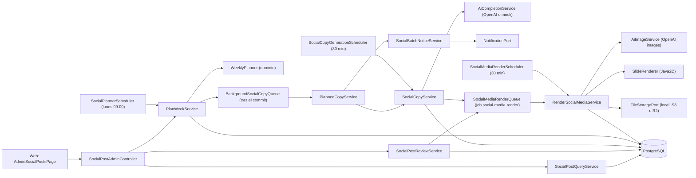
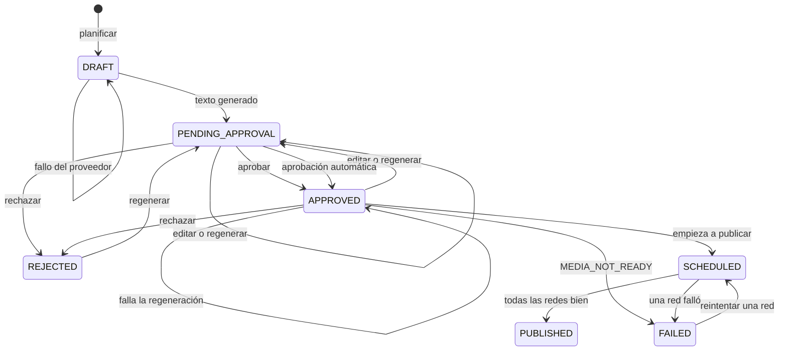
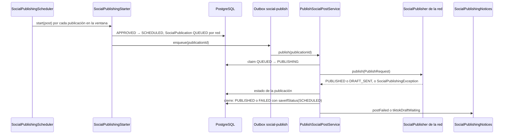
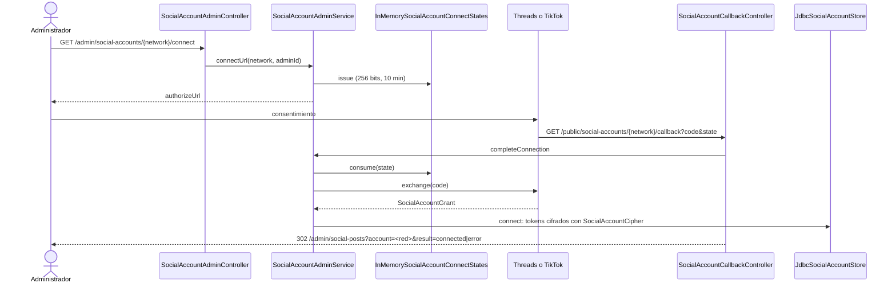

# Arquitectura

El módulo sigue el flujo hexagonal `controller → caso de uso → dominio → puerto de salida →
adaptador`. El dominio decide los turnos y las transiciones sin conocer Spring, JDBC ni OpenAI;
la aplicación orquesta planificar, redactar, avisar, revisar, dibujar las placas, publicar, medir,
aprobar por pilar y administrar las cuentas; la infraestructura aporta las tablas, los jobs, los
controllers, el email, el dibujo con Java2D, el cliente de imágenes de OpenAI, el almacenamiento,
los adaptadores de cada red y el OAuth con los tokens cifrados.

[Ver diagrama de «Arquitectura» completo](https://images.vinnot.com/docs/diagrams/v1/es/modules-marketing-architecture-45a2c0f55354.svg)

## Backend

### Capas

| Capa | Qué contiene |
|---|---|
| `domain/model` | `DateRule`, `WineDay`, `ContentPillar` (con `autoApprove` y `active`), `SocialPost` (transiciones, `PostPublishing`), `PostCopy` (límites y leyenda legal), `GenerationInfo`, `PostReview` (con `automatic`), `SocialPostMedia` (ilustración, placas y estado del dibujo), `ContentHash`, `SocialPublication` (una por red), `PublicationStatus`, `SocialNetwork`, `PublicationMetrics`, `PillarPerformance`, `SocialAccount`, enums de estado y verificación |
| `domain/service` | `WeeklyPlanner` (turnos, días del vino, rotación ponderada e idempotencia), `NetworkCaptionFormatter` (texto por red) y `PillarWeighting` (factor de rendimiento), sin dependencias |
| `application/port/in` | `PlanWeekUseCase`, `GeneratePlannedCopyUseCase`, `GenerateSocialCopyUseCase`, `ReviewSocialPostUseCase`, `ScheduleSocialPostUseCase`, `BrowseSocialPostsUseCase`, `RenderSocialMediaUseCase`, `StartSocialPublishingUseCase`, `PublishSocialPostUseCase`, `RetrySocialPublicationUseCase`, `CollectSocialMetricsUseCase`, `SyncSocialDraftsUseCase`, `AutoApproveSocialPostsUseCase`, `ManageContentPillarsUseCase`, `ManageSocialAccountsUseCase`, `RefreshSocialAccountsUseCase` |
| `application/port/out` | `SocialPostRepository`, `SocialCopyQueue`, `WineDayCatalog`, `ContentPillarCatalog`, `AdminRecipients`, `ReviewerEmails`, `SocialMediaRenderQueue`, `SlideRenderer`, `StyleReferenceCatalog`, `SocialPublicationRepository`, `SocialMetricsRepository`, `SocialPublisher` y `SocialMetricsReader` (uno por red), `SocialDraftTracker` (uno por red que envía borradores), `SocialAccountTokens`, `SocialPublishQueue`, `SocialPublishingNotices`, `SocialAccountStore`, `SocialAccountOAuthProvider`, `SocialAccountConnectStates` |
| `application/service` | `PlanWeekService`, `PlannedCopyService`, `SocialCopyService` (+ `SocialCopyPromptBuilder`, `SocialCopyParser`, `MockSocialCopy`), `SocialPostReviewService`, `SocialPostScheduleService`, `SocialPostQueryService`, `SocialPostPresenter`, `SocialBatchNoticeService`, `RenderSocialMediaService` (+ `IllustrationPromptBuilder`), `SocialPublishingSweepService`, `SocialPublishingStarter`, `PublishSocialPostService`, `SocialPublicationRetryService`, `SocialPublishingNoticeService`, `SyncSocialDraftsService`, `CollectSocialMetricsService`, `PillarPerformanceService`, `AutoApproveSocialPostsService`, `ContentPillarAdminService`, `SocialAccountAdminService`, `SocialAccountRefreshService` |
| `infrastructure` | `JdbcSocialPostRepository`, `JdbcWineDayCatalog`, `JdbcContentPillarCatalog`, `JdbcMarketingStaff`, `JdbcSocialMediaReferences`, `BackgroundSocialCopyQueue`, los tres schedulers, `OutboxSocialMediaRenderQueue`, `SocialMediaRenderEffectHandler`, `render/` (`Java2dSlideRenderer`, `ClasspathStyleReferenceCatalog`), `MarketingConfiguration`, `SocialPostAdminController`; desde #510 `JdbcSocialPublicationRepository`, `JdbcSocialMetricsRepository`, `OutboxSocialPublishQueue`, `SocialPublishEffectHandler`, `SocialPublishingScheduler`, `SocialMetricsScheduler`, `SocialAutoApproveScheduler`, `MarketingPublishingConfiguration`, `social/` (publicadores y lectores de Instagram, Facebook, Threads y TikTok, `GraphApi`, `TikTokApi`, `StatusPoller`), `accounts/` (`ThreadsOAuthProvider`, `TikTokOAuthProvider`, `JdbcSocialAccountStore`, `SocialAccountCipher`, `ConfiguredSocialAccountTokens`, `MetaPageTokenClient`, `InMemorySocialAccountConnectStates`, `SocialAccountRefreshScheduler`), `SocialPillarAdminController`, `SocialAccountAdminController` y `SocialAccountCallbackController`; desde #516 `SocialDraftSyncScheduler` y `social/TikTokDraftTracker` |

`SocialPostAdminController` responde con el cuerpo directo (sin envoltorio `{ data }`). El bloque `review` trae
`reviewedBy` y `editedBy` (ids de cuenta) más `reviewedByEmail` y `editedByEmail`, que `SocialPostPresenter`
resuelve con `ReviewerEmails` (implementado por `JdbcMarketingStaff`) para que el administrador vea quién actuó.

### Planificación

`PlanWeekService` toma la fecha de hoy en la zona configurada, lee los días del vino, los
pilares y las publicaciones existentes (las de la ventana y las de los 14 días anteriores,
para seguir la rotación) y delega en `WeeklyPlanner`:

1. Cada semana ISO (lunes a domingo) tiene sus días de turno (martes, miércoles y jueves, las
   rotativas a las 12:30). Las publicaciones existentes cuentan por fecha local, sea cual sea su
   hora: una fecha con publicación no recibe otra. Una rotativa movida fuera de los días de turno
   ocupa un turno libre de su semana, y un día del vino que ya tiene publicación (donde sea que se
   la haya movido) no se vuelve a planificar.
2. Los días del vino se publican en su propio día a las 09:30. De dos días del vino en una fecha
   gana el número de prioridad más bajo y el otro se descarta. Un día del vino en un día de turno
   libre toma el turno de ese día (ese día no sale una rotativa). Un día del vino en otro día es
   una publicación extra: la prioridad 1 sale siempre; la 2 y la 3, por prioridad, solo mientras la
   semana tenga menos de `max-posts-per-week` (4) publicaciones, contando las existentes, las
   planificadas y los días de turno de la semana que quedan fuera de la ventana (los planifica una
   corrida posterior).
3. Los turnos que quedan van a los pilares activos: cada uno toma el pilar con menos usos
   (las publicaciones existentes más las ya planificadas) dividido por su peso por su factor de
   rendimiento (`PillarPerformanceService`, ver [Métricas y ponderación](#métricas-y-ponderación)),
   sin repetir el pilar anterior y con el menor `sort_order` como desempate; cada cuarta
   publicación rotativa es `APP_FEATURE`. Un pilar inactivo no se planifica y apagar `WINE_DAY`
   deja de planificar días del vino. La secuencia incluye las publicaciones existentes, por eso
   una segunda corrida no crea nada.

Cada publicación nueva se guarda en `DRAFT` en una transacción y «Planificar ahora» responde
enseguida. Escribir lleva de una a tres llamadas a la IA por publicación, más de lo que
Cloudflare deja esperar a un pedido (100 s). Cuando se confirma la transacción,
`BackgroundSocialCopyQueue` corre el lote en un hilo propio, de a un lote por vez:
`PlannedCopyService` escribe el texto de cada publicación que sigue en `DRAFT` y manda el aviso
del lote. Una publicación que no se puede escribir se registra en el log y se saltea. El lote
queda fuera del outbox compartido a propósito, porque el drenado del outbox espera a cada job
reclamado y minutos de llamadas a la IA demorarían los emails y pushes encolados detrás. Los
borradores son el estado durable: un fallo del proveedor, o un reinicio a mitad del lote, deja
borradores que el job de 30 minutos escribe después (tras un reinicio no sale el aviso del
lote). Mientras tanto la página web actualiza la cola cada 10 segundos durante hasta 5 minutos.

### Redacción

Cada publicación se escribe en dos idiomas (#497): español neutro, que trata al lector de
«tú», sin voseo ni regionalismos, e inglés natural. `SocialCopyService` hace **una** sola
llamada que devuelve los dos (`{"es": texto, "en": texto, "illustration": tema}`), así los dos
idiomas dicen los mismos datos y comparten un tema de ilustración. `SocialCopyPromptBuilder`
escribe las instrucciones en inglés:

- Voz: un sommelier experto que escribe para amantes del vino curiosos de todo el mundo, refinado
  y preciso; los términos técnicos (fermentación maloláctica, crianza sobre lías, estructura
  tánica, terroir, clones) se explican en pocas palabras. La app no se presenta como argentina,
  las publicaciones no giran alrededor de un país salvo que el tema venga de ahí (Día Mundial del
  Malbec, Torrontés) y no se menciona hora de publicación ni zona horaria local.
- Contenido: datos y curiosidades concretos y verificables (origen e historia, principales
  regiones, cuerpo, acidez, taninos y aromas, decisiones de elaboración, potencial de guarda); un
  día del vino explica por qué existe y suma al menos dos datos concretos; sin relleno ni bromas a
  costa de la cultura del vino.
- Maridajes: solo por categorías de alimentos, explicados por la estructura (grasa, acidez,
  taninos, sal), como «quesos de pasta dura y madurados (parmesano, pecorino)» o «carnes rojas»;
  nunca comida callejera, comida rápida ni un plato casero puntual.
- El brief del pilar en inglés (`content_pillars.brief_en`, V81), el día del vino y la fecha.

`SocialCopyParser` valida los dos textos; un idioma inválido o ausente invalida toda la
respuesta. El prompt indica los límites como límites estrictos de caracteres, y una respuesta
inválida se vuelve a pedir una vez con el motivo exacto (por ejemplo
`es: slide body must hold at most 160 characters`). Si la reescritura también es inválida, el
borrador sigue esperando con `INVALID_POST_COPY`. El llamado a la acción es obligatorio en los
dos idiomas. Cada respuesta rechazada queda en el log con su forma: los campos de cada idioma y
sus largos, nunca el texto. Una segunda llamada verifica
los hechos de los dos idiomas a la vez (y marca un dato que un idioma contradice); si no pasa,
regenera los dos una vez y marca `FLAGGED` con los problemas. `PostCopy.of` valida los límites
y agrega la leyenda legal de su idioma: «Beber con moderación. Prohibida su venta a menores de
18 años.» en español y «Drink responsibly. Not for sale to anyone under 18.» en inglés. Cada
idioma tiene sus hashtags, siempre con `#vinnot`. Con `AI_PROVIDER=mock` los dos textos los
escribe `MockSocialCopy` y queda `mock = true` y `SKIPPED`.

Las llamadas usan `AiCompletionService.chatCompletion`; `OpenAiClient` ya pasa por
`AiProviderAdmissionService` (capacidad y presupuesto), así que el módulo no reserva nada por
su cuenta. Si la admisión rechaza, el error (`AI_BUDGET_EXHAUSTED`, `AI_CAPACITY_EXCEEDED`)
queda en `generation.error`.

### Transiciones

[Ver diagrama de «Transiciones» completo](https://images.vinnot.com/docs/diagrams/v1/es/modules-marketing-architecture-d7226a8d6fc9.svg)

Una generación lleva la publicación a `PENDING_APPROVAL` solo con texto en los dos idiomas.
Regenerar una publicación aprobada (#497) le quita la aprobación (quién y cuándo) y la deja
pendiente con su texto nuevo; si el proveedor falla, sigue aprobada con su texto anterior y el
error. Desde #510 una publicación aprobada con placas en español listas pasa a `SCHEDULED` al empezar
a publicarse y a `PUBLISHED` o `FAILED` al cerrarse; una `FAILED` vuelve a `SCHEDULED` cuando el
administrador reintenta una red (ver [Publicación en las redes](#publicación-en-las-redes)).
`SCHEDULED` y `PUBLISHED` congelan la media: no se piden ilustraciones ni se vuelve a dibujar. Una acción inválida lanza `InvalidPostTransitionException`, que reutiliza el
código `INVALID_POST_TRANSITION` para que el handler compartido responda 409.

### Ilustración y placas

El dibujo corre como efecto durable, fuera de la transacción que guarda el texto:

1. `SocialPost` calcula `PostCopy.mediaHash()` (hook, placas, CTA y tema de la ilustración) de
   cada idioma. Si alguno cambió, la media pasa a `PENDING`; si no, todo sigue igual. Generar,
   regenerar y editar llaman a `SocialMediaRenderQueue.requestFor`, que encola
   `social-media-render` con la clave `social-render:<post>:<hash del objetivo>:<versión>` (el
   hash del objetivo cubre el hash de cada idioma) solo si la media está pendiente.
2. `SocialMediaRenderEffectHandler` (no transaccional) llama a
   `RenderSocialMediaService.render`. Cada escritura de la media es un compare-and-set contra
   lo último que escribió esa corrida: si el texto o la versión cambiaron, la corrida se
   detiene y la más nueva dibuja.
3. La ilustración: si la versión y el tema no cambiaron se reutiliza la guardada. Si no,
   `IllustrationPromptBuilder` arma el prompt con la receta de acuarela de la dueña del
   producto y `AiImageService.edit` la pide con las cuatro referencias de
   `marketing/references/`. Toda `AiImageGenerationException` y un fallo al guardar la imagen
   pagada (`HERO_STORE_FAILED`) dejan la ilustración `FALLBACK` con su motivo.
4. `Java2dSlideRenderer` dibuja los dos formatos de cada idioma desactualizado
   (`SocialPostMedia.staleLanguages()`: los idiomas cuyas placas no muestran su texto con la
   versión de ilustración actual) en el JVM sin pantalla, de a una publicación por vez (el host
   tiene 512 MB de heap). Editar un idioma redibuja solo ese; una nueva ilustración redibuja los
   dos. Si la ilustración no se puede dibujar (`INVALID_ILLUSTRATION`) todos los idiomas se
   dibujan con la viñeta del pilar. La ilustración principal es la misma para los dos idiomas.
5. Cada placa se guarda con `FileStoragePort.storeSocialMedia`, la media queda `READY` y las
   claves que ya no usa van a `deleteSocialMedia`.

| Formato | Lienzo | Zona del texto |
|---|---|---|
| `INSTAGRAM` | 1080x1350 (4:5) | Márgenes de 110 px a los lados y abajo y 120 px arriba |
| `TIKTOK` | 1080x1920 (9:16) | Franja central: 140 px a los lados, 260 px arriba y 420 px abajo, libres de la interfaz de TikTok |

| Placa | Contenido |
|---|---|
| Portada | Ilustración (o viñeta del pilar), hook y marca Vinnot |
| Contenido | Marcador «n / total», título, ornamento divisor, texto, ornamentos en las esquinas y marca Vinnot pequeña |
| Cierre | CTA, marca y la leyenda legal del idioma de las placas (`PostLanguage.legalLine()`) |

El fondo es una textura de papel, los ornamentos son ramas de vid en acuarela y las fuentes
son Cormorant Garamond (títulos) y Poppins (texto), incluidas con su licencia OFL. El texto se
ajusta por palabras y se achica hasta un mínimo; lo que no entra falla con
`TEXT_DOES_NOT_FIT`. Los JPEG salen con calidad 0,9.

#### Errores y respaldo

| Código | Dónde queda | Qué pasa |
|---|---|---|
| `AI_IMAGE_UNAVAILABLE` | `illustrationReason` | IA apagada, modo simulado, admisión rechazada (presupuesto o capacidad) o sin referencias: viñeta del pilar |
| `AI_IMAGE_REJECTED` | `illustrationReason` | La imagen no es un PNG válido o no tiene fondo transparente: viñeta, sin reintento |
| `AI_IMAGE_FAILED` | `illustrationReason` | El pedido falló después de sus reintentos (solo 429 y 5xx se reintentan): viñeta |
| `HERO_STORE_FAILED` | `illustrationReason` | La imagen pagada no se pudo guardar: viñeta para esa versión, sin volver a pagar |
| `INVALID_ILLUSTRATION` | `illustrationReason` | El dibujo no pudo usar la ilustración: se dibuja con la viñeta |
| `TEXT_DOES_NOT_FIT` | `media.error`, `FAILED` | El texto no entra ni con la letra mínima |
| `ENCODING_FAILED` | `media.error`, `FAILED` | No se pudo codificar el JPEG |
| `BUSY`, `INTERRUPTED` u otra excepción | `media.error`, sigue `PENDING` | El worker reintenta con espera |
| `RENDER_ATTEMPTS_EXHAUSTED` | `media.error`, `FAILED` | Se agotaron los cinco intentos |

Un render `FAILED` se reintenta pidiendo una nueva ilustración, que sube la versión y vuelve
los intentos a cero. `SocialMediaRenderScheduler` (cada `app.marketing.generation.delay-ms`)
encola hasta 50 publicaciones próximas con texto cuya media es nula o `PENDING`: las
anteriores a V80 y los pedidos perdidos.

#### Almacenamiento

Las claves son `posts/<post>/hero-<hash16>.png` y
`posts/<post>/{es|en}/{instagram|tiktok}-NN-<hash16>.jpg`, con el SHA-256 del contenido (las
placas dibujadas antes de #497 conservan sus claves sin el segmento de idioma). Los
adaptadores validan la clave (minúsculas, hasta 160 caracteres, `.jpg` o `.png`), el tipo,
los bytes mágicos y hasta 5 MB, y escriben una sola vez. R2 reserva un cupo mensual de bytes
propio (`app.storage.r2.social-max-monthly-bytes`) más una escritura del cupo compartido.
Borrar encola `social-media-cleanup`, que solo borra si `JdbcSocialMediaReferences` confirma
que ninguna publicación ni job pendiente de ese post usa la clave.

#### Media en la base

`social_posts.media` (V80, por idioma desde V81) guarda un documento JSONB: `status`,
`copyHashes` (`{"es": hash, "en": hash}`), `illustrationVersion`, `attempts`, `error`,
`illustration` (`version`, `subject`, `source`, `image {key, url}`, `reason`) y `slides`
(`{"es": juego, "en": juego}`, cada juego con `copyHash`, `illustrationVersion`, `instagram[]`,
`tiktok[]`, `renderedAt`). La media está `READY` cuando cada idioma con texto muestra su hash con
la versión de ilustración actual. Mientras un dibujo está pendiente se siguen mostrando la
ilustración y las placas anteriores, pero la API solo devuelve las placas de cada idioma para su
texto actual. Guardar la publicación combina por idioma: cada juego guardado se mantiene si es de
la misma versión o una más nueva que la de la foto.

### Publicación en las redes

La publicación (#510) corre fuera de cualquier transacción, porque las redes son lentas, como
efectos durables del outbox compartido:

1. `SocialPublishingScheduler` (cada `app.marketing.publishing.delay-ms`, solo con
   `app.marketing.publishing.enabled`) llama a `SocialPublishingSweepService`, que lee hasta 50
   publicaciones `APPROVED` cuyo turno pasó dentro de las últimas 2 × `media-grace` y llama a
   `SocialPublishingStarter` para cada una en su propia transacción. Sin redes habilitadas no lee
   nada. Una publicación más vieja que esa ventana se ignora y nunca se publica tarde.
2. `SocialPublishingStarter`: con las placas en español listas (`SocialPost.readyToPublish()`:
   media `READY` con placas de Instagram y de TikTok para el texto en español actual) pasa la
   publicación a `SCHEDULED` con `saveIfStatus(APPROVED)`, crea una `SocialPublication` `QUEUED`
   por red habilitada y llama a `SocialPublishQueue.enqueue`, que guarda un efecto
   `social-publish` con la clave `social-publish:<publicación>:<nonce>`. Cada efecto vence después
   de la demora de su red (#513): `PublishingSettings.delay` es lo que falta hasta la hora mínima de
   la red el día local de la publicación (`app.marketing.publishing.networks.<red>.not-before`,
   TikTok 19:30 por defecto), o cero si la red no tiene o ya pasó. La publicación queda `SCHEDULED`
   hasta que termina cada publicación por red. Sin placas espera hasta
   `media-grace` después del turno; después la deja `FAILED` con `MEDIA_NOT_READY` y avisa.
3. `SocialPublishEffectHandler` llama a `PublishSocialPostService.publish`, que primero reclama
   la publicación con un update condicional (`QUEUED` → `PUBLISHING`, intento + 1). Si el reclamo
   falla (efecto duplicado, otro worker) no hace nada: una red nunca recibe la publicación dos veces.
4. Arma el `PublishRequest` con el texto en español formateado por `NetworkCaptionFormatter` y las
   URLs de las placas en español (TikTok para TikTok, Instagram para las demás), que deben ser https
   absolutas (`MEDIA_NOT_PUBLIC`), y llama al `SocialPublisher` de la red.
5. Un `SocialPublishingException` reintentable (`RATE_LIMITED`, `UNAVAILABLE`,
   `PROCESSING_TIMEOUT`) con menos de 5 intentos vuelve la publicación a `QUEUED` y se relanza para
   que el outbox reintente; cualquier otro, o el quinto intento, la deja `FAILED`. Con la
   publicación general o la red apagadas, una publicación encolada o reintentada queda `FAILED` con
   `PUBLISHING_OFF`.
6. Cuando todas las publicaciones de la publicación son terminales, la cierra con
   `saveIfStatus(SCHEDULED)`: `PUBLISHED` si todas terminaron bien (`DRAFT_SENT` cuenta), `FAILED`
   con el primer error si no. Solo el cierre que cambia la publicación avisa a los administradores.
7. Una publicación `DRAFT_SENT` es terminal para publicar pero no final (#516).
   `SocialDraftSyncScheduler` (cada `app.marketing.publishing.draft-sync.delay-ms`, 15 minutos,
   con los mismos interruptores que el barrido de publicación) llama a `SyncSocialDraftsService`,
   que lee los borradores enviados en los últimos `draft-sync.window-days` (14) con id de red, los
   más viejos primero y hasta `draft-sync.max-per-sweep` (20), con
   `SocialPublicationRepository.findDraftsSentSince` (`published_at` guarda el momento en que se
   envió el borrador). El `SocialDraftTracker` de la red consulta cada uno; ante `POSTED`,
   `SocialPublication.draftPosted` lo pasa a `PUBLISHED` (mismo id de red, el enlace si se conoce,
   `publishedAt` = ahora) y `saveIfStatus(DRAFT_SENT)` lo escribe una sola vez. Un borrador
   pendiente queda como está. Un borrador que falla se registra y el barrido sigue; `NOT_CONNECTED`,
   `TOKEN_INVALID` o `RATE_LIMITED` frenan esa red hasta la próxima pasada. La publicación ya se
   cerró cuando se envió el borrador, así que no cambia.

[Ver diagrama de «Publicación en las redes» completo](https://images.vinnot.com/docs/diagrams/v1/es/modules-marketing-architecture-2548461cc81b.svg)

| Red | Adaptador | Qué hace |
|---|---|---|
| Instagram | `InstagramPublisher` | Revisa el cupo diario (`content_publishing_limit`), crea un contenedor por imagen con su texto alternativo y el contenedor `CAROUSEL` con el caption, espera a que Meta lo procese, publica (`media_publish`) y lee el enlace; de 2 a 20 imágenes |
| Facebook | `FacebookPublisher` | Sube cada foto sin publicar y crea un post de la página con `attached_media` y el caption; lee el enlace; de 1 a 50 imágenes; usa el token de la página |
| Threads | `ThreadsPublisher` | Crea un contenedor por imagen, el carrusel con el texto y el tema, espera el procesamiento, publica (`threads_publish`) y lee el enlace; de 2 a 20 imágenes |
| TikTok | `TikTokPublisher` | Consulta el creador, inicia un post de fotos (`/v2/post/publish/content/init/`) que TikTok descarga de las URLs públicas y consulta el estado; `MEDIA_UPLOAD` termina en `DRAFT_SENT`, `DIRECT_POST` publica con la privacidad más abierta del creador; de 1 a 35 imágenes. `TikTokDraftTracker` consulta un borrador con un `status/fetch`: `PUBLISH_COMPLETE` es publicado, con enlace a `https://www.tiktok.com/@<creator_username>/photo/<id>` sólo cuando `publicaly_available_post_id` ya trae el id (entonces lee `creator_info`); cualquier otro estado es pendiente; `FAILED` y los errores de la API se traducen a los mismos códigos |

`StatusPoller` consulta cada `MARKETING_NETWORKS_POLL_INTERVAL` hasta
`MARKETING_NETWORKS_POLL_TIMEOUT` y falla con `PROCESSING_TIMEOUT`. Un enlace que no se puede leer
después de publicar queda nulo sin fallar la publicación (reintentar publicaría dos veces).

| Código | Reintenta | Significado |
|---|---|---|
| `NOT_CONNECTED` | No | La red no tiene cuenta configurada o conectada |
| `TOKEN_INVALID` | No | El token venció o fue revocado |
| `MEDIA_REJECTED` | No | La red rechazó las imágenes |
| `MEDIA_NOT_PUBLIC` | No | Una URL de placa no es https absoluta |
| `REJECTED` | No | La red rechazó el pedido (también una cantidad de imágenes fuera de rango) |
| `RATE_LIMITED` | Sí | Límite de la red o cupo diario de Instagram |
| `UNAVAILABLE` | Sí | La red no respondió o error inesperado |
| `PROCESSING_TIMEOUT` | Sí | La red tardó demasiado en procesar las imágenes |
| `MEDIA_NOT_READY` | — | Las placas no estuvieron listas `media-grace` después del turno (publicación) |
| `POST_NOT_SCHEDULED` | — | La publicación cambió mientras se publicaba |
| `PUBLISHING_OFF` | — | La publicación general o la red se apagaron |

El administrador reintenta una red `FAILED` con `SocialPublicationRetryService`, en una
transacción: mueve la publicación de `FAILED` a `QUEUED` de forma condicional (de dos reintentos
concurrentes gana uno; el otro recibe 409 `INVALID_PUBLICATION_TRANSITION`), vuelve los intentos a
cero, pasa la publicación general de `FAILED` a `SCHEDULED` (exige placas listas) y encola un
efecto nuevo. Con la publicación general o la red apagadas responde 409 `SOCIAL_PUBLISHING_OFF`.

`SocialPublishingNoticeService` encola por administrador `SOCIAL_POST_FAILED` (clave
`social-failed:<post>:<red|ALL>:<fin de la corrida>`), `SOCIAL_TIKTOK_DRAFT_WAITING`
(`social-tiktok-draft:<post>`) y `SOCIAL_ACCOUNT_RECONNECT` (`social-reconnect:<red>:<día UTC>`), cada
clave con el administrador al final; email `SocialPublishingNoticeTemplate` (categoría
`MODERATION`) y push `SocialPublishingPushTemplate`.

### Cambiar fecha y hora y publicar ahora

`SocialPostScheduleService` (#513) implementa `ScheduleSocialPostUseCase` detrás de
`PUT /admin/social-posts/{id}/schedule` (cuerpo `{"scheduledFor": "<instante ISO-8601>"}`, 200) y
`POST /admin/social-posts/{id}/publish-now` (202); los dos responden `SocialPostAdminResponse`.

- Cambiar fecha y hora: `SocialPost.reschedule` admite `DRAFT`, `PENDING_APPROVAL`, `APPROVED` y
  `REJECTED` (si no, 409 `INVALID_POST_TRANSITION`), conserva el estado, el texto y las placas,
  guarda la hora al segundo y la exige posterior a ahora (400 `SOCIAL_POST_SCHEDULE_NOT_FUTURE`).
  Después el servicio lee las publicaciones de esa fecha local (zona del planificador) y responde
  409 `SOCIAL_POST_DATE_TAKEN` si hay otra; mover una publicación dentro de su propia fecha está
  permitido.
- Publicar ahora: con la publicación apagada o sin redes habilitadas responde 409
  `SOCIAL_PUBLISHING_OFF`; `SocialPost.publishNow` exige `APPROVED` (409 `INVALID_POST_TRANSITION`)
  y placas en español listas (409 `SOCIAL_POST_MEDIA_NOT_READY`) y pasa la hora a ahora. En una
  transacción el servicio escribe la hora y llama a `SocialPublishingStarter.startNow`, el mismo
  inicio del barrido pero con cada red encolada enseguida (sin la demora de la hora mínima).
- Los dos escriben la hora con `SocialPostRepository.saveScheduleIfUnchanged`, solo sobre el estado
  y la hora que leyeron. `saveIfStatus` también controla la hora leída, así que el barrido y una
  acción del administrador nunca se pisan: el que escribe segundo no escribe nada (la acción del
  administrador responde 409 `INVALID_POST_TRANSITION`). El upsert común nunca escribe
  `scheduled_for`, así que guardar una copia leída antes de un cambio de fecha nunca devuelve la
  publicación a su hora anterior; un trabajo de texto que leyó la hora vieja descarta su texto y el
  borrador se vuelve a redactar.

La respuesta trae `canReschedule`, `canPublishNow` (también `false` con la publicación apagada o
sin redes habilitadas) y `networkSchedule` (`[{network, publishAt}]` por cada red que publica: la
hora de la publicación, o la hora mínima de esa red ese día si es posterior; vacía cuando la
publicación ya empezó, porque sus publicaciones por red muestran el estado real), para que los
clientes no deduzcan las reglas.

### Métricas y ponderación

`SocialMetricsScheduler` (`app.marketing.metrics.cron`, en la zona del planificador, solo con
`app.marketing.metrics.enabled`) llama a `CollectSocialMetricsService`: para cada publicación
`PUBLISHED` o `DRAFT_SENT` con id de red de los últimos `metrics.window-days`, el
`SocialMetricsReader` de su red devuelve `PublicationMetrics` y `JdbcSocialMetricsRepository` guarda
la foto del día (upsert por publicación y día). Una red sin lector se saltea y una falla se registra
sin cortar las demás.

| Red | Lector | Métricas |
|---|---|---|
| Instagram | `InstagramMetricsReader` | `views`, `reach`, `likes`, `comments`, `saved`, `shares` (lista configurable en `MARKETING_INSTAGRAM_METRICS`; `follows` si se agrega) |
| Facebook | `FacebookMetricsReader` | `post_media_view` (vistas), `post_total_media_view_unique` (alcance), `post_reactions_by_type_total` (me gusta), comentarios y compartidos del post |
| Threads | `ThreadsMetricsReader` | `views`, `likes`, `replies` (comentarios) y `reposts` + `quotes` + `shares` (compartidos) |
| TikTok | `TikTokMetricsReader` | Ninguna: el `publish_id` no es un id de video consultable |

`PillarPerformanceService` suma la última foto de cada publicación por pilar en los últimos
`weighting.window-days` (`PillarPerformance`: publicaciones medidas, vistas, interacciones) y
`PillarWeighting` calcula el factor: interacciones por vista del pilar contra las del total, entre
0,5 y 2,0, neutro (1,0) con menos de 3 publicaciones medidas, sin vistas o sin interacciones en
total. `PlanWeekService` pasa los factores a `WeeklyPlanner` y el panel de pilares los muestra.

### Aprobación automática

`SocialAutoApproveScheduler` (cada `auto-approve.delay-ms`, solo con
`app.marketing.auto-approve.enabled`) llama a `AutoApproveSocialPostsService`: si algún pilar tiene
`auto_approve`, lee hasta 200 publicaciones `PENDING_APPROVAL` y aprueba las de esos pilares con turno
futuro dentro de `auto-approve.lead`, placas listas y verificación `PASSED` con
`SocialPost.autoApprove` (`PostReview.automatic`: sin revisor, motivo `AUTO_APPROVED`). Guarda con
`saveApprovalIfUnchanged` contra el `updatedAt` y la media que leyó, así nunca pisa una acción del
administrador. `ContentPillarAdminService` cambia `auto_approve` y `active`; apagar el último pilar
rotativo activo lanza `LastRotatingPillarException` (409 `LAST_ROTATING_PILLAR`).

### Cuentas y OAuth

Meta (Instagram y la página de Facebook) usa un token de usuario del sistema de un portfolio
comercial, que no vence, y los ids de la cuenta y la página, todos desde la configuración
(`app.marketing.accounts.meta.*`). `ConfiguredSocialAccountTokens` entrega ese token a Instagram y,
para Facebook, el token de la página (`page-access-token` o, si está vacío, leído de la Graph API con
`MetaPageTokenClient` y guardado en memoria una hora). Threads y TikTok se conectan desde el panel con
OAuth y se guardan en `social_accounts`; su token solo se entrega mientras la cuenta está `CONNECTED`
y no venció.

[Ver diagrama de «Cuentas y OAuth» completo](https://images.vinnot.com/docs/diagrams/v1/es/modules-marketing-architecture-90a6d6247c82.svg)

- `SocialAccountCipher`: sobre versionado AES-256-GCM con la clave
  `app.marketing.accounts.encryption-key` (base64 de 32 bytes), autenticado contra la red y el campo.
  Sin clave la aplicación arranca pero no se puede conectar (422
  `SOCIAL_ACCOUNT_ENCRYPTION_KEY_MISSING`); una clave mal formada detiene el arranque.
- `InMemorySocialAccountConnectStates`: estados de 256 bits, 10 minutos, borrados al primer uso, en
  la memoria de la instancia; funciona con una sola instancia del backend y un reinicio entre
  «Conectar» y la vuelta obliga a empezar de nuevo.
- `ThreadsOAuthProvider`: permisos `threads_basic`, `threads_content_publish`,
  `threads_manage_insights`; canje del código, cambio por un token de 60 días (`th_exchange_token`) y
  renovación con `th_refresh_token` en los últimos 10 días, cuando el token tiene al menos 24 h.
- `TikTokOAuthProvider`: permisos `user.info.basic`, `video.upload`, `video.publish`, `video.list`;
  canje y renovación en `/v2/oauth/token/` en la última media hora del token de acceso; cada
  renovación trae un token de renovación nuevo.
- `SocialAccountRefreshService` (cada hora, `SocialAccountRefreshScheduler`) toma un lease por
  cuenta (`refresh_claimed_until`); un rechazo, una credencial vencida o un token ilegible
  (`TOKEN_UNREADABLE`) marcan `REFRESH_FAILED` y avisan una vez; un error transitorio libera el lease
  y se reintenta.
- La vuelta (`/public/social-accounts/*/callback`) es pública en `SecurityConfig`: el `state` prueba
  quién empezó. Siempre responde 302 a la web sin código, `state` ni token.

### Persistencia

`social_posts` guarda `copy` como un documento JSONB por idioma (`{"es": texto, "en": texto}`, los
`copies` de la API) y `generation` como JSONB; `scheduled_for` es único. La columna `language`
(V78) ya no se escribe. V81 reescribió los briefs de los pilares con la voz nueva, agregó
`brief_en` y movió cada texto y media guardados bajo `es` (el inglés queda faltante hasta
regenerar; regenerar una publicación aprobada está permitido para completar las anteriores). Los días del vino y los pilares se leen de sus tablas en cada
corrida (son 85 filas). `JdbcMarketingStaff` busca los administradores activos y no
bloqueados con `ROLE_ADMIN`. V82 agrega `social_publications`, `social_post_metrics`,
`social_accounts`, `content_pillars.auto_approve` y `social_posts.publishing` (JSONB `{startedAt,
finishedAt, error}`); V83 agrega `content_pillars.active` y V84 los seis pilares refinados (ver el
[modelo relacional](../../backend/diagrams/relational-model.md#publicación-en-redes-v82v84)).

### Aviso por lote

`SocialBatchNoticeService` encola un `SOCIAL_BATCH_READY` por administrador con `count`,
`from` y `to`. El outbox deduplica con una clave global, por eso la clave es
`social-batch:<from>:<admin>`. El push es `SocialBatchReadyPushTemplate` (copia en `push/marketing_{es,en}.properties`, abre la app). El email es `SocialBatchReadyTemplate`, categoría
`MODERATION` (transaccional, siempre se entrega) con botón a `/admin/social-posts`.

### Pruebas

| Test | Qué cubre |
|---|---|
| `DateRuleTest` | Reglas fijas, enésimo día, último día y desplazamiento, para 2026 y 2027 |
| `WeeklyPlannerTest` | Días y horas de turno, días del vino a la mañana, una publicación por fecha, máximo semanal, publicaciones movidas, idempotencia y rotación |
| `SocialPostTest`, `PostCopyTest`, `PostCopiesTest`, `PostLanguageTest` | Transiciones (los dos idiomas para llegar a pendiente, regenerar desde aprobada), límites, leyenda legal por idioma y edición por idioma |
| `PlanWeekServiceTest`, `SocialCopyServiceTest`, `SocialBatchNoticeServiceTest` | Orquestación con puertos simulados |
| `SocialCopyParserTest`, `SocialCopyPromptBuilderTest`, `MockSocialCopyTest` | Prompt, parseo y copia simulada |
| `SocialPostReviewServiceTest`, `SocialPostQueryServiceTest`, `SocialPostPresenterTest` | Acciones, consultas y proyección (con `canReschedule`, `canPublishNow` y `networkSchedule`) |
| `SocialPostScheduleTest`, `SocialPostScheduleServiceTest` | Cambiar fecha y hora y publicar ahora: estados permitidos, hora futura, fecha ocupada, placas listas, publicación apagada y compare-and-set |
| `SocialBilingualMigrationPostgresIntegrationTest` | V81 sobre filas anteriores: briefs, texto y media bajo `es`, sin pérdidas, idempotente (Testcontainers) |
| `JdbcSocialPostRepositoryPostgresIntegrationTest` | Semillas de V78, JSONB, unicidad, paginación y administradores (Testcontainers) |
| `SocialPostAdminControllerTest` | Guardia `ADMIN`, envoltura de página, 409 y 400 |
| `SocialBatchReadyTemplateTest` | Email en los dos idiomas |
| `SocialBatchReadyPushTemplateTest` | Push en los dos idiomas, singular y plural |
| `SocialPostMediaTest`, `IllustrationPromptBuilderTest` | Versionado por hash, nueva ilustración, reutilización y prompt de acuarela |
| `RenderSocialMediaServiceTest` | Ilustración con IA, viñeta de respaldo, `HERO_STORE_FAILED`, reintentos, tope de intentos, carreras y barrido |
| `SlideDeckTest`, `Java2dSlideRendererTest`, `TextFitterTest`, `RenderAssetsTest`, `SlidePaletteTest`, `ClasspathStyleReferenceCatalogTest` | Tamaños, diseños, ajuste del texto, arte y referencias |
| `OutboxSocialMediaRenderQueueTest`, `SocialMediaRenderEffectHandlerTest` | Clave del job y ejecución no transaccional |
| `JdbcSocialPostMediaPostgresIntegrationTest` | `media` en JSONB, compare-and-set, barrido y referencias de limpieza (Testcontainers) |
| `OpenAiImageClientTest`, `OpenAiImageClientWiringTest`, `ImageTransparencyTest`, `ImageEditRequestTest` | Pedido multipart, admisión con costo fijo, reintentos y transparencia |
| `SocialPublicationTest`, `SocialPostPublishingTest`, `PublicationMetricsTest`, `ContentPillarTest`, `SocialAccountTest` | Transiciones de la publicación por red, publicación congelada, aprobación automática, métricas y cuentas |
| `NetworkCaptionFormatterTest`, `PillarWeightingTest`, `WeeklyPlannerTest` | Texto por red, factor de rendimiento y rotación ponderada |
| `SocialPublishingSweepServiceTest`, `SocialPublishingStarterTest`, `PublishSocialPostServiceTest`, `SocialPublicationRetryServiceTest`, `SocialPublishingNoticeServiceTest` | Ventana, inicio, demora por red, reclamo, reintentos, cierre, reintento manual y avisos |
| `SyncSocialDraftsServiceTest`, `TikTokDraftTrackerTest`, `SocialDraftSyncSchedulerTest` | Los borradores de TikTok publicados pasan a publicados: ventana, tope, guardado condicional, fallas por borrador y por red, traducción de `status/fetch` e interruptores |
| `MarketingPublishingConfigurationTest`, `OutboxSocialPublishQueueTest` | Redes, horas mínimas y efectos demorados |
| `CollectSocialMetricsServiceTest`, `PillarPerformanceServiceTest`, `AutoApproveSocialPostsServiceTest`, `ContentPillarAdminServiceTest` | Métricas, rendimiento, aprobación automática e interruptores de pilares |
| `SocialAccountAdminServiceTest`, `SocialAccountRefreshServiceTest`, `ThreadsOAuthProviderTest`, `TikTokOAuthProviderTest`, `SocialAccountCipherTest`, `InMemorySocialAccountConnectStatesTest`, `ConfiguredSocialAccountTokensTest`, `MetaPageTokenClientTest` | Conexión, renovación, cifrado, estados y tokens |
| `InstagramPublisherTest`, `FacebookPublisherTest`, `ThreadsPublisherTest`, `TikTokPublisherTest`, `SocialMetricsReadersTest`, `GraphApiTest`, `StatusPollerTest`, `SocialNetworksConfigurationTest` | Adaptadores contra un servidor HTTP falso |
| `JdbcSocialPublicationRepositoryPostgresIntegrationTest`, `JdbcSocialMetricsRepositoryPostgresIntegrationTest`, `JdbcSocialPostPublishingPostgresIntegrationTest`, `JdbcSocialAccountStorePostgresIntegrationTest`, `SocialPillarSwitchesPostgresIntegrationTest`, `SocialPublishingMigrationPostgresIntegrationTest`, `SocialContentRefinementMigrationPostgresIntegrationTest` | V82–V84, reclamo atómico, upsert de métricas, leases y compare-and-set, incluidas las carreras de cambiar fecha y hora y publicar ahora con el barrido (Testcontainers) |
| `SocialPostAdminControllerTest`, `SocialPillarAdminControllerTest`, `SocialAccountAdminControllerTest`, `SocialAccountCallbackControllerTest`, `GlobalExceptionHandlerTransitionConflictTest` | Endpoints nuevos, guardia `ADMIN`, vuelta pública y códigos 409 |
| `SocialPublishingNoticeTemplateTest`, `SocialPublishingPushTemplatesTest` | Email y push de los tres avisos en los dos idiomas |
| `SocialMediaObjectsTest`, `*SocialMediaTest` de almacenamiento, `SocialMediaControllerTest`, `PublicUploadServiceTest` | Claves, límites, escritura única, cupo R2, limpieza y ruta pública |

## Web

La página `/admin/social-posts` vive en `frontend-react` bajo `AdminOnlyLayout`, con el flujo
`página → view model → hooks de consulta → servicio de aplicación → cliente API`. Su diseño y
sus pruebas están en el [manual de administración](../../manuals/admin.md) y en
[Requisitos](requirements.md).
