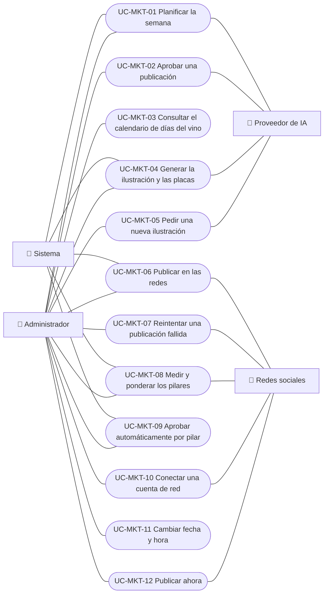

# Casos de uso

Casos de uso de marketing en redes: planificar la semana, aprobar una publicación, consultar el calendario de días del vino, generar la ilustración y las placas de una publicación, pedir una nueva ilustración, publicar en las redes, reintentar una publicación fallida, medir las publicaciones y ponderar los pilares, aprobar automáticamente por pilar, conectar una cuenta de red, cambiar la fecha y hora de una publicación y publicar una publicación ahora.

| ID | Caso de uso | Plataformas | Actores |
|---|---|---|---|
| `UC-MKT-01` | [Planificar la semana](uc-mkt-01-plan-week.md) | Web, Solo backend | Sistema, Administrador, Proveedor de IA |
| `UC-MKT-02` | [Aprobar una publicación](uc-mkt-02-approve-post.md) | Web | Administrador, Proveedor de IA |
| `UC-MKT-03` | [Consultar el calendario de días del vino](uc-mkt-03-wine-day-calendar.md) | Web | Administrador |
| `UC-MKT-04` | [Generar la ilustración y las placas de una publicación](uc-mkt-04-render-post-media.md) | Web, Solo backend | Sistema, Administrador, Proveedor de IA |
| `UC-MKT-05` | [Pedir una nueva ilustración](uc-mkt-05-new-illustration.md) | Web | Administrador, Proveedor de IA |
| `UC-MKT-06` | [Publicar una publicación en las redes](uc-mkt-06-publish-post.md) | Web, App, Solo backend | Sistema, Instagram, Facebook, Threads, TikTok, Administrador |
| `UC-MKT-07` | [Reintentar una publicación fallida](uc-mkt-07-retry-publication.md) | Web, App | Administrador, Sistema |
| `UC-MKT-08` | [Medir las publicaciones y ponderar los pilares](uc-mkt-08-collect-metrics-weight-pillars.md) | Web, App, Solo backend | Sistema, Instagram, Facebook, Threads, Administrador |
| `UC-MKT-09` | [Aprobar automáticamente por pilar](uc-mkt-09-auto-approve-by-pillar.md) | Web, App, Solo backend | Administrador, Sistema |
| `UC-MKT-10` | [Conectar una cuenta de red](uc-mkt-10-connect-network-account.md) | Web, App | Administrador, Threads, TikTok, Sistema |
| `UC-MKT-11` | [Cambiar la fecha y hora de una publicación](uc-mkt-11-reschedule-post.md) | Web, App | Administrador, Sistema |
| `UC-MKT-12` | [Publicar una publicación ahora](uc-mkt-12-publish-post-now.md) | Web, App | Administrador, Sistema, Instagram, Facebook, Threads, TikTok |

## Diagrama de casos de uso

[Ver diagrama de «Casos de uso · Diagrama de casos de uso» completo](https://images.vinnot.com/docs/diagrams/v1/es/modules-marketing-use-cases-readme-d395fe8a112c.svg)

## Equivalencia con Lucidchart

| ID | IDs en Lucidchart |
|---|---|
| `UC-MKT-01` | Ninguno |
| `UC-MKT-02` | Ninguno |
| `UC-MKT-03` | Ninguno |
| `UC-MKT-04` | Ninguno |
| `UC-MKT-05` | Ninguno |
| `UC-MKT-06` | Ninguno |
| `UC-MKT-07` | Ninguno |
| `UC-MKT-08` | Ninguno |
| `UC-MKT-09` | Ninguno |
| `UC-MKT-10` | Ninguno |
| `UC-MKT-11` | Ninguno |
| `UC-MKT-12` | Ninguno |
