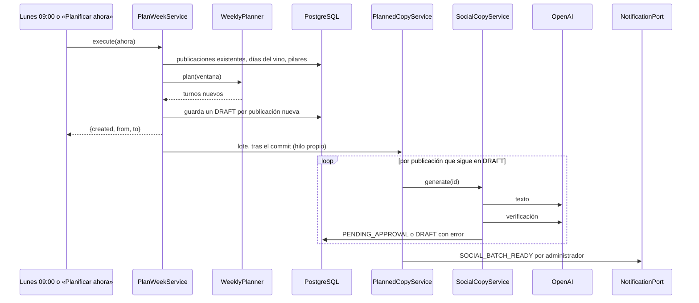

# UC-MKT-01 · Planificar la semana

| Campo | Valor |
|---|---|
| ID | `UC-MKT-01` |
| Módulo | [Marketing en redes](../README.md) |
| Plataformas | Web, Solo backend |
| Actores | Sistema, Administrador, Proveedor de IA |
| IDs en Lucidchart | Ninguno |
| Requisitos | [`RF-WEB-MKT-01`](../requirements.md), [`RF-WEB-MKT-02`](../requirements.md), [`RF-WEB-MKT-03`](../requirements.md), [`RF-WEB-MKT-04`](../requirements.md), [`RF-WEB-MKT-32`](../requirements.md) |
| Casos de prueba | [`CP-MKT-01`](../testing.md), [`CP-MKT-02`](../testing.md), [`CP-MKT-03`](../testing.md), [`CP-MKT-04`](../testing.md), [`CP-MKT-05`](../testing.md), [`CP-MKT-06`](../testing.md), [`CP-MKT-07`](../testing.md), [`CP-MKT-67`](../testing.md), [`CP-MKT-68`](../testing.md) |

## Precondiciones

- `app.marketing.enabled` está en `true` (para la corrida automática) o la persona es administradora y toca «Planificar ahora».
- Los días del vino y los pilares están cargados (migración `V78`).

## Postcondiciones

- Hay como mucho una publicación por fecha de Argentina de los próximos 14 días (rotativas en los días de turno libres y los días del vino que entran), con texto en español e inglés y la leyenda legal de cada uno, esperando aprobación.
- Los administradores recibieron el aviso del lote.

## Flujo principal

1. Llega el lunes a las 09:00 hora Argentina o la persona toca «Planificar ahora» (`POST /admin/social-posts/plan`).
2. El sistema calcula los turnos de martes, miércoles y jueves a las 12:30 de los próximos 14 días, sin las fechas que ya tienen una publicación, sea cual sea su hora.
3. Guarda un borrador por turno, encola el lote para su texto y responde `{created, from, to}` enseguida; la página avisa que la IA está escribiendo y actualiza la cola.
4. En segundo plano escribe cada publicación en español neutro e inglés (una llamada escribe los dos idiomas, otra verifica los hechos de ambos) y avisa por email y push a los administradores.

## Flujos alternativos

- 2a. Hay un día del vino dentro de la ventana: la publicación sale ese día a las 09:30; en un día de turno toma el turno de ese día y ese día no sale una rotativa.
- 2b. Dos días del vino caen en la misma fecha: gana el número de prioridad más bajo; el otro se descarta.
- 2c. Se planifica de nuevo la misma ventana: `created` es 0 y no se envía ningún aviso.
- 2d. Un día del vino cae fuera de los días de turno: es una publicación extra; la prioridad 1 sale siempre, la 2 y la 3 solo mientras su semana (lunes a domingo, publicaciones existentes y planificadas) tenga menos de `max-posts-per-week` (4) publicaciones.
- 2e. Una publicación se movió a otra fecha ([`UC-MKT-11`](uc-mkt-11-reschedule-post.md)) o se planificó con otras horas: las existentes cuentan por fecha, una rotativa movida fuera de los días de turno ocupa un turno libre de su semana y un día del vino ya publicado no se vuelve a planificar, así que planificar de nuevo no agrega nada a esa fecha ni a esa semana.
- 2f. Se planifica cuando un turno de hoy ya pasó (por ejemplo "Planificar ahora" a las 15:00): ese turno se saltea, porque una publicación en el pasado nunca llegaría a aprobarse a tiempo.
- 3a. El proveedor de IA falla o no está disponible: la publicación queda en `DRAFT` con `generation.error` y se reintenta cada 30 minutos.
- 3b. La verificación de datos no pasa: se regenera una vez y la publicación queda `FLAGGED`.
- 3c. El proveedor está en modo simulado: el texto es determinista en los dos idiomas, `mock` es `true` y la verificación queda `SKIPPED`.
- 3d. La respuesta no trae un idioma o un idioma supera un límite: el texto se vuelve a pedir una vez con el motivo exacto; si la reescritura también es inválida, la publicación sigue `DRAFT` con `INVALID_POST_COPY` y se reintenta.

## Reglas de negocio

- Una publicación por fecha de Argentina; `scheduled_for` es único.
- Los pilares rotan sin repetir el anterior y `APP_FEATURE` es una de cada cuatro.
- La leyenda legal de cada idioma la agrega siempre el dominio, nunca el modelo.
- La voz es la de un sommelier refinado y técnico para un público global (español con «tú», sin voseo ni regionalismos; sin enfoque en Argentina salvo que el tema sea argentino; sin hora local); maridajes solo por categorías de alimentos, nunca comida callejera ni rápida.
- Solo el pilar `APP_FEATURE` menciona la app y el enlace `vinnot.com/share`.

## Diagrama

[Ver diagrama de «UC-MKT-01 · Planificar la semana» completo](https://images.vinnot.com/docs/diagrams/v1/es/modules-marketing-use-cases-uc-mkt-01-plan-week-c06a2894f854.svg)

## Código

| Capa | Ubicación |
|---|---|
| Backend | [`WeeklyPlanner.java`](../../../../../backend/src/main/java/com/vinnot/marketing/domain/service/WeeklyPlanner.java), [`PlanWeekService.java`](../../../../../backend/src/main/java/com/vinnot/marketing/application/service/PlanWeekService.java), [`PlannedCopyService.java`](../../../../../backend/src/main/java/com/vinnot/marketing/application/service/PlannedCopyService.java), [`BackgroundSocialCopyQueue.java`](../../../../../backend/src/main/java/com/vinnot/marketing/infrastructure/async/BackgroundSocialCopyQueue.java), [`SocialCopyService.java`](../../../../../backend/src/main/java/com/vinnot/marketing/application/service/SocialCopyService.java), [`SocialBatchNoticeService.java`](../../../../../backend/src/main/java/com/vinnot/marketing/application/service/SocialBatchNoticeService.java), [`SocialPlannerScheduler.java`](../../../../../backend/src/main/java/com/vinnot/marketing/infrastructure/scheduling/SocialPlannerScheduler.java) |
| Web | `AdminSocialPostsPage` («Planificar ahora») |

## Tests automáticos

- Backend: [`WeeklyPlannerTest.java`](../../../../../backend/src/test/java/com/vinnot/marketing/domain/service/WeeklyPlannerTest.java), [`PostCopyTest.java`](../../../../../backend/src/test/java/com/vinnot/marketing/domain/model/PostCopyTest.java), [`PlanWeekServiceTest.java`](../../../../../backend/src/test/java/com/vinnot/marketing/application/service/PlanWeekServiceTest.java), [`PlannedCopyServiceTest.java`](../../../../../backend/src/test/java/com/vinnot/marketing/application/service/PlannedCopyServiceTest.java), [`BackgroundSocialCopyQueueTest.java`](../../../../../backend/src/test/java/com/vinnot/marketing/infrastructure/async/BackgroundSocialCopyQueueTest.java), [`SocialCopyServiceTest.java`](../../../../../backend/src/test/java/com/vinnot/marketing/application/service/SocialCopyServiceTest.java), [`SocialCopyParserTest.java`](../../../../../backend/src/test/java/com/vinnot/marketing/application/service/SocialCopyParserTest.java), [`SocialCopyPromptBuilderTest.java`](../../../../../backend/src/test/java/com/vinnot/marketing/application/service/SocialCopyPromptBuilderTest.java), [`MockSocialCopyTest.java`](../../../../../backend/src/test/java/com/vinnot/marketing/application/service/MockSocialCopyTest.java), [`SocialBatchNoticeServiceTest.java`](../../../../../backend/src/test/java/com/vinnot/marketing/application/service/SocialBatchNoticeServiceTest.java), [`SocialBatchReadyTemplateTest.java`](../../../../../backend/src/test/java/com/vinnot/notification/infrastructure/template/SocialBatchReadyTemplateTest.java), [`JdbcSocialPostRepositoryPostgresIntegrationTest.java`](../../../../../backend/src/test/java/com/vinnot/marketing/infrastructure/persistence/JdbcSocialPostRepositoryPostgresIntegrationTest.java), [`SocialPostAdminControllerTest.java`](../../../../../backend/src/test/java/com/vinnot/marketing/infrastructure/web/controller/SocialPostAdminControllerTest.java)
- Web: tests de `AdminSocialPostsPage` y de su view model (ver el [manual de administración](../../../manuals/admin.md))
- App: No aplica
