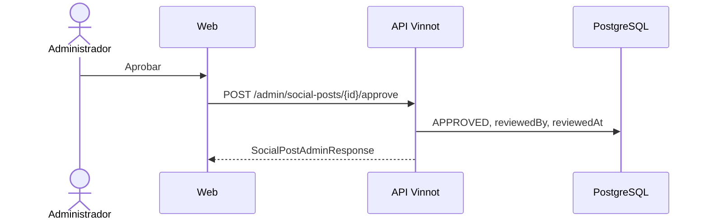

# UC-MKT-02 · Aprobar una publicación

| Campo | Valor |
|---|---|
| ID | `UC-MKT-02` |
| Módulo | [Marketing en redes](../README.md) |
| Plataformas | Web |
| Actores | Administrador, Proveedor de IA |
| IDs en Lucidchart | Ninguno |
| Requisitos | [`RF-WEB-MKT-05`](../requirements.md), [`RF-WEB-MKT-06`](../requirements.md), [`RF-WEB-MKT-07`](../requirements.md) |
| Casos de prueba | [`CP-MKT-08`](../testing.md), [`CP-MKT-09`](../testing.md), [`CP-MKT-10`](../testing.md), [`CP-MKT-11`](../testing.md), [`CP-MKT-12`](../testing.md), [`CP-MKT-13`](../testing.md) |

## Precondiciones

- La persona es administradora y hay publicaciones en la cola.

## Postcondiciones

- La publicación quedó aprobada, rechazada, editada o con texto nuevo, con quién lo hizo y cuándo.

## Flujo principal

1. La persona abre `/admin/social-posts`; la cola muestra las pendientes ordenadas por fecha.
2. Elige una publicación, elige el idioma (ES o EN) y revisa las placas de ese idioma (dibujadas en [`UC-MKT-04`](uc-mkt-04-render-post-media.md), o como texto si todavía no tienen imágenes), caption con la leyenda legal del idioma, hashtags, alt, CTA y la información de generación (modelo, simulada, verificación con sus problemas). Un idioma que la publicación todavía no tiene (una guardada antes de #497) aparece como pendiente con la acción Regenerar.
3. Toca «Aprobar».
4. El cliente envía `POST /admin/social-posts/{id}/approve` y la API registra quién y cuándo.

## Flujos alternativos

- 1a. La persona no es administradora: la API responde 403 y la web no muestra la entrada de menú.
- 3a. La persona toca «Rechazar» y escribe un motivo opcional: `POST /{id}/reject` deja la publicación `REJECTED`.
- 3b. La persona edita el texto de un idioma y guarda: `PUT /{id}` con `language` (`es` o `en`) valida los límites, vuelve a agregar la leyenda legal de ese idioma si falta, deja el otro idioma como está, guarda quién editó y deja la publicación `PENDING_APPROVAL`, también si estaba aprobada; si cambió lo que se dibuja, solo se vuelven a generar las placas de ese idioma.
- 3c. La persona toca «Regenerar» en una pendiente, rechazada o aprobada: `POST /{id}/regenerate` pide los dos idiomas de nuevo y vuelve a `PENDING_APPROVAL`; una aprobada pierde la aprobación (quién y cuándo). Si el proveedor falla, la publicación conserva su estado y su texto y muestra el error.
- 4a. La acción no corresponde al estado, el texto editado supera un límite, o la edición no indica idioma o indica otro: 409 `INVALID_POST_TRANSITION`, 400 `INVALID_POST_COPY` o 400 `INVALID_POST_LANGUAGE`; nada cambia.

## Reglas de negocio

- Aprobar solo desde `PENDING_APPROVAL`; rechazar desde `PENDING_APPROVAL` o `APPROVED`; editar desde esas dos; regenerar desde `PENDING_APPROVAL`, `REJECTED` o `APPROVED`.
- Una generación deja la publicación pendiente de aprobación solo con texto válido en los dos idiomas; cada idioma tiene su leyenda legal y sus hashtags (siempre con `#vinnot`).
- Editar usa los mismos límites que la generación: hook ≤ 60, 3 a 7 slides, caption ≤ 600, 5 a 10 hashtags con `#vinnot`, alt ≤ 200.
- `SCHEDULED`, `PUBLISHED` y `FAILED` están reservados para la fase de publicación.

## Diagrama

[Ver diagrama de «UC-MKT-02 · Aprobar una publicación» completo](https://images.vinnot.com/docs/diagrams/v1/es/modules-marketing-use-cases-uc-mkt-02-approve-post-c4d129caf41f.svg)

## Código

| Capa | Ubicación |
|---|---|
| Backend | [`SocialPost.java`](../../../../../backend/src/main/java/com/vinnot/marketing/domain/model/SocialPost.java), [`SocialPostReviewService.java`](../../../../../backend/src/main/java/com/vinnot/marketing/application/service/SocialPostReviewService.java), [`SocialPostAdminController.java`](../../../../../backend/src/main/java/com/vinnot/marketing/infrastructure/web/controller/SocialPostAdminController.java) |
| Web | `AdminSocialPostsPage`, `useAdminSocialPostsViewModel`, `adminSocialPosts.service` |

## Tests automáticos

- Backend: [`SocialPostTest.java`](../../../../../backend/src/test/java/com/vinnot/marketing/domain/model/SocialPostTest.java), [`PostCopyTest.java`](../../../../../backend/src/test/java/com/vinnot/marketing/domain/model/PostCopyTest.java), [`SocialPostReviewServiceTest.java`](../../../../../backend/src/test/java/com/vinnot/marketing/application/service/SocialPostReviewServiceTest.java), [`SocialPostQueryServiceTest.java`](../../../../../backend/src/test/java/com/vinnot/marketing/application/service/SocialPostQueryServiceTest.java), [`SocialPostPresenterTest.java`](../../../../../backend/src/test/java/com/vinnot/marketing/application/service/SocialPostPresenterTest.java), [`SocialPostAdminControllerTest.java`](../../../../../backend/src/test/java/com/vinnot/marketing/infrastructure/web/controller/SocialPostAdminControllerTest.java), [`JdbcSocialPostRepositoryPostgresIntegrationTest.java`](../../../../../backend/src/test/java/com/vinnot/marketing/infrastructure/persistence/JdbcSocialPostRepositoryPostgresIntegrationTest.java)
- Web: tests de `AdminSocialPostsPage`, su view model, hooks, servicio, cliente y modelo de dominio
- App: No aplica
