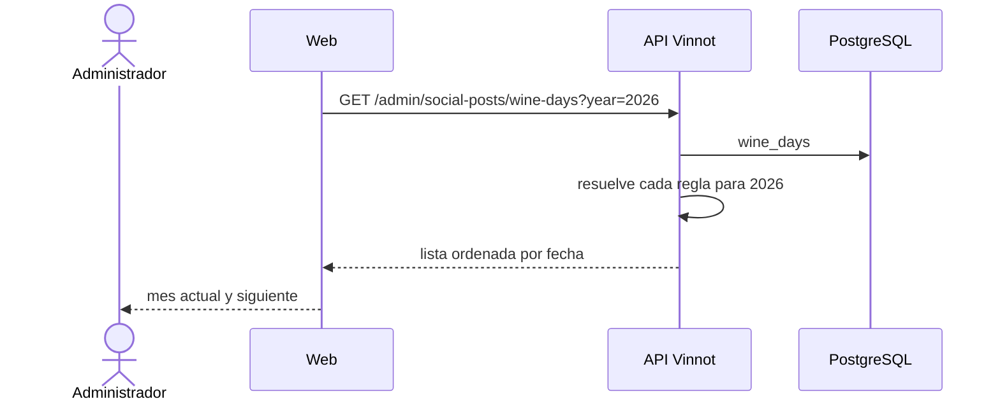

# UC-MKT-03 · Consultar el calendario de días del vino

| Campo | Valor |
|---|---|
| ID | `UC-MKT-03` |
| Módulo | [Marketing en redes](../README.md) |
| Plataformas | Web |
| Actores | Administrador |
| IDs en Lucidchart | Ninguno |
| Requisitos | [`RF-WEB-MKT-08`](../requirements.md) |
| Casos de prueba | [`CP-MKT-14`](../testing.md), [`CP-MKT-15`](../testing.md) |

## Precondiciones

- La persona es administradora.

## Postcondiciones

- La persona sabe qué días del vino caen en el período que mira y cuándo.

## Flujo principal

1. La página pide `GET /admin/social-posts/wine-days?year=2026`.
2. La API resuelve la regla de cada día para ese año y devuelve la lista ordenada por fecha.
3. La página muestra en una lista lateral los días del mes actual y del siguiente.

## Flujos alternativos

- 1a. No se pasa `year`: la API usa el año en curso.
- 2a. Un día tiene regla móvil (`nth-weekday`, `last-weekday`, `offset-from`): la fecha cambia de un año a otro (Chardonnay: 2026-05-21 y 2027-05-27).

## Reglas de negocio

- Cada día tiene nombre en español e inglés, tipo (`GRAPE`, `STYLE`, `PROFESSION`, `NATIONAL`, `GENERIC`), prioridad 1 a 3 y país opcional.
- Las reglas: `fixed:MM-DD`, `nth-weekday:MM:DOW:N` (N de 1 a 4), `last-weekday:MM:DOW` y `offset-from:<regla>:<días>`.

## Diagrama

[Ver diagrama de «UC-MKT-03 · Consultar el calendario de días del vino» completo](https://images.vinnot.com/docs/diagrams/v1/es/modules-marketing-use-cases-uc-mkt-03-wine-day-calendar-00259a524065.svg)

## Código

| Capa | Ubicación |
|---|---|
| Backend | [`DateRule.java`](../../../../../backend/src/main/java/com/vinnot/marketing/domain/model/DateRule.java), [`SocialPostQueryService.java`](../../../../../backend/src/main/java/com/vinnot/marketing/application/service/SocialPostQueryService.java), [`V78__social_media_agent.sql`](../../../../../backend/src/main/resources/db/migration/V78__social_media_agent.sql) |
| Web | `AdminSocialPostsPage` (lista lateral) |

## Tests automáticos

- Backend: [`DateRuleTest.java`](../../../../../backend/src/test/java/com/vinnot/marketing/domain/model/DateRuleTest.java), [`SocialPostQueryServiceTest.java`](../../../../../backend/src/test/java/com/vinnot/marketing/application/service/SocialPostQueryServiceTest.java), [`JdbcSocialPostRepositoryPostgresIntegrationTest.java`](../../../../../backend/src/test/java/com/vinnot/marketing/infrastructure/persistence/JdbcSocialPostRepositoryPostgresIntegrationTest.java), [`SocialPostAdminControllerTest.java`](../../../../../backend/src/test/java/com/vinnot/marketing/infrastructure/web/controller/SocialPostAdminControllerTest.java)
- Web: tests de `AdminSocialPostsPage` y del servicio `adminSocialPosts.service`
- App: No aplica
