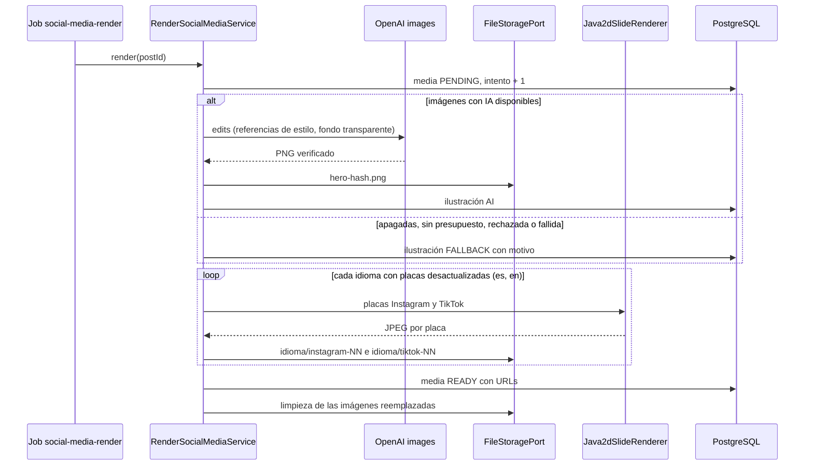

# UC-MKT-04 · Generar la ilustración y las placas de una publicación

| Campo | Valor |
|---|---|
| ID | `UC-MKT-04` |
| Módulo | [Marketing en redes](../README.md) |
| Plataformas | Web, Solo backend |
| Actores | Sistema, Administrador, Proveedor de IA |
| IDs en Lucidchart | Ninguno |
| Requisitos | [`RF-WEB-MKT-09`](../requirements.md), [`RF-WEB-MKT-10`](../requirements.md), [`RF-WEB-MKT-11`](../requirements.md), [`RF-WEB-MKT-12`](../requirements.md), [`RF-WEB-MKT-13`](../requirements.md), [`RF-WEB-MKT-14`](../requirements.md) |
| Casos de prueba | [`CP-MKT-16`](../testing.md), [`CP-MKT-17`](../testing.md), [`CP-MKT-18`](../testing.md), [`CP-MKT-19`](../testing.md), [`CP-MKT-20`](../testing.md), [`CP-MKT-21`](../testing.md), [`CP-MKT-22`](../testing.md), [`CP-MKT-23`](../testing.md), [`CP-MKT-24`](../testing.md), [`CP-MKT-25`](../testing.md), [`CP-MKT-26`](../testing.md), [`CP-MKT-27`](../testing.md), [`CP-MKT-28`](../testing.md) |

## Precondiciones

- La publicación tiene texto y no está publicada.
- Para la ilustración con IA: `ai.images.enabled` en `true`, `AI_PROVIDER=openai`, clave de OpenAI configurada y presupuesto de IA disponible. Sin eso se usa la viñeta del pilar.

## Postcondiciones

- La publicación tiene su ilustración principal (IA o viñeta del pilar, compartida por los dos idiomas) y, por idioma (ES y EN), sus placas en JPEG para Instagram (1080x1350) y TikTok (1080x1920), guardadas con URL pública.
- `media.status` es `READY`, o `FAILED` con su código de error.
- Las imágenes reemplazadas quedan en la cola de limpieza del almacenamiento.

## Flujo principal

1. El texto de la publicación se genera, se regenera o se edita en algo que se dibuja (hook, placas, CTA o tema de la ilustración) en cualquiera de los dos idiomas; el sistema encola un job `social-media-render` para esa versión del texto.
2. El worker de efectos durables toma el job fuera de cualquier transacción y suma un intento.
3. El sistema arma el tema de la ilustración: el campo `illustration` compartido del texto (en inglés), o uno derivado del día del vino o del pilar.
4. Pide la ilustración a OpenAI (`/v1/images/edits`) con cuatro ilustraciones de la app como referencia de estilo, la receta de acuarela y fondo transparente; verifica que la imagen tenga fondo transparente y la guarda como `posts/<id>/hero-<hash>.png`.
5. Para cada idioma cuyas placas no muestran su texto actual, dibuja las placas de los dos formatos: portada (ilustración, hook y marca Vinnot), una placa por cada placa del texto (título, texto y ornamentos) y cierre (CTA y leyenda legal del idioma).
6. Guarda cada placa como `posts/<id>/{es|en}/{instagram|tiktok}-NN-<hash>.jpg`, marca la media `READY` cuando todos los idiomas están dibujados y manda a limpieza las imágenes que reemplazó.
7. La persona abre la publicación en `/admin/social-posts`, elige el idioma y el formato, ve las placas con la etiqueta «Ilustración IA» o «Viñeta del pilar» y descarga las que necesite.

## Flujos alternativos

- 1a. La publicación se guardó antes de V80 o su pedido de dibujo se perdió: el barrido cada 30 minutos encola el dibujo de las publicaciones próximas con texto que siguen esperando.
- 1b. La edición cambia solo caption, hashtags o alt: el hash de lo que se dibuja no cambia, no se encola nada y las placas siguen vigentes.
- 1c. La edición cambia lo que se dibuja en un idioma: solo ese idioma se vuelve a dibujar; las placas del otro siguen vigentes.
- 1d. La publicación se guardó antes de #497 y solo tiene texto en español: solo se dibujan las placas en español; regenerar completa los dos idiomas.
- 4a. Las imágenes con IA están apagadas, en modo simulado, sin presupuesto o sin referencias de estilo (`AI_IMAGE_UNAVAILABLE`), o el pedido falla después de sus reintentos (`AI_IMAGE_FAILED`): la portada usa la viñeta del pilar y la media guarda el motivo.
- 4b. La imagen no tiene fondo transparente o no es una imagen válida (`AI_IMAGE_REJECTED`): no se reintenta; se usa la viñeta del pilar.
- 4c. La ilustración ya pagada no se puede guardar (`HERO_STORE_FAILED`): se registra la viñeta para esa versión, así un reintento nunca vuelve a pagar la imagen.
- 4d. La versión de la ilustración y el tema no cambiaron: se reutiliza la ilustración guardada sin llamar a OpenAI; si no se puede leer, se pinta de nuevo.
- 5a. El dibujo no puede usar la ilustración (`INVALID_ILLUSTRATION`): todos los idiomas se dibujan de nuevo con la viñeta del pilar.
- 5b. El texto no entra ni con la letra mínima (`TEXT_DOES_NOT_FIT`) o el JPEG no se puede codificar (`ENCODING_FAILED`): la media queda `FAILED` con ese código, sin reintento.
- 5c. El dibujo está ocupado con otra publicación (`BUSY`) o hay otro error transitorio: la media sigue `PENDING` con el error y el worker reintenta; después de cinco intentos queda `FAILED` con `RENDER_ATTEMPTS_EXHAUSTED`.
- 6a. El texto o la versión de la ilustración cambian mientras se dibuja: la corrida se detiene sin borrar nada y la corrida más nueva dibuja la publicación.
- 7a. La media está `PENDING`: la página muestra «Generando las placas…» y vuelve a pedir la publicación cada 4 segundos hasta que cambia.
- 7b. La media está `FAILED`: la página muestra el error y sugiere pedir una nueva ilustración ([`UC-MKT-05`](uc-mkt-05-new-illustration.md)).

## Reglas de negocio

- Una publicación nunca queda sin imágenes por culpa de la ilustración: todo fallo de la IA termina en la viñeta del pilar.
- Estilo pedido por la dueña del producto: «detailed hand-painted watercolor, fine sepia ink linework, warm sepia, cream, aged oak, olive and soft wine red palette, paper grain, warm light, elegant premium editorial feel», con fondo transparente para que no quede un recuadro blanco, sin texto, letras, números, logos, caras ni personas.
- Cada imagen pasa por la admisión de IA con un costo fijo por imagen (`ai.images.max-cost-usd`) y comparte el tope mensual de IA.
- Las placas de cada idioma se versionan por un hash de lo que se dibuja en él (hook, placas, CTA y tema): editar solo caption, hashtags o alt no vuelve a dibujar, editar un idioma dibuja solo ese, y nunca se muestran placas de un texto anterior.
- Las claves de almacenamiento llevan un hash del contenido y se escriben una sola vez; cada imagen pesa hasta 5 MB.
- Publicar en las redes queda para la fase 3.

## Diagrama

[Ver diagrama de «UC-MKT-04 · Generar la ilustración y las placas de una publicación» completo](https://images.vinnot.com/docs/diagrams/v1/es/modules-marketing-use-cases-uc-mkt-04-render-post-media-919402e1e9cd.svg)

## Código

| Capa | Ubicación |
|---|---|
| Backend | [`RenderSocialMediaService.java`](../../../../../backend/src/main/java/com/vinnot/marketing/application/service/RenderSocialMediaService.java), [`SocialPostMedia.java`](../../../../../backend/src/main/java/com/vinnot/marketing/domain/model/SocialPostMedia.java), [`IllustrationPromptBuilder.java`](../../../../../backend/src/main/java/com/vinnot/marketing/application/service/IllustrationPromptBuilder.java), [`Java2dSlideRenderer.java`](../../../../../backend/src/main/java/com/vinnot/marketing/infrastructure/render/Java2dSlideRenderer.java), [`OpenAiImageClient.java`](../../../../../backend/src/main/java/com/vinnot/shared/infrastructure/ai/OpenAiImageClient.java), [`SocialMediaRenderEffectHandler.java`](../../../../../backend/src/main/java/com/vinnot/marketing/infrastructure/effects/SocialMediaRenderEffectHandler.java), [`SocialMediaRenderScheduler.java`](../../../../../backend/src/main/java/com/vinnot/marketing/infrastructure/scheduling/SocialMediaRenderScheduler.java), [`SocialMediaController.java`](../../../../../backend/src/main/java/com/vinnot/shared/infrastructure/web/controller/SocialMediaController.java) |
| Web | `SlideGallery`, `useAdminSocialPostsViewModel`, `useAdminSocialPosts` (consulta con sondeo) |

## Tests automáticos

- Backend: [`RenderSocialMediaServiceTest.java`](../../../../../backend/src/test/java/com/vinnot/marketing/application/service/RenderSocialMediaServiceTest.java), [`SocialPostMediaTest.java`](../../../../../backend/src/test/java/com/vinnot/marketing/domain/model/SocialPostMediaTest.java), [`IllustrationPromptBuilderTest.java`](../../../../../backend/src/test/java/com/vinnot/marketing/application/service/IllustrationPromptBuilderTest.java), [`SlideDeckTest.java`](../../../../../backend/src/test/java/com/vinnot/marketing/application/model/SlideDeckTest.java), [`Java2dSlideRendererTest.java`](../../../../../backend/src/test/java/com/vinnot/marketing/infrastructure/render/Java2dSlideRendererTest.java), [`TextFitterTest.java`](../../../../../backend/src/test/java/com/vinnot/marketing/infrastructure/render/TextFitterTest.java), [`RenderAssetsTest.java`](../../../../../backend/src/test/java/com/vinnot/marketing/infrastructure/render/RenderAssetsTest.java), [`ClasspathStyleReferenceCatalogTest.java`](../../../../../backend/src/test/java/com/vinnot/marketing/infrastructure/render/ClasspathStyleReferenceCatalogTest.java), [`OutboxSocialMediaRenderQueueTest.java`](../../../../../backend/src/test/java/com/vinnot/marketing/infrastructure/effects/OutboxSocialMediaRenderQueueTest.java), [`SocialMediaRenderEffectHandlerTest.java`](../../../../../backend/src/test/java/com/vinnot/marketing/infrastructure/effects/SocialMediaRenderEffectHandlerTest.java), [`JdbcSocialPostMediaPostgresIntegrationTest.java`](../../../../../backend/src/test/java/com/vinnot/marketing/infrastructure/persistence/JdbcSocialPostMediaPostgresIntegrationTest.java), [`OpenAiImageClientTest.java`](../../../../../backend/src/test/java/com/vinnot/shared/infrastructure/ai/OpenAiImageClientTest.java), [`ImageTransparencyTest.java`](../../../../../backend/src/test/java/com/vinnot/shared/infrastructure/ai/ImageTransparencyTest.java), [`SocialMediaObjectsTest.java`](../../../../../backend/src/test/java/com/vinnot/shared/infrastructure/storage/SocialMediaObjectsTest.java), [`R2FileStorageServiceSocialMediaTest.java`](../../../../../backend/src/test/java/com/vinnot/shared/infrastructure/storage/R2FileStorageServiceSocialMediaTest.java), [`StorageCleanupEffectHandlerSocialMediaTest.java`](../../../../../backend/src/test/java/com/vinnot/shared/infrastructure/storage/StorageCleanupEffectHandlerSocialMediaTest.java), [`SocialMediaControllerTest.java`](../../../../../backend/src/test/java/com/vinnot/shared/infrastructure/web/controller/SocialMediaControllerTest.java)
- Web: tests de `SlideGallery`, `useAdminSocialPosts`, el servicio, el cliente y el modelo de dominio `socialPost`
- App: No aplica
