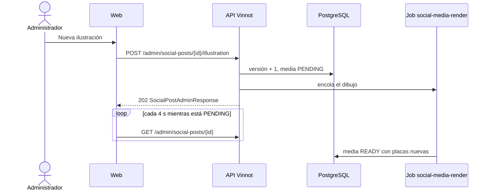

# UC-MKT-05 · Pedir una nueva ilustración

| Campo | Valor |
|---|---|
| ID | `UC-MKT-05` |
| Módulo | [Marketing en redes](../README.md) |
| Plataformas | Web |
| Actores | Administrador, Proveedor de IA |
| IDs en Lucidchart | Ninguno |
| Requisitos | [`RF-WEB-MKT-15`](../requirements.md) |
| Casos de prueba | [`CP-MKT-29`](../testing.md), [`CP-MKT-30`](../testing.md), [`CP-MKT-31`](../testing.md) |

## Precondiciones

- La persona es administradora.
- La publicación tiene texto y no está `PUBLISHED`.

## Postcondiciones

- La media apunta a una versión nueva de la ilustración y está `PENDING`; el estado de la publicación no cambia (una aprobada sigue aprobada).
- Las placas anteriores se siguen viendo hasta que las nuevas están listas.

## Flujo principal

1. La persona abre una publicación en `/admin/social-posts` y toca «Nueva ilustración».
2. El cliente envía `POST /admin/social-posts/{id}/illustration`.
3. La API sube la versión de la ilustración, deja la media `PENDING` con los intentos en cero, encola el job de dibujo y responde 202 con la publicación.
4. La página muestra «Nueva ilustración pedida. Las placas se están generando de nuevo.» y consulta la publicación cada 4 segundos.
5. El job pinta una ilustración nueva y vuelve a dibujar las placas ([`UC-MKT-04`](uc-mkt-04-render-post-media.md)); la página muestra las placas nuevas.

## Flujos alternativos

- 1a. La publicación no tiene texto o ya está publicada: la web deshabilita el botón y la API responde 409 `INVALID_POST_TRANSITION`.
- 3a. La media estaba `FAILED`: la nueva versión la vuelve a `PENDING` y el dibujo empieza de cero intentos; es la forma de reintentar un render fallido.

## Reglas de negocio

- Cada pedido paga una imagen nueva si las imágenes con IA están disponibles; si no, la portada vuelve a usar la viñeta del pilar.
- El tema de la ilustración no cambia; cambia la versión, por eso la ilustración guardada no se reutiliza.
- La ilustración y las placas reemplazadas pasan a la limpieza del almacenamiento, que solo borra lo que ninguna publicación ni job pendiente usa.

## Diagrama

[Ver diagrama de «UC-MKT-05 · Pedir una nueva ilustración» completo](https://images.vinnot.com/docs/diagrams/v1/es/modules-marketing-use-cases-uc-mkt-05-new-illustration-171cb95ea59c.svg)

## Código

| Capa | Ubicación |
|---|---|
| Backend | [`SocialPost.java`](../../../../../backend/src/main/java/com/vinnot/marketing/domain/model/SocialPost.java), [`SocialPostMedia.java`](../../../../../backend/src/main/java/com/vinnot/marketing/domain/model/SocialPostMedia.java), [`SocialPostReviewService.java`](../../../../../backend/src/main/java/com/vinnot/marketing/application/service/SocialPostReviewService.java), [`SocialPostAdminController.java`](../../../../../backend/src/main/java/com/vinnot/marketing/infrastructure/web/controller/SocialPostAdminController.java) |
| Web | `SlideGallery` («Nueva ilustración»), `useAdminSocialPostsViewModel`, `adminSocialPosts.service` |

## Tests automáticos

- Backend: [`SocialPostTest.java`](../../../../../backend/src/test/java/com/vinnot/marketing/domain/model/SocialPostTest.java), [`SocialPostMediaTest.java`](../../../../../backend/src/test/java/com/vinnot/marketing/domain/model/SocialPostMediaTest.java), [`SocialPostReviewServiceTest.java`](../../../../../backend/src/test/java/com/vinnot/marketing/application/service/SocialPostReviewServiceTest.java), [`SocialPostAdminControllerTest.java`](../../../../../backend/src/test/java/com/vinnot/marketing/infrastructure/web/controller/SocialPostAdminControllerTest.java)
- Web: tests de `SlideGallery`, `useAdminSocialPostsViewModel`, `AdminSocialPostsPage`, el servicio y el cliente
- App: No aplica
