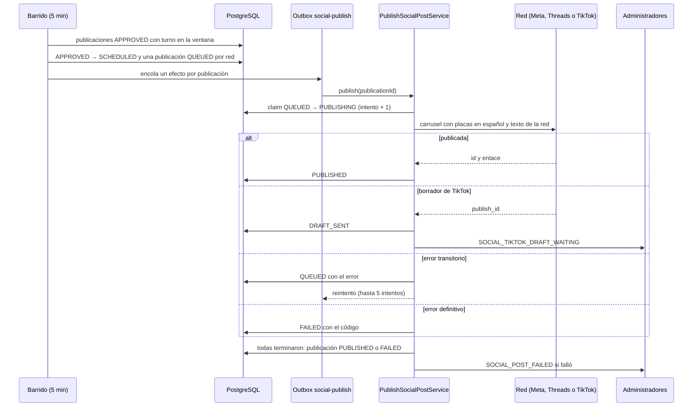

# UC-MKT-06 · Publicar una publicación en las redes

| Campo | Valor |
|---|---|
| ID | `UC-MKT-06` |
| Módulo | [Marketing en redes](../README.md) |
| Plataformas | Web, App, Solo backend |
| Actores | Sistema, Instagram, Facebook, Threads, TikTok, Administrador |
| IDs en Lucidchart | Ninguno |
| Requisitos | [`RF-WEB-MKT-19`](../requirements.md), [`RF-WEB-MKT-20`](../requirements.md), [`RF-WEB-MKT-21`](../requirements.md), [`RF-WEB-MKT-22`](../requirements.md), [`RF-WEB-MKT-23`](../requirements.md), [`RF-WEB-MKT-31`](../requirements.md), [`RF-WEB-MKT-33`](../requirements.md), [`RF-APK-MKT-01`](../requirements.md) |
| Casos de prueba | [`CP-MKT-39`](../testing.md), [`CP-MKT-40`](../testing.md), [`CP-MKT-41`](../testing.md), [`CP-MKT-42`](../testing.md), [`CP-MKT-43`](../testing.md), [`CP-MKT-44`](../testing.md), [`CP-MKT-45`](../testing.md), [`CP-MKT-46`](../testing.md), [`CP-MKT-47`](../testing.md), [`CP-MKT-69`](../testing.md), [`CP-MKT-80`](../testing.md) |

## Precondiciones

- `app.marketing.publishing.enabled` está en `true` y al menos una red está habilitada (`app.marketing.publishing.networks.<red>.enabled`).
- La cuenta de cada red habilitada está configurada (Instagram y Facebook) o conectada (Threads y TikTok, [`UC-MKT-10`](uc-mkt-10-connect-network-account.md)).
- La publicación está `APPROVED` (por una persona o por su pilar, [`UC-MKT-09`](uc-mkt-09-auto-approve-by-pillar.md)) y su hora (`scheduledFor`) llegó, o el administrador la publicó ahora ([`UC-MKT-12`](uc-mkt-12-publish-post-now.md)).

## Postcondiciones

- Hay una publicación por red habilitada (`social_publications`) con su estado, el id de la red, el enlace público, los intentos y el último error.
- La publicación queda `PUBLISHED` si todas las redes terminaron bien (un borrador de TikTok cuenta) o `FAILED` con el primer error si alguna falló de forma definitiva.
- Desde que empieza a publicarse, la publicación queda congelada: no se edita, no se regenera, no se rechaza ni pide una nueva ilustración, así las imágenes publicadas nunca se reemplazan ni se limpian.

## Flujo principal

1. Cada 5 minutos (`app.marketing.publishing.delay-ms`) el barrido busca hasta 50 publicaciones `APPROVED` cuyo turno ya pasó y está dentro de la ventana de publicación (las últimas 2 × `media-grace`, 12 h por defecto).
2. Para cada una, en su propia transacción, el sistema comprueba que las placas en español estén listas en los dos formatos, pasa la publicación a `SCHEDULED` (solo sobre el estado `APPROVED` que leyó), crea una publicación `QUEUED` por red habilitada y encola un efecto durable `social-publish` por cada una, que vence a la hora de su red: la de la publicación, o la hora mínima de la red ese día si es posterior.
3. El worker de efectos toma cada efecto fuera de cualquier transacción y reclama la publicación de forma atómica (`QUEUED` → `PUBLISHING`, un intento más).
4. El sistema arma el pedido en español: las placas de Instagram (4:5) para Instagram, Facebook y Threads, o las de TikTok (9:16) para TikTok, todas con URL https absoluta, el texto alternativo y el texto formateado para la red.
5. El adaptador de la red publica el carrusel: Instagram crea un contenedor por imagen y el del carrusel, espera a que Meta lo procese y lo publica; Facebook sube cada foto sin publicar y crea un post de la página con las fotos; Threads crea los contenedores y publica; TikTok envía las fotos con la Content Posting API.
6. La publicación queda `PUBLISHED` con el id y el enlace de la red.
7. Cuando todas las publicaciones de la publicación terminaron, el sistema la cierra: `PUBLISHED` con `publishing.finishedAt`.
8. En `/admin/social-posts`, la web y la app muestran el estado de cada red, el enlace «Ver en <red>», los intentos y la fecha de publicación.

## Flujos alternativos

- 1a. La publicación está más vieja que la ventana de publicación: el barrido la ignora; nunca se publica tarde.
- 1b. La publicación está apagada o ninguna red está habilitada: el barrido no lee ni empieza nada.
- 2a. Las placas en español todavía no están listas: la publicación sigue `APPROVED` y el barrido vuelve a mirarla; si pasaron más de `media-grace` (6 h) desde el turno, queda `FAILED` con `MEDIA_NOT_READY` y cada administrador recibe el aviso `SOCIAL_POST_FAILED` sin red.
- 2b. Una red tiene una hora mínima posterior a la publicación (`app.marketing.publishing.networks.<red>.not-before`, TikTok 19:30 por defecto): su efecto espera hasta esa hora; la publicación queda `SCHEDULED` hasta que termina cada red. «Publicar ahora» ([`UC-MKT-12`](uc-mkt-12-publish-post-now.md)) no espera.
- 3a. La publicación ya no está `QUEUED` (un efecto duplicado o un segundo worker): no se hace nada; una publicación nunca sale dos veces en la misma red.
- 3b. La publicación general o la red se apagaron después de encolar: la publicación queda `FAILED` con `PUBLISHING_OFF`.
- 4a. Una URL de placa no es https absoluta: la publicación queda `FAILED` con `MEDIA_NOT_PUBLIC`.
- 5a. TikTok en modo `MEDIA_UPLOAD` (por defecto): TikTok deja el carrusel como borrador en la bandeja de la cuenta; la publicación queda `DRAFT_SENT` sin enlace y cada administrador recibe `SOCIAL_TIKTOK_DRAFT_WAITING` para terminarla desde la app de TikTok. Con `DIRECT_POST` se publica directo.
- 5a1. El creador publica el borrador desde la app de TikTok: en menos de 15 minutos (`app.marketing.publishing.draft-sync.delay-ms`) el barrido de borradores ve el `PUBLISH_COMPLETE` de TikTok y la publicación queda `PUBLISHED`, con el enlace "Ver en TikTok" cuando TikTok ya da el id del post público (si no, sin enlace). Un borrador que sigue en la bandeja queda `DRAFT_SENT`; los borradores enviados hace más de 14 días ya no se consultan.
- 5b. Error transitorio (`RATE_LIMITED`, `UNAVAILABLE`, `PROCESSING_TIMEOUT`): la publicación vuelve a `QUEUED` con el error y el outbox la reintenta, hasta 5 intentos; el quinto la deja `FAILED`.
- 5c. Error definitivo (`NOT_CONNECTED`, `TOKEN_INVALID`, `MEDIA_REJECTED`, `REJECTED`): la publicación queda `FAILED` con ese código.
- 7a. Alguna red falló de forma definitiva: la publicación queda `FAILED` con el error de la primera falla y cada administrador recibe `SOCIAL_POST_FAILED` con la red y el motivo; la persona puede reintentar esa red ([`UC-MKT-07`](uc-mkt-07-retry-publication.md)).

## Reglas de negocio

- Se publica una sola cuenta en español: el texto y las placas en español; las placas en inglés no se publican.
- Instagram y Facebook: caption con la leyenda legal y hashtags, hasta 2.200 caracteres y 30 hashtags; los hashtags del final se quitan primero, el caption y su leyenda nunca. Threads: hook, caption acortado por palabra con «…» y leyenda legal, hasta 500 caracteres, sin hashtags y con un tema (el primer hashtag distinto de `#vinnot`). TikTok: el hook como título (hasta 90) y el caption con hashtags como descripción (hasta 4.000).
- Cantidad de imágenes por red: Instagram y Threads de 2 a 20, Facebook de 1 a 50, TikTok de 1 a 35; fuera de eso la red no se llama y la publicación falla con `REJECTED`.
- Instagram revisa su cupo diario de publicaciones antes de crear contenedores; sin cupo responde `RATE_LIMITED`.
- La espera de procesamiento consulta cada `MARKETING_NETWORKS_POLL_INTERVAL` (15 s) hasta `MARKETING_NETWORKS_POLL_TIMEOUT` (5 min) y después falla con `PROCESSING_TIMEOUT`, que se reintenta.
- Un borrador publicado se escribe sólo sobre `DRAFT_SENT`, así dos barridos nunca lo escriben dos veces; el barrido consulta hasta 20 borradores por pasada, los más viejos primero, dentro del límite de TikTok de 30 consultas de estado por minuto.
- Cerrar la publicación es un compare-and-set sobre `SCHEDULED`: un cierre concurrente o una acción del administrador nunca se pisan y el aviso de falla sale una sola vez por corrida.

## Diagrama

[Ver diagrama de «UC-MKT-06 · Publicar una publicación en las redes» completo](https://images.vinnot.com/docs/diagrams/v1/es/modules-marketing-use-cases-uc-mkt-06-publish-post-6833a8c26c4b.svg)

## Código

| Capa | Ubicación |
|---|---|
| Backend | [`SocialPublishingSweepService.java`](../../../../../backend/src/main/java/com/vinnot/marketing/application/service/SocialPublishingSweepService.java), [`SocialPublishingStarter.java`](../../../../../backend/src/main/java/com/vinnot/marketing/application/service/SocialPublishingStarter.java), [`PublishSocialPostService.java`](../../../../../backend/src/main/java/com/vinnot/marketing/application/service/PublishSocialPostService.java), [`NetworkCaptionFormatter.java`](../../../../../backend/src/main/java/com/vinnot/marketing/domain/service/NetworkCaptionFormatter.java), [`SocialPublication.java`](../../../../../backend/src/main/java/com/vinnot/marketing/domain/model/SocialPublication.java), [`SocialPost.java`](../../../../../backend/src/main/java/com/vinnot/marketing/domain/model/SocialPost.java), [`OutboxSocialPublishQueue.java`](../../../../../backend/src/main/java/com/vinnot/marketing/infrastructure/effects/OutboxSocialPublishQueue.java), [`SocialPublishEffectHandler.java`](../../../../../backend/src/main/java/com/vinnot/marketing/infrastructure/effects/SocialPublishEffectHandler.java), adaptadores en [`infrastructure/social`](../../../../../backend/src/main/java/com/vinnot/marketing/infrastructure/social/), [`SocialPublishingNoticeService.java`](../../../../../backend/src/main/java/com/vinnot/marketing/application/service/SocialPublishingNoticeService.java), [`SyncSocialDraftsService.java`](../../../../../backend/src/main/java/com/vinnot/marketing/application/service/SyncSocialDraftsService.java), [`SocialDraftSyncScheduler.java`](../../../../../backend/src/main/java/com/vinnot/marketing/infrastructure/scheduling/SocialDraftSyncScheduler.java) |
| Web | `SocialPostPublications` dentro de `SocialPostDetail` |
| App | Sección de publicaciones de `SocialPostDetailSheet` |

## Tests automáticos

- Backend: [`SocialPublicationTest.java`](../../../../../backend/src/test/java/com/vinnot/marketing/domain/model/SocialPublicationTest.java), [`SocialPostPublishingTest.java`](../../../../../backend/src/test/java/com/vinnot/marketing/domain/model/SocialPostPublishingTest.java), [`NetworkCaptionFormatterTest.java`](../../../../../backend/src/test/java/com/vinnot/marketing/domain/service/NetworkCaptionFormatterTest.java), [`SocialPublishingSweepServiceTest.java`](../../../../../backend/src/test/java/com/vinnot/marketing/application/service/SocialPublishingSweepServiceTest.java), [`SocialPublishingStarterTest.java`](../../../../../backend/src/test/java/com/vinnot/marketing/application/service/SocialPublishingStarterTest.java), [`PublishSocialPostServiceTest.java`](../../../../../backend/src/test/java/com/vinnot/marketing/application/service/PublishSocialPostServiceTest.java), [`SocialPublishingNoticeServiceTest.java`](../../../../../backend/src/test/java/com/vinnot/marketing/application/service/SocialPublishingNoticeServiceTest.java), [`InstagramPublisherTest.java`](../../../../../backend/src/test/java/com/vinnot/marketing/infrastructure/social/InstagramPublisherTest.java), [`FacebookPublisherTest.java`](../../../../../backend/src/test/java/com/vinnot/marketing/infrastructure/social/FacebookPublisherTest.java), [`ThreadsPublisherTest.java`](../../../../../backend/src/test/java/com/vinnot/marketing/infrastructure/social/ThreadsPublisherTest.java), [`TikTokPublisherTest.java`](../../../../../backend/src/test/java/com/vinnot/marketing/infrastructure/social/TikTokPublisherTest.java), [`GraphApiTest.java`](../../../../../backend/src/test/java/com/vinnot/marketing/infrastructure/social/GraphApiTest.java), [`StatusPollerTest.java`](../../../../../backend/src/test/java/com/vinnot/marketing/infrastructure/social/StatusPollerTest.java), [`OutboxSocialPublishQueueTest.java`](../../../../../backend/src/test/java/com/vinnot/marketing/infrastructure/effects/OutboxSocialPublishQueueTest.java), [`SocialPublishEffectHandlerTest.java`](../../../../../backend/src/test/java/com/vinnot/marketing/infrastructure/effects/SocialPublishEffectHandlerTest.java), [`SocialPublishingSchedulerTest.java`](../../../../../backend/src/test/java/com/vinnot/marketing/infrastructure/scheduling/SocialPublishingSchedulerTest.java), [`SyncSocialDraftsServiceTest.java`](../../../../../backend/src/test/java/com/vinnot/marketing/application/service/SyncSocialDraftsServiceTest.java), [`TikTokDraftTrackerTest.java`](../../../../../backend/src/test/java/com/vinnot/marketing/infrastructure/social/TikTokDraftTrackerTest.java), [`SocialDraftSyncSchedulerTest.java`](../../../../../backend/src/test/java/com/vinnot/marketing/infrastructure/scheduling/SocialDraftSyncSchedulerTest.java), [`MarketingPublishingConfigurationTest.java`](../../../../../backend/src/test/java/com/vinnot/marketing/infrastructure/config/MarketingPublishingConfigurationTest.java), [`JdbcSocialPublicationRepositoryPostgresIntegrationTest.java`](../../../../../backend/src/test/java/com/vinnot/marketing/infrastructure/persistence/JdbcSocialPublicationRepositoryPostgresIntegrationTest.java), [`JdbcSocialPostPublishingPostgresIntegrationTest.java`](../../../../../backend/src/test/java/com/vinnot/marketing/infrastructure/persistence/JdbcSocialPostPublishingPostgresIntegrationTest.java), [`SocialPublishingNoticeTemplateTest.java`](../../../../../backend/src/test/java/com/vinnot/notification/infrastructure/template/SocialPublishingNoticeTemplateTest.java), [`SocialPublishingPushTemplatesTest.java`](../../../../../backend/src/test/java/com/vinnot/notification/infrastructure/push/SocialPublishingPushTemplatesTest.java)
- Web: tests de `SocialPostPublications`, `SocialPostDetail`, el dominio `socialPost`, el servicio y el cliente
- App: tests de `AdminSocialPostsScreen`, `useAdminSocialPostsViewModel`, el dominio `socialPost`, el servicio y el cliente
