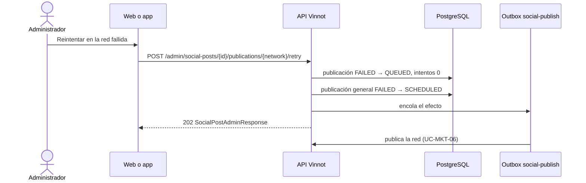

# UC-MKT-07 · Reintentar una publicación fallida

| Campo | Valor |
|---|---|
| ID | `UC-MKT-07` |
| Módulo | [Marketing en redes](../README.md) |
| Plataformas | Web, App |
| Actores | Administrador, Sistema |
| IDs en Lucidchart | Ninguno |
| Requisitos | [`RF-WEB-MKT-24`](../requirements.md), [`RF-APK-MKT-01`](../requirements.md) |
| Casos de prueba | [`CP-MKT-48`](../testing.md), [`CP-MKT-49`](../testing.md), [`CP-MKT-50`](../testing.md), [`CP-MKT-51`](../testing.md) |

## Precondiciones

- La persona es administradora.
- La publicación de esa red está `FAILED`.
- La publicación general y la red están habilitadas.

## Postcondiciones

- La publicación de esa red vuelve a `QUEUED`, sin error y con los intentos en cero, y queda encolada como efecto durable.
- Si la publicación estaba `FAILED`, vuelve a `SCHEDULED`.

## Flujo principal

1. La persona abre una publicación fallida en `/admin/social-posts` y ve el estado de cada red con su error.
2. Corrige la causa si hace falta (por ejemplo, reconecta la cuenta, [`UC-MKT-10`](uc-mkt-10-connect-network-account.md), o pide una nueva ilustración si las placas fallaron).
3. Toca «Reintentar» en la red fallida.
4. El cliente envía `POST /admin/social-posts/{id}/publications/{network}/retry`.
5. En una transacción, la API pasa la publicación de `FAILED` a `QUEUED` (movimiento condicional), vuelve los intentos a cero, pasa la publicación general de `FAILED` a `SCHEDULED` (exige placas en español listas) y encola un efecto `social-publish`.
6. La API responde 202 con la publicación; la página muestra «La publicación volvió a la cola.».
7. El worker publica esa red como en [`UC-MKT-06`](uc-mkt-06-publish-post.md) y la publicación se cierra de nuevo.

## Flujos alternativos

- 3a. La publicación de esa red ya no está `FAILED` (otra persona la reintentó al mismo tiempo, o ya terminó): la API responde 409 `INVALID_PUBLICATION_TRANSITION`; de dos reintentos concurrentes gana uno solo.
- 5a. La publicación general está `FAILED` y sus placas en español no están listas: la API responde 409 `INVALID_POST_TRANSITION` y nada cambia; hay que pedir una nueva ilustración y esperar las placas.
- 5b. La publicación general o la red están apagadas: la API responde 409 `SOCIAL_PUBLISHING_OFF`.
- 4a. La red del camino no existe: 400 `INVALID_REQUEST`. La publicación no tiene publicación en esa red, o no existe: 404.

## Reglas de negocio

- Cada publicación tiene hasta 5 intentos por corrida; reintentar a mano empieza de nuevo la cuenta.
- La clave del efecto lleva un valor aleatorio, así un reintento siempre se encola aunque quede un efecto anterior; el reclamo atómico evita publicar dos veces.
- Si la nueva corrida vuelve a fallar, los administradores reciben otro aviso `SOCIAL_POST_FAILED` (la clave incluye la hora de cierre de la corrida).

## Diagrama

[Ver diagrama de «UC-MKT-07 · Reintentar una publicación fallida» completo](https://images.vinnot.com/docs/diagrams/v1/es/modules-marketing-use-cases-uc-mkt-07-retry-publication-6e885ce74705.svg)

## Código

| Capa | Ubicación |
|---|---|
| Backend | [`SocialPublicationRetryService.java`](../../../../../backend/src/main/java/com/vinnot/marketing/application/service/SocialPublicationRetryService.java), [`SocialPublication.java`](../../../../../backend/src/main/java/com/vinnot/marketing/domain/model/SocialPublication.java), [`SocialPost.java`](../../../../../backend/src/main/java/com/vinnot/marketing/domain/model/SocialPost.java), [`SocialPostAdminController.java`](../../../../../backend/src/main/java/com/vinnot/marketing/infrastructure/web/controller/SocialPostAdminController.java) |
| Web | `SocialPostPublications`, `useSocialPublicationRetry`, `adminSocialPosts.service` |
| App | `SocialPostDetailSheet`, `useAdminSocialPostsViewModel`, `adminSocialPosts.service` |

## Tests automáticos

- Backend: [`SocialPublicationRetryServiceTest.java`](../../../../../backend/src/test/java/com/vinnot/marketing/application/service/SocialPublicationRetryServiceTest.java), [`SocialPublicationTest.java`](../../../../../backend/src/test/java/com/vinnot/marketing/domain/model/SocialPublicationTest.java), [`SocialPostPublishingTest.java`](../../../../../backend/src/test/java/com/vinnot/marketing/domain/model/SocialPostPublishingTest.java), [`SocialPostAdminControllerTest.java`](../../../../../backend/src/test/java/com/vinnot/marketing/infrastructure/web/controller/SocialPostAdminControllerTest.java), [`GlobalExceptionHandlerTransitionConflictTest.java`](../../../../../backend/src/test/java/com/vinnot/shared/infrastructure/web/GlobalExceptionHandlerTransitionConflictTest.java)
- Web: tests de `SocialPostPublications`, `useSocialPublicationRetry`, el servicio y el cliente
- App: tests de `useAdminSocialPostsViewModel`, `useAdminSocialPosts`, el servicio y el cliente
