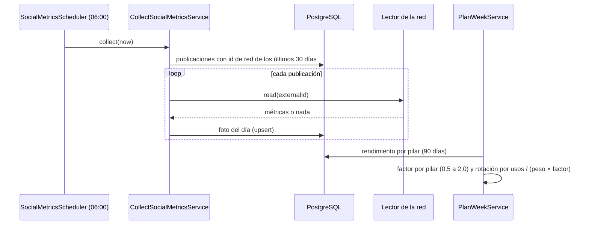

# UC-MKT-08 · Medir las publicaciones y ponderar los pilares

| Campo | Valor |
|---|---|
| ID | `UC-MKT-08` |
| Módulo | [Marketing en redes](../README.md) |
| Plataformas | Web, App, Solo backend |
| Actores | Sistema, Instagram, Facebook, Threads, Administrador |
| IDs en Lucidchart | Ninguno |
| Requisitos | [`RF-WEB-MKT-25`](../requirements.md), [`RF-WEB-MKT-26`](../requirements.md), [`RF-APK-MKT-01`](../requirements.md), [`RF-APK-MKT-02`](../requirements.md) |
| Casos de prueba | [`CP-MKT-52`](../testing.md), [`CP-MKT-53`](../testing.md), [`CP-MKT-54`](../testing.md), [`CP-MKT-55`](../testing.md) |

## Precondiciones

- `app.marketing.metrics.enabled` está en `true` para la lectura diaria.
- Hay publicaciones `PUBLISHED` o `DRAFT_SENT` con id de la red en los últimos 30 días.

## Postcondiciones

- Cada publicación medida tiene una foto de métricas del día (`social_post_metrics`), una por publicación y día.
- El planificador pondera cada pilar por su rendimiento de los últimos 90 días y la página muestra ese rendimiento.

## Flujo principal

1. Todos los días a las 06:00 en la zona del planificador (`app.marketing.metrics.cron`), el sistema busca las publicaciones con id de red publicadas en los últimos `app.marketing.metrics.window-days` (30).
2. Para cada una, el lector de su red pide las métricas: Instagram (vistas, alcance, me gusta, comentarios, guardados y compartidos), Facebook (vistas, alcance, reacciones como me gusta, comentarios y compartidos) y Threads (vistas, me gusta, respuestas como comentarios y reposts, citas y compartidos sumados como compartidos); Instagram suma seguidores nuevos si se agrega `follows` a la lista de métricas.
3. Guarda la foto del día; volver a leer el mismo día la reemplaza.
4. Al planificar ([`UC-MKT-01`](uc-mkt-01-plan-week.md)), el sistema suma la última foto de cada publicación por pilar en los últimos `app.marketing.weighting.window-days` (90) y calcula el factor de cada pilar: sus interacciones por vista contra las del total, entre 0,5 y 2,0.
5. Cada turno rotativo toma el pilar con menos usos dividido por (peso × factor), sin repetir el pilar anterior; el menor `sort_order` desempata.
6. En la web y la app, cada publicación muestra las últimas métricas por red y el panel «Pilares de contenido» muestra por pilar las publicaciones medidas, las vistas, las interacciones y el factor.

## Flujos alternativos

- 2a. TikTok: no hay lectura de métricas (el `publish_id` no es un id de video que la API de TikTok pueda consultar); la publicación queda sin métricas.
- 2b. La red no devuelve datos todavía o la publicación ya no existe: no se guarda nada.
- 2c. La lectura de una publicación falla (token, red caída): se registra en el log y las demás siguen.
- 4a. Un pilar tiene menos de 3 publicaciones medidas (una publicación cuenta como medida cuando alguna foto tiene vistas), no tiene vistas o no hay interacciones en total: su factor es neutro (1,0).
- 4b. La lectura diaria está apagada: no hay fotos nuevas y todos los pilares quedan neutros.

## Reglas de negocio

- Un valor nulo es una métrica que la red no da; interacciones = me gusta + comentarios + guardados + compartidos que no sean nulos.
- Las métricas de Instagram son configurables (`MARKETING_INSTAGRAM_METRICS`), porque Meta rechaza toda la lectura si una métrica no vale para carruseles.
- Los días del vino, `APP_FEATURE` una de cada cuatro publicaciones rotativas y la regla de no repetir el pilar anterior se mantienen.

## Diagrama

[Ver diagrama de «UC-MKT-08 · Medir las publicaciones y ponderar los pilares» completo](https://images.vinnot.com/docs/diagrams/v1/es/modules-marketing-use-cases-uc-mkt-08-collect-metrics-weight-pillars-7e9884d19eeb.svg)

## Código

| Capa | Ubicación |
|---|---|
| Backend | [`CollectSocialMetricsService.java`](../../../../../backend/src/main/java/com/vinnot/marketing/application/service/CollectSocialMetricsService.java), [`PillarPerformanceService.java`](../../../../../backend/src/main/java/com/vinnot/marketing/application/service/PillarPerformanceService.java), [`PillarWeighting.java`](../../../../../backend/src/main/java/com/vinnot/marketing/domain/service/PillarWeighting.java), [`WeeklyPlanner.java`](../../../../../backend/src/main/java/com/vinnot/marketing/domain/service/WeeklyPlanner.java), [`JdbcSocialMetricsRepository.java`](../../../../../backend/src/main/java/com/vinnot/marketing/infrastructure/persistence/JdbcSocialMetricsRepository.java), lectores en [`infrastructure/social`](../../../../../backend/src/main/java/com/vinnot/marketing/infrastructure/social/), [`SocialMetricsScheduler.java`](../../../../../backend/src/main/java/com/vinnot/marketing/infrastructure/scheduling/SocialMetricsScheduler.java) |
| Web | `SocialPostPublications` (métricas) y `ContentPillarsPanel` (rendimiento) |
| App | Métricas en `SocialPostDetailSheet` y pilares en `AdminSocialPostsScreen` |

## Tests automáticos

- Backend: [`CollectSocialMetricsServiceTest.java`](../../../../../backend/src/test/java/com/vinnot/marketing/application/service/CollectSocialMetricsServiceTest.java), [`PillarPerformanceServiceTest.java`](../../../../../backend/src/test/java/com/vinnot/marketing/application/service/PillarPerformanceServiceTest.java), [`PillarWeightingTest.java`](../../../../../backend/src/test/java/com/vinnot/marketing/domain/service/PillarWeightingTest.java), [`WeeklyPlannerTest.java`](../../../../../backend/src/test/java/com/vinnot/marketing/domain/service/WeeklyPlannerTest.java), [`PlanWeekServiceTest.java`](../../../../../backend/src/test/java/com/vinnot/marketing/application/service/PlanWeekServiceTest.java), [`PublicationMetricsTest.java`](../../../../../backend/src/test/java/com/vinnot/marketing/domain/model/PublicationMetricsTest.java), [`SocialMetricsReadersTest.java`](../../../../../backend/src/test/java/com/vinnot/marketing/infrastructure/social/SocialMetricsReadersTest.java), [`JdbcSocialMetricsRepositoryPostgresIntegrationTest.java`](../../../../../backend/src/test/java/com/vinnot/marketing/infrastructure/persistence/JdbcSocialMetricsRepositoryPostgresIntegrationTest.java), [`SocialPublishingSchedulersTest.java`](../../../../../backend/src/test/java/com/vinnot/marketing/infrastructure/scheduling/SocialPublishingSchedulersTest.java)
- Web: tests de `SocialPostPublications`, `ContentPillarsPanel`, `useContentPillarsPanel` y el servicio
- App: tests de `AdminSocialPostsScreen`, `useAdminSocialPostsViewModel` y el servicio
