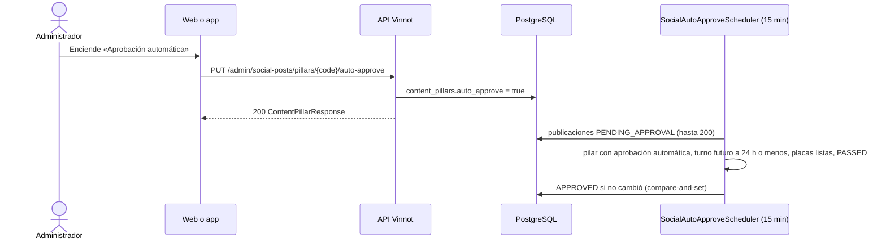

# UC-MKT-09 · Aprobar automáticamente por pilar

| Campo | Valor |
|---|---|
| ID | `UC-MKT-09` |
| Módulo | [Marketing en redes](../README.md) |
| Plataformas | Web, App, Solo backend |
| Actores | Administrador, Sistema |
| IDs en Lucidchart | Ninguno |
| Requisitos | [`RF-WEB-MKT-27`](../requirements.md), [`RF-WEB-MKT-28`](../requirements.md), [`RF-APK-MKT-02`](../requirements.md) |
| Casos de prueba | [`CP-MKT-56`](../testing.md), [`CP-MKT-57`](../testing.md), [`CP-MKT-58`](../testing.md), [`CP-MKT-59`](../testing.md), [`CP-MKT-60`](../testing.md) |

## Precondiciones

- La persona es administradora.
- `app.marketing.auto-approve.enabled` está en `true` para que corra la aprobación automática.

## Postcondiciones

- El pilar tiene su interruptor «Aprobación automática» (`auto_approve`) o «Activo» (`active`) en el valor elegido.
- Las publicaciones pendientes elegibles de un pilar con aprobación automática quedan `APPROVED` sin revisor, con el motivo `AUTO_APPROVED`.

## Flujo principal

1. La persona abre `/admin/social-posts` y, en el panel «Pilares de contenido», enciende «Aprobación automática» de un pilar.
2. El cliente envía `PUT /admin/social-posts/pillars/{code}/auto-approve` con `{"enabled": true}`.
3. La API guarda el interruptor y responde 200 con el pilar (`active`, `autoApprove` y `performance`).
4. Cada 15 minutos (`app.marketing.auto-approve.delay-ms`) el sistema lee hasta 200 publicaciones `PENDING_APPROVAL`, la más próxima primero.
5. Una publicación es elegible si su pilar tiene la aprobación automática encendida, su turno todavía no llegó y está a 24 h o menos (`app.marketing.auto-approve.lead`), sus placas en español están listas y su verificación de datos es `PASSED`.
6. El sistema la aprueba con un compare-and-set contra la versión que leyó: `APPROVED`, `review.reviewedBy` nulo, `review.reason = AUTO_APPROVED` y `review.automatic = true`.
7. La página muestra «Aprobado automáticamente el <fecha>» en la revisión; la publicación sigue a [`UC-MKT-06`](uc-mkt-06-publish-post.md).

## Flujos alternativos

- 1a. La persona apaga «Activo» de un pilar: `PUT /admin/social-posts/pillars/{code}/active` con `{"enabled": false}`; el planificador deja de planificarlo. Si es el pilar `WINE_DAY`, no se planifican días del vino.
- 1b. Es el último pilar activo que rota (sin contar `APP_FEATURE`): 409 `LAST_ROTATING_PILLAR`; la página muestra «No se puede desactivar: es el último pilar activo que rota en el planificador.».
- 2a. El código del pilar no existe: 404. El cuerpo no trae `enabled`: 400.
- 5a. La verificación quedó `FLAGGED` o `SKIPPED`, las placas no están listas, el turno está a más de 24 h o ya pasó: la publicación sigue pendiente para revisión humana.
- 6a. Un administrador editó, rechazó o aprobó la publicación entre la lectura y la aprobación: el compare-and-set no escribe y la publicación queda como la dejó la persona.

## Reglas de negocio

- La aprobación automática está apagada en todos los pilares (V82) y su job está apagado por configuración.
- Una aprobación automática se distingue por `reviewedBy` nulo y el motivo `AUTO_APPROVED`; no hay revisor ni email.
- Todos los pilares nacen activos (V83); V84 deja `HUMOR` inactivo.

## Diagrama

[Ver diagrama de «UC-MKT-09 · Aprobar automáticamente por pilar» completo](https://images.vinnot.com/docs/diagrams/v1/es/modules-marketing-use-cases-uc-mkt-09-auto-approve-by-pillar-536a326529d5.svg)

## Código

| Capa | Ubicación |
|---|---|
| Backend | [`AutoApproveSocialPostsService.java`](../../../../../backend/src/main/java/com/vinnot/marketing/application/service/AutoApproveSocialPostsService.java), [`ContentPillarAdminService.java`](../../../../../backend/src/main/java/com/vinnot/marketing/application/service/ContentPillarAdminService.java), [`PostReview.java`](../../../../../backend/src/main/java/com/vinnot/marketing/domain/model/PostReview.java), [`ContentPillar.java`](../../../../../backend/src/main/java/com/vinnot/marketing/domain/model/ContentPillar.java), [`SocialPillarAdminController.java`](../../../../../backend/src/main/java/com/vinnot/marketing/infrastructure/web/controller/SocialPillarAdminController.java), [`JdbcContentPillarCatalog.java`](../../../../../backend/src/main/java/com/vinnot/marketing/infrastructure/persistence/JdbcContentPillarCatalog.java), [`SocialAutoApproveScheduler.java`](../../../../../backend/src/main/java/com/vinnot/marketing/infrastructure/scheduling/SocialAutoApproveScheduler.java) |
| Web | `ContentPillarsPanel`, `useContentPillarsPanel`, etiqueta de revisión en `SocialPostDetail` |
| App | Interruptores de pilares en `AdminSocialPostsScreen` |

## Tests automáticos

- Backend: [`AutoApproveSocialPostsServiceTest.java`](../../../../../backend/src/test/java/com/vinnot/marketing/application/service/AutoApproveSocialPostsServiceTest.java), [`ContentPillarAdminServiceTest.java`](../../../../../backend/src/test/java/com/vinnot/marketing/application/service/ContentPillarAdminServiceTest.java), [`ContentPillarTest.java`](../../../../../backend/src/test/java/com/vinnot/marketing/domain/model/ContentPillarTest.java), [`SocialPostPublishingTest.java`](../../../../../backend/src/test/java/com/vinnot/marketing/domain/model/SocialPostPublishingTest.java), [`WeeklyPlannerTest.java`](../../../../../backend/src/test/java/com/vinnot/marketing/domain/service/WeeklyPlannerTest.java), [`SocialPillarAdminControllerTest.java`](../../../../../backend/src/test/java/com/vinnot/marketing/infrastructure/web/controller/SocialPillarAdminControllerTest.java), [`SocialPillarSwitchesPostgresIntegrationTest.java`](../../../../../backend/src/test/java/com/vinnot/marketing/infrastructure/persistence/SocialPillarSwitchesPostgresIntegrationTest.java), [`SocialContentRefinementMigrationPostgresIntegrationTest.java`](../../../../../backend/src/test/java/com/vinnot/marketing/infrastructure/persistence/SocialContentRefinementMigrationPostgresIntegrationTest.java), [`SocialPostPresenterTest.java`](../../../../../backend/src/test/java/com/vinnot/marketing/application/service/SocialPostPresenterTest.java), [`SocialPublishingSchedulersTest.java`](../../../../../backend/src/test/java/com/vinnot/marketing/infrastructure/scheduling/SocialPublishingSchedulersTest.java)
- Web: tests de `ContentPillarsPanel`, `useContentPillarsPanel`, `SocialPostDetail`, el servicio y el cliente
- App: tests de `AdminSocialPostsScreen`, `useAdminSocialPostsViewModel`, el servicio y el cliente
