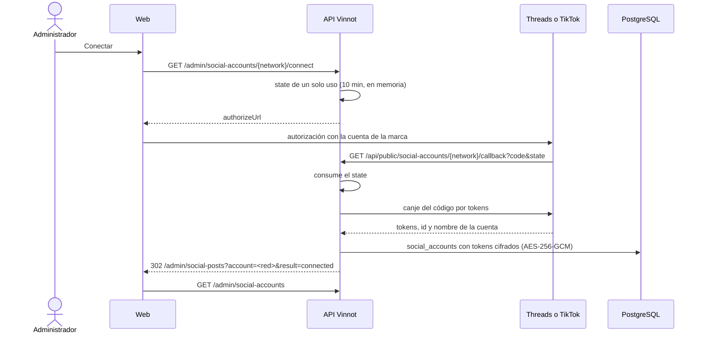

# UC-MKT-10 · Conectar una cuenta de red

| Campo | Valor |
|---|---|
| ID | `UC-MKT-10` |
| Módulo | [Marketing en redes](../README.md) |
| Plataformas | Web, App |
| Actores | Administrador, Threads, TikTok, Sistema |
| IDs en Lucidchart | Ninguno |
| Requisitos | [`RF-WEB-MKT-29`](../requirements.md), [`RF-WEB-MKT-30`](../requirements.md), [`RF-WEB-MKT-23`](../requirements.md), [`RF-APK-MKT-03`](../requirements.md) |
| Casos de prueba | [`CP-MKT-61`](../testing.md), [`CP-MKT-62`](../testing.md), [`CP-MKT-63`](../testing.md), [`CP-MKT-64`](../testing.md), [`CP-MKT-65`](../testing.md), [`CP-MKT-66`](../testing.md) |

## Precondiciones

- La persona es administradora y usa la web (conectar es solo web; la app muestra las conexiones en modo lectura).
- La app de la red está configurada en el servidor (`MARKETING_THREADS_*` o `MARKETING_TIKTOK_*`) y `MARKETING_ACCOUNTS_ENCRYPTION_KEY` existe ([guía de configuración](../../../infra/guides/social-networks-setup.md)).

## Postcondiciones

- `social_accounts` tiene una fila por red conectada con el id y el nombre de la cuenta y sus tokens cifrados con AES-256-GCM; ningún token sale del servidor ni queda en el log.
- El panel «Redes conectadas» muestra la red «Conectada», con la cuenta y la fecha de vencimiento.

## Flujo principal

1. La persona abre `/admin/social-posts` y, en «Redes conectadas», toca «Conectar» en Threads o TikTok.
2. El cliente pide `GET /admin/social-accounts/{network}/connect`.
3. La API emite un `state` de un solo uso (256 bits aleatorios, 10 minutos, guardado en la memoria del servidor) y responde con la URL de autorización de la red.
4. El navegador va a la red; la persona inicia sesión con la cuenta de la marca y acepta los permisos.
5. La red redirige a `GET /api/public/social-accounts/{network}/callback?code=…&state=…`.
6. La API consume el `state`, cambia el código por los tokens (Threads: token de larga duración de 60 días; TikTok: token de acceso y de renovación), lee el id y el nombre de la cuenta y guarda todo cifrado.
7. La API responde 302 a `/admin/social-posts?account=<red>&result=connected`, sin código, `state` ni token, con `Cache-Control: no-store` y `Referrer-Policy: no-referrer`.
8. La página muestra «<red> quedó conectada.» y el panel se actualiza con `GET /admin/social-accounts`.

## Flujos alternativos

- 1a. Instagram y Facebook muestran «Configurada en el servidor» o «Sin configurar en el servidor» y no tienen botón: se configuran con secretos. `GET /{network}/connect` para ellas responde 422 `SOCIAL_ACCOUNT_NOT_OAUTH` y `DELETE` responde 409 `SOCIAL_ACCOUNT_CONFIGURED_BY_SECRETS`.
- 3a. La app de la red no está configurada en el servidor: 422 `SOCIAL_ACCOUNT_NOT_CONFIGURED`. Falta la clave de cifrado: 422 `SOCIAL_ACCOUNT_ENCRYPTION_KEY_MISSING`. La red no existe: 404.
- 5a. El `state` es desconocido, ya se usó, venció, es de otra red, o la persona canceló en la red, o el canje falla: la API responde 302 con `result=error`, no guarda nada y la página muestra «No se pudo conectar <red>. Probá de nuevo.».
- 5b. El servidor se reinició entre «Conectar» y la vuelta: el `state` se perdió; hay que empezar de nuevo.
- 6a. Renovación automática: cada hora el sistema renueva el token de Threads en sus últimos 10 días (si tiene al menos un día) y el de TikTok en su última media hora. Un rechazo de la red, una credencial ya vencida o un token guardado que no se puede descifrar (`TOKEN_UNREADABLE`, por ejemplo tras rotar la clave) dejan la cuenta `REFRESH_FAILED` con su error, y cada administrador recibe `SOCIAL_ACCOUNT_RECONNECT` una vez; un error transitorio se reintenta en la corrida siguiente. Reconectar lo resuelve.
- 8a. «Desconectar»: `DELETE /admin/social-accounts/{network}` borra la cuenta y responde 204; si no había cuenta, 404.

## Reglas de negocio

- El `state` vive en la memoria de una sola instancia del backend (el despliegue low-cost corre una); con varias instancias el callback podría no encontrarlo.
- Los tokens se cifran ligados a la red y al campo, así un texto cifrado no sirve en otra red u otro campo.
- Una cuenta funciona mientras está `CONNECTED` y su token no venció; si no, la publicación en esa red falla con `NOT_CONNECTED` o `TOKEN_INVALID`.
- `expiresAt` es cuándo deja de funcionar si no se renueva: el fin del token de renovación de TikTok o del token de Threads; nulo para Meta.

## Diagrama

[Ver diagrama de «UC-MKT-10 · Conectar una cuenta de red» completo](https://images.vinnot.com/docs/diagrams/v1/es/modules-marketing-use-cases-uc-mkt-10-connect-network-account-01f926152cf5.svg)

## Código

| Capa | Ubicación |
|---|---|
| Backend | [`SocialAccountAdminService.java`](../../../../../backend/src/main/java/com/vinnot/marketing/application/service/SocialAccountAdminService.java), [`SocialAccountRefreshService.java`](../../../../../backend/src/main/java/com/vinnot/marketing/application/service/SocialAccountRefreshService.java), [`SocialAccountAdminController.java`](../../../../../backend/src/main/java/com/vinnot/marketing/infrastructure/web/controller/SocialAccountAdminController.java), [`SocialAccountCallbackController.java`](../../../../../backend/src/main/java/com/vinnot/marketing/infrastructure/web/controller/SocialAccountCallbackController.java), [`ThreadsOAuthProvider.java`](../../../../../backend/src/main/java/com/vinnot/marketing/infrastructure/accounts/ThreadsOAuthProvider.java), [`TikTokOAuthProvider.java`](../../../../../backend/src/main/java/com/vinnot/marketing/infrastructure/accounts/TikTokOAuthProvider.java), [`InMemorySocialAccountConnectStates.java`](../../../../../backend/src/main/java/com/vinnot/marketing/infrastructure/accounts/InMemorySocialAccountConnectStates.java), [`JdbcSocialAccountStore.java`](../../../../../backend/src/main/java/com/vinnot/marketing/infrastructure/accounts/JdbcSocialAccountStore.java), [`SocialAccountCipher.java`](../../../../../backend/src/main/java/com/vinnot/marketing/infrastructure/accounts/SocialAccountCipher.java), [`ConfiguredSocialAccountTokens.java`](../../../../../backend/src/main/java/com/vinnot/marketing/infrastructure/accounts/ConfiguredSocialAccountTokens.java) |
| Web | `SocialAccountsPanel`, `useSocialAccountsPanel`, `useAdminSocialAccounts`, `adminSocialAccounts.service`, `adminSocialAccounts.client` |
| App | Conexiones de solo lectura en `AdminSocialPostsScreen` |

## Tests automáticos

- Backend: [`SocialAccountAdminServiceTest.java`](../../../../../backend/src/test/java/com/vinnot/marketing/application/service/SocialAccountAdminServiceTest.java), [`SocialAccountRefreshServiceTest.java`](../../../../../backend/src/test/java/com/vinnot/marketing/application/service/SocialAccountRefreshServiceTest.java), [`SocialAccountAdminControllerTest.java`](../../../../../backend/src/test/java/com/vinnot/marketing/infrastructure/web/controller/SocialAccountAdminControllerTest.java), [`SocialAccountCallbackControllerTest.java`](../../../../../backend/src/test/java/com/vinnot/marketing/infrastructure/web/controller/SocialAccountCallbackControllerTest.java), [`ThreadsOAuthProviderTest.java`](../../../../../backend/src/test/java/com/vinnot/marketing/infrastructure/accounts/ThreadsOAuthProviderTest.java), [`TikTokOAuthProviderTest.java`](../../../../../backend/src/test/java/com/vinnot/marketing/infrastructure/accounts/TikTokOAuthProviderTest.java), [`InMemorySocialAccountConnectStatesTest.java`](../../../../../backend/src/test/java/com/vinnot/marketing/infrastructure/accounts/InMemorySocialAccountConnectStatesTest.java), [`JdbcSocialAccountStorePostgresIntegrationTest.java`](../../../../../backend/src/test/java/com/vinnot/marketing/infrastructure/accounts/JdbcSocialAccountStorePostgresIntegrationTest.java), [`SocialAccountCipherTest.java`](../../../../../backend/src/test/java/com/vinnot/marketing/infrastructure/accounts/SocialAccountCipherTest.java), [`ConfiguredSocialAccountTokensTest.java`](../../../../../backend/src/test/java/com/vinnot/marketing/infrastructure/accounts/ConfiguredSocialAccountTokensTest.java), [`MetaPageTokenClientTest.java`](../../../../../backend/src/test/java/com/vinnot/marketing/infrastructure/accounts/MetaPageTokenClientTest.java), [`SocialAccountRefreshSchedulerTest.java`](../../../../../backend/src/test/java/com/vinnot/marketing/infrastructure/accounts/SocialAccountRefreshSchedulerTest.java), [`SocialAccountsConfigurationTest.java`](../../../../../backend/src/test/java/com/vinnot/marketing/infrastructure/accounts/SocialAccountsConfigurationTest.java), [`SocialAccountTest.java`](../../../../../backend/src/test/java/com/vinnot/marketing/domain/model/SocialAccountTest.java)
- Web: tests de `SocialAccountsPanel`, `useSocialAccountsPanel`, `useAdminSocialAccounts`, el dominio `socialAccount`, el servicio y el cliente
- App: tests de `AdminSocialPostsScreen`, el servicio y el cliente
