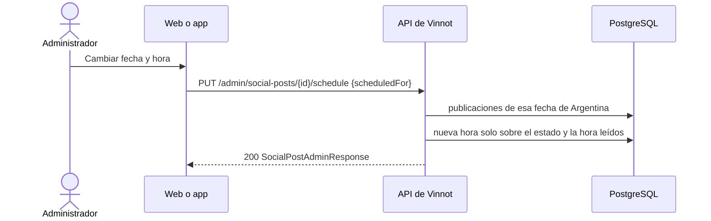

# UC-MKT-11 · Cambiar la fecha y hora de una publicación

| Campo | Valor |
|---|---|
| ID | `UC-MKT-11` |
| Módulo | [Marketing en redes](../README.md) |
| Plataformas | Web, App |
| Actores | Administrador, Sistema |
| IDs en Lucidchart | Ninguno |
| Requisitos | [`RF-WEB-MKT-34`](../requirements.md), [`RF-APK-MKT-04`](../requirements.md) |
| Casos de prueba | [`CP-MKT-70`](../testing.md), [`CP-MKT-71`](../testing.md), [`CP-MKT-72`](../testing.md), [`CP-MKT-73`](../testing.md), [`CP-MKT-74`](../testing.md) |

## Precondiciones

- La persona es administradora.
- La publicación no empezó a publicarse: está `DRAFT`, `PENDING_APPROVAL`, `APPROVED` o `REJECTED` (`canReschedule` es `true`).

## Postcondiciones

- La publicación sale a la nueva hora; su estado, su texto y sus placas quedan como estaban.
- Ninguna otra publicación sale esa fecha de Argentina.

## Flujo principal

1. La persona abre la publicación en `/admin/social-posts` y elige «Cambiar fecha y hora».
2. Elige la fecha y la hora en hora Argentina. En una publicación de día del vino el cliente avisa que su texto menciona el día.
3. El cliente envía `PUT /admin/social-posts/{id}/schedule` con `{"scheduledFor": "<instante ISO-8601>"}`.
4. La API comprueba el estado y que la hora sea futura (la guarda al segundo), y que ninguna otra publicación salga esa fecha en la zona del planificador.
5. Escribe la nueva hora solo sobre el estado y la hora que leyó, y responde 200 con la publicación (`SocialPostAdminResponse`, con `networkSchedule` a la nueva hora).
6. El barrido de publicación la publica a su nueva hora ([`UC-MKT-06`](uc-mkt-06-publish-post.md)) cuando está aprobada.

## Flujos alternativos

- 3a. El cuerpo no trae un instante válido: 400.
- 4a. La publicación está `SCHEDULED`, `PUBLISHED` o `FAILED`: 409 `INVALID_POST_TRANSITION`; no cambia nada.
- 4b. La hora es ahora o ya pasó: 400 `SOCIAL_POST_SCHEDULE_NOT_FUTURE`.
- 4c. Otra publicación sale esa fecha de Argentina: 409 `SOCIAL_POST_DATE_TAKEN`. Cambiar solo la hora dentro de la misma fecha de la publicación está permitido.
- 5a. El barrido arrancó la publicación, u otra persona la movió, después de leerla: 409 `INVALID_POST_TRANSITION` y no se escribe nada; a su vez, el barrido nunca arranca una publicación que se movió después de que la leyó.

## Reglas de negocio

- La publicación conserva su estado: una aprobada sigue aprobada y una rechazada sigue rechazada.
- El planificador cuenta la publicación movida en su nueva fecha: planificar de nuevo nunca agrega una segunda publicación esa fecha, y una rotativa movida fuera de los días de turno sigue ocupando un turno de su semana.
- Un trabajo de texto que leyó la hora vieja descarta su texto; el trabajo de cada 30 minutos vuelve a redactar el borrador.
- La aprobación automática y la ventana de publicación siguen la nueva hora.

## Diagrama

[Ver diagrama de «UC-MKT-11 · Cambiar la fecha y hora de una publicación» completo](https://images.vinnot.com/docs/diagrams/v1/es/modules-marketing-use-cases-uc-mkt-11-reschedule-post-4534e1065675.svg)

## Código

| Capa | Ubicación |
|---|---|
| Backend | [`SocialPost.java`](../../../../../backend/src/main/java/com/vinnot/marketing/domain/model/SocialPost.java), [`SocialPostScheduleService.java`](../../../../../backend/src/main/java/com/vinnot/marketing/application/service/SocialPostScheduleService.java), [`JdbcSocialPostRepository.java`](../../../../../backend/src/main/java/com/vinnot/marketing/infrastructure/persistence/JdbcSocialPostRepository.java), [`SocialPostAdminController.java`](../../../../../backend/src/main/java/com/vinnot/marketing/infrastructure/web/controller/SocialPostAdminController.java), [`RescheduleSocialPostRequest.java`](../../../../../backend/src/main/java/com/vinnot/marketing/infrastructure/web/dto/RescheduleSocialPostRequest.java) |
| Web | `AdminSocialPostsPage` («Cambiar fecha y hora») |
| App | `AdminSocialPostsScreen` («Cambiar fecha y hora») |

## Tests automáticos

- Backend: [`SocialPostScheduleTest.java`](../../../../../backend/src/test/java/com/vinnot/marketing/domain/model/SocialPostScheduleTest.java), [`SocialPostScheduleServiceTest.java`](../../../../../backend/src/test/java/com/vinnot/marketing/application/service/SocialPostScheduleServiceTest.java), [`SocialPostAdminControllerTest.java`](../../../../../backend/src/test/java/com/vinnot/marketing/infrastructure/web/controller/SocialPostAdminControllerTest.java), [`JdbcSocialPostPublishingPostgresIntegrationTest.java`](../../../../../backend/src/test/java/com/vinnot/marketing/infrastructure/persistence/JdbcSocialPostPublishingPostgresIntegrationTest.java), [`GlobalExceptionHandlerTransitionConflictTest.java`](../../../../../backend/src/test/java/com/vinnot/shared/infrastructure/web/GlobalExceptionHandlerTransitionConflictTest.java), [`WeeklyPlannerTest.java`](../../../../../backend/src/test/java/com/vinnot/marketing/domain/service/WeeklyPlannerTest.java)
- Web: tests de la acción de cambiar fecha y hora en `AdminSocialPostsPage`
- App: tests de la acción de cambiar fecha y hora en `AdminSocialPostsScreen`
