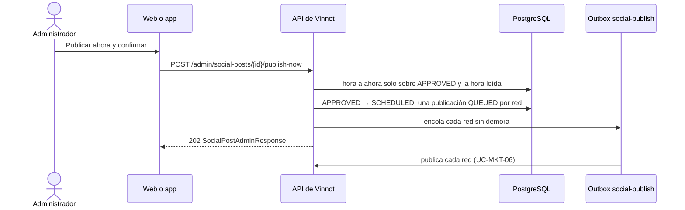

# UC-MKT-12 · Publicar una publicación ahora

| Campo | Valor |
|---|---|
| ID | `UC-MKT-12` |
| Módulo | [Marketing en redes](../README.md) |
| Plataformas | Web, App |
| Actores | Administrador, Sistema, Instagram, Facebook, Threads, TikTok |
| IDs en Lucidchart | Ninguno |
| Requisitos | [`RF-WEB-MKT-35`](../requirements.md), [`RF-APK-MKT-04`](../requirements.md) |
| Casos de prueba | [`CP-MKT-75`](../testing.md), [`CP-MKT-76`](../testing.md), [`CP-MKT-77`](../testing.md), [`CP-MKT-78`](../testing.md), [`CP-MKT-79`](../testing.md) |

## Precondiciones

- La persona es administradora.
- La publicación está `APPROVED` y sus placas en español están listas en los dos formatos.
- La publicación automática está encendida y hay al menos una red habilitada (`canPublishNow` es `true`).

## Postcondiciones

- La hora de la publicación es ahora y está `SCHEDULED`, con una publicación `QUEUED` por red habilitada encolada para salir enseguida.
- Las redes la publican como en [`UC-MKT-06`](uc-mkt-06-publish-post.md); la publicación se cierra cuando termina cada red.

## Flujo principal

1. La persona abre una publicación aprobada en `/admin/social-posts` y elige «Publicar ahora».
2. Confirma.
3. El cliente envía `POST /admin/social-posts/{id}/publish-now`.
4. En una transacción la API pasa la hora de la publicación a ahora (solo sobre el estado `APPROVED` y la hora que leyó) y arranca su publicación como el barrido, pero con cada red encolada enseguida, sin su hora mínima.
5. La API responde 202 con la publicación `SCHEDULED` y sus publicaciones por red `QUEUED`.
6. El worker publica cada red ([`UC-MKT-06`](uc-mkt-06-publish-post.md)).

## Flujos alternativos

- 4a. La publicación automática está apagada o no hay redes habilitadas: 409 `SOCIAL_PUBLISHING_OFF`; no cambia nada.
- 4b. La publicación no está `APPROVED`: 409 `INVALID_POST_TRANSITION`.
- 4c. Las placas en español no están listas: 409 `SOCIAL_POST_MEDIA_NOT_READY`; hay que esperar las placas o pedir una nueva ilustración.
- 4d. El barrido arrancó la publicación, u otra persona la movió o la cambió, después de leerla: 409 `INVALID_POST_TRANSITION` y no se escribe ni se encola nada; la publicación sale una sola vez.

## Reglas de negocio

- Publicar ahora no controla la fecha: la publicación puede salir en una fecha que ya tiene otra.
- Las horas mínimas de las redes (TikTok 19:30 por defecto) no se aplican.
- Como en cualquier inicio, la publicación queda congelada desde entonces: no se edita, no se regenera, no se rechaza ni recibe una nueva ilustración.

## Diagrama

[Ver diagrama de «UC-MKT-12 · Publicar una publicación ahora» completo](https://images.vinnot.com/docs/diagrams/v1/es/modules-marketing-use-cases-uc-mkt-12-publish-post-now-8d0f5f2a8d18.svg)

## Código

| Capa | Ubicación |
|---|---|
| Backend | [`SocialPost.java`](../../../../../backend/src/main/java/com/vinnot/marketing/domain/model/SocialPost.java), [`SocialPostScheduleService.java`](../../../../../backend/src/main/java/com/vinnot/marketing/application/service/SocialPostScheduleService.java), [`SocialPublishingStarter.java`](../../../../../backend/src/main/java/com/vinnot/marketing/application/service/SocialPublishingStarter.java), [`JdbcSocialPostRepository.java`](../../../../../backend/src/main/java/com/vinnot/marketing/infrastructure/persistence/JdbcSocialPostRepository.java), [`SocialPostAdminController.java`](../../../../../backend/src/main/java/com/vinnot/marketing/infrastructure/web/controller/SocialPostAdminController.java) |
| Web | `AdminSocialPostsPage` («Publicar ahora») |
| App | `AdminSocialPostsScreen` («Publicar ahora») |

## Tests automáticos

- Backend: [`SocialPostScheduleTest.java`](../../../../../backend/src/test/java/com/vinnot/marketing/domain/model/SocialPostScheduleTest.java), [`SocialPostScheduleServiceTest.java`](../../../../../backend/src/test/java/com/vinnot/marketing/application/service/SocialPostScheduleServiceTest.java), [`SocialPublishingStarterTest.java`](../../../../../backend/src/test/java/com/vinnot/marketing/application/service/SocialPublishingStarterTest.java), [`SocialPostAdminControllerTest.java`](../../../../../backend/src/test/java/com/vinnot/marketing/infrastructure/web/controller/SocialPostAdminControllerTest.java), [`JdbcSocialPostPublishingPostgresIntegrationTest.java`](../../../../../backend/src/test/java/com/vinnot/marketing/infrastructure/persistence/JdbcSocialPostPublishingPostgresIntegrationTest.java), [`GlobalExceptionHandlerTransitionConflictTest.java`](../../../../../backend/src/test/java/com/vinnot/shared/infrastructure/web/GlobalExceptionHandlerTransitionConflictTest.java)
- Web: tests de la acción de publicar ahora en `AdminSocialPostsPage`
- App: tests de la acción de publicar ahora en `AdminSocialPostsScreen`
