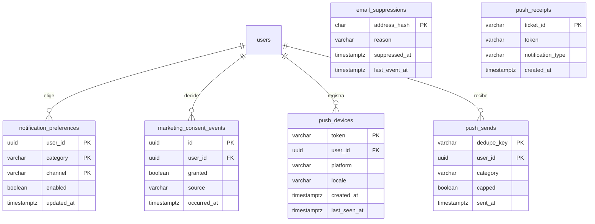

# Notificaciones

Avisos por correo y push. Los demás módulos piden un aviso (una verificación, una
inscripción, un cambio de evento, una respuesta en la comunidad) y este módulo decide si
se envía, en qué idioma y cuándo, según las preferencias de la persona, su consentimiento
de marketing, el horario de descanso y los topes de push. Las sugerencias personalizadas por push las planifica el paquete `engagement` con las señales de actividad y salen por este módulo. También registra los teléfonos
para push y atiende las bajas de correo.

- Código del módulo: `NOT`.
- Backend: paquete [`notification`](../../../../backend/src/main/java/com/vinnot/notification/).
- [Casos de uso](use-cases/README.md) · [Requisitos](requirements.md) ·
  [Arquitectura](architecture.md) · [Pruebas](testing.md)

## Actores

| Actor | Qué hace en este módulo |
|---|---|
| Usuario autenticado | Elige qué avisos recibir, da o retira el consentimiento, permite y recibe push |
| Persona que recibe un correo | Lo lee y puede darse de baja de los promocionales |
| Sistema (tareas programadas) | Entrega correos y push, reintenta, posterga, lee rebotes y revisa recibos |
| Proveedor de correo y servicio push de Expo | Envían los mensajes y reportan rebotes, quejas y recibos |

## Categorías

| Categoría | Tipo | ¿Se puede apagar? | Notas |
|---|---|---|---|
| Cuenta, seguridad, pagos, entradas | Obligatoria, visible | No | — |
| Envíos de vinos, soporte, moderación | Obligatoria, no visible | No | — |
| Eventos cerca tuyo | Opcional | Sí; empieza encendida | Solo push, 1 por día |
| Comunidad | Opcional | Sí; empieza encendida | Comentarios, resúmenes de likes y sello nuevo (`TIER_REACHED`) |
| Recomendaciones | Promocional | Sí; empieza encendida | Solo push, 1 cada 7 días |
| Novedades | Promocional | Sí; empieza encendida | — |

Todas las categorías empiezan encendidas. Las promocionales dejan de enviarse si la persona retira el consentimiento de marketing o las apaga.

## Reglas de negocio

| Regla | Detalle | Dónde |
|---|---|---|
| Preferencias | Las obligatorias no se pueden apagar; las opcionales y las promocionales empiezan encendidas; las promocionales se cortan si se retira el consentimiento | [`NotificationPreferences.java`](../../../../backend/src/main/java/com/vinnot/notification/domain/model/NotificationPreferences.java) |
| Consentimiento | Cuenta como dado hasta que la persona lo retira; cada decisión se guarda con fecha y fuente y no se modifica | [`NotificationPreferencesService.java`](../../../../backend/src/main/java/com/vinnot/notification/application/service/NotificationPreferencesService.java) |
| Envío una sola vez | Cada aviso tiene una clave; repetirlo no genera otro envío | [`EnqueueNotificationService.java`](../../../../backend/src/main/java/com/vinnot/notification/application/service/EnqueueNotificationService.java) |
| Idioma | El de la cuenta; sin idioma, español; los anuncios conservan el idioma pedido | [`DeliverNotificationService.java`](../../../../backend/src/main/java/com/vinnot/notification/application/service/DeliverNotificationService.java) |
| Direcciones bloqueadas | Un rebote permanente o una queja bloquean la dirección, también para los obligatorios | [`EmailFeedbackService.java`](../../../../backend/src/main/java/com/vinnot/notification/application/service/EmailFeedbackService.java) |
| Baja de correo | Solo en promocionales; el enlace va cifrado, no vence y no cambia el consentimiento | [`UnsubscribeService.java`](../../../../backend/src/main/java/com/vinnot/notification/application/service/UnsubscribeService.java) |
| Horario de descanso | Los push que pueden esperar se postergan entre las 22 y las 8 de la zona horaria de la cuenta | [`QuietHours.java`](../../../../backend/src/main/java/com/vinnot/notification/domain/model/QuietHours.java) |
| Topes de push | 3 por día de categorías no obligatorias, además del tope de cada categoría; las sugerencias personalizadas usan su propio presupuesto | [`DeliverPushService.java`](../../../../backend/src/main/java/com/vinnot/notification/application/service/DeliverPushService.java) |
| Sugerencias personalizadas | El planificador de [`engagement`](../../../../backend/src/main/java/com/vinnot/engagement/) elige como mucho una por día con las señales de [Actividad](../activity/README.md); presupuesto propio de 2 cada 7 días, 1 por día y 48 horas entre dos, nunca antes de las 9; no usan el tope de 3 por día ([`UC-NOT-07`](use-cases/uc-not-07-receive-suggestions.md)) | [`EngagementPolicy.java`](../../../../backend/src/main/java/com/vinnot/engagement/domain/model/EngagementPolicy.java), [`SendTime.java`](../../../../backend/src/main/java/com/vinnot/engagement/domain/model/SendTime.java) |
| Teléfonos | Un token por cuenta; hasta 10 teléfonos por envío; se borran al desactivar la cuenta | [`PushDeviceService.java`](../../../../backend/src/main/java/com/vinnot/notification/application/service/PushDeviceService.java) |
| Reintentos | Hasta 10 con espera creciente; los agotados se borran a los 30 días | [`DurableEffectWorker.java`](../../../../backend/src/main/java/com/vinnot/shared/infrastructure/effects/DurableEffectWorker.java) |

## Dónde vive

| Parte | Ubicación |
|---|---|
| API | Controllers en [`notification/infrastructure/web`](../../../../backend/src/main/java/com/vinnot/notification/infrastructure/web/), bajo `/users/me/notification-preferences`, `/users/me/push-devices` y `/notifications/unsubscribe` |
| Web | Pestaña [`UserProfileNotificationsTab`](../../../../frontend-react/src/presentation/pages/user/UserProfileNotificationsTab.tsx) del perfil y [`UnsubscribePage`](../../../../frontend-react/src/presentation/pages/public/UnsubscribePage.tsx) |
| App | [`NotificationPreferencesSheet`](../../../../frontend-mobile/src/presentation/features/user/NotificationPreferencesSheet.tsx) y los push en [`pushNotifications.service.ts`](../../../../frontend-mobile/src/application/services/pushNotifications.service.ts) |

## Datos

[Ver diagrama de «Notificaciones · Datos» completo](https://images.vinnot.com/docs/diagrams/v1/es/modules-notifications-readme-34b50dd49a55.svg)

`notification_preferences` guarda solo las elecciones de las categorías opcionales y
promocionales; las obligatorias no se guardan porque siempre se envían.
`marketing_consent_events` solo admite altas. `email_suppressions` guarda la dirección
como hash. Los correos y push pendientes viven en el outbox compartido
`external_effects`. Las tablas de anuncios e interruptores de push
(`announcements`, `announcement_delivery_stats`, `push_type_switches`,
`push_type_switch_changes`, `push_delivery_outcomes`) se usan desde
[Administración](../admin/README.md); `announcement_delivery_stats` (V79) cuenta
los emails y push enviados, fallidos y abiertos de cada anuncio, y
`push_receipts.announcement_id` (V79) liga cada ticket a su anuncio para contar los
recibos fallidos que llegan después (el diagrama no muestra esa columna). Además,
`organizer_push_digests` agrupa los avisos de inscripciones para el organizador.
