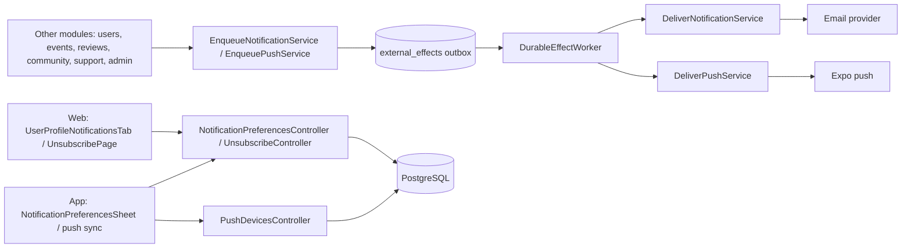
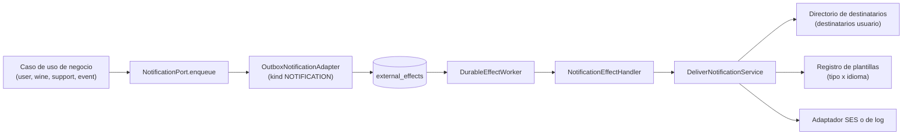

# Arquitectura

Cómo está construido el módulo en cada capa. Los demás módulos piden avisos por puertos de
salida; el módulo los guarda en el outbox dentro de la misma transacción y una tarea los
entrega por correo o push respetando preferencias, consentimiento, horario y topes. La web y
la app siguen `pantalla → hook → servicio → cliente API → transporte HTTP`; la app suma un
gateway del dispositivo para los push.

[Ver diagrama de «Arquitectura» completo](https://images.vinnot.com/docs/diagrams/v1/es/modules-notifications-architecture-4eeccd983b8b.svg)

## Backend

### Responsabilidades y límites

El módulo `notification` es dueño de todos los correos que envía el backend. Los
módulos de negocio describen *qué* enviar con un `NotificationRequest` tipado y
llaman a un único puerto de entrada, `NotificationPort.enqueue`. Nunca arman el
texto, eligen proveedor ni hablan con SES. El módulo guarda la solicitud en el
outbox compartido `external_effects` dentro de la transacción de quien llama y
la entrega después, así que una caída del proveedor nunca hace fallar ni revierte
el trabajo de negocio.

[Ver diagrama de «Responsabilidades y límites» completo](https://images.vinnot.com/docs/diagrams/v1/es/modules-notifications-architecture-ab53ad442d10.svg)

| Capa | Contenido |
|---|---|
| Dominio (`notification/domain/model`) | `NotificationType`, `NotificationCategory`, `NotificationLocale`, `NotificationRecipient`, `NotificationRequest` |
| Aplicación | Puertos de entrada `NotificationPort` y `DeliverNotificationUseCase`; puertos de salida para outbox, renderizado, entrega y búsqueda de destinatarios; `EnqueueNotificationService` y `DeliverNotificationService` |
| Infraestructura | Adaptador de outbox, codec y sellado del payload, handlers de efectos, retención, registro y plantillas, adaptadores SES y de log, directorio JDBC de destinatarios |

Los módulos de negocio dependen solo del puerto de aplicación y de los tipos de
dominio de la solicitud. Nada fuera del módulo importa su infraestructura.

### Contrato de la solicitud

`NotificationRequest{type, recipient, locale, data, dedupeKey, category}`:

- `type` elige la plantilla. La categoría sale del tipo (`NotificationRequest.of`
  la deriva; una categoría distinta se rechaza).
- `recipient` es una dirección (con nombre visible opcional) o un id de usuario.
  Un destinatario usuario se resuelve al entregar desde `users`, así el mensaje
  va a la dirección actual y se muestra en el `preferred_language` actual del
  usuario (el idioma del pedido es la alternativa); si la cuenta ya no existe,
  el mensaje se descarta.
  Las direcciones no pueden contener espacios, por lo que no inyectan cabeceras.
- `locale` es `ES` o `EN`. No hay fallback: pedir un idioma que el tipo no
  soporta falla en lugar de cambiar de idioma en silencio.
- `data` contiene valores de texto para la plantilla. Se escapan al insertarse
  en HTML y se sustituyen en una sola pasada, así un texto que parece un
  marcador queda literal.
- `dedupeKey` identifica un envío lógico. La entrega es al menos una vez; la
  clave del outbox `notification:<dedupeKey>` es única, así que encolar dos veces
  la misma clave guarda un solo mensaje.

### Tipos de notificación actuales

| Tipo | Categoría | Destinatario | Idioma | Clave de deduplicación | Productor |
|---|---|---|---|---|---|
| `ACCOUNT_EMAIL_VERIFICATION` | `ACCOUNT` | dirección de la cuenta nueva | `preferred_language` del usuario (es/en) | `ACCOUNT_EMAIL_VERIFICATION:<tokenId>` | `AccountActionTokenService` |
| `ACCOUNT_PASSWORD_RESET` | `SECURITY` | dirección de la cuenta | `preferred_language` del usuario (es/en) | `ACCOUNT_PASSWORD_RESET:<tokenId>` | `AccountActionTokenService` |
| `ACCOUNT_EMAIL_CHANGE_CONFIRMATION` | `SECURITY` | nueva dirección pedida | `preferred_language` del usuario (es/en) | `ACCOUNT_EMAIL_CHANGE_CONFIRMATION:<tokenId>` | `AccountActionTokenService` |
| `ACCOUNT_EMAIL_CHANGED` | `SECURITY` | dirección anterior | `preferred_language` del usuario (es/en) | `ACCOUNT_EMAIL_CHANGED:<tokenId consumido>` | `ConfirmEmailChangeCommandHandler` |
| `ACCOUNT_WELCOME` | `ACCOUNT` | el usuario (user id) | `preferred_language` del usuario al entregar | `welcome:<userId>` | `WelcomeEmailService`, llamado por `VerifyEmailCommandHandler` y `SocialLoginCommandHandler` la primera vez que el correo queda verificado |
| `ACCOUNT_PASSWORD_CHANGED` | `SECURITY` | el usuario (user id) | `preferred_language` del usuario al entregar | `password-changed:<userId>:<sessionVersion>` | `ChangePasswordCommandHandler`, `ResetPasswordCommandHandler` |
| `ACCOUNT_LOGIN_LOCKED` | `SECURITY` | el usuario (user id) | `preferred_language` del usuario al entregar | `login-locked:<userId>:<untilMillis>` | `LoginLockStarter`, al empezar el bloqueo temporal de inicio de sesión |
| `ACCOUNT_SOCIAL_LINKED` | `SECURITY` | el usuario (user id); dato `provider` | `preferred_language` del usuario al entregar | `social-linked:<socialIdentityId>` | `SocialLoginCommandHandler`, al vincular un proveedor a una cuenta existente |
| `ACCOUNT_DEACTIVATED` | `SECURITY` | dirección de la cuenta capturada al desactivar | `preferred_language` del usuario | `account-deactivated:<userId>:<sessionVersion>` | `DeactivateOwnAccountCommandHandler` |
| `ACCOUNT_DELETED` | `SECURITY` | dirección de la cuenta capturada antes de eliminar | `preferred_language` del usuario | `account-deleted:<userId>` | `DeleteOwnAccountCommandHandler` |
| `ACCOUNT_ROLE_CHANGED` | `SECURITY` | el usuario (user id); dato `role` (el rol otorgado) | `preferred_language` del usuario al entregar | `role-changed:<userId>:<sessionVersion>` | `AccountAdministrationNoticeService` desde `AssignRoleCommandHandler` (ambos endpoints de rol), solo si cambió el conjunto de roles |
| `ACCOUNT_SUSPENDED` | `SECURITY` | dirección de la cuenta capturada en el ban; datos `reasonCode` y `note` solo con `OTHER` | `preferred_language` del usuario | `account-suspended:<userId>:<sessionVersion>` | `AccountAdministrationNoticeService` desde `BanUserCommandHandler` |
| `ACCOUNT_REINSTATED` | `SECURITY` | el usuario (user id), solo si la cuenta estaba suspendida | `preferred_language` del usuario al entregar | `account-reinstated:<userId>:<unbannedAtEpochMillis>` | `AccountAdministrationNoticeService` desde `UnbanUserCommandHandler` |
| `ACCOUNT_DELETED_BY_ADMIN` | `SECURITY` | dirección de la cuenta capturada antes de eliminar | `preferred_language` del usuario | `account-deleted-by-admin:<userId>` | `AccountAdministrationNoticeService` desde `DeleteUserAdminCommandHandler` |
| `TERMS_UPDATED` | `ACCOUNT` | cada usuario activo que aceptó una revisión anterior; datos `version`, `requiredFrom`, `timeZone` | `preferred_language` del usuario al entregar | `terms-updated:<acceptanceRevision>:<userId>` | `AnnounceTermsUpdateService` desde `TermsAnnouncementScheduler` |
| `WINE_SUBMISSION_STATUS` | `SUBMISSIONS` | quien propuso (id de usuario) | `preferred_language` de quien propuso al entregar (ES como alternativa) | `submission:<id>:<updatedAt>` | `EmailWineSubmissionNotificationAdapter` |
| `SUPPORT_REQUEST` | `SUPPORT` | casilla de soporte configurada, Reply-To = solicitante | EN | `support:<requestId>` | `JdbcSupportRequestAdapter` |
| `SUPPORT_REQUEST_RECEIVED` | `SUPPORT` | la dirección escrita en el formulario, con o sin sesión; datos `requestId` (se muestra como referencia `VIN-…`) y `subject`, nunca el mensaje | `language` del formulario (es/en) | `support-received:<requestId>` | `JdbcSupportRequestAdapter` |
| `EVENT_REGISTRATION_ATTENDEE` | `TICKETS` | asistente | idioma de la inscripción | `event-registration:<id>:<version>:ATTENDEE` | `NotifyEventRegistrationService` |
| `EVENT_REGISTRATION_ORGANIZER` | `TICKETS` | organizador del evento, salvo cambios hechos por el organizador y cancelaciones de un evento cancelado | `preferred_language` del organizador | `event-registration:<id>:<version>:ORGANIZER` | `NotifyEventRegistrationService` |
| `NEWSLETTER` | `NEWSLETTER` (promocional) | id de usuario, email y push; datos `subject`, `body` (formato de anuncio), `route` | la versión del `preferred_language` del usuario, si no la otra | `announcement:<id>:<userId>` (email), `announcement:<id>:<lang>:<firstUserId>` (push) | `DeliverAnnouncementsService` (novedades de administradores, #310) |
| `SERVICE_NOTICE` | `ACCOUNT` | id de usuario, email y push; mismos datos que `NEWSLETTER` | igual que `NEWSLETTER` | igual que `NEWSLETTER` | `DeliverAnnouncementsService` (avisos de servicio de administradores, #310) |
| `ANNOUNCEMENT_TEST` | `ACCOUNT` | solo quien administra y envía, email y push; datos `kind` más los del tipo que se prueba | cada versión escrita | `announcement-test:<testId>:<lang>` | `AnnouncementService.sendTest` (#310) |
| `EVENT_CANCELLED_ORGANIZER_SUMMARY` | `TICKETS` | organizador del evento (id de usuario), solo cuando otra persona canceló el evento y se canceló al menos una inscripción | `preferred_language` del organizador | `event-cancelled-summary:<eventId>` | `EventCancellationService` |
| `EVENT_CANCELLED_ATTENDEE` | `TICKETS` | cada inscripción activa al cancelarse el evento | idioma de la inscripción | `event-cancelled:<eventId>:<registrationId>` | `EventCancellationService` |
| `EVENT_CHANGED_ATTENDEE` | `TICKETS` | cada inscripción confirmada cuando un evento publicado o agotado cambia su inicio, fin o lugar | idioma de la inscripción | `event-changed:<eventId>:<scheduleVersion>:<registrationId>` | `EventScheduleChangeService` desde `UpdateEventCommandHandler` |
| `EVENT_REMINDER` | `TICKETS` | cada inscripción confirmada de un evento publicado o agotado que empieza en 1–24 horas, una sola vez (`event_registrations.reminded_at`); un segundo recordatorio, solo push, llega entre 15 minutos y 2 horas antes (`reminded_soon_at`) | idioma de la inscripción | `reminder:<registrationId>:24h:<startEpoch>` | `SendEventRemindersService` desde `EventReminderScheduler` |
| `PAYMENT_RECEIPT` | `TICKETS` | comprador (user id) | `preferred_language` del comprador al entregar | `payment-receipt:<paymentId>` | `PaymentNoticeService` desde `ApplyProviderPaymentService` |
| `PAYMENT_REFUND_REQUESTED` | `TICKETS` | comprador y organizador (user ids, `audience`) | `preferred_language` del destinatario | `payment-refund-requested:<paymentId>:<BUYER\|ORGANIZER>` | `PaymentNoticeService` desde `ApplyProviderPaymentService` y `RequestPaymentRefundService` |
| `PAYMENT_REFUNDED` | `TICKETS` | comprador y organizador (user ids, `audience`) | `preferred_language` del destinatario | `payment-refunded:<paymentId>:<refundedAmount>:<BUYER\|ORGANIZER>` | `PaymentNoticeService` desde `ApplyProviderPaymentService` |
| `PAYMENT_CHARGEBACK` | `TICKETS` | organizador (user id) | `preferred_language` del organizador | `payment-chargeback:<paymentId>` | `PaymentNoticeService` desde `ApplyProviderPaymentService` |
| `PAYMENT_REFUND_REJECTED` | `TICKETS` | organizador (user id), solo email; datos `title`, `amount`, `currency`, `reference`, `registrationId` y `reason` (código corto) | `preferred_language` del organizador | `payment-refund-rejected:<paymentId>:<n>` (una vez por rechazo) | `PaymentNoticeService` desde `RefundRejectionRecorder` (conciliación) |
| `PAYMENT_ACCOUNT_CONNECTED` | `PAYMENTS` | organizador (user id) | `preferred_language` del organizador | `payment-account-connected:<userId>:<stateHash>` | `PaymentAccountNoticeService` desde `ConnectPaymentAccountService.complete` |
| `PAYMENT_ACCOUNT_RECONNECT_REQUIRED` | `PAYMENTS` | organizador (user id), correo y push; dato `reason` (`REVOKED` o `EXPIRED`) | `preferred_language` del organizador | `payment-reconnect:<userId>:<expiresAtEpochSeconds>` | `PaymentAccountNoticeService` desde `RenewalFailureRecorder` (worker de renovación) |
| `SOCIAL_BATCH_READY` | `MODERATION` | cada administrador activo (user id), correo y push; datos `count`, `from`, `to` | `preferred_language` del administrador al entregar | `social-batch:<from>:<adminId>` | `SocialBatchNoticeService`, cuando una planificación deja publicaciones sociales pendientes |
| `SOCIAL_POST_FAILED` | `MODERATION` | cada administrador activo (user id), correo y push; datos `postId`, `error` y `network` (ausente si las placas nunca estuvieron listas) | `preferred_language` del administrador al entregar | `social-failed:<postId>:<red\|ALL>:<fin de la corrida en ms>:<adminId>` | `SocialPublishingNoticeService`, cuando una publicación social falla de forma definitiva (una vez por corrida) |
| `SOCIAL_TIKTOK_DRAFT_WAITING` | `MODERATION` | cada administrador activo (user id), correo y push; dato `postId` | `preferred_language` del administrador al entregar | `social-tiktok-draft:<postId>:<adminId>` | `SocialPublishingNoticeService`, cuando TikTok recibe el carrusel como borrador |
| `SOCIAL_ACCOUNT_RECONNECT` | `MODERATION` | cada administrador activo (user id), correo y push; dato `network` | `preferred_language` del administrador al entregar | `social-reconnect:<red>:<día UTC>:<adminId>` | `SocialPublishingNoticeService` desde `SocialAccountRefreshService`, cuando una cuenta de Threads o TikTok queda `REFRESH_FAILED` |

Los correos de cuenta se encolan en la transacción de la cuenta: registro,
reenvío de verificación, olvido de clave, pedido de cambio de correo y su
confirmación se confirman aunque SES no esté disponible, y el worker reintenta
el correo. Un aviso de correo cambiado que falla ya no revierte el cambio
confirmado.

El correo de bienvenida se encola solo cuando el correo de una cuenta pasa de no
verificado a verificado: tras el enlace de verificación (alta local), cuando un
login social crea la cuenta o cuando un proveedor prueba el correo de una cuenta
local que nunca lo verificó. Esa transición ocurre una vez por usuario, así que
los logins repetidos o una nueva verificación nunca envían otro, y
`welcome:<userId>` absorbe los reintentos mientras está en cola. Es transaccional
(`ACCOUNT`), no tiene ofertas y enlaza a vinos, cava, eventos y rutas del vino.

Los avisos de seguridad (`SECURITY`, transaccionales) no se pueden apagar en las
preferencias. El cierre de cuenta escribe a la dirección capturada en la misma
transacción, antes de que la eliminación la borre, así que una eliminación
fallida no envía nada. La desactivación o eliminación hecha por el propio
usuario envía los avisos de autogestión. Las acciones de un administrador (#309)
envían su propio texto, que nunca dice "si no fuiste vos": un cambio de rol, una
suspensión con su motivo predefinido (`SPAM`, `HARASSMENT`, `FRAUD`,
`IMPERSONATION`, `TERMS_VIOLATION`, `OTHER`; el detalle del administrador llega a
la persona solo con `OTHER`), el fin de una suspensión y una eliminación. La
suspensión y la eliminación escriben a la dirección capturada en la transacción
del comando.

El aviso de términos (#309) sale cuando la publicación de términos seleccionada
trae una revisión de aceptación nueva. `TermsAnnouncementScheduler` (cada 5
minutos, `app.legal.announcements.delay-ms`; se apaga con
`app.legal.announcements.enabled=false`) recorre en lotes de 500 las cuentas
activas y no suspendidas que aceptaron una revisión anterior, con un cursor V56 por revisión, y
envía la fecha desde la que la aceptación es obligatoria
(`app.legal.notice-period`, 30 días por defecto). Las cuentas que nunca aceptaron
una revisión no reciben aviso: deben aceptar en el momento.

El acuse de soporte (#309) se encola junto con el correo de soporte, en la misma
transacción, a la dirección que escribió la persona, con un saludo genérico y
como máximo una vez por dirección y día UTC (ver
[soporte público](../support/architecture.md)). El cliente envía el idioma
de la interfaz como `language`; no forma parte de la huella de la solicitud, así
que un reintento en otro idioma sigue siendo la misma solicitud.

El reenvío de verificación y el olvido de clave no encolan el correo en el
pedido: para cada dirección guardan un efecto `ACCOUNT_RECOVERY_REQUESTED`
(clave aleatoria, payload = acción y dirección normalizada), así el pedido hace
el mismo trabajo exista o no la cuenta. Luego `AccountRecoveryEffectHandler`
resuelve la cuenta, emite el token y encola el correo dentro de la transacción
del trabajo del worker, así un intento fallido no deja un token a medias. Las direcciones desconocidas o no elegibles no hacen
nada, y estas filas se descartan al día (`AccountRecoveryRetention`).

El camino de eventos conserva su trigger de base de datos: V35 encola
`EVENT_REGISTRATION_CHANGED`, `EventRegistrationEffectHandler` lee el estado
actual de la inscripción y llama a `NotificationPort` dentro de la transacción
del worker, y la misma pasada del worker entrega la notificación resultante.
Las transiciones superadas se siguen omitiendo. V40 reemplaza la función del
trigger con el mismo tipo, claves y payload: registra quién actuó en
`event_registrations.last_actor_id` y omite la copia del organizador cuando el
cambio lo hizo el organizador o cuando una cancelación masiva del evento cancela
la inscripción. Los correos de eventos muestran las fechas en `events.timezone`
(id IANA, tomado de la zona horaria del organizador al crear el evento); los
mensajes encolados antes de V40 se muestran en UTC.

### Entrega

`app.auth.email.provider` elige exactamente un adaptador de entrega:

- `log` (por defecto): `LoggingNotificationDeliveryAdapter` registra solo el
  tipo. Nunca registra destinatarios, enlaces ni contenido y no envía nada.
- `ses`: `SesNotificationDeliveryAdapter` envía HTML y texto plano con el bean
  compartido `SesV2Client` de `AwsServiceClientConfiguration`, con sus timeouts
  de llamada e intento y sin reintentos del SDK. El remitente es
  `Vinnot <app.auth.email.from>` (si el valor configurado ya trae nombre visible,
  se respeta). Reply-To se define cuando la plantilla lo pide. Cada falla
  incrementa `vinnot.email.failures`, registra solo el tipo y la clase de la
  excepción, y se relanza para que el outbox reintente.

El worker del outbox (ver [Rendimiento y garantías del outbox](#rendimiento-y-garantías-del-outbox))
ejecuta cada job de correo en su propia transacción y reintenta con
backoff exponencial hasta 10 intentos (`DurableEffectWorker.MAX_ATTEMPTS`, el
límite que repiten los índices parciales de `external_effects`), conservando las
filas agotadas para inspección del operador durante 30 días
(`app.notifications.exhausted-retention`); después `NotificationRetention` borra
los jobs agotados de correo (`NOTIFICATION`) y de push (`PUSH_NOTIFICATION`),
porque una notificación agotada nunca se reenvía y solo conserva datos personales
(los payloads push llevan nombres visibles). Un job fallido revierte todo lo que escribió su
handler, y el intento se registra en una transacción aparte, así un error de
base de datos dentro de un handler nunca bloquea los jobs encolados después. Los mensajes
`SUPPORT_REQUEST` y `SUPPORT_REQUEST_RECEIVED` no entregados se descartan a los 7 días
(`NotificationRetention`) porque contienen datos personales.

#### Rebotes y quejas

Cada envío, incluido el correo transaccional, consulta primero
`EmailSuppressionPort`. Una dirección suprimida se omite antes de renderizar (así
un mensaje promocional nunca emite un enlace de baja) y solo se registra el tipo.
`email_suppressions` guarda una huella SHA-256 de la dirección recortada y en
minúsculas, nunca la dirección.

Las direcciones se suprimen a partir del feedback de SES. Con
`app.auth.email.ses-configuration-set` (`EMAIL_SES_CONFIGURATION_SET`), SES envía
por ese configuration set, que publica los eventos de rebote y queja en SNS y de
ahí a una cola SQS (`infra/aws-low-cost/email-feedback-stack.json`). Con
`app.notifications.feedback.queue-url` (`EMAIL_FEEDBACK_QUEUE_URL`),
`SqsEmailFeedbackPoller` lee esa cola cada `poll-ms` (60 s) en su propio
scheduler, con long poll de 5 s y como máximo 5 lotes de 10. Los rebotes
permanentes suprimen como `HARD_BOUNCE` y las quejas como `COMPLAINT`; los rebotes
transitorios o indeterminados y otros eventos se confirman sin efecto. Un mensaje
se borra solo después de registrarse; uno ilegible queda para la cola de mensajes
fallidos tras 5 recepciones. Ambos valores están vacíos por defecto y entonces la
aplicación envía exactamente como antes. El configuration set también suprime los
mismos motivos del lado de SES, y la lista de supresión de la cuenta SES cubre
ambos entornos.

### Preferencias, consentimiento y baja

Cada `NotificationCategory` tiene un tipo:

- `TRANSACTIONAL` (`ACCOUNT`, `SECURITY`, `PAYMENTS`, `TICKETS`, y las no
  listadas `SUBMISSIONS`, `SUPPORT` y `MODERATION`): siempre se entregan y no se
  pueden editar.
- `OPTIONAL` (`EVENTS_NEARBY`, `COMMUNITY`, `REMINDERS`): se entregan salvo que
  el usuario apague el canal. `REMINDERS` agrupa los recordatorios sobre la propia
  actividad (vinos para valorar, cava, primeros pasos, volver a la app) y no tiene
  un límite propio de push.
- `PROMOTIONAL` (`RECOMMENDATIONS`, `NEWSLETTER`): se entregan salvo que el
  usuario retire el consentimiento de marketing o apague el canal. Una cuenta que
  nunca decidió cuenta con el consentimiento dado y los canales encendidos.

Las elecciones se guardan por usuario, categoría y canal (`EMAIL`, `PUSH`) en
`notification_preferences`. El consentimiento es un historial de solo inserción
en `marketing_consent_events`, con la decisión, la hora del servidor y el origen
(`WEB` o `MOBILE`; un enlace de baja solo apaga un canal y nunca registra
consentimiento); la última fila es la decisión vigente y, sin filas, el
consentimiento cuenta como dado. La primera respuesta explícita se guarda aunque
coincida con ese valor. El
usuario lee y cambia ambos con `GET`/`PUT /users/me/notification-preferences`. Cada
categoría de la respuesta trae `email`, `push`, `editable`, `emailAvailable` y
`pushAvailable`: los dos últimos dicen si algún tipo de la categoría se envía por correo
(`NotificationType.emails()`) o tiene plantilla de push (`PushRendererPort.types()`), y los
clientes ocultan el interruptor de un canal no disponible.
Un `PUT` aplica primero la decisión de consentimiento y después las elecciones;
activar un canal promocional con el consentimiento retirado falla con
`MARKETING_CONSENT_REQUIRED`, y cambiar una categoría transaccional falla con
`TRANSACTIONAL_NOTIFICATION_CATEGORY`.

Las solicitudes no transaccionales deben dirigirse a un id de usuario, porque la
elección pertenece a una cuenta. `DeliverNotificationService` revisa la elección
guardada después de resolver el destinatario y `DeliverPushService` revisa la
elección de push por cuenta, así que un cambio hecho después de encolar igual se
respeta. Un correo o push promocional nunca se envía con el consentimiento de
marketing retirado, aunque la categoría esté activada. Los resúmenes de actividad ("me
gusta", el resumen del organizador) no son marketing: solo siguen la elección de
su propia categoría.

Los correos promocionales reciben dos enlaces de `UnsubscribeLinkPort`
(`SealedUnsubscribeLinks`): un token AES-GCM sobre el usuario y la categoría, con
una clave derivada de `jwt.secret` bajo su propia etiqueta de propósito. El
enlace a la página (`{frontend}/unsubscribe?token=`) va en el pie; el enlace de un
clic (`{app.notifications.public-api-base-url}/notifications/unsubscribe?token=`)
va en el encabezado `List-Unsubscribe` junto con
`List-Unsubscribe-Post: List-Unsubscribe=One-Click`, enviados como encabezados de
mensaje de SES. `POST /notifications/unsubscribe` es público: apaga el correo de
esa categoría y no revoca el consentimiento. `GET` no se acepta, así que los
escáneres de correo que abren el enlace no cambian nada; la página web pide un
clic antes. `APP_PUBLIC_API_BASE_URL` define la base de la API
(`https://api.vinnot.com/api` en producción, `https://api-dev.vinnot.com/api` en
desarrollo).

### Dispositivos push

`push_devices` (V46) guarda una fila por token Expo push: `token` (clave
primaria), `user_id` (`ON DELETE CASCADE`), `platform` (`IOS`/`ANDROID`),
`locale` (`es`/`en`, el idioma de la app), `created_at`, `last_seen_at` y, desde
V65, `channels` (la app creó los canales de Android por categoría). `PushToken`
solo acepta `ExponentPushToken[...]` o `ExpoPushToken[...]` y nunca imprime su
valor. `PushDeviceService` (`ManagePushDevicesUseCase`):

- `PUT /users/me/push-devices` registra o renueva un dispositivo y fija
  `last_seen_at` en el momento actual; la app lo llama en cada arranque en frío.
  Un token usado antes por otra cuenta pasa a la cuenta con sesión iniciada, así
  un teléfono compartido solo recibe pushes de quien tiene la sesión abierta. El
  campo opcional `channels: true` indica que el dispositivo creó los canales por
  categoría; sin él (versiones anteriores de la app) el dispositivo sigue
  recibiendo el canal heredado `default`.
- `DELETE /users/me/push-devices` lo da de baja; los tokens desconocidos o de
  otra cuenta se ignoran.
- `POST /auth/logout` con `pushToken` olvida este dispositivo aunque la sesión ya
  haya vencido: para la cuenta de la sesión cuando se conoce el refresh token
  (vigente, vencido o revocado) y, si no, solo ese token exacto, sea de quien sea.
  El logout funciona aunque el access token haya vencido.
- Un restablecimiento de contraseña cierra todas las sesiones y olvida todos los
  dispositivos de la cuenta.
- Desactivar una cuenta (propia o por un administrador) elimina todos sus
  dispositivos; el borrado definitivo los elimina por la clave foránea.
- `PushDeviceRetentionScheduler` (diario, `app.notifications.push.device-purge-cron`,
  03:50) olvida los dispositivos que no se registraron durante
  `app.notifications.push.device-retention` (`PUSH_DEVICE_RETENTION`, 120 días):
  apps desinstaladas y teléfonos que no se volvieron a abrir. Es idempotente, así
  que cualquier instancia puede ejecutarlo.

### Entrega de push

Los módulos de negocio llaman a `PushNotificationPort.push(PushRequest)`: un
tipo, hasta 1000 ids de cuenta, datos de plantilla y una clave de deduplicación
(como máximo 180 caracteres). La solicitud se guarda como **un solo** trabajo del
outbox (`PUSH_NOTIFICATION`, clave `push:<dedupeKey>`) en la transacción de quien
llama, así un envío masivo nunca se convierte en un trabajo por dispositivo.
`PushEffectHandler` lo ejecuta **fuera** de la transacción del outbox (ver
[Rendimiento y garantías del outbox](#rendimiento-y-garantías-del-outbox)), y
después `DeliverPushService`:

0. descarta la solicitud entera cuando un administrador apagó su tipo
   (`push_type_switches`, #310), copias de horario de descanso incluidas, y la
   descarta cuando ya pasó `expiresAt`;
1. omite las cuentas que ya están en `push_sends` para esa clave (un trabajo
   reintentado) y las cuentas inactivas, suspendidas (bloqueadas) o borradas
   (`JdbcPushAudience`);
2. solo para categorías no transaccionales: aplica la preferencia **push** de la
   cuenta (las preferencias de todas las cuentas del trabajo se leen en un solo
   lote, `NotificationPreferenceRepositoryPort.loadAll`) y retiene las cuentas en
   horario de descanso (22:00–08:00 en `users.timezone`; 22:00–09:00 para los push
   de engagement, incluido el `WINE_RECOMMENDATION` disparado por eventos, #405 S11)
   guardando para ellas una copia demorada de la solicitud (clave
   `<dedupeKey>:quiet:<epochSecond>`);
3. conserva las cuentas con al menos un dispositivo (los diez más recientes);
4. para los push con límite (todo push reactivo no transaccional cuenta para
   `app.notifications.push.daily-cap`, 3 por defecto en las últimas 24 h; algunas
   categorías suman un límite propio; los push de engagement no se frenan en el
   tope diario ni cuentan para él: se registran con `capped = false` y pasan por el
   [presupuesto de engagement](#push-de-engagement)) **reserva** el envío:
   `PushSendLogPort.reserve` revisa los límites y registra las cuentas en
   `push_sends` en una transacción corta que toma un lock consultivo de
   transacción por cuenta (cuentas distribuidas en 64 ranuras por hash, tomadas
   en orden). Los trabajos concurrentes para la misma cuenta se esperan entre sí
   y ven los envíos del otro, así dos trabajos nunca superan juntos un límite;
5. arma el push una vez por idioma de dispositivo con `PushTemplateRegistry`
   (beans `PushTemplate`; solo los tipos que envían push tienen uno) como
   `PushContent`: título ≤ 65 y cuerpo ≤ 178 caracteres, acortados en una palabra
   con puntos suspensivos, más una ruta de la app;
6. envía en lotes de como máximo 100 mensajes, con todos los dispositivos de una
   cuenta en el mismo lote. Un push transaccional registra sus cuentas en
   `push_sends` apenas el proveedor acepta cada lote. Después, como mejor
   esfuerzo (una falla se registra en el log y nunca hace fallar el trabajo, así
   que un lote entregado nunca se vuelve a enviar), guarda los tickets aceptados
   en `push_receipts` y olvida los tokens rechazados como `DeviceNotRegistered`.
   Una falla del proveedor hace fallar el trabajo: un push reservado primero
   libera las reservas de las cuentas no alcanzadas, y el reintento solo llega a
   las cuentas que todavía no se registraron. Un lote que el proveedor rechaza por
   mal formado (`400`/`413`) se cuenta como fallido y este trabajo no lo vuelve a
   enviar; el trabajo continúa. Una cuenta reservada que el proveedor no tomó (su
   lote fue rechazado, o no se aceptó ninguno de sus mensajes) se libera de
   `push_sends` y de `engagement_sends`, así un push que nunca recibió no le
   consume límites ni cuenta como un push de engagement sin abrir (un reintento tras
   una falla posterior del proveedor puede volver a intentarlo). Contar los
   resultados también es mejor esfuerzo, y las cuentas de un lote salen de la lista
   pendiente del trabajo apenas responde el proveedor, así una falla de las métricas
   nunca hace fallar el trabajo ni envía un lote dos veces.

Los push transaccionales son urgentes (`priority: high`) e ignoran preferencias,
horario de descanso y tope. Un pedido marcado `deferrable` (un push transaccional
que puede esperar: recordatorios del día anterior, resúmenes al organizador,
contracargos) sigue ignorando preferencias y tope, pero espera el horario de
descanso como un push opcional y se envía con prioridad normal; la marca sobrevive
al outbox y a las copias diferidas, y los trabajos encolados antes de que existiera
son inmediatos. Un `expiresAt` opcional descarta el push que se entrega tarde, y
también las cuentas cuyo horario de descanso terminaría después, así un
recordatorio nunca llega cuando el evento está por empezar.

El payload de Expo lleva `to`, `title`, `body`, `sound: default`, `priority`
(`high` solo para los push urgentes), `channelId`, `ttl` (segundos hasta
`expiresAt`, cuando el push lo tiene, así Expo deja de reintentar con un
dispositivo sin conexión) y `data = {url, type, ref}`: la ruta de la app, el
nombre del `NotificationType` y la clave de deduplicación del trabajo, que la app
informa cuando se abre el push. Ningún dato personal. `channelId` sigue a la
categoría cuando el dispositivo se registró con `channels: true`; si no, es
`default`:

| Categoría (o tipo) | Canal de Android |
|---|---|
| `TICKETS`, `PAYMENTS`, `ACCOUNT`, `SECURITY`, `SUBMISSIONS`, `SUPPORT`, `MODERATION` | `tickets` |
| `COMMUNITY` | `community` |
| `RECOMMENDATIONS` | `recommendations` |
| `EVENTS_NEARBY` | `events-nearby` |
| `REMINDERS` | `reminders` |
| `NEWSLETTER`, y los tipos `SERVICE_NOTICE` y `ANNOUNCEMENT_TEST` | `news` |
| cualquier categoría que el mapeo no conoce | `default` |

Cada resultado se cuenta por tipo y día UTC en `push_delivery_outcomes` (V59):
enviados (cuentas con al menos un mensaje aceptado por el proveedor), bloqueados
por preferencias, diferidos por horario de descanso, descartados por el tope
diario o por categoría, vencidos, fallidos (mensajes a dispositivos que el
proveedor rechazó y recibos no entregados), apagados y, para los push de
engagement, descartados por el presupuesto compartido, por fatiga o retenidos por
el holdout (`DROPPED_ENGAGEMENT_BUDGET`, `DROPPED_FATIGUE`, `DROPPED_HOLDOUT`). Los contadores se escriben
en su propia transacción, así que un trabajo reintentado después de una falla del
proveedor vuelve a contar las cuentas que reevalúa: los números son aproximados,
no exactos. Cada código de error del proveedor distinto de `DeviceNotRegistered`,
en un ticket o en un recibo, se registra en el log con su cantidad (nunca el
token), y todos los códigos se cuentan en el contador de Micrometer
`vinnot.push.provider.errors{stage=ticket|receipt, code}`.

`PushReceiptScheduler` (cada 5 minutos, `app.notifications.push.receipts-enabled`)
ejecuta `CheckPushReceiptsService`, fuera de toda transacción: primero descarta los
tickets de más de un día (Expo conserva los recibos un día; un ticket más reciente
nunca se descarta sin revisar) y los `push_sends` de más de una semana, y después
recorre todos los tickets de más de 15 minutos, del más antiguo al más nuevo, en
bloques de 1000 (con un cursor por clave, así los tickets cuyo recibo todavía no
está listo no frenan el recorrido) hasta que no quede ninguno o se agote
`app.notifications.push.receipts-budget` (4 minutos). En cada bloque olvida los
dispositivos cuyo recibo dice `DeviceNotRegistered` y borra los recibos leídos.

El proveedor `log` no envía nada, devuelve un ticket aceptado sintético
(`log-<uuid>`) por mensaje y lee cada recibo como entregado, así las métricas de
local y desarrollo cuentan los envíos igual que producción.

Configuración: `PUSH_PROVIDER` (`app.notifications.push.provider`, `log` por
defecto; `expo` envía por `https://exp.host/--/api/v2/push`), `EXPO_ACCESS_TOKEN`
(secreto opcional, enviado como bearer token), `PUSH_DAILY_CAP`,
`PUSH_RATE_PER_SECOND` (500), `PUSH_HTTP_RETRIES` (3), `PUSH_RECEIPTS_BUDGET` (4m),
`PUSH_DEVICE_RETENTION` (120d). Desarrollo sigue en `log`; producción fija `expo`
en `compose.production.yml` desde el release que publica los binarios `0.1.3`.

### Rendimiento y garantías del outbox

El outbox compartido (`external_effects`, `DurableEffectWorker`) transporta todos
los trabajos de correo, push y limpieza. El recorrido de un trabajo: la
transacción de negocio lo inserta, su commit avisa al worker que escucha, una
transacción corta toma un lote, hilos virtuales ejecutan los trabajos, y las
llamadas al proveedor de un trabajo push pasan por el limitador de tasa hacia Expo.

- **Aviso y sondeo.** La inserción de un trabajo que vence en el momento avisa al
  canal `external_effects` cuando su transacción confirma (trigger de V65).
  `DurableEffectWakeUp` mantiene una conexión del pool escuchando y drena con cada
  aviso; el sondeo programado (`app.effects.poll-ms`, 30 s) queda como respaldo
  para trabajos demorados, reintentos y una conexión de escucha perdida (que se
  reabre con una pausa creciente de hasta un minuto). `app.effects.listen-enabled`
  apaga el aviso; un sondeo de una hora o más (pruebas de integración que drenan a
  mano) también lo apaga.
- **Toma.** Una transacción corta toma hasta `app.effects.batch-size` (20)
  trabajos vencidos con `FOR UPDATE SKIP LOCKED` y los arrienda: `next_attempt_at`
  avanza `app.effects.lease` (15 min) y la transacción confirma, así otras
  instancias los saltean sin que quede un lock tomado. Un trabajo que dejó un
  worker caído vuelve a vencer cuando termina su arriendo. Un drenado sigue
  tomando hasta que no queda nada vencido (incluidos los trabajos que encolaron
  sus propios trabajos) o se agota `app.effects.drain-budget` (60 s).
- **Ejecución.** Los trabajos corren en hilos virtuales, como máximo
  `app.effects.concurrency` (4) a la vez por instancia. Un handler transaccional
  (el comportamiento por defecto: correo, limpieza, cambios de inscripción) corre
  en su propia transacción, que además bloquea la fila del trabajo, así una falla
  revierte lo que escribió. El handler de push corre fuera de toda transacción:
  cada lectura y escritura es una sentencia propia, así no se retiene ninguna
  conexión ni lock de fila mientras Expo responde. El uso del pool es como máximo
  una conexión de escucha, una por trabajo transaccional en curso y una breve por
  sentencia de push, muy por debajo de las 20 de Hikari.
- **Llamadas al proveedor.** `ExpoPushSenderAdapter` espera un token bucket
  compartido por todos los envíos de la instancia (`PUSH_RATE_PER_SECOND`, 500
  mensajes por segundo, un segundo de ráfaga; Expo permite 600 por segundo por
  proyecto, así que con varias instancias hay que repartirlo). `429` y `5xx` se
  reintentan en el momento hasta `PUSH_HTTP_RETRIES` veces, esperando lo que pide
  `Retry-After` (como máximo 30 s) o 1 s, 2 s, 4 s…; después el trabajo falla y
  espera su backoff. `400` y `413` nunca se reintentan.
- **Garantías.** Un push con límite (todo push no transaccional) se reserva antes
  de enviarse: como máximo una vez. Una caída entre la reserva y el envío pierde
  ese push para esas cuentas; nunca se envía dos veces ni supera un tope. Un push
  transaccional se registra apenas el proveedor acepta cada lote: al menos una
  vez. Una caída entre que el proveedor acepta un lote y su registro vuelve a
  enviar ese lote, como antes. Los trabajos fallidos esperan
  `min(1 h, 30 s × 2^intentos)` durante como máximo 10 intentos.
- **Escala.** Una instancia envía hasta 500 mensajes por segundo: unos 1,8
  millones por hora. Un trabajo alcanza hasta 1000 cuentas, con como máximo 100
  mensajes por llamada HTTP. Con 1k usuarios el volumen semanal son minutos de
  envío por semana; con 100k usuarios, unos 200k envíos por semana llevan cerca de
  7 minutos; con 1M de usuarios, unos 2M de envíos por semana llevan unos 67
  minutos a 500 por segundo (unos 56 al techo de 600 de Expo), repartidos en la
  semana por los horarios de envío.

**Por qué un outbox en Postgres y no Kafka ni RabbitMQ.** El trabajo se escribe en
la misma transacción que el cambio de negocio, así un efecto existe exactamente
cuando su decisión confirmó, sin doble escritura. El techo es el de Expo, 600
mensajes por segundo por proyecto, no la cola: tomar unos pocos trabajos por
segundo con `SKIP LOCKED` está muy por debajo de lo que maneja Postgres, y cada
trabajo lleva hasta 1000 cuentas. Un broker sumaría un servicio siempre activo,
su propia durabilidad y monitoreo, y un segundo almacén que mantener consistente,
sin ganar rendimiento a esta escala. Conviene pasar a una cola dedicada (primero
PGMQ dentro de Postgres, o SQS) cuando se cumpla cualquiera de estas condiciones:
latencia de toma mayor a un minuto sostenida, el backend corre en más de un host,
o más de unos 500 trabajos por segundo sostenidos.

### Push transaccionales

Los textos viven en `push/<bundle>_<es|en>.properties` (`PushCopy`, sin idioma de
respaldo, reemplazo de marcadores en una pasada), con el registro profesional de
la app: sin emoji ni signos de exclamación, lo que un test verifica junto con la
paridad de claves. Cada tipo con push tiene un bean `PushTemplate` en
`notification.infrastructure.push`.

| Momento | Tipo | Quién | Abre | Momento de envío |
| --- | --- | --- | --- | --- |
| Cambió el estado de la inscripción o del pago (`NotifyEventRegistrationService`, misma clave que el email) | `EVENT_REGISTRATION_ATTENDEE` | asistente | `/my-tickets/<registrationId>` | inmediato |
| El banco del comprador revirtió un pago (`PaymentNoticeService.chargeback`) | `PAYMENT_CHARGEBACK` | organizador | `/partner/events` | diferible |
| Hay que volver a conectar Mercado Pago (`PaymentAccountNoticeService.reconnectRequired`, misma clave que el correo) | `PAYMENT_ACCOUNT_RECONNECT_REQUIRED` | organizador | `/partner/events` | diferible |
| Evento cancelado (`EventCancellationService`) | `EVENT_CANCELLED_ATTENDEE` | cada asistente activo | `/my-tickets` | inmediato |
| Cambió la fecha, el horario o el lugar (`EventScheduleChangeService`; `change` = DATE, VENUE o BOTH) | `EVENT_CHANGED_ATTENDEE` | cada asistente confirmado | `/events/<eventId>` | inmediato |
| Alrededor de un día antes (`window` = DAY_BEFORE, junto con el email; solo si al evento le faltan más de 2 h) | `EVENT_REMINDER` | asistente confirmado | `/my-tickets/<registrationId>` | diferible, vence 2 h antes del inicio |
| Alrededor de dos horas antes (`window` = SOON, solo push) | `EVENT_REMINDER` | asistente confirmado | `/my-tickets/<registrationId>` | inmediato, vence al inicio |
| Actividad de inscripciones en un evento del organizador, agrupada | `EVENT_REGISTRATION_ORGANIZER` | organizador | `/partner/events` | diferible |

El push de inscripción prioriza un pago rechazado, informado o reintegrado y, si
no, el estado de la inscripción; un estado sin texto propio recibe una novedad
neutra. Un evento cancelado o modificado envía un único pedido para todos sus
asistentes (`PushRequest.batches` divide más de 1000 en claves `<clave>:<n>`), no
uno por inscripción. Las claves de recordatorio, de correo y de push, terminan con el inicio del
evento (`reminder:<registrationId>:24h:<startEpoch>`, `...:2h:<startEpoch>`),
porque `push_sends` guarda las claves una semana: un evento reprogramado vuelve a
recibir push. El organizador nunca recibe un push por inscripción: el aviso de
inscripción suma lugares confirmados, solicitudes pendientes de aprobación
(incluida una transferencia informada) y cancelaciones en `organizer_push_digests` (V49, una fila por evento). La primera
actividad abre una ventana de 15 minutos; `OrganizerDigestScheduler` (cada minuto,
`app.events.organizer-digests.enabled`, `initial-delay-ms`/`delay-ms` 60000)
ejecuta `SendOrganizerDigestsService`, que quita cada fila vencida y encola un push
en la misma transacción (clave `organizer-digest:<eventId>:<dueEpoch>`); el
resumen de un evento que ya no está publicado ni agotado se borra sin push, por
ejemplo "Cata: 3 inscripciones nuevas · 1 pendiente de tu aprobación". Los emails
al organizador siguen siendo uno por inscripción. Los recibos y reintegros no agregan push al comprador, porque el cambio de
inscripción que provocan ya envía uno.

### Eventos nuevos cerca tuyo

`EVENT_NEARBY` es un tipo solo push (`NotificationType.emails()` es false, así que
no necesita plantilla de email) de la categoría opcional `EVENTS_NEARBY`. El
usuario se suma al definir una zona (`/users/me/event-area`, tabla
`user_event_areas`): una región del catálogo, o una ubicación redondeada a 0,1°
(unos 11 km) por la app y de nuevo por el servidor. Cuando un evento se publica por
primera vez (`PublishEventCommandHandler`, o los handlers de creación y edición que
lo pasan a `PUBLISHED`, comprobado con `isPublishedOnce()` antes del cambio),
`AnnounceNewEventNearbyService` corre en la misma transacción:

- nada si es una republicación, si el estado no es `PUBLISHED` (un evento agotado
  nunca se anuncia) o si ya pasó el cierre efectivo de inscripciones;
- `PostgresNewEventAudience` busca zonas cuya región se llama como la región o la
  ciudad del evento (sin distinguir mayúsculas ni espacios al inicio o al final; los
  acentos sí cuentan), o cuya ubicación está a 50 km o menos (haversine, tras una
  franja de latitud), sin el organizador ni los miembros con un bloqueo en cualquier
  sentido con el organizador (`user_blocks`). El lugar sale del evento en memoria, así
  que un evento creado o editado como publicado en el mismo pedido coincide antes
  de que su fila se escriba;
- un pedido de push por cada 1000 cuentas (clave `event-nearby:<eventId>`) que abre
  `/events/<eventId>` ("Nuevo evento cerca tuyo" / "New event near you", con el
  lugar y el inicio en la zona del evento) y vence al cerrar las inscripciones.

La entrega aplica la preferencia push de `EVENTS_NEARBY`, el horario de descanso y
el tope global, más el límite propio de la categoría
(`NotificationCategory.pushLimit`, una cantidad y una ventana móvil): como mucho
uno de estos push por cuenta en cualquier lapso de 24 horas, contado desde `push_sends` (índice V51). Dos trabajos
entregados en el mismo instante pueden pasar ambos ese control; la ventana es un
ciclo del worker.

### Recomendaciones según el gusto

`TasteAffinityScheduler` (cron `app.recommendations.affinities.cron`, por defecto
03:40; se apaga con `app.recommendations.enabled=false`) ejecuta
`ComputeTasteAffinitiesService`, que reemplaza `user_taste_affinities` (V52) en
una transacción. La puntuación de un usuario sobre un vino es la de su reseña, o
la de su cava si no lo reseñó; las reseñas rechazadas no cuentan. Hay una fila
por usuario y uva (nombre recortado y en minúsculas; la etiqueta es la grafía más
común) y por usuario y tipo de vino, con el promedio y cuántos vinos puntuados la
forman. La columna de texto libre `style` no se usa.

Crear un vino (`CreateWineCommandHandler`), publicar una propuesta
(`WineSubmissionCatalogPublisher`) y destacar un vino
(`ToggleWineFeaturedCommandHandler`, y `UpdateWineCommandHandler` detrás del
formulario de edición del admin, solo cuando pasa a destacado) llaman a
`RecommendWineService` en la misma transacción. Las importaciones masivas
escriben SQL directo y nunca llegan ahí. Para un vino activo,
`PostgresTasteAudience` busca cuentas con una afinidad fuerte (`TasteAffinity`:
al menos 3 vinos puntuados con promedio de 4,0 o más) por una de sus uvas o por
su tipo, prefiriendo la uva, sin el creador del vino ni quien ya lo tiene en su
cava o lo reseñó. El vino se pasa desde memoria, así que uno guardado en el mismo
pedido coincide antes de escribirse. Un pedido `WINE_RECOMMENDATION`, solo push,
por cada motivo (clave `wine-recommendation:<wineId>:<UUID del motivo>`) abre
`/wines/<wineId>` ("Un vino para vos" / "A wine for you", nombrando la uva o el
tipo de vino) y vence a los 3 días. Como todo push de engagement, nunca sale entre
las 22:00 y las 09:00 locales: la entrega lo retiene hasta las 09:00.

`RECOMMENDATIONS` es promocional: la entrega lo omite si la persona lo apagó o
retiró el consentimiento de marketing, y su límite de categoría es un push por cuenta en
cualquier lapso de 7 días. El registro de envíos se guarda 7 días, lo mismo que la
ventana más larga de una categoría (un test lo fija). `WINE_RECOMMENDATION` también
es un push de engagement: sus datos llevan `contentRef` `WINE:<wineId>` y la entrega
lo admite bajo el [presupuesto de engagement](#push-de-engagement) compartido, así el
planificador nunca vuelve a sugerir ese vino. El recálculo nocturno corre a una hora
de una zona explícita (`app.recommendations.affinities.zone`, UTC) y toma un bloqueo
consultivo de transacción: una corrida que encuentra a otra instancia recalculando se
omite, y los lectores siguen viendo la tabla anterior hasta que la nueva se confirma.

### Push de engagement

El motor de engagement (#405, `com.vinnot.engagement`) planifica como máximo un
push personalizado por cuenta y día, a partir de un catálogo de diez tipos solo
push, bajo un presupuesto compartido. `WINE_RECOMMENDATION`, que se dispara por
eventos, cuenta para el mismo presupuesto. Los push que la persona pidió
(entradas, recordatorios de sus eventos, seguridad) nunca cuentan ni quedan
bloqueados por él.

**Flujo.**

| Paso | Componente | Qué ocurre |
|---|---|---|
| 1. Corrida | `EngagementPlannerScheduler` | Cada hora (`app.engagement.delay-ms`, la primera 10 minutos después del arranque; se apaga con `app.engagement.enabled=false`). Es seguro en todas las instancias. |
| 2. Lease | `JdbcPlannerLease` (`engagement_planner_lease`) | Una corrida toma el lease de todo el clúster si está libre o vencido (`app.engagement.lease`, 2 h) y lo libera al terminar; la corrida de otra instancia se omite. |
| 3. Zonas | `EngagementPlannerService` | Solo las zonas horarias cuya hora local está en la ventana de planificación: desde `planning-hour` (04:00) durante `catch-up-hours` (6), así una corrida perdida se recupera más tarde esa mañana. Se omiten los nombres de zona desconocidos. |
| 4. Páginas | `JdbcEngagementAudience` | Las cuentas activas, no suspendidas, con un dispositivo push y sin planificar ese día local de cada zona, en páginas por clave de `page-size` (1000) sobre `(timezone, id)`. Las páginas corren en hilos virtuales, `concurrency` (4) a la vez, lo que también acota las conexiones de una corrida. Una página que falla se registra y se cuenta; sus cuentas las planifica la corrida siguiente. |
| 5. Reclamo | `engagement_planning` | Un upsert condicional reclama las cuentas de la página para el día, así dos corridas nunca planifican dos veces una cuenta. |
| 6. Señales | `EngagementPageService` | En bloque para la página: ritmos de actividad (hora habitual de apertura, última apertura), las últimas 20 filas del registro y sus aperturas, y las preferencias de push. |
| 7. Candidatos | diez adaptadores `CandidateSourcePort` | Una sentencia por tipo para toda la página (ver el catálogo). |
| 8. Elección | `EngagementSelection`, `EngagementPolicy` | Descarta candidatos de una categoría que la cuenta apagó, de un tipo apagado, demasiado cerca del último push de ese tipo o por encima del límite de su categoría; de las sugerencias solo compite la del turno (ver rotación más abajo) y gana el mejor puntaje; después decide el presupuesto. |
| 9. Holdout | `Holdout` | Las cuentas del grupo de medición reciben una fila en el registro (`holdout = true`) y ningún push. |
| 10. Cola | `PushNotificationPort.schedule` | Las cuentas que reciben el mismo push a la misma hora comparten un pedido (hasta 1000); los pedidos de la página van al outbox en un solo lote, cada uno demorado hasta su hora de envío y con vencimiento a las 21:59 locales. |
| 11. Entrega | `DeliverPushService` | Interruptores, preferencias, horario de descanso (hasta las 09:00) y el límite de la categoría se aplican como en cualquier push, el tope diario reactivo no; después, dentro del bloqueo de reserva de la cuenta, `EngagementBudgetPort` admite el push y lo registra en `engagement_sends`, o lo descarta como `DROPPED_ENGAGEMENT_BUDGET`, `DROPPED_FATIGUE` o `DROPPED_HOLDOUT`. Un envío que falla, o que el proveedor no toma, libera sus filas del registro. |

Los controles del planificador son una optimización; el presupuesto se aplica en
la entrega, bajo el mismo bloqueo consultivo por cuenta que protege el tope
diario, así cualquier cantidad de corridas del planificador y de push disparados
por eventos que compiten por una cuenta admiten como máximo lo que permite el
presupuesto (un test de integración hace competir a cuatro).

**Catálogo.** El puntaje de cada candidato es el peso de su tipo por
`0,5 + 0,5 × fuerza`, donde la fuerza es 55 % afinidad de gusto, 20 % novedad
(se desvanece en 60 días), 15 % cercanía y 10 % vista reciente (se desvanece en
14 días). Una cuenta ausente 14 días o más solo recibe `WINBACK`.

**Rotación.** Las sugerencias permanentes `TASTE_PICK`, `ROUTE_PICK` y
`WINERY_PICK` comparten el límite de `RECOMMENDATIONS` de una por semana, así que
solo compite la que tiene el turno (`EngagementSelection.suggestionInTurn`): el vino
de la semana cuando pasaron 14 días desde la última sugerencia de vino
(`EngagementRules.WINE_OF_THE_WEEK_EVERY`; cuenta también un `WINE_RECOMMENDATION`
disparado por un evento); si no, la ruta o la bodega enviada hace más tiempo; y otra
vez el vino de la semana cuando ninguna es elegible, para no dejar la semana vacía.
Con las tres elegibles una cuenta recibe vino, ruta, vino, bodega, y de nuevo: el
vino cada dos semanas, rutas y bodegas cada cuatro. Las cadencias siguen valiendo
(`TASTE_PICK` como máximo semanal, `ROUTE_PICK` y `WINERY_PICK` como máximo cada 14
días). La sugerencia del turno compite después con los demás candidatos por su
puntaje.

| Tipo | Categoría | Candidato | Peso | Mismo tipo otra vez después de | Abre | Texto (es / en) |
|---|---|---|---|---|---|---|
| `TASTE_PICK` | `RECOMMENDATIONS` | El vino activo más puntuado de una uva o un tipo que la cuenta puntúa bien, que no puntuó, no guarda y no se le sugirió | 0,75 | 7 días | `/wines/<id>` | "Tu vino de la semana": "{wine}, porque te gusta el {reason}." / "Your wine of the week": "{wine}, because you like {reason}." |
| `ROUTE_PICK` | `RECOMMENDATIONS` | Una ruta publicada de una región cuyas rutas miró hace poco, con un tipo recomendado que puntúa bien, o de una región de vinos que puntuó bien | 0,65 | 14 días | `/routes/<id>` | "Una ruta para vos": "{route}, en {region}. Elegida según tus gustos." / "A route for you": "{route}, in {region}. Picked for your taste." |
| `WINERY_PICK` | `RECOMMENDATIONS` | Una bodega activa de la región que más veces puntúa bien, la mejor valorada primero, nunca sugerida y sin vinos que haya puntuado | 0,6 | 14 días | `/wineries/<id>` | "Bodega de la semana": "{winery}, en {region}. Conocé sus vinos." / "Winery of the week": "{winery}, in {region}. Discover its wines." |
| `VIEWED_NOT_RATED` | `REMINDERS` | Un vino abierto al menos dos veces en 30 días, la última hace 5 a 10 días, sin puntuar, sin guardar y sin preguntar antes | 0,8 | — | `/wines/<id>` | "¿Lo probaste?": "¿Ya probaste {wine}? Contanos qué te pareció." / "Have you tried it?": "Have you tried {wine}? Tell us what you thought." |
| `CELLAR_CHECKIN` | `REMINDERS` | El vino más antiguo de la cava, guardado hace más de 30 días sin puntaje ni reseña, nunca preguntado | 0,6 | 30 días | `/wines/<id>` | "¿Cómo estuvo?": "¿Ya abriste {wine}? Dejá tu puntaje." / "How was it?": "Have you opened {wine}? Add your rating." |
| `WEEKEND_EVENTS` | `EVENTS_NEARBY` | Los jueves locales, los eventos publicados de viernes a domingo en la zona de eventos de la cuenta (su región, o 50 km alrededor de su ubicación), que no organiza, sin inscripción y sin organizadores bloqueados; un push nombra al más concurrido | 0,85 | 6 días | `/events/<id>` (uno) o `/events` | "Este finde cerca tuyo": "{count} eventos este finde en tu zona. Elegí el tuyo." / "This weekend near you": "{count} events this weekend in your area. Pick yours." |
| `ONBOARDING` | `REMINDERS` | Las dos primeras semanas, cada paso una vez: día 1 escanear una etiqueta, día 3 puntuar tres vinos (mientras puntuó menos), día 7 el vino más puntuado que no puntuó ni guarda; un paso cuyos días pasaron se omite | 1,0 | — | `/wines` o `/wines/<id>` | "Primeros pasos": "Escaneá una etiqueta y conocé el vino en segundos." / "First steps": "Scan a label and get to know the wine in seconds." |
| `WINBACK` | `REMINDERS` | Tras 14 días sin la app, el vino más visto últimamente que no puntuó ni guarda; tras 30, cuántos vinos se sumaron; después silencio hasta que vuelva | 0,9 | — | `/wines/<id>` o `/wines` | "Te extrañamos": "{wine} es de lo más buscado estas semanas." / "We miss you": "{wine} is among the most viewed wines these weeks." |
| `MILESTONE` | `COMMUNITY` | Los me gusta de sus reseñas (de 10 a 1000) o los vinos reseñados (de 5 a 500) cruzaron un hito en la última semana, nunca celebrado; gana el más alto | 0,9 | — | `/wines/<id>` o `/wines` | "Tu reseña sumó": "Tus reseñas ya suman {count} me gusta." / "Your reviews are adding up": "Your reviews now have {count} likes." |
| `POST_EVENT` | `REMINDERS` | El día después de un evento al que asistió (confirmado, no cancelado, terminado ayer en hora local), una vez | 0,95 | — | `/events/<id>` | "¿Cómo estuvo el evento?": "¿Qué tal {event}? Puntuá los vinos que probaste." / "How was the event?": "How was {event}? Rate the wines you tasted." |

Las demás variantes (los pasos 2 y 3 del onboarding, el segundo push de regreso,
el hito de vinos puntuados, un único evento del fin de semana, una ruta o bodega
sin región, y las alternativas cuando no se encuentra un vino) están en
`backend/src/main/resources/push/engagement_es.properties` y `engagement_en.properties`,
y las arma `EngagementPushTemplates`. La pantalla bloqueada muestra el título y unas
dos líneas (80 caracteres) del cuerpo, así que las palabras fijas de un cuerpo no
superan 60 caracteres y, con nombres típicos, el cuerpo completo no supera 80; los
títulos sin completar no superan 40, y cualquier push completo entra en los límites
de 65 y 178 (tests fijan los tres). El onboarding abre `/wines` y no el escáner,
porque la app no abre el escáner desde un push.

**Presupuesto, fatiga y holdout.** `EngagementPolicy` permite 2 push de
engagement en cualquier lapso de 7 días, 1 por día calendario local y 48 horas
entre dos (`weekly-limit`, `daily-limit`, `minimum-gap`). Si una cuenta no recibió
ninguno en los últimos 7 días, se le debe su mejor candidato cualquiera sea su
puntaje; un segundo en la misma semana necesita un puntaje de al menos
`second-push-min-score` (0,6). Tras `fatigue-streak` (3) push entregados seguidos
sin apertura, la cuenta recibe como máximo `fatigued-weekly-limit` (1) por semana;
tras `pause-after` (28 días) de push sin ninguna apertura no recibe ninguno hasta
que vuelva a abrir la app, salvo `WINBACK`: los push de regreso existen para las
cuentas que dejaron de abrir la app, así que la pausa no los frena (el presupuesto,
el holdout y las bajas sí), y después de su segundo intento quedan en silencio hasta
que la cuenta vuelva. El `holdout-percent` (5) de las cuentas, elegido por un
hash SHA-256 de su id, nunca recibe un push de engagement: sus filas del registro
cuentan para el presupuesto, no para la fatiga, y miden el efecto.

**Hora de envío.** `SendTime` envía a la hora habitual de apertura de la app de la
cuenta en su propia zona horaria (según `app_opens`), dentro de 09:00–21:59 (una
hora habitual de las 22:00 o más tarde pasa a las 21:00); sin una, a las 19:30 los
días hábiles y a las 12:30 los fines de semana. Una corrida que llega tarde a esa
hora envía enseguida mientras siga dentro de la ventana, y después de las 21:59 no
envía.

**Medición y pausa automática.** `GET /admin/notifications/push/engagement?days=1|7|30`
devuelve por tipo: enviados, abiertos (una fila de `push_opens` para la clave del
push), bajas (la cuenta apagó el push de esa categoría dentro de las 48 horas del
envío) y retenidos por el holdout, con sus tasas y si el tipo está encendido. Cada
hora (`auto-pause.delay-ms`) `EngagementMetricsService` apaga un tipo cuya tasa de
bajas en los últimos 7 días supera `auto-pause.opt-out-rate` (2 %) con al menos
`auto-pause.min-sends` (200) envíos; el cambio queda auditado como
"automatic pause (opt-out rate)" y un administrador lo vuelve a encender en los
controles de push. Desde ese momento la pausa automática solo evalúa los push
enviados después (el último cambio de apagado a encendido en
`push_type_switch_changes`), así los envíos que causaron la pausa nunca vuelven a
pausar el tipo. `EngagementLedgerRetentionService` borra cada día las filas del
registro con más de `ledger-retention` (365 días, nunca menos de 35).

**Escala.** Una página cuesta una cantidad fija de sentencias cualquiera sea la
cantidad de cuentas (reclamo, ritmos, historial, aperturas, preferencias, una por
fuente, un lote del registro y un lote del outbox); un test de integración fija que
10 y 100 cuentas cuestan lo mismo.

| Cuentas | Planificación por día | Envíos de engagement por semana (como máximo 2 por cuenta) | Envío a 500 / 600 por segundo |
|---|---|---|---|
| 1k | 1 página | unos 2k | segundos |
| 100k | 100 páginas | unos 200k | unos 7 / 6 minutos |
| 1M | 1000 páginas, repartidas en las horas en que abre la ventana de cada zona | unos 2M | unos 67 / 56 minutos, repartidos en la semana por las horas de envío |

Los push iguales comparten un trabajo de hasta 1000 cuentas, así el outbox lleva
pocos trabajos. Por qué se usa el outbox compartido en Postgres y no Kafka ni
RabbitMQ se explica en
[Rendimiento y garantías del outbox](#rendimiento-y-garantías-del-outbox).

**Configuración.** Todas las claves están bajo `app.engagement` y se pueden
reemplazar desde el entorno: `enabled`, `initial-delay-ms`, `delay-ms`,
`planning-hour`, `catch-up-hours`, `page-size`, `concurrency`, `lease`,
`weekly-limit`, `daily-limit`, `minimum-gap`, `second-push-min-score`,
`fatigue-streak`, `fatigued-weekly-limit`, `pause-after`, `holdout-percent`,
`ledger-retention`, `retention-delay-ms` y
`auto-pause.enabled|window|opt-out-window|opt-out-rate|min-sends|delay-ms`.

### Moderación

Todos los correos de moderación usan la categoría transaccional `MODERATION`
(#307): son explicaciones sobre el contenido propio del usuario, o avisos para el
equipo, y no aparecen en las preferencias. Van a destinatarios usuarios, así que la
dirección y el idioma se resuelven al entregar.

- `REVIEW_PUBLICATION_DECISION`: `DecideReviewPublicationCommandHandler` le avisa al
  autor si su reseña o comentario se publicó. Como los comentarios nuevos se publican al
  instante, aplica a los pendientes anteriores y a reseñas pendientes o rechazadas que se editan. Un rechazo nombra el motivo
  predefinido y enlaza a `/content-policy`; la nota del moderador solo viaja con
  un `OTHER` explícito (un rechazo heredado con solo nota la deja interna). Una
  aprobación enlaza al vino.
- `CONTENT_REMOVED`: `DeleteReviewCommandHandler` y
  `DeleteReviewCommentCommandHandler` le avisan al autor cuando un moderador retira
  contenido ajeno, por un reporte (`ReportedContentRemovalAdapter` pasa el motivo
  del reporte) o directamente desde el panel. Quien borra su propio contenido no
  recibe nada. El correo nunca nombra a quien reportó.
- `REPORT_OUTCOME`: `ReviewReportCommandHandler` (resuelto o descartado) y
  `RemoveReportedContentCommandHandler` (retirado) le cuentan a quien reportó cómo
  terminó, qué reportó y por qué, sin nombrar al autor. Si esa cuenta se eliminó,
  no se envía.
- `MODERATION_QUEUE_DIGEST`: `ModerationDigestScheduler` (cada 15 minutos,
  `app.moderation.digest.delay-ms`; se apaga con
  `app.moderation.digest.enabled=false`) ejecuta `SendModerationDigestService`.
  Mueve el cursor de V54 y, si en esa ventana hubo propuestas de vino que pasaron a
  revisión o reportes nuevos, envía un correo a cada administrador y moderador
  activo: un elemento se nombra (el vino, o el motivo del reporte) y varios se
  cuentan, con botones a `/admin/wine-submissions` y `/admin/community`. El cursor y
  los correos comparten la transacción, así que una ejecución fallida informa esa
  ventana la próxima vez. Como en el resumen de likes, una ventana termina cinco
  minutos antes de la ejecución y el cursor nunca retrocede, así que una fila
  sellada antes de que su transacción confirmara aparece en el siguiente resumen.
- Avisos del agente de redes (#489, #510) para cada administrador, por correo y push
  (el push abre la app en `/`; la cola vive en la web): `SOCIAL_BATCH_READY` cuando hay un
  lote nuevo por aprobar; `SOCIAL_POST_FAILED` cuando una publicación no se pudo publicar
  (nombra la red y el motivo traducido, por ejemplo «la conexión con la red venció o fue
  revocada», e invita a reintentar); `SOCIAL_TIKTOK_DRAFT_WAITING` cuando el carrusel quedó
  como borrador en la bandeja de TikTok y hay que terminarlo desde la app de TikTok, y
  `SOCIAL_ACCOUNT_RECONNECT` cuando la conexión con Threads o TikTok dejó de funcionar. Los
  correos tienen un botón a `/admin/social-posts`; textos en
  `email/social_publishing_{es,en}.properties` y `push/marketing_{es,en}.properties`
  ([Marketing en redes](../marketing/architecture.md#publicación-en-las-redes)).

### Actividad de la comunidad

Los avisos de la comunidad usan la categoría opcional `COMMUNITY` (#308): están
activos hasta que el miembro los desactiva, y la preferencia se revisa por canal al
entregar. Van a destinatarios usuario, así que la dirección y el idioma se resuelven
al entregar.

- `REVIEW_COMMENT` (email y push): cuando se publica un comentario
  (`AddReviewCommentCommandHandler`), o se aprueba uno que quedó pendiente de antes
  (`DecideReviewPublicationCommandHandler`), `CommentActivityAnnouncer` le avisa al autor de la reseña
  quién comentó (nombre público: nombre y apellido, o si no el usuario) y sobre qué
  vino; el botón del email y el push abren `/wines/<id>`. No se envía nada por un
  comentario en la propia reseña ni mientras alguno de los dos bloquee al otro
  (`isInteractionBlocked`). Clave de deduplicación `review-comment:<commentId>`.
- `REVIEW_LIKES_DAILY` (solo push) y `REVIEW_LIKES_WEEKLY` (email): los "me gusta"
  nunca se avisan de a uno. `ReviewLikeSummaryScheduler` ejecuta
  `SummarizeReviewLikesCommandHandler` todas las noches a las 19:00
  (`app.community.likes.daily-cron`) y los domingos a las 10:00
  (`app.community.likes.weekly-cron`), hora de Argentina
  (`app.community.likes.zone`); se apaga con `app.community.likes.enabled=false`.
  Cada frecuencia mueve su propio cursor de V55 y envía un resumen por miembro
  cuyas reseñas aprobadas recibieron "me gusta" en esa ventana: un "me gusta" nombra
  a quien lo dio, varios en una reseña se cuentan con su vino, y varios en distintas
  reseñas suman el vino de la más valorada. No cuentan los propios, los que hay
  entre miembros donde alguno bloquea al otro, los de vinos ocultos ni los
  retirados. Cada ventana termina cinco minutos antes de la corrida, así un "me
  gusta" que todavía se está guardando en el corte entra en el resumen siguiente. El push diario se
  descarta si no puede mostrarse dentro de un día. Claves de deduplicación
  `review-likes:<daily|weekly>:<userId>:<windowEnd>`. El cursor y los resúmenes
  comparten una transacción, así que una corrida fallida informa la ventana en la
  siguiente.
- `TIER_REACHED` (push «Alcanzaste <nivel>»; en inglés «Reached <tier>»): cuando una persona alcanza por primera vez un nivel de
  [puntos y sellos](../gamification/README.md), el módulo de gamificación lo encola en la
  cola durable de efectos una sola vez por persona y nivel. Bajar de nivel y volver a
  subir no lo repite, y el cálculo histórico de V70 nunca lo envía.
- `NEW_FOLLOWER` (solo push; «Nuevo seguidor», «<nombre> empezó a seguirte.», con
  plantillas en español e inglés en `push/community_*.properties`): cuando alguien
  empieza a seguir a un miembro (#541), `PushNewFollowerNotifier` del módulo de
  comunidad lo encola en la transacción del seguimiento con el nombre público del
  seguidor; el push abre `/users/<followerId>`. Nunca se puede seguir con un bloqueo
  de por medio. Clave de deduplicación
  `new-follower:<followerId>:<followeeId>:<fecha UTC>`, así seguir, dejar de seguir y
  volver a seguir envía como máximo un push por día. No hay bandeja dentro de la app:
  el push es el aviso.

### Anuncios de administradores y controles de push

La sección de notificaciones del admin (#310, solo ADMIN) tiene dos partes.

**Anuncios.** Quien administra escribe un título (una línea, hasta 120
caracteres) y un contenido en español, inglés o ambos. El contenido usa un formato
de texto chico que interpreta `AnnouncementBody`, nunca HTML: `## ` empieza un
título, `**texto**` es negrita, `[texto](https://…)` es un enlace y una línea que
solo tiene `[[Etiqueta]](https://…)` es un botón. Los enlaces tienen que ser
direcciones `http(s)` absolutas sin credenciales (`INVALID_ANNOUNCEMENT_LINK`) y
pueden tener un nivel de paréntesis balanceados (`…/Malbec_(grape)`); el contenido
tiene hasta 5000 caracteres y necesita algo de texto visible. Las plantillas lo renderizan con helpers que
escapan, así que nada de lo que se escribe llega a un email como markup. Hay dos
tipos (`AnnouncementKind`):

- `NEWS` → `NEWSLETTER`, promocional: omite las cuentas que retiraron el
  consentimiento de marketing o apagaron las novedades en ese canal; el email
  lleva el enlace de baja.
- `SERVICE` → `SERVICE_NOTICE`, transaccional (`ACCOUNT`): todas las cuentas
  activas, para mantenimientos o cambios importantes, nunca contenido comercial.
  Su push igual espera el horario de descanso (sale como `deferrable`).

La audiencia (`AnnouncementAudience`) elige email, push o ambos y, opcionalmente,
un idioma (`preferred_language`), una región (la región de "eventos cerca" de cada
persona, `user_event_areas.region_id`), un país (`countryId`: las personas cuya
región de "eventos cerca" pertenece a ese país, `regions.country_id`; un área
guardada como ubicación nunca coincide con un país) y un rol (`PARTNER`,
`MODERATOR` o `ADMIN`). Con región y país a la vez, la región de la persona debe
ser esa región y pertenecer a ese país, así una región de otro país no alcanza a
nadie.
`JdbcAnnouncementAudience` responde el conteo y las tandas con la misma consulta:
cuentas activas y sin suspensión; por email, una dirección verificada que no esté
en `email_suppressions`; por push, al menos un dispositivo; para novedades, que
el último evento de consentimiento no sea un retiro y que el canal de
`NEWSLETTER` no esté apagado (una cuenta sin decisiones entra). El
push abre una de las pantallas predefinidas (`AnnouncementDestination`: inicio,
eventos, vinos, rutas del vino, bodegas).

`POST /admin/notifications/announcements/preview` renderiza un idioma con las
plantillas reales para quien administra (las novedades llevan un enlace de baja de
muestra). `POST …/test` envía cada versión escrita solo a quien administra, como
`ANNOUNCEMENT_TEST` con asunto y título de push "[Prueba]"/"[Test]", por email
solo si su dirección no está suprimida y por push solo si tiene un dispositivo;
una prueba que no llegaría a ningún lado se rechaza (`ANNOUNCEMENT_TEST_UNREACHABLE`).
Los emails de anuncios conservan el idioma de la versión que llevan
(`NotificationType.keepsRequestLocale`), así una versión de respaldo nunca recibe
el saludo y el pie del otro idioma. `POST /admin/notifications/announcements` (202)
rechaza una audiencia sin coincidencias (`ANNOUNCEMENT_AUDIENCE_EMPTY`) y guarda
el envío en `announcements` (V60) con quién lo envió, el contenido, el segmento y
las cuentas que alcanzó. El cuerpo puede llevar un `requestId` opcional (UUID)
generado por el cliente que pasa a ser el id del anuncio: una solicitud repetida o
duplicada con el mismo id devuelve el primer envío (el mismo cuerpo 202) en lugar
de enviarlo otra vez, también cuando las dos llegan a la vez
(`INSERT … ON CONFLICT (id) DO NOTHING`); un id que usó una prueba se rechaza
(`ANNOUNCEMENT_REQUEST_CONFLICT`). Sin él, cada solicitud es un envío nuevo.
`POST …/test` lo ignora. `AnnouncementDeliveryScheduler` (cada 30 segundos,
`app.notifications.announcements.enabled`, `…delay-ms`) ejecuta
`DeliverAnnouncementsService`: bloquea el anuncio pendiente más antiguo con
`FOR UPDATE SKIP LOCKED`, encola las 500 cuentas siguientes a su cursor (un email
por cuenta; una solicitud de push por versión de idioma) y avanza el cursor,
marcando el anuncio como completado cuando se termina la audiencia. La entrega
vuelve a aplicar preferencias, consentimiento, supresiones, horario de descanso,
tope diario (solo para novedades; el aviso de servicio es transaccional) y los interruptores de push. `GET /admin/notifications/announcements`
lista los últimos 20 envíos y pruebas; `GET …/reach` devuelve las cuentas
alcanzadas por email, por push y en total.

**Estadísticas por anuncio (#490).** Cada registro del historial lleva `stats`
con lo que pasó con sus mensajes hasta ese momento, y
`GET /admin/notifications/announcements/{id}` devuelve un envío o una prueba con
sus `stats` (404 `NOT_FOUND` si el id no existe; solo `ADMIN`, sin
reautenticación porque no cambia nada). `recipients` sigue siendo la cantidad de
cuentas a las que apuntó al enviarse.

| Campo | Qué cuenta |
| --- | --- |
| `emailsSent` | Emails que el proveedor aceptó. |
| `emailsFailed` | Emails que no van a llegar: la dirección estaba suprimida al entregar (rebote o queja anterior) o el outbox se rindió tras su último intento. |
| `pushesSent` | Cuentas con al menos un push aceptado por el proveedor, como la métrica `SENT` por tipo. |
| `pushesFailed` | Mensajes de push (uno por dispositivo) que el proveedor rechazó al enviar o cuyo recibo llegó después como no entregado. |
| `pushesOpened` | Cuentas que abrieron el push, una vez por cuenta, desde versiones de la app que informan aperturas. |

No hace falta nada nuevo en el contenido de los mensajes: todas las claves de
deduplicación de un anuncio empiezan con `announcement:<id>:` (`announcement-test:<id>:`
para una prueba), lo resume `AnnouncementRef`, y el push lleva su clave como el
`ref` que la app ya devuelve en `POST /users/me/push-opens`. Así se atribuyen:

- `DeliverNotificationService` cuenta el email como enviado cuando el proveedor
  lo acepta y como fallido cuando la dirección está suprimida;
  `NotificationEffectHandler` le avisa con `gaveUp` cuando falla el último intento
  del trabajo (`OutboxAttempts` lee `external_effects.attempts` en su propia
  transacción). El trabajo sigue fallando y queda para un operador como antes; un
  fallo intermedio que después se reintenta bien no cuenta como fallido.
- `DeliverPushService` cuenta las cuentas alcanzadas y los mensajes rechazados
  de cada tanda, y guarda el anuncio en `push_receipts.announcement_id`;
  `CheckPushReceiptsService` suma como fallido cada recibo no entregado de ese
  anuncio.
- `PushOpenService` cuenta la primera apertura de cada cuenta para un tipo de
  anuncio (`NEWSLETTER`, `SERVICE_NOTICE`, `ANNOUNCEMENT_TEST`) en la misma
  transacción que la apertura; otra `ref` del mismo anuncio para la misma cuenta no vuelve a
  contar.

`JdbcAnnouncementStats` guarda los conteos en `announcement_delivery_stats` (V79)
con un upsert que suma en la base (`SET x = x + EXCLUDED.x`), así tandas y
chequeos de recibos simultáneos nunca pisan un conteo. Los de envíos y fallos
corren en su propia transacción y se conservan aunque el trabajo falle después;
contar es best-effort y nunca hace fallar una entrega. Como las métricas por tipo,
un trabajo reintentado puede contar algún mensaje dos veces: los números son
cercanos, no exactos. Los anuncios enviados antes de V79 no tienen fila y se leen
en cero.

**Controles de push.** `GET /admin/notifications/push` devuelve el proveedor del
servidor (`PUSH_PROVIDER`, solo lectura: sigue siendo el interruptor general de
último recurso), cada tipo con push con su categoría, si es transaccional y su
interruptor, y los últimos 20 cambios. `PUT /admin/notifications/push/types/{type}`
con `{enabled}` guarda el interruptor en `push_type_switches` y una fila de auditoría en
`push_type_switch_changes` (quién, de qué a qué, cuándo); si el valor no cambió no
guarda nada.
`GET /admin/notifications/push/metrics?days=1|7|30` devuelve los resultados por
tipo para ese período, hoy incluido.
`GET /admin/notifications/push/engagement?days=1|7|30` devuelve los resultados de
engagement por tipo ([push de engagement](#push-de-engagement)); otro período se
rechaza con `INVALID_METRICS_WINDOW`.

Toda solicitud que no sea GET bajo `/admin/notifications/` necesita una
reautenticación reciente (`AdminSensitiveActionInterceptor`), salvo la vista
previa, que no cambia nada y corre mientras se escribe. Los clientes de admin web y
mobile la piden una vez y reutilizan el comprobante para la prueba y el envío.

### Secretos en el outbox

Los enlaces de verificación, recuperación y cambio de correo contienen un token
de un solo uso, y `user_action_tokens` guarda solo su hash SHA-256, así que el
enlace no puede reconstruirse después desde una referencia opaca. Por eso el
enlace se guarda en el payload del outbox, pero sellado: los valores listados en
`NotificationType.secretDataKeys` se cifran con AES-GCM usando una clave
derivada de `jwt.secret` con una etiqueta de propósito propia, y se autentican
contra el tipo, la clave de deduplicación y el campo. Una lectura solo de la
base no permite usar un enlace en cola, y un valor sellado no puede moverse a
otro mensaje. No se necesita un secreto nuevo de despliegue; rotar `jwt.secret`
deja sin entregar los enlaces en cola, y el usuario puede pedir uno nuevo. El
worker borra las filas entregadas; los tokens vencen por su propia vigencia.

### Plantillas

`NotificationTemplateRegistry` reúne cada bean `NotificationTemplate` y lo
indexa por tipo e idioma. El arranque falla si un tipo no tiene plantilla o si
dos plantillas reclaman el mismo tipo e idioma.

Los textos viven en resource bundles bajo `backend/src/main/resources/email/`:
`account_{es,en}`, `account_admin_{es,en}`, `submission_{es,en}`, `support_en`,
`support_received_{es,en}`, `events_{es,en}`, `event_summary_{es,en}`,
`event_cancelled_{es,en}`, `event_changed_{es,en}`, `event_reminder_{es,en}`,
`payment_{es,en}`, `payment_account_{es,en}`, `moderation_publication_{es,en}`,
`moderation_removed_{es,en}`, `moderation_report_{es,en}`,
`moderation_digest_{es,en}`, `community_comment_{es,en}`,
`community_likes_{es,en}`, `terms_updated_{es,en}`, `newsletter_{es,en}`,
`service_notice_{es,en}` y `announcement_test_{es,en}`. Los correos promocionales usan
`BrandedEmailTemplate.promotionalHtml`/`promotionalText`, cuyo pie explica por qué
llega el correo y enlaza a la baja; la salida transaccional no cambia. Las plantillas
componen el cuerpo con fragmentos escapados y lo envuelven en el layout de marca
compartido (`BrandedEmailTemplate` y `email/branded-message.html`). Los enlaces
usan `app.auth.frontend-base-url`.

### Cómo agregar un tipo de notificación

1. Agregar un valor a `NotificationType` con su categoría, las claves de datos
   que llevan credenciales de acceso (`secretDataKeys`) y, si contiene datos
   personales que no deben esperar para siempre, una retención sin entrega. Un
   tipo solo push pasa `emails = false` y necesita un `PushTemplate` en lugar de
   los pasos de email siguientes.
2. Agregar los textos a un bundle `email/<nombre>_<idioma>.properties` por cada
   idioma soportado.
3. Agregar una plantilla: extender `BundleEmailTemplate`, declarar los idiomas
   soportados y renderizar asunto, texto y HTML con el layout de marca.
   Registrarla como bean de Spring (un `@Component`, o un `@Bean` en una clase
   de configuración cuando una clase sirve a varios tipos).
4. Desde el caso de uso de negocio, llamar a `NotificationPort.enqueue` dentro
   de la transacción de negocio con una clave de deduplicación determinística
   para el envío lógico.
5. Probar la plantilla (asunto, texto y HTML esperados por idioma), la solicitud
   del productor (tipo, destinatario, idioma, datos, clave) y agregar la muestra
   del tipo en `NotificationEmailPreviewTest`, que falla hasta que cada tipo
   tenga una.

No hace falta cambiar adaptadores, puertos ni el worker.

### Compatibilidad de actualización

`LegacyNotificationEffectHandler` sigue entregando las filas encoladas antes de
este módulo con los kinds anteriores `submission-status` y `SUPPORT_REQUEST`.

### Pruebas

- Los fixtures dorados de `backend/src/test/resources/notification/golden/` se
  capturaron de los emisores previos a este módulo; cada plantilla migrada debe
  reproducirlos byte a byte.
- `NotificationOutboxPostgresIntegrationTest` ejecuta el SQL real del outbox, el
  worker y las plantillas: unión a la transacción, deduplicación, reintentos
  ante falla del proveedor, resolución de usuarios, relevo del trigger, filas
  heredadas y retención.
- `AccountEmailOutagePostgresIntegrationTest` prueba que registro, olvido de
  clave y confirmación de cambio de correo se confirman con el proveedor caído
  y que el enlace de recuperación en cola está sellado.
- `AccountRecoveryPostgresIntegrationTest` prueba que olvido de clave y reenvío
  de verificación escriben las mismas filas para direcciones existentes, no
  elegibles y desconocidas, y que solo las cuentas elegibles reciben un enlace
  válido.
- `EventNotificationRecipientsPostgresIntegrationTest` cubre el idioma del
  organizador, la omisión de acciones propias y el resumen de cancelación masiva.
- `JdbcPushAdministrationPostgresIntegrationTest` y
  `JdbcAnnouncementPostgresIntegrationTest` cubren los interruptores de push con su
  auditoría, los contadores de resultados, la audiencia de anuncios
  (consentimiento, preferencias, supresión, verificación, segmento) y el cursor de
  entrega bloqueado.
- `NotificationEmailPreviewTest` renderiza una muestra de cada tipo y, con
  `-Dvinnot.email.preview.directory=<dir>`, escribe ahí las vistas previas HTML
  y de texto sin enviar nada.

### Referencias

- `backend/src/main/java/com/vinnot/notification/`
- `backend/src/main/java/com/vinnot/shared/infrastructure/effects/`
- `backend/src/main/resources/email/`
- [Sesiones, publicación y efectos externos](../../backend/architecture/session-and-data-integrity.md),
  [diagramas de consistencia de datos](../../backend/diagrams/data-consistency.md).

## Web

### Preferencias

`/profile?tab=notifications` muestra `UserProfileNotificationsTab` →
`useNotificationPreferencesViewModel` → `useNotificationPreferences` →
`notificationsService` → `notificationsClient`. La pestaña tiene el interruptor de
consentimiento de marketing y una tabla de nueve categorías con correo y push; las reglas
de qué se puede cambiar están en `domain/notification/notificationPreferences.ts`. El
servicio envía la fuente `WEB`. Bajo «Eventos cerca tuyo» aparece el selector de zona de
[Eventos](../events/architecture.md). La web no tiene bandeja de notificaciones: los
avisos llegan por correo y, en el teléfono, por push. El idioma de los correos sigue al
de la interfaz: al cambiarlo, `usersService` guarda el idioma preferido de la cuenta.

### Baja de un correo

`/unsubscribe` es pública: `UnsubscribePage` → `useUnsubscribeViewModel` llama a
`POST /notifications/unsubscribe` solo después del clic en «Confirmar» y muestra la
categoría dada de baja, con un enlace a las preferencias, o un error.

## App

### Preferencias

`ProfileScreen` abre `NotificationPreferencesSheet` → `useNotificationPreferencesSheet`
→ `notificationsService` → `notificationsClient`, con la fuente `MOBILE`. Los cambios se
muestran al instante y se revierten si la API falla. Encender un push pide el permiso
del sistema cuando nunca se consultó; `useDevicePush` lee el permiso, lo vuelve a leer al
volver a primer plano y abre los Ajustes cuando está bloqueado. La zona de «Eventos
cerca tuyo» está en la misma hoja ([Eventos](../events/architecture.md)).

### Permiso y registro

`pushNotificationsGateway` es el único que conoce `expo-notifications`: permiso, token
Expo, canales de Android con el acento `#ab214c`, banner en primer plano sin sonido y el
toque en una notificación, también desde un arranque en frío.

Las notificaciones vienen activadas en la cuenta; el permiso del teléfono decide si llegan.
`launchPushPrompt` (`domain/notification/pushPermissionPrompt.ts`) decide la hoja de cada
apertura desde cero y `pushNotificationsService.launchPrompt` garantiza una sola hoja por
proceso, así que volver desde segundo plano nunca la repite:

| Situación | Hoja | Acción principal |
|---|---|---|
| Primer inicio, el sistema nunca preguntó (con o sin sesión) | `intro` («Activá las notificaciones») | «Activar» abre el aviso del sistema |
| Con sesión, el sistema todavía puede preguntar | `enable` («Tus notificaciones están apagadas») | «Activar notificaciones» abre el aviso del sistema |
| Con sesión, el sistema bloqueó el permiso | `settings` | «Abrir ajustes» abre los ajustes del teléfono |
| Permiso concedido, simulador o sin sesión después del primer inicio | ninguna | — |

`useLaunchPushPrompt` espera a que se carguen las preferencias guardadas y la sesión, y
`PushNotificationsSync` muestra `PushPermissionSheet` con esa variante. «Ahora no» cierra
la hoja hasta la próxima apertura desde cero. `pushPromptStorage` solo recuerda que la hoja
del primer inicio ya se mostró. Tras una entrada confirmada, `usePushPermissionPrompt`
muestra la variante del evento si el sistema todavía puede preguntar y no apareció otra
hoja en esa apertura.

Antes de pedir el permiso se crean los canales de Android (Android 13 o posterior solo
muestra el aviso cuando existe un canal). `usePushNotificationsSync` también los crea al
iniciar y los renombra al cambiar el idioma; `setNotificationChannelAsync` corre en
JavaScript, así que una OTA alcanza:

| Canal | Importancia | Nombre |
|---|---|---|
| `tickets` | alta | «Entradas y cuenta» |
| `community` | normal | «Comunidad» |
| `recommendations` | normal | «Recomendaciones» |
| `events-nearby` | normal | «Eventos cerca tuyo» |
| `reminders` | normal | «Recordatorios» |
| `news` | baja | «Novedades» |
| `default` | normal | «Vinnot», para push anteriores a los canales |

`pushNotificationsService.register` envía `PUT /users/me/push-devices` con el token, la
plataforma, el idioma y, en Android, `channels: true` cuando creó los canales; guarda el
token en `pushDeviceStorage` y lo entrega al cierre de sesión. Sin permiso no registra nada
y quita de la cuenta el último token del teléfono con `DELETE /users/me/push-devices`, de
modo que rechazar el aviso o apagarlas en los ajustes deja la cuenta sin ese teléfono.
`usePushNotificationsSync`, montado por `PushNotificationsSync`, vuelve a registrar en cada
apertura desde cero (así `last_seen_at` se mantiene al día), al iniciar sesión, cambiar el
idioma o rotar el token, y al volver a primer plano mientras no quedó registrado, por
ejemplo al volver de los ajustes con el permiso concedido.

### Abrir una notificación

La ruta de `data.url` pasa por `safeNativeIntent` y por la lista de secciones permitidas
de `domain/notification/pushRoute.ts` (entradas, eventos, vinos, rutas, bodegas y eventos
de partner); cualquier otra se ignora. `toPushOpen` lee `ref` y `type` de `data`, y la app
informa la apertura con `POST /users/me/push-opens` sin esperar la respuesta ni frenar la
navegación; un push anterior que solo trae `url` abre igual, sin informarla.
`usePushNotificationsSync` navega cuando la navegación raíz está lista
(`useRootNavigationState`) y la sesión terminó de cargarse. Sin sesión no navega: guarda la
sección como destino de retorno (`rememberReturnPath`), que el inicio de sesión abre, e
informa la apertura después de iniciar sesión. El módulo nativo de notificaciones exige un
build de tienda; una OTA no lo agrega, pero los canales, las hojas de permiso y las señales
son JavaScript y llegan por OTA.

### Señales de actividad

`activityService` envía, sin esperar la respuesta y solo con sesión, las señales que usan
los push de engagement: `POST /users/me/activity/views` con `{kind, id}` una vez por
apertura de la ficha de un vino, una ruta, un evento o una bodega (`useDetailViewTracking`),
y `POST /users/me/activity/app-open` al abrir la app desde cero y al volver a primer plano
(`useAppOpenTracking`, montado por `ActivitySync`), como máximo una vez cada 30 minutos.
Un error solo se registra en desarrollo.
