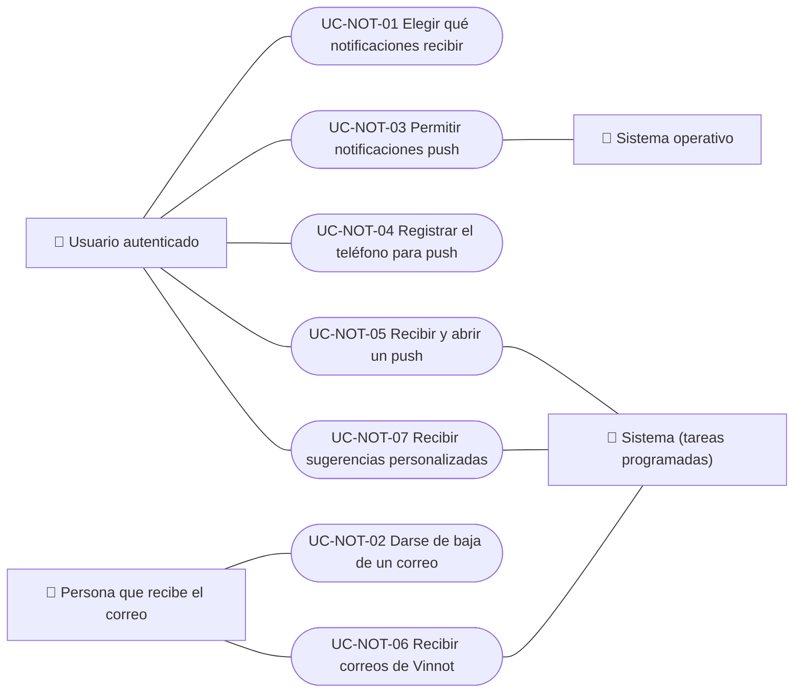

# Casos de uso

Casos de uso de notificaciones: elegir qué avisos recibir y el consentimiento de marketing, darse de baja de un correo, permitir y registrar los push en el teléfono, recibir push, recibir correos y recibir sugerencias personalizadas. Los anuncios del equipo están en Administración y la zona de «Eventos cerca tuyo», en Eventos. Cada caso vale para las plataformas indicadas.

| ID | Caso de uso | Plataformas | Actores |
|---|---|---|---|
| `UC-NOT-01` | [Elegir qué notificaciones recibir](uc-not-01-manage-preferences.md) | Web, APK | Usuario autenticado |
| `UC-NOT-02` | [Darse de baja de un correo](uc-not-02-unsubscribe.md) | Web | Persona que recibe el correo |
| `UC-NOT-03` | [Permitir notificaciones push](uc-not-03-allow-push.md) | APK | Usuario autenticado, Sistema operativo |
| `UC-NOT-04` | [Registrar el teléfono para push](uc-not-04-register-device.md) | APK | Usuario autenticado |
| `UC-NOT-05` | [Recibir y abrir un push](uc-not-05-receive-push.md) | APK | Usuario autenticado, Sistema (tareas programadas) |
| `UC-NOT-06` | [Recibir correos de Vinnot](uc-not-06-receive-email.md) | Web, APK | Persona que recibe el correo, Sistema (tareas programadas) |
| `UC-NOT-07` | [Recibir sugerencias personalizadas](uc-not-07-receive-suggestions.md) | APK | Usuario autenticado, Sistema (tareas programadas) |

## Diagrama de casos de uso

[Ver diagrama de «Casos de uso · Diagrama de casos de uso» completo](https://images.vinnot.com/docs/diagrams/v1/es/modules-notifications-use-cases-readme-3b215df28a41.svg)

## Equivalencia con Lucidchart

| ID | IDs en Lucidchart |
|---|---|
| `UC-NOT-01` | [WEB UC-NOTIF-01](https://lucid.app/lucidchart/9f11a16b-bb5a-42fc-a9e8-0852b17bd241/edit), [APK UC-NOTIF-05](https://lucid.app/lucidchart/e095dd25-e8ac-41ba-bf5b-396e1055f217/edit) |
| `UC-NOT-02` | [WEB UC-NOTIF-03](https://lucid.app/lucidchart/9f11a16b-bb5a-42fc-a9e8-0852b17bd241/edit) |
| `UC-NOT-03` | [APK UC-NOTIF-01](https://lucid.app/lucidchart/e095dd25-e8ac-41ba-bf5b-396e1055f217/edit), [APK UC-NOTIF-02](https://lucid.app/lucidchart/e095dd25-e8ac-41ba-bf5b-396e1055f217/edit) |
| `UC-NOT-04` | [APK UC-NOTIF-03](https://lucid.app/lucidchart/e095dd25-e8ac-41ba-bf5b-396e1055f217/edit) |
| `UC-NOT-05` | [APK UC-NOTIF-04](https://lucid.app/lucidchart/e095dd25-e8ac-41ba-bf5b-396e1055f217/edit) |
| `UC-NOT-06` | Ninguno |
| `UC-NOT-07` | Ninguno |
