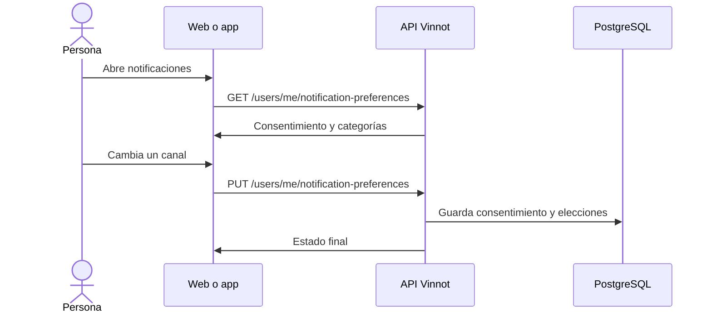

# UC-NOT-01 · Elegir qué notificaciones recibir

| Campo | Valor |
|---|---|
| ID | `UC-NOT-01` |
| Módulo | [Notificaciones](../README.md) |
| Plataformas | Web, APK |
| Actores | Usuario autenticado |
| IDs en Lucidchart | [WEB UC-NOTIF-01](https://lucid.app/lucidchart/9f11a16b-bb5a-42fc-a9e8-0852b17bd241/edit), [APK UC-NOTIF-05](https://lucid.app/lucidchart/e095dd25-e8ac-41ba-bf5b-396e1055f217/edit) |
| Requisitos | [`RF-WEB-NOT-01`](../requirements.md), [`RF-WEB-NOT-02`](../requirements.md), [`RF-APK-NOT-01`](../requirements.md), [`RF-APK-NOT-02`](../requirements.md) |
| Casos de prueba | [`CP-NOT-01`](../testing.md), [`CP-NOT-28`](../testing.md), [`CP-NOT-02`](../testing.md), [`CP-NOT-03`](../testing.md), [`CP-NOT-04`](../testing.md), [`CP-NOT-05`](../testing.md) |

## Precondiciones

- La persona tiene sesión iniciada.

## Postcondiciones

- Sus preferencias quedan guardadas y los envíos siguientes las respetan.

## Flujo principal

1. La persona abre Perfil → Notificaciones en la web o la hoja de notificaciones en la app.
2. El cliente pide `GET /users/me/notification-preferences`.
3. La API devuelve el consentimiento de marketing y nueve categorías con su estado de correo y push, si se pueden cambiar y qué canales usa cada una (`emailAvailable`, `pushAvailable`).
4. La persona cambia un canal de una categoría o el consentimiento.
5. El cliente envía `PUT /users/me/notification-preferences` con la fuente `WEB` o `MOBILE`.
6. La API guarda primero el consentimiento y después cada elección, y devuelve el estado final.

## Flujos alternativos

- 4a. La categoría es obligatoria (cuenta, seguridad, pagos o entradas): el control está deshabilitado y la API rechaza el cambio.
- 4b. Se enciende una categoría promocional con el consentimiento retirado: la API rechaza el cambio.
- 4c. En la app se enciende un push y el teléfono nunca pidió permiso: se abre el aviso del sistema.
- 3a. En la app el permiso del sistema falta o está bloqueado: la hoja ofrece «Permitir notificaciones» o «Abrir ajustes».
- 3b. Una categoría nunca envía por un canal, como el correo en una categoría que solo usa push: la web muestra «—» en lugar del interruptor y la app no muestra ese interruptor.

## Reglas de negocio

- Las categorías obligatorias siempre se envían.
- Un canal está disponible en una categoría cuando algún aviso de esa categoría se envía por ese canal.
- Todas las categorías vienen encendidas y el consentimiento de marketing cuenta como dado; retirarlo corta recomendaciones y novedades.
- Se guarda cuándo y desde dónde se dio o retiró el consentimiento.
- La zona de «Eventos cerca tuyo» se elige en el mismo lugar ([UC-EVT-07](../../events/use-cases/uc-evt-07-event-area.md)).

## Diagrama

[Ver diagrama de «UC-NOT-01 · Elegir qué notificaciones recibir» completo](https://images.vinnot.com/docs/diagrams/v1/es/modules-notifications-use-cases-uc-not-01-manage-preferences-80e8e15e4325.svg)

Diagrama de componentes en Lucidchart: [WEB UC-NOTIF-01](https://lucid.app/lucidchart/9f11a16b-bb5a-42fc-a9e8-0852b17bd241/edit), [APK UC-NOTIF-05](https://lucid.app/lucidchart/e095dd25-e8ac-41ba-bf5b-396e1055f217/edit).

## Código

| Capa | Ubicación |
|---|---|
| Endpoints | `GET /users/me/notification-preferences`, `PUT /users/me/notification-preferences` |
| Backend | [`NotificationPreferencesController.java`](../../../../../backend/src/main/java/com/vinnot/notification/infrastructure/web/NotificationPreferencesController.java), [`NotificationPreferencesService.java`](../../../../../backend/src/main/java/com/vinnot/notification/application/service/NotificationPreferencesService.java), [`NotificationPreferences.java`](../../../../../backend/src/main/java/com/vinnot/notification/domain/model/NotificationPreferences.java), [`NotificationCategory.java`](../../../../../backend/src/main/java/com/vinnot/notification/domain/model/NotificationCategory.java) |
| Web | [`UserProfileNotificationsTab.tsx`](../../../../../frontend-react/src/presentation/pages/user/UserProfileNotificationsTab.tsx), [`useNotificationPreferencesViewModel.ts`](../../../../../frontend-react/src/presentation/pages/user/useNotificationPreferencesViewModel.ts), [`useNotificationPreferences.ts`](../../../../../frontend-react/src/presentation/hooks/queries/notification/useNotificationPreferences.ts), [`notifications.service.ts`](../../../../../frontend-react/src/application/services/notifications.service.ts), [`notifications.client.ts`](../../../../../frontend-react/src/infrastructure/api/clients/notifications.client.ts), [`notificationPreferences.ts`](../../../../../frontend-react/src/domain/notification/notificationPreferences.ts) |
| App | [`NotificationPreferencesSheet.tsx`](../../../../../frontend-mobile/src/presentation/features/user/NotificationPreferencesSheet.tsx), [`useNotificationPreferencesSheet.ts`](../../../../../frontend-mobile/src/presentation/features/user/useNotificationPreferencesSheet.ts), [`useDevicePush.ts`](../../../../../frontend-mobile/src/presentation/features/notifications/useDevicePush.ts), [`notifications.service.ts`](../../../../../frontend-mobile/src/application/services/notifications.service.ts), [`notifications.client.ts`](../../../../../frontend-mobile/src/infrastructure/api/clients/notifications.client.ts) |

## Tests automáticos

- Backend: [`NotificationPreferencesControllerTest.java`](../../../../../backend/src/test/java/com/vinnot/notification/infrastructure/web/NotificationPreferencesControllerTest.java), [`NotificationPreferencesServiceTest.java`](../../../../../backend/src/test/java/com/vinnot/notification/application/service/NotificationPreferencesServiceTest.java), [`NotificationPreferencesTest.java`](../../../../../backend/src/test/java/com/vinnot/notification/domain/model/NotificationPreferencesTest.java), [`JdbcNotificationPreferenceRepositoryPostgresIntegrationTest.java`](../../../../../backend/src/test/java/com/vinnot/notification/infrastructure/persistence/JdbcNotificationPreferenceRepositoryPostgresIntegrationTest.java)
- Web: [`UserProfileNotificationsTab.test.tsx`](../../../../../frontend-react/src/presentation/pages/user/UserProfileNotificationsTab.test.tsx), [`notifications.service.test.ts`](../../../../../frontend-react/src/application/services/notifications.service.test.ts), [`notifications.client.test.ts`](../../../../../frontend-react/src/infrastructure/api/clients/notifications.client.test.ts), [`notificationPreferences.test.ts`](../../../../../frontend-react/src/domain/notification/notificationPreferences.test.ts)
- App: [`NotificationPreferencesSheet.test.tsx`](../../../../../frontend-mobile/src/presentation/features/user/NotificationPreferencesSheet.test.tsx), [`useDevicePush.test.ts`](../../../../../frontend-mobile/src/presentation/features/notifications/useDevicePush.test.ts), [`notifications.service.test.ts`](../../../../../frontend-mobile/src/application/services/notifications.service.test.ts), [`notifications.client.test.ts`](../../../../../frontend-mobile/src/infrastructure/api/clients/notifications.client.test.ts), [`notificationPreferences.test.ts`](../../../../../frontend-mobile/src/domain/notification/notificationPreferences.test.ts)
