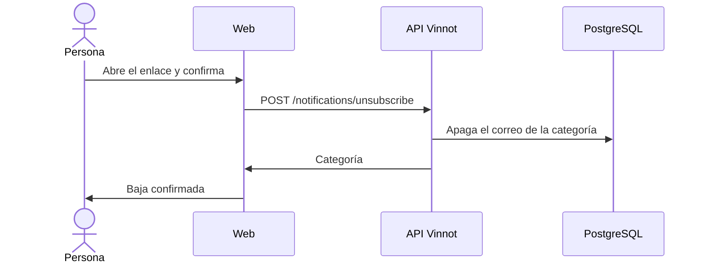

# UC-NOT-02 · Darse de baja de un correo

| Campo | Valor |
|---|---|
| ID | `UC-NOT-02` |
| Módulo | [Notificaciones](../README.md) |
| Plataformas | Web |
| Actores | Persona que recibe el correo |
| IDs en Lucidchart | [WEB UC-NOTIF-03](https://lucid.app/lucidchart/9f11a16b-bb5a-42fc-a9e8-0852b17bd241/edit) |
| Requisitos | [`RF-WEB-NOT-03`](../requirements.md) |
| Casos de prueba | [`CP-NOT-06`](../testing.md), [`CP-NOT-07`](../testing.md), [`CP-NOT-08`](../testing.md) |

## Precondiciones

- La persona recibió un correo promocional con enlace de baja.

## Postcondiciones

- Esa categoría deja de enviarle correos.

## Flujo principal

1. La persona toca «Darse de baja» en el correo.
2. La web abre `/unsubscribe?token=…` y pide confirmar.
3. La persona confirma.
4. La web envía `POST /notifications/unsubscribe` con el token, sin sesión.
5. La API apaga el correo de esa categoría y devuelve cuál fue.
6. La web confirma la baja y ofrece ir a las preferencias.

## Flujos alternativos

- 1a. El cliente de correo ofrece la baja de un clic: envía el mismo pedido sin abrir la web.
- 5a. El token es inválido o es de una categoría obligatoria: la API rechaza la baja y la web muestra un error.

## Reglas de negocio

- Solo los correos promocionales traen enlace de baja.
- La baja no cambia el consentimiento de marketing ni el push.
- El token va cifrado, identifica a la persona y la categoría, y no vence.
- La baja se aplica solo después de confirmar, para que un escáner de enlaces no la dispare.

## Diagrama

[Ver diagrama de «UC-NOT-02 · Darse de baja de un correo» completo](https://images.vinnot.com/docs/diagrams/v1/es/modules-notifications-use-cases-uc-not-02-unsubscribe-d3c52043fe85.svg)

Diagrama de componentes en Lucidchart: [WEB UC-NOTIF-03](https://lucid.app/lucidchart/9f11a16b-bb5a-42fc-a9e8-0852b17bd241/edit).

## Código

| Capa | Ubicación |
|---|---|
| Endpoints | `POST /notifications/unsubscribe` |
| Backend | [`UnsubscribeController.java`](../../../../../backend/src/main/java/com/vinnot/notification/infrastructure/web/UnsubscribeController.java), [`UnsubscribeService.java`](../../../../../backend/src/main/java/com/vinnot/notification/application/service/UnsubscribeService.java), [`SealedUnsubscribeLinks.java`](../../../../../backend/src/main/java/com/vinnot/notification/infrastructure/security/SealedUnsubscribeLinks.java) |
| Web | [`UnsubscribePage.tsx`](../../../../../frontend-react/src/presentation/pages/public/UnsubscribePage.tsx), [`useUnsubscribeViewModel.ts`](../../../../../frontend-react/src/presentation/pages/public/useUnsubscribeViewModel.ts), [`notifications.service.ts`](../../../../../frontend-react/src/application/services/notifications.service.ts), [`notifications.client.ts`](../../../../../frontend-react/src/infrastructure/api/clients/notifications.client.ts) |

## Tests automáticos

- Backend: [`UnsubscribeControllerTest.java`](../../../../../backend/src/test/java/com/vinnot/notification/infrastructure/web/UnsubscribeControllerTest.java), [`UnsubscribeServiceTest.java`](../../../../../backend/src/test/java/com/vinnot/notification/application/service/UnsubscribeServiceTest.java), [`SealedUnsubscribeLinksTest.java`](../../../../../backend/src/test/java/com/vinnot/notification/infrastructure/security/SealedUnsubscribeLinksTest.java)
- Web: [`UnsubscribePage.test.tsx`](../../../../../frontend-react/src/presentation/pages/public/UnsubscribePage.test.tsx)
- App: Ninguno
