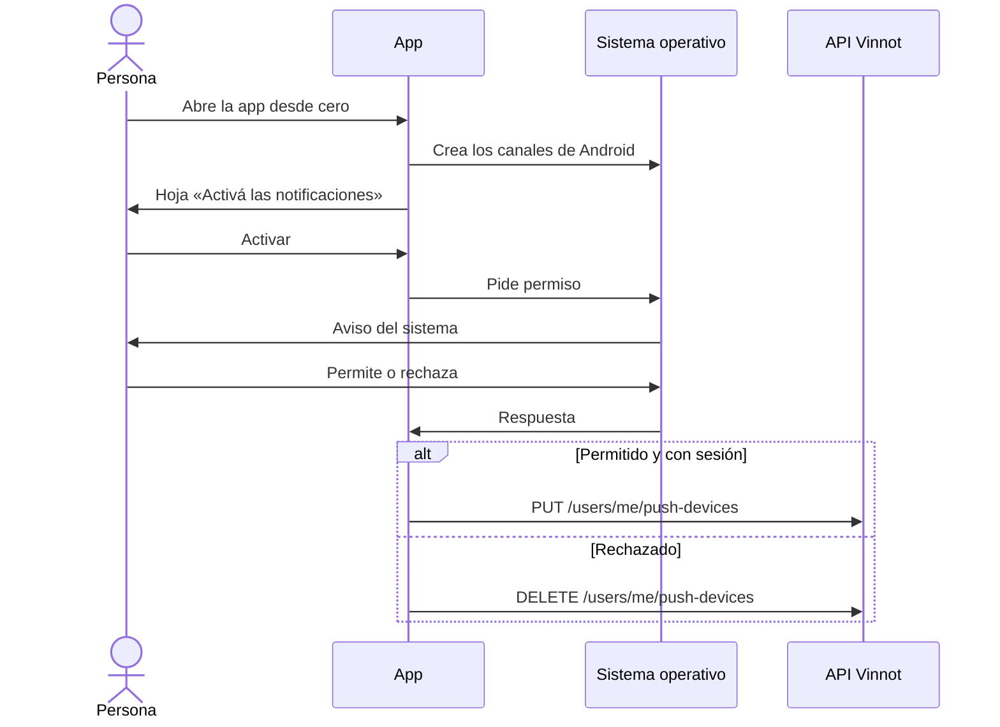

# UC-NOT-03 · Permitir notificaciones push

| Campo | Valor |
|---|---|
| ID | `UC-NOT-03` |
| Módulo | [Notificaciones](../README.md) |
| Plataformas | APK |
| Actores | Persona usuaria, Sistema operativo |
| IDs en Lucidchart | [APK UC-NOTIF-01](https://lucid.app/lucidchart/e095dd25-e8ac-41ba-bf5b-396e1055f217/edit), [APK UC-NOTIF-02](https://lucid.app/lucidchart/e095dd25-e8ac-41ba-bf5b-396e1055f217/edit) |
| Requisitos | [`RF-APK-NOT-03`](../requirements.md) |
| Casos de prueba | [`CP-NOT-09`](../testing.md), [`CP-NOT-10`](../testing.md), [`CP-NOT-11`](../testing.md), [`CP-NOT-12`](../testing.md), [`CP-NOT-29`](../testing.md), [`CP-NOT-30`](../testing.md) |

## Precondiciones

- La app está instalada y el teléfono todavía no respondió el permiso de notificaciones.

## Postcondiciones

- El teléfono tiene permiso para mostrar notificaciones y queda registrado si hay sesión, o la persona las dejó apagadas y el teléfono no recibe push.

## Flujo principal

1. La persona abre la app por primera vez en ese teléfono, con o sin sesión.
2. La app crea los canales de notificación de Android y muestra la hoja «Activá las notificaciones», con una sola línea: «Para que no te pierdas nada sobre eventos y vinos.». La hoja se cierra antes de que aparezca el aviso del sistema.
3. La persona toca «Activar» y el sistema muestra su aviso de permiso.
4. La persona permite las notificaciones.
5. Si hay sesión, la app registra el teléfono ([UC-NOT-04](uc-not-04-register-device.md)).

## Flujos alternativos

- 3a. La persona toca «Ahora no»: el aviso del sistema no aparece y la app no muestra otra hoja hasta la próxima vez que se abra desde cero.
- 4a. La persona rechaza: la app no registra el teléfono y quita de la cuenta el registro que ese teléfono haya dejado (`DELETE /users/me/push-devices`).
- 1a. Las notificaciones están apagadas y la persona tiene sesión: cada vez que abre la app desde cero aparece la misma hoja «Activá las notificaciones». «Activar» abre el aviso del sistema; si el sistema ya las bloqueó (iOS después de «No permitir», Android después de dos rechazos), la hoja dice «En Ajustes, activá las notificaciones de Vinnot.» y «Abrir ajustes» abre los ajustes de notificaciones de Vinnot en Android o la página de Vinnot en Ajustes en iOS. Ninguna app puede volver a activarlas por su cuenta una vez que el sistema las bloqueó. Al volver con el permiso concedido, la app registra el teléfono. Volver a la app desde segundo plano no muestra la hoja.
- 1b. Una entrada confirmada, mientras el sistema todavía puede preguntar y no apareció otra hoja en esa apertura: una hoja explica los avisos del evento y solo «Activar notificaciones» abre el aviso del sistema.
- 2a. Android 12 o anterior concede el permiso por defecto: no aparece ni la hoja ni el aviso.

## Reglas de negocio

- Las notificaciones vienen activadas en la cuenta; el permiso del teléfono decide si llegan.
- La app muestra como máximo una hoja de permiso por apertura desde cero.
- Los canales de Android se crean antes de pedir el permiso, como exige Android 13 o posterior.
- iOS no permite enviar push sin este permiso.

## Diagrama

[Ver diagrama de «UC-NOT-03 · Permitir notificaciones push» completo](https://images.vinnot.com/docs/diagrams/v1/es/modules-notifications-use-cases-uc-not-03-allow-push-c55bd77d76cd.svg)

Diagrama de componentes en Lucidchart: [APK UC-NOTIF-01](https://lucid.app/lucidchart/e095dd25-e8ac-41ba-bf5b-396e1055f217/edit), [APK UC-NOTIF-02](https://lucid.app/lucidchart/e095dd25-e8ac-41ba-bf5b-396e1055f217/edit).

## Código

| Capa | Ubicación |
|---|---|
| App | [`pushNotifications.service.ts`](../../../../../frontend-mobile/src/application/services/pushNotifications.service.ts), [`pushPermissionPrompt.ts`](../../../../../frontend-mobile/src/domain/notification/pushPermissionPrompt.ts), [`pushChannels.ts`](../../../../../frontend-mobile/src/domain/notification/pushChannels.ts), [`pushNotifications.gateway.ts`](../../../../../frontend-mobile/src/infrastructure/device/pushNotifications.gateway.ts), [`pushPrompt.storage.ts`](../../../../../frontend-mobile/src/infrastructure/storage/pushPrompt.storage.ts), [`pushDevice.storage.ts`](../../../../../frontend-mobile/src/infrastructure/storage/pushDevice.storage.ts), [`useLaunchPushPrompt.ts`](../../../../../frontend-mobile/src/presentation/features/notifications/useLaunchPushPrompt.ts), [`usePushChannels.ts`](../../../../../frontend-mobile/src/presentation/features/notifications/usePushChannels.ts), [`PushPermissionSheet.tsx`](../../../../../frontend-mobile/src/presentation/features/notifications/PushPermissionSheet.tsx), [`usePushPermissionPrompt.ts`](../../../../../frontend-mobile/src/presentation/features/notifications/usePushPermissionPrompt.ts), [`useDevicePush.ts`](../../../../../frontend-mobile/src/presentation/features/notifications/useDevicePush.ts), [`PushNotificationsSync.tsx`](../../../../../frontend-mobile/src/presentation/navigation/PushNotificationsSync.tsx) |

## Tests automáticos

- Backend: Ninguno
- Web: Ninguno
- App: [`pushNotifications.service.test.ts`](../../../../../frontend-mobile/src/application/services/pushNotifications.service.test.ts), [`pushPermissionPrompt.test.ts`](../../../../../frontend-mobile/src/domain/notification/pushPermissionPrompt.test.ts), [`pushChannels.test.ts`](../../../../../frontend-mobile/src/domain/notification/pushChannels.test.ts), [`pushPrompt.storage.test.ts`](../../../../../frontend-mobile/src/infrastructure/storage/pushPrompt.storage.test.ts), [`pushDevice.storage.test.ts`](../../../../../frontend-mobile/src/infrastructure/storage/pushDevice.storage.test.ts), [`useLaunchPushPrompt.test.ts`](../../../../../frontend-mobile/src/presentation/features/notifications/useLaunchPushPrompt.test.ts), [`usePushChannels.test.ts`](../../../../../frontend-mobile/src/presentation/features/notifications/usePushChannels.test.ts), [`PushPermissionSheet.test.tsx`](../../../../../frontend-mobile/src/presentation/features/notifications/PushPermissionSheet.test.tsx), [`usePushPermissionPrompt.test.ts`](../../../../../frontend-mobile/src/presentation/features/notifications/usePushPermissionPrompt.test.ts)
