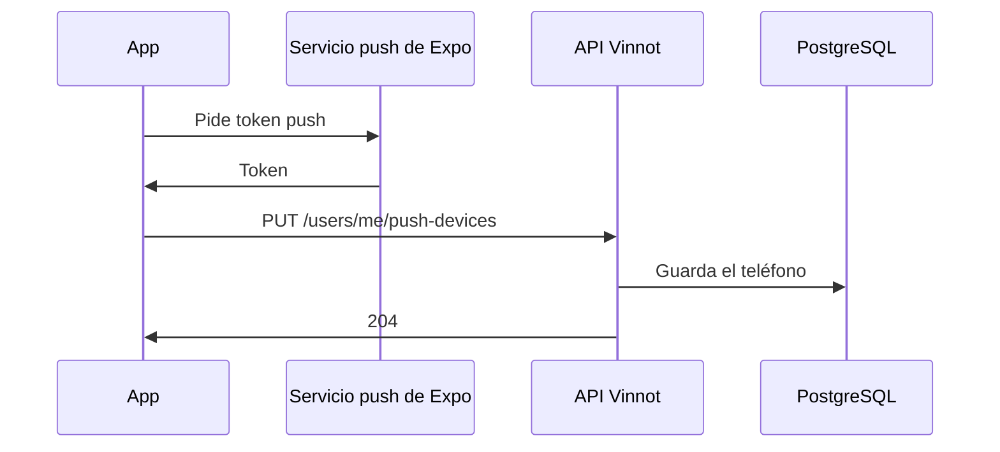

# UC-NOT-04 · Registrar el teléfono para push

| Campo | Valor |
|---|---|
| ID | `UC-NOT-04` |
| Módulo | [Notificaciones](../README.md) |
| Plataformas | APK |
| Actores | Usuario autenticado |
| IDs en Lucidchart | [APK UC-NOTIF-03](https://lucid.app/lucidchart/e095dd25-e8ac-41ba-bf5b-396e1055f217/edit) |
| Requisitos | [`RF-APK-NOT-04`](../requirements.md) |
| Casos de prueba | [`CP-NOT-13`](../testing.md), [`CP-NOT-14`](../testing.md), [`CP-NOT-15`](../testing.md), [`CP-NOT-16`](../testing.md), [`CP-NOT-17`](../testing.md), [`CP-NOT-31`](../testing.md) |

## Precondiciones

- El teléfono tiene permiso de notificaciones y la persona tiene sesión iniciada.

## Postcondiciones

- El teléfono queda asociado a la cuenta para recibir push.

## Flujo principal

1. La app obtiene el token push de Expo del teléfono.
2. Envía `PUT /users/me/push-devices` con el token, la plataforma y el idioma de la app; en Android agrega `channels: true` cuando ya creó los canales de notificación.
3. La API valida el token y lo guarda para esa cuenta.
4. La app vuelve a registrarlo cada vez que se abre desde cero (así la API sabe que el teléfono sigue en uso), al iniciar sesión, cambiar el idioma o cambiar el token, y al volver a primer plano mientras no quedó registrado.

## Flujos alternativos

- 3a. El token no tiene el formato de Expo: la API responde 400.
- 3b. El token ya estaba en otra cuenta: pasa a la cuenta actual.
- 4a. La persona cierra sesión: la app envía el token con el cierre de sesión y la API lo da de baja.
- 2a. El registro falla: se reintenta al volver a primer plano.
- 1a. El teléfono no tiene permiso de notificaciones: la app no registra nada y quita de la cuenta el último token que registró ese teléfono con `DELETE /users/me/push-devices`; si falla, lo intenta en la próxima apertura.

## Reglas de negocio

- Un token pertenece a una sola cuenta.
- Se envía a lo sumo a los 10 teléfonos más recientes de cada cuenta.
- Al suspender o desactivar una cuenta se borran sus teléfonos.

## Diagrama

[Ver diagrama de «UC-NOT-04 · Registrar el teléfono para push» completo](https://images.vinnot.com/docs/diagrams/v1/es/modules-notifications-use-cases-uc-not-04-register-device-bec9e4de8d7f.svg)

Diagrama de componentes en Lucidchart: [APK UC-NOTIF-03](https://lucid.app/lucidchart/e095dd25-e8ac-41ba-bf5b-396e1055f217/edit).

## Código

| Capa | Ubicación |
|---|---|
| Endpoints | `PUT /users/me/push-devices`, `POST /auth/logout` |
| Backend | [`PushDevicesController.java`](../../../../../backend/src/main/java/com/vinnot/notification/infrastructure/web/PushDevicesController.java), [`PushDeviceService.java`](../../../../../backend/src/main/java/com/vinnot/notification/application/service/PushDeviceService.java), [`LogoutCommandHandler.java`](../../../../../backend/src/main/java/com/vinnot/user/application/command/handler/LogoutCommandHandler.java) |
| App | [`usePushNotificationsSync.ts`](../../../../../frontend-mobile/src/presentation/hooks/usePushNotificationsSync.ts), [`PushNotificationsSync.tsx`](../../../../../frontend-mobile/src/presentation/navigation/PushNotificationsSync.tsx), [`pushNotifications.service.ts`](../../../../../frontend-mobile/src/application/services/pushNotifications.service.ts), [`pushNotifications.gateway.ts`](../../../../../frontend-mobile/src/infrastructure/device/pushNotifications.gateway.ts), [`pushDevice.storage.ts`](../../../../../frontend-mobile/src/infrastructure/storage/pushDevice.storage.ts) |

## Tests automáticos

- Backend: [`PushDevicesControllerTest.java`](../../../../../backend/src/test/java/com/vinnot/notification/infrastructure/web/PushDevicesControllerTest.java), [`PushDeviceServiceTest.java`](../../../../../backend/src/test/java/com/vinnot/notification/application/service/PushDeviceServiceTest.java), [`PushTokenTest.java`](../../../../../backend/src/test/java/com/vinnot/notification/domain/model/PushTokenTest.java), [`JdbcPushDeviceRepositoryPostgresIntegrationTest.java`](../../../../../backend/src/test/java/com/vinnot/notification/infrastructure/persistence/JdbcPushDeviceRepositoryPostgresIntegrationTest.java)
- Web: Ninguno
- App: [`usePushNotificationsSync.test.tsx`](../../../../../frontend-mobile/src/presentation/hooks/usePushNotificationsSync.test.tsx), [`pushNotifications.service.test.ts`](../../../../../frontend-mobile/src/application/services/pushNotifications.service.test.ts), [`pushNotifications.gateway.test.ts`](../../../../../frontend-mobile/src/infrastructure/device/pushNotifications.gateway.test.ts), [`pushDevice.storage.test.ts`](../../../../../frontend-mobile/src/infrastructure/storage/pushDevice.storage.test.ts)
