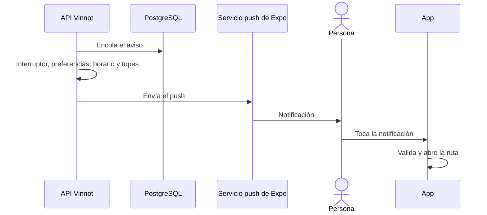

# UC-NOT-05 · Recibir y abrir un push

| Campo | Valor |
|---|---|
| ID | `UC-NOT-05` |
| Módulo | [Notificaciones](../README.md) |
| Plataformas | APK |
| Actores | Usuario autenticado, Sistema (tareas programadas) |
| IDs en Lucidchart | [APK UC-NOTIF-04](https://lucid.app/lucidchart/e095dd25-e8ac-41ba-bf5b-396e1055f217/edit) |
| Requisitos | [`RF-APK-NOT-05`](../requirements.md), [`RF-APK-NOT-06`](../requirements.md) |
| Casos de prueba | [`CP-NOT-18`](../testing.md), [`CP-NOT-19`](../testing.md), [`CP-NOT-20`](../testing.md), [`CP-NOT-21`](../testing.md), [`CP-NOT-22`](../testing.md), [`CP-NOT-23`](../testing.md), [`CP-NOT-32`](../testing.md), [`CP-NOT-33`](../testing.md) |

## Precondiciones

- Algo generó un aviso para la persona y su teléfono está registrado.

## Postcondiciones

- La persona recibió el push y, si lo tocó, está en la sección correspondiente.

## Flujo principal

1. El módulo que originó el aviso lo deja en la cola de envíos.
2. La tarea de envío revisa el interruptor del tipo, el vencimiento, los duplicados, la cuenta y las preferencias.
3. Revisa el horario de descanso y los topes diarios.
4. Envía el push por Expo y luego revisa los recibos.
5. La persona toca la notificación.
6. La app informa la apertura (`POST /users/me/push-opens` con `ref` y `type` del push, sin esperar la respuesta), valida la ruta y, cuando la navegación está lista, abre la sección: una entrada, un evento, un vino, una ruta, una bodega o los eventos de partner.

## Flujos alternativos

- 2a. El tipo está apagado por el equipo, el aviso venció, ya se envió, la cuenta está inactiva o la persona lo apagó: no se envía.
- 3a. Son entre las 22 y las 8 en la zona horaria de la cuenta y el aviso puede esperar: se posterga hasta las 8.
- 3b. Se alcanzó el tope del día o de la categoría: se descarta.
- 6a. La ruta no está permitida: la app la ignora.
- 5a. La app estaba cerrada: la ruta se abre al arrancar, cuando la navegación está lista.
- 5b. No hay sesión: la app no navega; guarda la sección como destino y la abre después de iniciar sesión, cuando también informa la apertura.
- 6b. El push no trae `ref` ni `type` (los enviados antes de este cambio solo traen la ruta): la app abre la sección sin informar la apertura.

## Reglas de negocio

- Las categorías obligatorias no respetan preferencias ni topes; las que no pueden esperar se envían con prioridad alta.
- Topes: 3 por día para categorías no obligatorias, 1 por día de eventos cercanos y 1 cada 7 días de recomendaciones.
- El título se corta a 65 caracteres y el texto a 178.
- Los envíos fallidos se reintentan hasta 10 veces con espera creciente.

## Diagrama

[Ver diagrama de «UC-NOT-05 · Recibir y abrir un push» completo](https://images.vinnot.com/docs/diagrams/v1/es/modules-notifications-use-cases-uc-not-05-receive-push-cb2af2351798.svg)

Diagrama de componentes en Lucidchart: [APK UC-NOTIF-04](https://lucid.app/lucidchart/e095dd25-e8ac-41ba-bf5b-396e1055f217/edit).

## Código

| Capa | Ubicación |
|---|---|
| Backend | [`EnqueuePushService.java`](../../../../../backend/src/main/java/com/vinnot/notification/application/service/EnqueuePushService.java), [`DeliverPushService.java`](../../../../../backend/src/main/java/com/vinnot/notification/application/service/DeliverPushService.java), [`QuietHours.java`](../../../../../backend/src/main/java/com/vinnot/notification/domain/model/QuietHours.java), [`ExpoPushSenderAdapter.java`](../../../../../backend/src/main/java/com/vinnot/notification/infrastructure/push/ExpoPushSenderAdapter.java), [`CheckPushReceiptsService.java`](../../../../../backend/src/main/java/com/vinnot/notification/application/service/CheckPushReceiptsService.java) |
| App | [`pushNotifications.gateway.ts`](../../../../../frontend-mobile/src/infrastructure/device/pushNotifications.gateway.ts), [`usePushNotificationsSync.ts`](../../../../../frontend-mobile/src/presentation/hooks/usePushNotificationsSync.ts), [`pushRoute.ts`](../../../../../frontend-mobile/src/domain/notification/pushRoute.ts), [`pushOpen.ts`](../../../../../frontend-mobile/src/domain/notification/pushOpen.ts), [`pushChannels.ts`](../../../../../frontend-mobile/src/domain/notification/pushChannels.ts), [`notifications.client.ts`](../../../../../frontend-mobile/src/infrastructure/api/clients/notifications.client.ts) |

## Tests automáticos

- Backend: [`DeliverPushServiceTest.java`](../../../../../backend/src/test/java/com/vinnot/notification/application/service/DeliverPushServiceTest.java), [`EnqueuePushServiceTest.java`](../../../../../backend/src/test/java/com/vinnot/notification/application/service/EnqueuePushServiceTest.java), [`QuietHoursTest.java`](../../../../../backend/src/test/java/com/vinnot/notification/domain/model/QuietHoursTest.java), [`PushRequestTest.java`](../../../../../backend/src/test/java/com/vinnot/notification/domain/model/PushRequestTest.java), [`PushContentTest.java`](../../../../../backend/src/test/java/com/vinnot/notification/domain/model/PushContentTest.java), [`CheckPushReceiptsServiceTest.java`](../../../../../backend/src/test/java/com/vinnot/notification/application/service/CheckPushReceiptsServiceTest.java), [`ExpoPushSenderAdapterTest.java`](../../../../../backend/src/test/java/com/vinnot/notification/infrastructure/push/ExpoPushSenderAdapterTest.java), [`JdbcPushDeliveryPostgresIntegrationTest.java`](../../../../../backend/src/test/java/com/vinnot/notification/infrastructure/persistence/JdbcPushDeliveryPostgresIntegrationTest.java), [`PushPlanningServiceTest.java`](../../../../../backend/src/test/java/com/vinnot/notification/application/service/PushPlanningServiceTest.java), [`PushRateLimiterTest.java`](../../../../../backend/src/test/java/com/vinnot/notification/infrastructure/push/PushRateLimiterTest.java), [`PushOpenServiceTest.java`](../../../../../backend/src/test/java/com/vinnot/notification/application/service/PushOpenServiceTest.java), [`PushOpensControllerTest.java`](../../../../../backend/src/test/java/com/vinnot/notification/infrastructure/web/PushOpensControllerTest.java), [`PushInfrastructureTest.java`](../../../../../backend/src/test/java/com/vinnot/notification/infrastructure/push/PushInfrastructureTest.java), [`TransactionalPushTemplatesTest.java`](../../../../../backend/src/test/java/com/vinnot/notification/infrastructure/push/TransactionalPushTemplatesTest.java), [`JdbcPushOpenStorePostgresIntegrationTest.java`](../../../../../backend/src/test/java/com/vinnot/notification/infrastructure/persistence/JdbcPushOpenStorePostgresIntegrationTest.java)
- Web: Ninguno
- App: [`pushRoute.test.ts`](../../../../../frontend-mobile/src/domain/notification/pushRoute.test.ts), [`pushNotifications.gateway.test.ts`](../../../../../frontend-mobile/src/infrastructure/device/pushNotifications.gateway.test.ts), [`pushOpen.test.ts`](../../../../../frontend-mobile/src/domain/notification/pushOpen.test.ts), [`usePushNotificationsSync.test.tsx`](../../../../../frontend-mobile/src/presentation/hooks/usePushNotificationsSync.test.tsx), [`notifications.client.test.ts`](../../../../../frontend-mobile/src/infrastructure/api/clients/notifications.client.test.ts)
