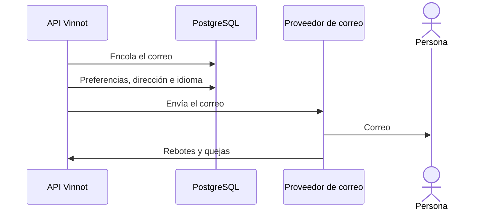

# UC-NOT-06 · Recibir correos de Vinnot

| Campo | Valor |
|---|---|
| ID | `UC-NOT-06` |
| Módulo | [Notificaciones](../README.md) |
| Plataformas | Web, APK |
| Actores | Persona que recibe el correo, Sistema (tareas programadas) |
| IDs en Lucidchart | Ninguno |
| Requisitos | [`RF-WEB-NOT-04`](../requirements.md), [`RF-WEB-NOT-05`](../requirements.md), [`RF-WEB-NOT-06`](../requirements.md), [`RF-WEB-NOT-07`](../requirements.md), [`RF-WEB-NOT-08`](../requirements.md), [`RF-WEB-NOT-09`](../requirements.md), [`RF-APK-NOT-07`](../requirements.md), [`RF-APK-NOT-08`](../requirements.md), [`RF-APK-NOT-09`](../requirements.md), [`RF-APK-NOT-10`](../requirements.md), [`RF-APK-NOT-11`](../requirements.md), [`RF-APK-NOT-12`](../requirements.md) |
| Casos de prueba | [`CP-NOT-24`](../testing.md), [`CP-NOT-25`](../testing.md), [`CP-NOT-26`](../testing.md), [`CP-NOT-27`](../testing.md) |

## Precondiciones

- Algo generó un correo para la persona: una verificación, un cambio de estado, una inscripción, un aviso de comunidad o un anuncio.

## Postcondiciones

- La persona recibió el correo en su idioma, o el envío quedó descartado por una regla.

## Flujo principal

1. El módulo que originó el aviso lo deja en la cola de envíos, una sola vez por clave.
2. La tarea de envío vuelve a revisar las preferencias, la dirección actual y el idioma de la cuenta.
3. Arma el correo HTML con marca y su versión de texto.
4. Si es promocional, agrega el enlace de baja y la baja de un clic.
5. Lo envía por el proveedor de correo.

## Flujos alternativos

- 2a. La persona apagó esa categoría: no se envía.
- 2b. La dirección rebotó de forma permanente o marcó spam: no se envía, ni siquiera los obligatorios.
- 5a. El proveedor falla: se reintenta hasta 10 veces con espera creciente.

## Reglas de negocio

- El idioma es el guardado en la cuenta; sin idioma, español. Los anuncios conservan el idioma con que se pidieron.
- Los rebotes permanentes y las quejas se leen del proveedor cada minuto y la dirección se guarda solo como hash.
- Los correos no llevan contraseñas; los enlaces secretos viajan cifrados en la cola.
- Los envíos agotados se borran a los 30 días.

## Diagrama

[Ver diagrama de «UC-NOT-06 · Recibir correos de Vinnot» completo](https://images.vinnot.com/docs/diagrams/v1/es/modules-notifications-use-cases-uc-not-06-receive-email-d050aac2ca66.svg)

## Código

| Capa | Ubicación |
|---|---|
| Backend | [`EnqueueNotificationService.java`](../../../../../backend/src/main/java/com/vinnot/notification/application/service/EnqueueNotificationService.java), [`DeliverNotificationService.java`](../../../../../backend/src/main/java/com/vinnot/notification/application/service/DeliverNotificationService.java), [`DurableEffectWorker.java`](../../../../../backend/src/main/java/com/vinnot/shared/infrastructure/effects/DurableEffectWorker.java), [`EmailFeedbackService.java`](../../../../../backend/src/main/java/com/vinnot/notification/application/service/EmailFeedbackService.java), [`SqsEmailFeedbackPoller.java`](../../../../../backend/src/main/java/com/vinnot/notification/infrastructure/feedback/SqsEmailFeedbackPoller.java) |

## Tests automáticos

- Backend: [`EnqueueNotificationServiceTest.java`](../../../../../backend/src/test/java/com/vinnot/notification/application/service/EnqueueNotificationServiceTest.java), [`DeliverNotificationServiceTest.java`](../../../../../backend/src/test/java/com/vinnot/notification/application/service/DeliverNotificationServiceTest.java), [`EmailFeedbackServiceTest.java`](../../../../../backend/src/test/java/com/vinnot/notification/application/service/EmailFeedbackServiceTest.java), [`NotificationOutboxPostgresIntegrationTest.java`](../../../../../backend/src/test/java/com/vinnot/notification/infrastructure/NotificationOutboxPostgresIntegrationTest.java), [`JdbcEmailSuppressionRepositoryPostgresIntegrationTest.java`](../../../../../backend/src/test/java/com/vinnot/notification/infrastructure/persistence/JdbcEmailSuppressionRepositoryPostgresIntegrationTest.java), [`NotificationTemplateRegistryTest.java`](../../../../../backend/src/test/java/com/vinnot/notification/infrastructure/template/NotificationTemplateRegistryTest.java)
- Web: Ninguno
- App: Ninguno
