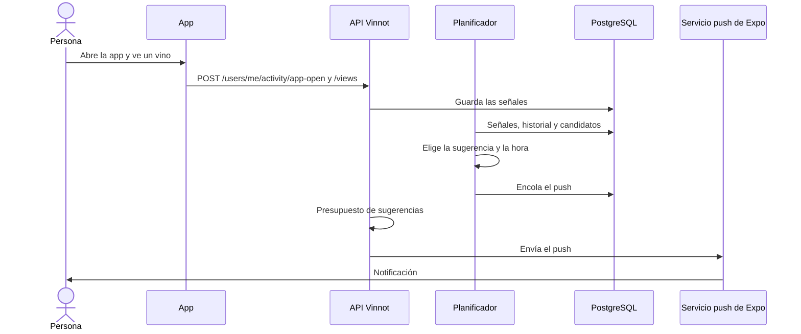

# UC-NOT-07 · Recibir sugerencias personalizadas

| Campo | Valor |
|---|---|
| ID | `UC-NOT-07` |
| Módulo | [Notificaciones](../README.md) |
| Plataformas | APK |
| Actores | Usuario autenticado, Sistema (tareas programadas) |
| IDs en Lucidchart | Ninguno |
| Requisitos | [`RF-APK-NOT-13`](../requirements.md), [`RF-APK-NOT-14`](../requirements.md) |
| Casos de prueba | [`CP-NOT-34`](../testing.md), [`CP-NOT-35`](../testing.md), [`CP-NOT-36`](../testing.md), [`CP-NOT-37`](../testing.md), [`CP-NOT-38`](../testing.md), [`CP-NOT-39`](../testing.md), [`CP-NOT-40`](../testing.md), [`CP-NOT-41`](../testing.md), [`CP-NOT-42`](../testing.md), [`CP-NOT-43`](../testing.md) |

## Precondiciones

- La persona tiene sesión iniciada en la app y su teléfono está registrado para push ([UC-NOT-04](uc-not-04-register-device.md)).

## Postcondiciones

- La persona recibió, como mucho, una sugerencia ese día, a la hora en que suele abrir la app, dentro del presupuesto semanal.

## Flujo principal

1. Mientras la persona usa la app, la app informa cada apertura, al arrancar y al volver a primer plano, con `POST /users/me/activity/app-open`, y cada detalle de vino, ruta, evento o bodega que abre con `POST /users/me/activity/views`, sin esperar la respuesta.
2. La API guarda una fila por persona, contenido y día, y como mucho una apertura cada 30 minutos.
3. Cada hora, el planificador toma el turno exclusivo y recorre, en cada zona horaria donde son entre las 4 y las 10, las cuentas que todavía no se planificaron ese día.
4. Para cada cuenta junta los candidatos: bienvenida, día después de un evento, logro, regreso, eventos del fin de semana, vino visto y sin calificar, vino de la semana o elegido por su gusto, ruta, bodega y revisión de la cava; descarta los de categorías que la persona apagó, los tipos que el equipo apagó y los que se repetirían demasiado pronto.
5. Elige el candidato de mayor puntaje y fija la hora de envío: la hora habitual de apertura de la persona en su zona horaria o, si no tiene, las 19:30 en días hábiles y las 12:30 los fines de semana, siempre entre las 9 y las 21:59.
6. Deja el push en la cola de envíos para esa hora.
7. A esa hora, la tarea de envío consulta el presupuesto de sugerencias, que lo admite, y lo envía ([UC-NOT-05](uc-not-05-receive-push.md)).
8. La persona toca la notificación, la app informa la apertura y abre el contenido sugerido.

## Flujos alternativos

- 1a. No hay sesión: la app no informa ninguna señal.
- 1b. El pedido falla: la pantalla sigue igual; la apertura se vuelve a informar en la próxima apertura o vuelta a primer plano.
- 3a. Otra instancia tiene el turno del planificador: esta corrida no planifica.
- 4a. La persona no abre la app hace 14 días: solo compiten los pushes de regreso, como mucho dos por ausencia (a los 14 y a los 30 días); después, silencio hasta que vuelva.
- 4b. No hay candidatos: ese día no se envía nada.
- 5a. La cuenta está en el grupo de control: la sugerencia se registra, pero no se envía.
- 7a. Ya recibió 2 sugerencias en los últimos 7 días, una ese día o una hace menos de 48 horas: no se envía.
- 7b. Las últimas 3 sugerencias quedaron sin abrir: recibe como mucho 1 por semana; si pasan 28 días sin abrir ninguna, no recibe más, salvo las de regreso, hasta que abra la app.
- 7c. Ya recibió una esa semana y la nueva tiene un puntaje menor a 0,6: no se envía.

## Reglas de negocio

- Presupuesto de sugerencias: 2 cada 7 días, 1 por día local y 48 horas entre dos; si no recibió ninguna en 7 días, el mejor candidato se envía sin importar su puntaje.
- Nunca se envían entre las 22 y las 9 en la zona horaria de la cuenta.
- Respetan las preferencias de cada categoría (Recomendaciones, Recordatorios, Eventos cerca tuyo y Comunidad) y el consentimiento de marketing; no usan ni cuentan para el tope de 3 por día de los demás avisos, y los avisos obligatorios y sociales nunca consumen este presupuesto.
- El grupo de control es el 5 % de las cuentas, elegido siempre igual por un hash del id, para medir el efecto de las sugerencias.
- Un tipo cuyas bajas superan el 2 % de sus envíos, con al menos 200 envíos en 7 días, se apaga automáticamente.
- Las señales de actividad se borran a los 180 días y el registro de sugerencias a los 365; no se muestran a otras personas ni se comparten con terceros ([Actividad](../../activity/README.md)).

## Diagrama

[Ver diagrama de «UC-NOT-07 · Recibir sugerencias personalizadas» completo](https://images.vinnot.com/docs/diagrams/v1/es/modules-notifications-use-cases-uc-not-07-receive-suggestions-583be55ed782.svg)

## Código

| Capa | Ubicación |
|---|---|
| Endpoints | `POST /users/me/activity/views`, `POST /users/me/activity/app-open` |
| Backend | [`EngagementPlannerService.java`](../../../../../backend/src/main/java/com/vinnot/engagement/application/service/EngagementPlannerService.java), [`EngagementPageService.java`](../../../../../backend/src/main/java/com/vinnot/engagement/application/service/EngagementPageService.java), [`EngagementSelection.java`](../../../../../backend/src/main/java/com/vinnot/engagement/domain/model/EngagementSelection.java), [`EngagementPolicy.java`](../../../../../backend/src/main/java/com/vinnot/engagement/domain/model/EngagementPolicy.java), [`SendTime.java`](../../../../../backend/src/main/java/com/vinnot/engagement/domain/model/SendTime.java), [`Holdout.java`](../../../../../backend/src/main/java/com/vinnot/engagement/domain/model/Holdout.java), [`EngagementAdmissionService.java`](../../../../../backend/src/main/java/com/vinnot/engagement/application/service/EngagementAdmissionService.java), [`EngagementPlannerScheduler.java`](../../../../../backend/src/main/java/com/vinnot/engagement/infrastructure/scheduling/EngagementPlannerScheduler.java), [`ActivityController.java`](../../../../../backend/src/main/java/com/vinnot/activity/infrastructure/web/ActivityController.java), [`RecordContentViewCommandHandler.java`](../../../../../backend/src/main/java/com/vinnot/activity/application/command/handler/RecordContentViewCommandHandler.java), [`RecordAppOpenCommandHandler.java`](../../../../../backend/src/main/java/com/vinnot/activity/application/command/handler/RecordAppOpenCommandHandler.java), [`ReadActivitySignalsQueryHandler.java`](../../../../../backend/src/main/java/com/vinnot/activity/application/query/handler/ReadActivitySignalsQueryHandler.java) |
| App | [`activity.service.ts`](../../../../../frontend-mobile/src/application/services/activity.service.ts), [`useAppOpenTracking.ts`](../../../../../frontend-mobile/src/presentation/hooks/useAppOpenTracking.ts), [`useDetailViewTracking.ts`](../../../../../frontend-mobile/src/presentation/hooks/useDetailViewTracking.ts), [`ActivitySync.tsx`](../../../../../frontend-mobile/src/presentation/navigation/ActivitySync.tsx), [`activity.client.ts`](../../../../../frontend-mobile/src/infrastructure/api/clients/activity.client.ts), [`activity.ts`](../../../../../frontend-mobile/src/domain/activity/activity.ts) |

## Tests automáticos

- Backend: [`EngagementPlannerServiceTest.java`](../../../../../backend/src/test/java/com/vinnot/engagement/application/service/EngagementPlannerServiceTest.java), [`EngagementPageServiceTest.java`](../../../../../backend/src/test/java/com/vinnot/engagement/application/service/EngagementPageServiceTest.java), [`EngagementAdmissionServiceTest.java`](../../../../../backend/src/test/java/com/vinnot/engagement/application/service/EngagementAdmissionServiceTest.java), [`EngagementHistoryReaderTest.java`](../../../../../backend/src/test/java/com/vinnot/engagement/application/service/EngagementHistoryReaderTest.java), [`EngagementLedgerRetentionServiceTest.java`](../../../../../backend/src/test/java/com/vinnot/engagement/application/service/EngagementLedgerRetentionServiceTest.java), [`EngagementCandidateTest.java`](../../../../../backend/src/test/java/com/vinnot/engagement/domain/model/EngagementCandidateTest.java), [`EngagementPolicyTest.java`](../../../../../backend/src/test/java/com/vinnot/engagement/domain/model/EngagementPolicyTest.java), [`EngagementSelectionTest.java`](../../../../../backend/src/test/java/com/vinnot/engagement/domain/model/EngagementSelectionTest.java), [`HoldoutTest.java`](../../../../../backend/src/test/java/com/vinnot/engagement/domain/model/HoldoutTest.java), [`SendTimeTest.java`](../../../../../backend/src/test/java/com/vinnot/engagement/domain/model/SendTimeTest.java), [`EngagementPlannerPostgresIntegrationTest.java`](../../../../../backend/src/test/java/com/vinnot/engagement/infrastructure/EngagementPlannerPostgresIntegrationTest.java), [`CandidateSourcesPostgresIntegrationTest.java`](../../../../../backend/src/test/java/com/vinnot/engagement/infrastructure/candidate/CandidateSourcesPostgresIntegrationTest.java), [`EngagementBudgetAdapterTest.java`](../../../../../backend/src/test/java/com/vinnot/engagement/infrastructure/notification/EngagementBudgetAdapterTest.java), [`JdbcEngagementPostgresIntegrationTest.java`](../../../../../backend/src/test/java/com/vinnot/engagement/infrastructure/persistence/JdbcEngagementPostgresIntegrationTest.java), [`EngagementSchedulersTest.java`](../../../../../backend/src/test/java/com/vinnot/engagement/infrastructure/scheduling/EngagementSchedulersTest.java), [`EngagementPushTemplatesTest.java`](../../../../../backend/src/test/java/com/vinnot/notification/infrastructure/push/EngagementPushTemplatesTest.java), [`PushPlanningServiceTest.java`](../../../../../backend/src/test/java/com/vinnot/notification/application/service/PushPlanningServiceTest.java), [`RecordContentViewCommandHandlerTest.java`](../../../../../backend/src/test/java/com/vinnot/activity/application/command/handler/RecordContentViewCommandHandlerTest.java), [`RecordAppOpenCommandHandlerTest.java`](../../../../../backend/src/test/java/com/vinnot/activity/application/command/handler/RecordAppOpenCommandHandlerTest.java), [`ReadActivitySignalsQueryHandlerTest.java`](../../../../../backend/src/test/java/com/vinnot/activity/application/query/handler/ReadActivitySignalsQueryHandlerTest.java), [`OpenHourHistogramTest.java`](../../../../../backend/src/test/java/com/vinnot/activity/domain/model/OpenHourHistogramTest.java), [`PurgeExpiredActivityCommandHandlerTest.java`](../../../../../backend/src/test/java/com/vinnot/activity/application/command/handler/PurgeExpiredActivityCommandHandlerTest.java), [`JdbcActivityPostgresIntegrationTest.java`](../../../../../backend/src/test/java/com/vinnot/activity/infrastructure/persistence/JdbcActivityPostgresIntegrationTest.java), [`ActivityRetentionSchedulerTest.java`](../../../../../backend/src/test/java/com/vinnot/activity/infrastructure/scheduling/ActivityRetentionSchedulerTest.java), [`ActivityControllerTest.java`](../../../../../backend/src/test/java/com/vinnot/activity/infrastructure/web/ActivityControllerTest.java), [`EngagementSignalEndpointsSecurityTest.java`](../../../../../backend/src/test/java/com/vinnot/activity/infrastructure/web/EngagementSignalEndpointsSecurityTest.java)
- Web: Ninguno
- App: [`activity.test.ts`](../../../../../frontend-mobile/src/domain/activity/activity.test.ts), [`activity.service.test.ts`](../../../../../frontend-mobile/src/application/services/activity.service.test.ts), [`activity.client.test.ts`](../../../../../frontend-mobile/src/infrastructure/api/clients/activity.client.test.ts), [`useAppOpenTracking.test.ts`](../../../../../frontend-mobile/src/presentation/hooks/useAppOpenTracking.test.ts), [`useDetailViewTracking.test.ts`](../../../../../frontend-mobile/src/presentation/hooks/useDetailViewTracking.test.ts)
